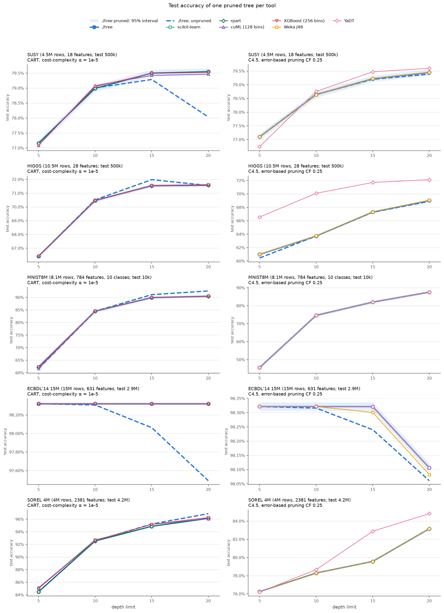
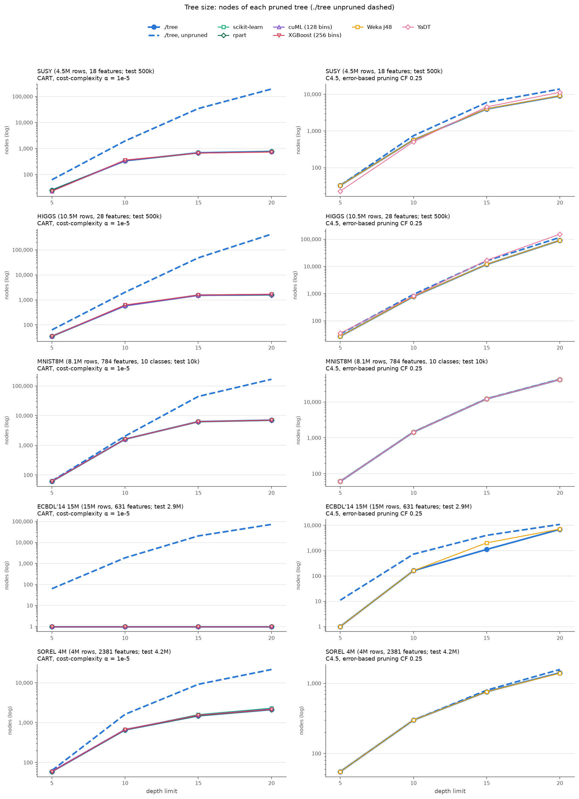

# Pruned accuracy: ./tree against scikit-learn, rpart, cuML, XGBoost, Weka J48 and YaDT

This benchmark measures test accuracy, not time. For each tool it grows one tree with pruning on, on every training row and feature. It covers every dataset in the paper (the GPU subsets of ECBDL'14 and SOREL) at depth limits 5, 10, 15 and 20, for CART and C4.5. Each tree is scored on the dataset's test set. Besides accuracy, the tables give:
- tree size: nodes, leaves and depth
- training accuracy
- balanced accuracy
- agreement with ./tree's tree, row by row
- an exact McNemar test against ./tree

Every tool's unpruned tree is reported too.

**Data:** one run per case, 2026-11-24/25. ./tree is at 4de42544967b; its tree code is unchanged since 7f98876f. Time is recorded (`fit_seconds`) but not benchmarked, so the nodes were shared. The jobs ran on:
- epyc2, dell2 and dell3: the long CPU jobs (J48, scikit-learn, rpart)
- dell1 and dell4: jobs of under an hour (./tree and YaDT)
- turing, hopper and ampere: the GPU tools only





All the numbers are in [report.md](report.md): one table per dataset, algorithm and depth. [report.csv](report.csv) has the same data as rows.

## Pruning: one setting for every tool

| Algorithm | Rule | ./tree | Others |
|---|---|---|---|
| CART | Minimal cost-complexity pruning (Breiman) on the misclassification rate, with a fixed α = 1e-5: a subtree is cut when errors(node) − errors(subtree) ≤ α·n·(leaves − 1), ties cut. α·n is 45 training rows on SUSY, 105 on HIGGS, 81 on MNIST8M, 150 on ECBDL'14 15M and 40 on SOREL 4M. | `--cart --prune 1e-05` | **rpart** prunes natively: grown with `cp=0`, then `prune(cp = α·n / root risk)`, which is the same rule. **scikit-learn, cuML and XGBoost** have no such rule (scikit-learn's `ccp_alpha` uses impurity, not errors). Each library grows its tree, the tree is exported, and the benchmark's own code prunes it with the rule above (`prunelib.ccp_prune`). |
| C4.5 | Error-based pruning with confidence factor 0.25 and subtree raising, min 2 rows per branch | `--c45 --prune 0.25` | **Weka J48** `-C 0.25 -M 2`. **YaDT** `-ebpg -c 0.25 -m 2`. |

- **No tuning:** α and CF are fixed defaults, the same for every dataset. There is no validation set.
- **Growth settings:** as in the timing benchmarks. Gini (CART) or gain ratio (C4.5), every row and feature, at least 1 row per leaf (CART). cuML uses 128 histogram bins and XGBoost 256 (one round, `eta=1, lambda=0`; MNIST8M is one multi-output tree, as in [cluster-gpu-vs-others](../cluster-gpu-vs-others/BENCHMARK.md)). J48 gets its depth limit from the `DepthLimitedTree` of [J48Fit](../tools/adapters/J48Fit.java).
- **Library trees are routed by the benchmark:** every test row goes through the exported library tree, and a leaf predicts its training rows' majority class. As a check, these predictions are compared with the library's own predictions of the unpruned tree (`own_predict_agreement` in report.csv). It is 1.0 in every case except XGBoost's multi-output trees on MNIST8M: 1, 1 and 4 of the 10,000 test rows at depths 10, 15 and 20, (not investigated; the prediction there is the argmax of the leaf's values, not its majority class). XGBoost's thresholds are float32 and are compared as float32: read as float64 from its JSON, a row equal to a threshold went the wrong way (fixed before the XGBoost results here; the first run's records are in `~/jobs/acc/xgb-float64-routing/` on mordor3).
- **J48 is fitted once per depth:** grow, collapse, evaluate (the `-U` tree), prune, evaluate again ([J48Acc.java](../tools/accuracy/J48Acc.java)). On SUSY this matched two separate runs exactly.
- **./tree backends:** `--multicore` grows both the pruned and the unpruned tree. `--serial`, `--gpu` and `--hybrid` grow the pruned tree only. Every backend grew the same tree in every case (the hash of its dump).

## Results

### CART

- **Exact CART:** scikit-learn's tree, pruned by the same rule, is ./tree's tree, node for node, on SUSY, HIGGS, MNIST8M and ECBDL'14. That is 100.00% agreement on every test row at every depth.
- **rpart's tree** is the same at depths 5 and 10 on SUSY and depth 5 on HIGGS. Deeper it has 2–4% fewer nodes: even at `cp=0` it never grows a split that leaves the training errors unchanged, so some subtrees the cost-complexity rule keeps never exist. It agrees with ./tree on 99.7–100% of rows and is within 0.03 pp. rpart cannot fit MNIST8M, ECBDL'14 or SOREL: more than 2³¹ values.
- **cuML and XGBoost (binned):** their trees agree with ./tree's on 94–100% of rows. On SUSY, HIGGS and MNIST8M their accuracy is within ±0.1 pp of ./tree's; the one exception is cuML on MNIST8M at depth 5, at −0.61 pp. On SOREL 4M they are 0.05–0.66 pp better at depths 5–15, as the binned trees happen to generalise better there.
- **scikit-learn is not exact CART on SOREL 4M:** its trees agree with ./tree's on only 87–96% of rows. scikit-learn never splits between two values closer than 1e-7 (`FEATURE_THRESHOLD`), and SOREL has many tiny feature values. Below the root (a split both tools choose), ./tree splits on f589 at 0.0034087 with weighted Gini 0.38728, between two values 5.8e-9 apart. scikit-learn cannot use that gap and picks f572 instead, with Gini 0.38814 (checked with `~/jobs/acc/sorel_left.py`, a one-off script outside the repository). ./tree's is the greedy CART split. scikit-learn's tree scores 0.59 pp higher at depth 5 and 0.20 pp at 10, and is level with ./tree at 15 and 20.
- **Effect of pruning (α = 1e-5):**
  - **SUSY and HIGGS:** the deep trees shrink by two to three orders of magnitude at no cost. SUSY at depth 20 gains 1.5 pp (79.55% with 775 nodes against 78.04% with 193,943). HIGGS at depth 20 holds 71.59% with 1,611 nodes against 426,197.
  - **MNIST8M and SOREL:** α·n = 81 and 40 rows is too coarse here, and pruning costs accuracy. MNIST8M at depth 20 falls from 92.57% to 90.47% (7,059 nodes against 168,241). SOREL at depth 20 falls from 96.88% to 96.12%.
  - **ECBDL'14:** 98.3% of the rows are one class, and α·n = 150 rows cuts every tree back to its root at every depth, for every tool. That gives 98.32% accuracy and 50.0% balanced accuracy. Unpruned, deeper trees lose accuracy: 97.49% at depth 20.
- **XGBoost on MNIST8M at depths 15 and 20 ran on the CPU** (`hist`, the same settings; `ACC_XGB_DEVICE=cpu` in [fit_lib.py](../tools/accuracy/fit_lib.py), 2026-11-26 on dell4, 72 GB peak, under 5 min a tree). On the GPU, both run out of memory on an 80 GB H100 or A100 at any `max_cached_hist_node` (1, 16 tried): from depth 11 on, XGBoost 3.4.1's multi-output split search allocates one scan buffer for a batch of 1,024 nodes (2 × 2,048 children × 10 classes × every bin × 16 bytes = 51.6 GB). That batch is a constant in its code (`kMaxNodeBatchSize`), not a setting. The buffer comes on top of ~62 GB already in use, about 113 GB in all. RMM managed memory does not help: the pip build allocates it with plain `cudaMalloc`. The CPU tree at depth 10 has the GPU tree's nodes (2,047 grown, 1,615 pruned), training accuracy and every test prediction; one threshold differs (pixel 377 at 62 against 73), which moves no reported number. Pruned, XGBoost's trees at depths 15 and 20 have ./tree's node counts (6,299 and 7,059) and agree on every test row.

### C4.5

- **Weka J48 grows ./tree's tree on MNIST8M and SOREL 4M:** the same unpruned trees at every depth, and 100.00% agreement pruned. On SOREL at depth 20, J48's pruning cuts 20 more nodes (1,395 against 1,415), which changes the prediction of 5 of the 4.2M test rows.
- **J48 on SUSY and HIGGS:** within 0.04 pp of ./tree, with 97.5–100% agreement; almost all of these differences are not significant (p ≥ 0.1).
- **J48 on ECBDL'14:** the unpruned trees differ from depth 10 on: 711 nodes for J48 against 725 for ./tree at depth 10, and 3,929 against 4,017 at depth 15. Pruned, they are the same at depths 5 and 10. At 15 and 20, J48's pruned trees agree with ./tree's on 99.9% of rows and are 0.02–0.03 pp lower. ./tree's C4.5 matches Quinlan's C4.5 Release 8 node by node ([docs/ALGORITHMS.md](../../docs/ALGORITHMS.md)); why J48 departs from it here was not investigated.
- **YaDT grows ./tree's tree on MNIST8M** at every depth, with 100.00% agreement.
- **YaDT on SUSY and HIGGS:** its trees differ. On SUSY it is −0.36 pp at depth 5 and +0.12 to +0.25 pp deeper. On HIGGS it is +3.1 to +6.4 pp. This is known from [cluster-cpu-vs-others](../cluster-cpu-vs-others/BENCHMARK.md): YaDT picks a different root threshold on HIGGS than C4.5's rule (Quinlan's C4.5, which ./tree and nearly J48 follow), and grows a more CART-like tree. It is a C4.5-family tool, not a reference for C4.5's trees.
- **YaDT has no ECBDL'14 or SOREL results:** it has no input files for those datasets (only SUSY, HIGGS and MNIST8M have `yadt.names`).
- **Effect of pruning (CF 0.25):** it changes accuracy by at most 0.54 pp: HIGGS at depth 5, 61.0% against 60.5%. How many nodes it removes depends on the dataset:
  - MNIST8M and SOREL: 0–10%.
  - SUSY and HIGGS: 17–35%.
  - ECBDL'14: 36–91%. C4.5's pruning does not stop a deep tree from overfitting ECBDL'14: at depth 20 the pruned tree is at 98.11%, below the 98.32% of always predicting the majority class.

## What runs

| Tool | Version | Node | Cases |
|---|---|---|---|
| ./tree `--multicore --threads 8` (pruned and unpruned), `--serial` (pruned) | 4de42544967b | epyc2 (SUSY), dell4 (HIGGS, MNIST8M), dell1 (ECBDL'14), dell1 and dell4 (SOREL) | every dataset, CART and C4.5 |
| ./tree `--gpu`, `--hybrid` (pruned) | 4de42544967b | turing (HIGGS), hopper (the rest) | every dataset |
| scikit-learn `DecisionTreeClassifier` | 1.9.1 | epyc2 (SUSY, HIGGS, MNIST8M), dell2 (ECBDL'14), dell3 (SOREL) | CART |
| rpart | 4.1.27 | epyc2 | CART, SUSY and HIGGS |
| cuML `RandomForestClassifier` (1 tree, no bootstrap) | 26.10 | turing (HIGGS), hopper (the rest) | CART |
| XGBoost `hist` on CUDA, 1 round | 3.4.1 | turing (SUSY, HIGGS), ampere (the rest); dell4 on the CPU (MNIST8M at depths 15 and 20) | CART |
| Weka J48 (with J48Fit's depth limit) | weka.jar of the timing benchmarks | dell4 (SUSY), epyc2 (HIGGS, MNIST8M), dell2 (ECBDL'14), dell3 (SOREL) | C4.5 |
| YaDT `dTcmd` | 2.3.0 | epyc2 (SUSY), dell4 (HIGGS, MNIST8M) | C4.5, SUSY, HIGGS, MNIST8M |

**Slowest fits:**
- **J48, the most:** 3.5–19.1 h a tree on MNIST8M, ECBDL'14 and SOREL.
- **scikit-learn:** up to 1.3 h.
- **rpart on HIGGS at depth 20:** 23 min.
- **Each tool on the GPU:** 1–4 min.

## Commands

```bash
bench/tools/accuracy/job.sh susy cpu ...         # SUSY ran first, by hand (sbatch lines in job.sh)
AFTER_HOPPER=909 AFTER_AMPERE=910 bench/tools/accuracy/submit_all.sh   # every other job
# re-submitting a job resumes it: a case whose runs/<dataset>/cases/<case>.json exists is skipped
bench/tools/.venv/bin/python bench/tools/accuracy/report.py bench/cluster-accuracy-pruned/runs \
  --md bench/cluster-accuracy-pruned/report.md --csv bench/cluster-accuracy-pruned/report.csv
bench/tools/.venv/bin/python bench/tools/accuracy/accuracy_chart.py \
  bench/cluster-accuracy-pruned/report.csv bench/cluster-accuracy-pruned
```

**Re-submitted cases:**
- **J48 on ECBDL'14 at depths 10 and 20 (job 934):** the depth-20 run was killed for running out of memory, and I stopped the depth-10 run to protect the runs beside it. The cause: Java's G1 collector keeps its heap at the largest size it has reached, up to `-Xmx`, which was 200 GB for 77 GB of live data. J48 now runs with `-XX:MinHeapFreeRatio=5 -XX:MaxHeapFreeRatio=15`.
- **Every XGBoost case (jobs 961–965, turing and ampere):** rerun after the float32 threshold fix described above. The accuracies moved by at most 0.07 pp; the first run's records are kept on mordor3.
- **XGBoost on MNIST8M and SOREL at depths 15 and 20 (jobs 941 and 942):** the first runs ran out of GPU memory. They were rerun with `max_cached_hist_node` at 128 (16 on MNIST8M): a cache, so speed only, not the tree. [cache-check/](cache-check) shows SOREL at depth 10 again with the cap: the same predictions on all 4,195,042 test rows.

**Files:**
- **`runs/<dataset>/cases/*.json`:** every record.
- **`runs/<dataset>/logs/`:** each tool's output.
- **`logs/`:** the SLURM jobs.
- **Not kept in git:** the test predictions (`pred/`), the tree dumps (`trees/`) and the converted inputs (`tmp/`); they stay on mordor3.

Code: [bench/tools/accuracy/](../tools/accuracy). It holds the [driver](../tools/accuracy/acc.py), the [library fits](../tools/accuracy/fit_lib.py), [rpart](../tools/accuracy/fit_rpart.R), [J48](../tools/accuracy/J48Acc.java), the [pruning and statistics](../tools/accuracy/prunelib.py), the [report](../tools/accuracy/report.py) and the [charts](../tools/accuracy/accuracy_chart.py).
