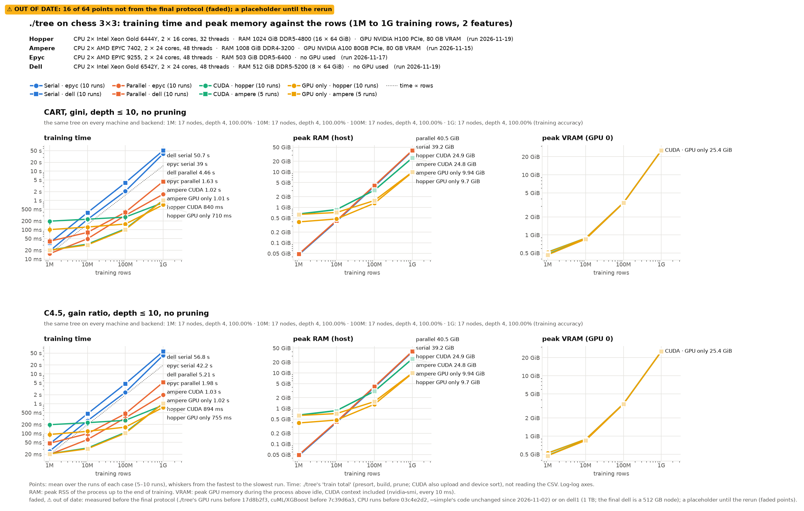
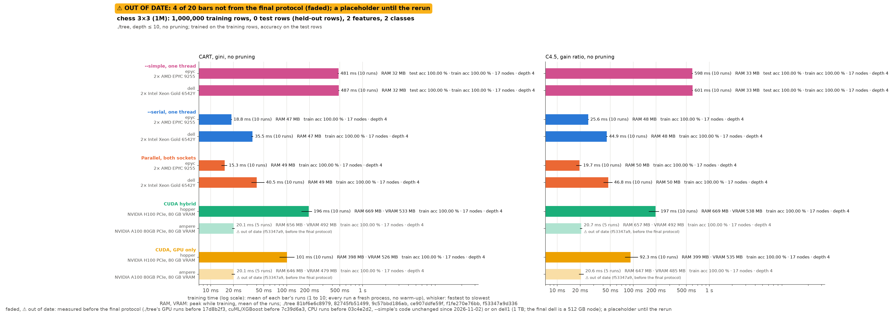
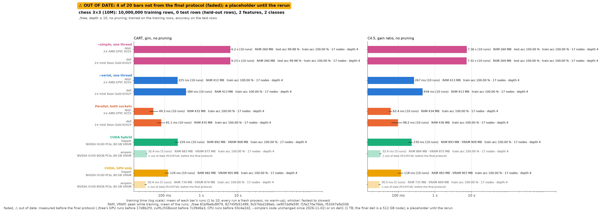
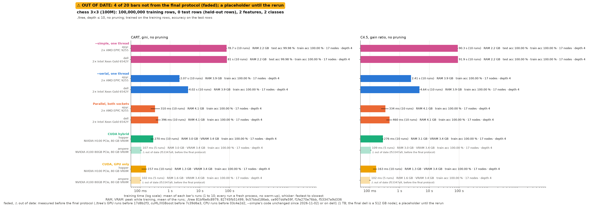
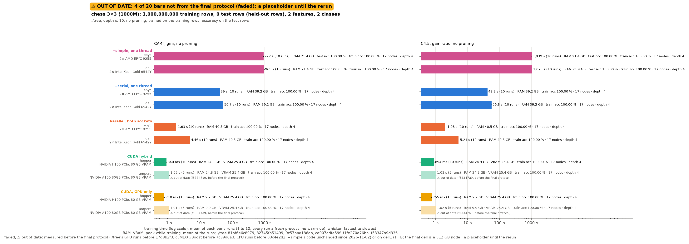

# Chess 3×3 on the mordor3 cluster: 1M to 1000M rows on two GPU and two CPU servers, CART and C4.5 at depth ≤ 10 without pruning

- **Runs:** every case on hopper and ampere (CUDA `--hybrid` and `--gpu`), and on epyc and dell (`--multicore` on both sockets, `--serial`, `--simple`). Each run a fresh process with no warm-up; 10 runs a case in the final runs, 5 in the 2026-11-15 runs, `--simple` 10 (the tables give the count in brackets, the charts on every bar or legend entry).
- **Builds:** the final runs: ./tree 82745fb5 (2026-11-17, the same tree code as 8fe0c73d): `--multicore` on epyc1, `--serial` on epyc2 and dell3 (dell3's rerun, job 320, recorded as 9c57bbd1, the same build: its first final runs, job 297, took up to 1.5× as long for no cause found — not the input format nor the batch's warm-up, both tested — and were replaced; the same trees); ./tree 81bf6e6c (the 2026-11-19 rerun, the same tree code): CUDA on hopper and dell's `--multicore` on dell2 (a 512 GB node). The CUDA runs time ./tree's GPU setup (memory pool, staging buffers, and for `--hybrid` its 256 MB of page-locked hand-off buffers): only the bare CUDA context is untimed ([bench/tools/README.md](../tools/README.md#how-time-is-measured)). `--simple` is from 2026-11-11/12 (f1fe270e on epyc, ce907ddf on dell): its code has not changed since 2026-11-02, so it stands. **Out of date** (⚠ in the time tables, faded on the charts): the CUDA runs on ampere (2026-11-15/16, f53347a9, 5 runs, with ./tree's GPU setup untimed), not rerun: ampere was unavailable from 2026-11-19 for two weeks. The 2026-11-15 CPU runs the final ones replace are in git at bae12944^ (`cpu-dell-chess_1m` and `cpu-dell-chess_10m` there are a rerun of 2026-11-16 on dell1, after a first batch that took 1.5–2× as long); the runs before them (f1fe270e, 10 runs a case) at 1e655067.
- **Each node ran alone** and was reserved whole (`--exclusive`). The GPU runs use one GPU and every CPU of the node, the GPU's socket first: hopper's GPU 2 (NUMA node 1, CPUs 16–31, then 0–15), ampere's GPU 0 (NUMA node 0, CPUs 0–47), memory first-touch (`run.log`).
- **Same trees:** every case built the same tree on every node and backend (`--hash-trees`), the same as in the runs before: 17 nodes (9 leaves), depth 4, 100% training accuracy, at every size. That is the exact tree of a 3×3 board.
- **Settings:** ./tree's defaults. `cart_depth10` and `c45_depth10_unpruned`, like every other test-set benchmark: depth ≤ 10 without pruning. The tree stops at depth 4, so the limit never acts. Chess has no test set since f2a4f921: the tree is exact, and the training accuracy is reported.

How the runs are made, and where the data came from: [bench/tools/cluster/README.md](../tools/cluster/README.md).

The charts:
- `chart-chess_1m.png`, `chart-chess_10m.png`, `chart-chess_100m.png`, `chart-chess_1b.png`: one `testset_chart.py` chart per size. A bar is the mean of the runs, the whisker runs from the fastest to the slowest run, and its label gives the mean ± standard deviation and the number of runs.
- `chart-rows.png`: `rows_chart.py`, means against the rows, with whiskers from the fastest to the slowest run (without `--simple`); the legend gives the runs per line.

**The dataset** is a 3×3 checkerboard: two features, x and y, uniform in [0, 3] with six decimals. The class alternates over the nine unit squares (on five of them: 55.5% of the rows), with no noise. Four sizes:

| Dataset | Training rows | CSV | Note |
|---|--:|--:|---|
| `chess_1m` | 1,000,000 | 20 MB | the first 1M rows of `chess_2b` (`./tree --rows`) |
| `chess_10m` | 10,000,000 | 200 MB | the first 10M rows of `chess_2b` |
| `chess_100m` | 100,000,000 | 2.0 GB | the first 100M rows of `chess_2b` |
| `chess_1b` | 1,000,000,000 | 20.8 GB | its own file: 100M distinct rows, each 10 times |

`chess_2b` (2,000M rows, 41.6 GB) and its other prefixes (50M, 500M) are used by [cluster-profiling](../cluster-profiling/BENCHMARK.md). The 1M, 10M and 100M trees hash as with the earlier copied files.

**What it measures.** The tree is tiny (4 levels, 8 splits), so a run is the presort plus a few full sweeps over all rows: time per row at the top levels, without the many small nodes of a deep tree. With two features, the CPU backend has only two columns to share among 48 threads.

| Run | Node | CPU | RAM | GPU | Backend |
|---|---|---|---|---|---|
| `cuda-hopper-*` | hopper | 2× Xeon Gold 6444Y, 32 cores | 1 TB DDR5-4800 | H100 PCIe 80 GB (GPU 2) | `--hybrid`, 32 CPU threads |
| `cuda-ampere-*` | ampere | 2× EPYC 7402, 48 cores | 1 TB DDR4-3200 | A100 80 GB PCIe (GPU 0) | `--hybrid`, 48 CPU threads |
| `gpuonly-hopper-*`, `gpuonly-ampere-*` | hopper, ampere | as above | | as above | `--gpu` (on the same CPUs) |
| `cpu-epyc-*` | epyc1 | 2× EPYC 9255 (Zen 5), 48 cores | 512 GB DDR5-6400 | – | `--multicore` (48 threads) |
| `cpu-dell-*` | dell2 | 2× Xeon Gold 6542Y, 48 cores | 512 GB DDR5-5200 (8 × 64 GB, 8 of the 16 channels) | – | `--multicore` (48 threads) |
| `serial-epyc-*`, `simple-epyc-*` | epyc1 or epyc2 (the same hardware) | | | – | `--serial`, `--simple` (1 thread, the whole node reserved) |
| `serial-dell-*`, `simple-dell-*` | dell1, dell2 or dell3 (the same CPUs; dell2/3 512 GB) | | | – | `--serial`, `--simple` (1 thread, the whole node reserved) |

## Time and memory against the rows

Training time (`train total`: presort and build, on CUDA also GPU setup and upload; not reading the data), mean of the runs (runs in brackets; ⚠: out of date, measured before the final protocol, faded on the charts):

| CART, no pruning | 1M | 10M | 100M | 1000M |
|---|--:|--:|--:|--:|
| CUDA hybrid · hopper (H100 PCIe + 32 threads) | 196 ms (10) | 229 ms (10) | 270 ms (10) | 840 ms (10) |
| CUDA hybrid · ampere (A100 80GB PCIe + 48 threads) | 20 ms (5) ⚠ | 32 ms (5) ⚠ | 107 ms (5) ⚠ | 1.02 s (5) ⚠ |
| GPU only · hopper | 101 ms (10) | 124 ms (10) | 157 ms (10) | **710 ms** (10) |
| GPU only · ampere | 20 ms (5) ⚠ | **30 ms** (5) ⚠ | **102 ms** (5) ⚠ | 1.01 s (5) ⚠ |
| Multicore · epyc (EPYC 9255, 48 threads) | **15 ms** (10) | 49 ms (10) | 310 ms (10) | 1.63 s (10) |
| Multicore · dell (Xeon 6542Y, 48 threads) | 40 ms (10) | 81 ms (10) | 396 ms (10) | 4.46 s (10) |
| Serial · epyc (1 thread) | 19 ms (10) | 225 ms (10) | 2.07 s (10) | 39.05 s (10) |
| Serial · dell (1 thread) | 35 ms (10) | 384 ms (10) | 4.02 s (10) | 50.65 s (10) |
| Simple · epyc (1 thread) | 481 ms (10) | 6.20 s (10) | 78.70 s (10) | 922 s (10) |
| Simple · dell (1 thread) | 487 ms (10) | 6.23 s (10) | 80.98 s (10) | 965 s (10) |

| C4.5, no pruning | 1M | 10M | 100M | 1000M |
|---|--:|--:|--:|--:|
| CUDA hybrid · hopper | 197 ms (10) | 230 ms (10) | 276 ms (10) | 894 ms (10) |
| CUDA hybrid · ampere | 21 ms (5) ⚠ | 32 ms (5) ⚠ | 109 ms (5) ⚠ | 1.03 s (5) ⚠ |
| GPU only · hopper | 92 ms (10) | 118 ms (10) | 163 ms (10) | **755 ms** (10) |
| GPU only · ampere | 21 ms (5) ⚠ | **31 ms** (5) ⚠ | **102 ms** (5) ⚠ | 1.02 s (5) ⚠ |
| Multicore · epyc | **20 ms** (10) | 62 ms (10) | 334 ms (10) | 1.98 s (10) |
| Multicore · dell | 47 ms (10) | 98 ms (10) | 460 ms (10) | 5.21 s (10) |
| Serial · epyc | 26 ms (10) | 267 ms (10) | 2.41 s (10) | 42.18 s (10) |
| Serial · dell | 45 ms (10) | 458 ms (10) | 4.64 s (10) | 56.84 s (10) |
| Simple · epyc | 598 ms (10) | 7.36 s (10) | 90.33 s (10) | 1,039 s (10) |
| Simple · dell | 601 ms (10) | 7.32 s (10) | 91.90 s (10) | 1,075 s (10) |

Peak memory (the same for CART and C4.5 within 0.01 GiB):

| | 1M | 10M | 100M | 1000M |
|---|--:|--:|--:|--:|
| RAM, `--multicore` | 0.05 GiB | 0.43 GiB | 4.14 GiB | 40.6 GiB |
| RAM, `--serial` | 0.05 GiB | 0.40 GiB | 3.93 GiB | 39.2 GiB |
| RAM, `--simple` | 0.03 GiB | 0.26 GiB | 2.19 GiB | 21.4 GiB |
| RAM, CUDA hybrid (hopper / ampere) | 0.65 / 0.64 GiB | 0.87 / 0.86 GiB | 3.05 / 3.05 GiB | 24.9 / 24.8 GiB |
| RAM, GPU only (hopper / ampere) | 0.39 / 0.63 GiB | 0.47 / 0.72 GiB | 1.31 / 1.56 GiB | 9.70 / 9.94 GiB |
| VRAM (hopper / ampere; GPU only the same) | 0.53 / 0.49 GiB | 0.89 / 0.85 GiB | 3.44 / 3.42 GiB | 25.4 / 25.4 GiB |

- **The GPU setup now counts, and up to 10M rows it decides.** The H100's runs include the GPU setup (memory pool, staging buffers; for hybrid also its hand-off buffers): 96–138 ms for GPU only and 191–250 ms for hybrid up to 100M rows, against a build of 5–20 ms. So epyc's `--multicore` is the fastest at 1M (15–20 ms: 4.6–6.7× the H100's GPU only) and still at 10M (49–62 ms: 1.9–2.5×). The A100's runs (out of date, setup untimed) took 20–32 ms there.
  - From 100M rows on the H100 leads: GPU only is 2.0× faster than epyc at 100M (157–163 ms) and **2.3× (CART) to 2.6× (C4.5) at 1000M** (0.71–0.76 s). Hybrid is 1.2× faster at 100M and 1.9–2.2× at 1000M (0.84–0.89 s). Before the timing rule (2026-11-15) the H100 took 0.61–0.62 s at 1000M, 2.6–3.1× epyc.
  - The A100 (out of date) was 1.6–1.9× faster than epyc at 1000M.
- **From 100M to 1000M** (10× the rows) the time grows 4.5–4.6× on the H100 (GPU only; its fixed setup is a smaller share at 1000M), 3.1–3.2× for its hybrid, 9.4–9.5× on the A100, 5.3–5.9× on epyc and 11.3× on dell.
- **epyc is 1.3–1.4× faster than dell at 100M rows and 2.6–2.7× at 1000M**, where dell's 48 threads share 8 memory channels (dell1, with 16, was 1.7× slower than epyc there); 1.6× at 10M and 2.4–2.7× at 1M, where dell's fixed costs (its presort, 24 ms against 9 ms) dominate.
- **Memory is linear in the rows:** 43 bytes per row with `--multicore` (40.6 GiB for 1000M rows, 2G values: 22 bytes per value) and 27 bytes per row of VRAM (25.4 GiB of the 80 GB). Every size fits on every GPU; the 40 GB A100s of ampere would hold the 1000M set too. A hybrid run needs about 60% of the host RAM of a `--multicore` run (24.9 GiB at 1000M), GPU only a quarter (9.70 GiB), `--simple` about half (21.4 GiB).
- **Against the runs before (f1fe270e)**, the same trees: epyc's `--multicore` 28–43% faster at 1M and 10M, 46–57% at 100M and 64–70% at 1000M; `--serial` 16–37% faster at 1M–100M and 48–60% at 1000M. dell's `--multicore` ran on another node (dell2, not dell1) and the GPU runs now time their setup, so those are not compared.

## Serial (one thread)

Means of the runs; train total = presort + build (prune ≈ 0).

| | 1M | 10M | 100M | 1000M | 1000M / 100M |
|---|--:|--:|--:|--:|--:|
| epyc CART: presort | 9 ms | 121 ms | 1.21 s | 12.23 s | 10.1× |
| epyc CART: build | 10 ms | 103 ms | 857 ms | 26.81 s | **31.3×** |
| dell CART: presort | 21 ms | 224 ms | 2.24 s | 21.26 s | 9.5× |
| dell CART: build | 15 ms | 161 ms | 1.78 s | 29.39 s | **16.5×** |
| epyc C4.5: build | 15 ms | 137 ms | 1.13 s | 29.23 s | 26.0× |
| dell C4.5: build | 22 ms | 216 ms | 2.23 s | 33.78 s | 15.1× |

| Speed-up of 48 threads over 1 (train total) | 1M | 10M | 100M | 1000M |
|---|--:|--:|--:|--:|
| epyc CART / C4.5 | 1.2× / 1.3× | 4.6× / 4.3× | 6.7× / 7.2× | **23.9× / 21.3×** |
| dell CART / C4.5 | 0.9× / 1.0× | 4.7× / 4.7× | 10.1× / 10.1× | **11.4× / 10.9×** |

- **Up to 100M rows, the serial time grows with the rows** (about 10× per 10× rows), and epyc is 1.7–2.2× faster than dell.
- **At 1000M the serial build is 15–31× its 100M time**, while the presort stays at 10×: one thread moves a column of 1G rows, far beyond the caches ([the section below](#the-1000m-slowdown-and-its-fix-2026-10-19)). The blocked partition that fixed this needs more than one thread. d2957ff2 halved the build at 1000M (epyc CART 86.3 → 26.8 s, dell 77.9 → 30.6 s), and epyc leads again at every size (1.3–1.4× dell at 1000M).
- **Parallelism pays off only with the rows.** At 1M rows, 48 threads are hardly faster than one (0.9–1.3×). The speed-up grows to 7× on epyc and 10× on dell at 100M, and 21–24× on epyc and 11× on dell at 1000M (dell2's 8 memory channels; dell1, with 16, reached 18–19×).
- **`--simple`**, the reference implementation, takes 23–27× `--serial`'s time at 1M on epyc, 37–38× at 100M and 24–25× at 1000M; on dell 13–20×. `--simple` itself is the same on epyc and dell within 5%, with about half the RAM of `--serial`.

## GPU only

`--gpu`: every node is grown on the GPU, with no hand-offs to the CPU and no host arena for them, on the same CPUs as the hybrid runs. Means of the runs, CART (C4.5 the same within a few ms):

| | 1M | 10M | 100M | 1000M |
|---|--:|--:|--:|--:|
| | 1M | 10M | 100M | 1000M |
|---|--:|--:|--:|--:|
| hopper, hybrid: GPU setup / build | 191 / 6 ms | 220 / 9 ms | 250 / 20 ms | 492 / 349 ms |
| hopper, GPU only: GPU setup / build | 96 / 5 ms | 117 / 7 ms | 138 / 18 ms | 363 / 347 ms |
| ampere, hybrid ⚠: GPU setup / build | 16 / 4 ms | 25 / 7 ms | 76 / 31 ms | 552 / 468 ms |
| ampere, GPU only ⚠: GPU setup / build | 17 / 4 ms | 25 / 5 ms | 78 / 24 ms | 552 / 456 ms |

- **GPU only is faster than hybrid here, by the setup alone:** 95 ms at 1M to 0.13 s at 1000M on the H100 (CART). Hybrid's setup also makes its 256 MB of page-locked hand-off buffers, which this tree never uses: its 17 nodes are all far above the hand-off size, so the hybrid run hands nothing to the CPU. The builds are the same within 1–3 ms. On the A100 (out of date, setup untimed) the two took the same time.
- **Still the fastest on the big sets:** 2.3–2.6× (H100) and 1.6–1.9× (A100, out of date) faster than epyc's 48 threads at 1000M, and 55–56× (H100) faster than one epyc thread.
- **Less than half the host RAM:** 9.70 GiB at 1000M against 24.9 GiB for hybrid (no host arena) and 40.6 GiB for `--multicore`. The VRAM is the same as hybrid's.
- **Reading the data is the cost:** a whole 1000M process (`wall_seconds`) takes 13–33 s on hopper, most of it reading the binary columns (`chess_1b.f32`) again over NFS (`--drop-cache`); the A100's runs of 2026-11-15, which parsed the 20.8 GB CSV, 41–78 s. The training time above excludes it.

## The 1000M slowdown and its fix (2026-10-19)

**Before the fix**, the CPU time grew 13–41× from 100M to 1000M rows, 10× the rows. The times before and after, as measured on 2026-10-19 (medians of 3 runs, at 1000M on dell and dell512 of 10; the builds are in git, the run folders were replaced since):

| Before (2a9d64e) → after (d9da007) | 100M CART | 100M C4.5 | 1000M CART | 1000M C4.5 |
|---|--:|--:|--:|--:|
| epyc | 1.15 → 0.69 s | 1.35 → 0.66 s | 47.19 → **6.46 s** (7.3×) | 40.98 → **7.31 s** (5.6×) |
| dell | 2.43 → 1.21 s | 3.47 → 1.51 s | 34.20 → **9.95 s** (3.4×) | 43.33 → **12.32 s** (3.5×) |
| dell512 | 2.75 → 1.32 s | 3.18 → 1.63 s | 36.00 → **11.68 s** (3.1×) | 48.32 → **14.32 s** (3.4×) |

**The cause** was the partition of the big nodes.
- A node of the CPU builder is split by moving every column except the winner's into its children. Normally each column is moved by one thread, fused with the children's sweep.
- With two features, there is one column to move. So one thread moved all 1G rows of the root, and then of its children, while the other 47 waited.
- A single thread moving a column becomes much slower once the column is far beyond the caches: 3.5 ns per row at 100M rows, about 30 ns at 1000M.
- The builder already had a mode that partitions a node in blocks across all threads, but it used that mode only when spare memory ran short.

**The fix:** a node of at least 2^20 rows is also partitioned in blocks when its columns to move would keep at most one thread in 8 busy (48 threads: 1–6 columns).
- In blocks the node loses the fused sweep. Forcing the blocked mode on the other datasets cost airline (12 columns) 0–15%, and SUSY and HIGGS (17 and 27 columns) up to 50%. Those datasets are outside the new rule and keep the fused sweeps.
- The trees are unchanged: the golden tests pass, and so do checks of 3M synthetic rows with 2 and 3 features.

**Ruled out:**
- The TLB: the columns are on huge pages.
- The repeated rows of the 1000M set.
- Prefetching the partition bitmap: no gain at 1000M, and slower on airline.

**At 1M rows** (below 2^20) the code path is unchanged; the differences there (dell CART 70 → 78 ms) are run-to-run noise.

**At 10M rows** the new path is used, with mixed results:
- dell: 1.3–1.4× faster.
- dell512 C4.5: 1.4× faster.
- epyc, and dell512 CART: unchanged.

Some 10M cases had a single slow run (up to 0.77 s on epyc), which the median leaves out.

## One chart per size

## Notes

- **Not timed:** reading the data (the binary `.f32` columns; the 2026-11-15 ampere runs and `--simple` read the CSV), and the data check before each job (SHA-256 of every prepared file and every CSV row against the binary files). Every run reads its input again over NFS (`--drop-cache`). A whole `chess_1b` process (`wall_seconds`) took 13–33 s on hopper (ampere, reading the CSV on 2026-11-15: 41–78 s), 12–27 s with `--multicore` on epyc and 28–43 s on dell, 66–99 s with `--serial` and 980–1,160 s with `--simple` (whose runs of 2026-11-11/12 parsed the CSV).
- **Hopper's and ampere's 1M and 10M runs** are dominated by fixed costs (on hopper the timed GPU setup, 0.1–0.2 s; on ampere, out of date, none of it timed); their order there says little about the GPUs.
- **dell against dell512** (dell2, half the memory channels: 1.10–1.36× dell's time at 1000M with 58% of its bandwidth) and **one socket against both** were measured on ec77727 (2026-10-29/30); those runs are in git before 6bf6705a.
- **The originals** (C4.5 files from mordor3's `~/chess`) were deleted after the conversion; `datasets/chess/chess_*.csv` on mordor3 are the only copies.
