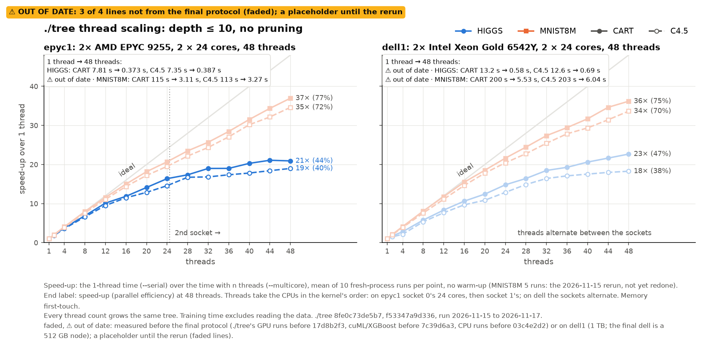

# Thread scaling on the mordor3 CPU servers: ./tree with 1 to 48 threads on HIGGS and MNIST8M

**Final data (2026-11-19/20):** one build of main (81bf6e6c, the same tree code as the final runs of 2026-11-17; `bench/tools/cluster/final.sh`), 10 runs per point (the chart's footnote gives the count), on epyc2 and dell2 (a 512 GB node, 8 of dell1's 16 memory channels: from 2026-11-17 the dell runs are on dell2–4, [bench/tools/cluster/README.md](../tools/cluster/README.md)). MNIST8M ran in parts of under 4 h each (epyc2: 2, dell2: 3; `bench/tools/cluster/merge_parts.py`, the parts in `machine.json`). dell's HIGGS and MNIST8M were rerun on 2026-11-20 with the CPUs in node order ([below](#dell-the-noisy-low-thread-counts)): HIGGS on dell2 (job 548), MNIST8M in three parts at once on dell2, dell3 and dell4 (jobs 555, 553, 554; the three agree within 2% at every thread count). The 2026-11-19 runs (kernel order) are in git at 1c196c36. The runs before (2026-11-15/16, f53347a9, 5 runs per point, dell on dell1) are in git at 84b4c67e; the ones before them (f1fe270, 10 runs per point, 2026-11-09/10) at 1e655067. Every tree is grown to depth ≤ 10 without pruning, as in the test-set benchmarks; every thread count built the same tree on both nodes.



```bash
bench/tools/cluster/final.sh            # queues these runs with all the others (cpu-epyc-<data>, cpu-dell-<data>)
bench/tools/.venv/bin/python bench/tools/scaling_chart.py bench/cluster-cpu-scaling   # chart.png, <run>/scaling.csv
```

- **Protocols:** `cart_depth10` and `c45_depth10_unpruned`.
- **Threads:** 1, 2, 4, then every 4 up to 48.
  - **1 thread** is the serial backend (`--serial`); more threads use `--multicore --threads N`. Speed-up is the serial time divided by the N-thread time, so it includes the parallel backend's own overhead. Efficiency is the speed-up divided by N.
  - **Pinning:** N threads are pinned to the first N CPUs of the node, socket by socket and NUMA node by node (`bench/tools/cluster/job.sh` since e129991e), memory first-touch. `run.log` records that order. On epyc it is the kernel's (0–47); on dell it is node 0's CPUs (0, 4, …, 44), then node 1's (2, 6, …, 46: the same socket), then socket 1's.
- **Measurements:** as in every benchmark here: training time timed inside ./tree (presort, build; no file reading), and peak RSS up to the end of training, from the same process. `scaling.csv` in each run directory has every point with its min–max, speed-up, efficiency and peak RSS.

| Node | CPU | RAM | CPU order (`lscpu`) | Governor |
|---|---|---|---|---|
| epyc2 | 2× EPYC 9255 (Zen 5), 24 cores each, no SMT | 512 GB DDR5-6400 | CPUs 0–23 on socket 0, 24–47 on socket 1 (one NUMA node each) | `performance` |
| dell2 | 2× Xeon Gold 6542Y (Emerald Rapids), 24 cores each, no SMT | 512 GB DDR5-5200 (8 × 64 GB) | the kernel numbers the CPUs round-robin over the sockets and their 4 NUMA nodes (CPU 0 node 0, 1 node 2, 2 node 1, 3 node 3, …; nodes 0–1 socket 0) | `powersave`, EPP `balance_performance` (intel_pstate HWP: the CPU picks its clock; root only) |

So on both nodes up to 24 threads stay on one socket, and the second socket joins from 28 on (the dotted line in the chart); on dell up to 12 threads stay on one NUMA node (sub-NUMA clustering: two per socket). dell2–4 number their CPUs differently (dell2 and dell3 round-robin over the nodes, dell4 node by node: 0–11 node 0), so the kernel's order put the same thread count on different CPUs; the node order is the same placement on all three.

## HIGGS

10.5M rows, 28 features. Training time, mean of 10 runs, and speedup over 1 thread:

| Threads | epyc CART | speedup | epyc C4.5 | speedup | dell CART | speedup | dell C4.5 | speedup |
|--:|--:|--:|--:|--:|--:|--:|--:|--:|
| 1 (serial) | 7.90 s | 1.0× | 7.49 s | 1.0× | 13.00 s | 1.0× | 12.77 s | 1.0× |
| 2 | 4.04 s | 2.0× | 4.03 s | 1.9× | 6.62 s | 2.0× | 7.20 s | 1.8× |
| 4 | 2.08 s | 3.8× | 2.08 s | 3.6× | 3.79 s | 3.4× | 4.13 s | 3.1× |
| 8 | 1.14 s | 7.0× | 1.16 s | 6.5× | 2.09 s | 6.2× | 2.27 s | 5.6× |
| 12 | 0.78 s | 10.1× | 0.78 s | 9.6× | 1.63 s | 8.0× | 1.76 s | 7.3× |
| 16 | 0.65 s | 12.2× | 0.69 s | 10.9× | 1.22 s | 10.7× | 1.41 s | 9.0× |
| 20 | 0.56 s | 14.1× | 0.57 s | 13.0× | 1.10 s | 11.9× | 1.25 s | 10.2× |
| 24 | 0.48 s | 16.5× | 0.51 s | 14.8× | 0.93 s | 14.0× | 1.03 s | 12.5× |
| 28 | 0.45 s | 17.6× | 0.44 s | 17.0× | 0.88 s | 14.8× | 0.94 s | 13.6× |
| 32 | 0.42 s | 18.8× | 0.44 s | 16.9× | 0.82 s | 15.8× | 0.95 s | 13.4× |
| 36 | 0.40 s | 19.6× | 0.42 s | 18.0× | 0.83 s | 15.7× | 0.92 s | 13.8× |
| 40 | 0.40 s | 19.9× | 0.41 s | 18.1× | 0.81 s | 16.1× | 0.90 s | 14.2× |
| 44 | 0.35 s | 22.4× | 0.42 s | 17.8× | 0.74 s | 17.5× | 0.84 s | 15.2× |
| 48 | 0.35 s | 22.8× | 0.40 s | 18.6× | 0.68 s | 19.1× | 0.81 s | 15.9× |

The trees are CART 2,029 nodes (training accuracy 70.63%) and C4.5 935 nodes (63.76%), depth 10, at every point on both nodes. `scaling.csv` in each run directory has every point with its min–max, efficiency and peak RSS.

- **With all 48 threads epyc is faster:** CART 0.35 against 0.68 s, C4.5 0.40 against 0.81 s (dell1 took 0.54 and 0.67 s; the runs before f53347a9: 0.63 and 0.80 s, 0.63 and 1.11 s).
- **On one thread dell is 1.6–1.7× slower** (CART 13.0 against 7.9 s, C4.5 12.8 against 7.5 s), and 1.5–2.1× with every thread count. dell's speed-ups at 48 threads are 19.1× (CART) and 15.9× (C4.5), epyc's 22.8× and 18.6×; up to 12 threads (one NUMA node) dell's speed-up is 2.0× at 2 threads and 8.0× (CART) and 7.3× (C4.5) at 12.
- **epyc's step at the second socket is small:** 16.5× at 24 threads, 17.6× at 28, then 18.8–22.8× to 48. C4.5 stops gaining at 28 threads (17.0×), 18.6× at 48.
- **Efficiency at 48 threads:** 47% (CART) and 39% (C4.5) on epyc, 40% and 33% on dell2 (dell1: 49% and 39%). The big nodes near the root are bound by memory bandwidth, and at 0.35–0.84 s the fixed costs show.
- **Spread** (min–max over the mean, `scaling.csv`): on epyc under 10% up to 24 threads (C4.5 at 8 and 16 threads 17% and 28%: one slow run each) and 13–34% from 28 threads on (0.35–0.45 s, a few tens of ms); on dell 2% on one thread, 5–12% at 2–12 threads (before the rerun 30–69%), 4–33% from 16 on ([below](#dell-the-noisy-low-thread-counts)).
- **Memory:** 3.5 GiB serial, rising with the spare column slots to 5.6–5.7 GiB from 28 threads on (27 spare slots for 28 features).

## MNIST8M

8.1M rows, 784 features, 10 classes. Training time, mean of 10 runs, and speedup over 1 thread:

| Threads | epyc CART | speedup | epyc C4.5 | speedup | dell CART | speedup | dell C4.5 | speedup |
|--:|--:|--:|--:|--:|--:|--:|--:|--:|
| 1 (serial) | 115.11 s | 1.0× | 113.94 s | 1.0× | 200.23 s | 1.0× | 203.07 s | 1.0× |
| 2 | 56.23 s | 2.0× | 57.42 s | 2.0× | 93.57 s | 2.1× | 98.20 s | 2.1× |
| 4 | 28.38 s | 4.1× | 29.08 s | 3.9× | 50.17 s | 4.0× | 52.42 s | 3.9× |
| 8 | 14.50 s | 7.9× | 14.93 s | 7.6× | 29.32 s | 6.8× | 30.70 s | 6.6× |
| 12 | 9.94 s | 11.6× | 10.23 s | 11.1× | 23.31 s | 8.6× | 24.55 s | 8.3× |
| 16 | 7.68 s | 15.0× | 7.90 s | 14.4× | 17.28 s | 11.6× | 18.23 s | 11.1× |
| 20 | 6.36 s | 18.1× | 6.59 s | 17.3× | 14.01 s | 14.3× | 14.82 s | 13.7× |
| 24 | 5.57 s | 20.7× | 5.81 s | 19.6× | 12.28 s | 16.3× | 13.17 s | 15.4× |
| 28 | 5.01 s | 23.0× | 5.08 s | 22.4× | 11.13 s | 18.0× | 12.16 s | 16.7× |
| 32 | 4.50 s | 25.6× | 4.79 s | 23.8× | 10.13 s | 19.8× | 11.55 s | 17.6× |
| 36 | 4.17 s | 27.6× | 4.37 s | 26.1× | 9.96 s | 20.1× | 11.22 s | 18.1× |
| 40 | 3.86 s | 29.8× | 4.09 s | 27.9× | 9.05 s | 22.1× | 10.34 s | 19.6× |
| 44 | 3.47 s | 33.2× | 3.71 s | 30.7× | 8.13 s | 24.6× | 9.13 s | 22.2× |
| 48 | 3.30 s | 34.9× | 3.47 s | 32.8× | 7.75 s | 25.9× | 8.63 s | 23.5× |

The trees are CART 2,047 nodes (training accuracy 80.77%) and C4.5 1,453 nodes (70.96%), depth 10, at every point on both nodes.

- **Nearly linear to 48 threads on epyc:** 34.9× (CART) and 32.8× (C4.5), 73% and 68% efficiency. dell reaches 25.9× and 23.5× (54% and 49%), against dell1's 36.2× and 33.6× with twice the memory channels: up to 4 threads dell keeps up (2.1× and 4.0× CART), from 8 threads on it falls behind. With 784 features there are many columns to share among the threads.
- **dell takes 1.7–1.8× epyc's time on one thread and 2.3–2.5× at 48 threads** (CART 7.75 against 3.30 s; dell1 took 5.53 s).
- **No step at the second socket on epyc; on dell memory bandwidth per NUMA node shows:** epyc keeps gaining at every thread count. dell's 12 threads share one NUMA node (8.6× CART, 8.3× C4.5), 24 threads one socket (16.3× and 15.4×), and the second socket adds 1.5–1.6× more (25.9× and 23.5× at 48). In the kernel's order of 2026-11-19 (threads spread over all four nodes from 4 threads on) 12–36 threads were 6–17% faster, 2–4 threads 8–11% slower, 48 threads the same. On dell every point spreads under 12% (CART at 48 threads 22%: one slow run); on epyc under 2% up to 24 threads and 5–23% from 28 on.
- **Against the runs before (f1fe270):** 2.0× faster serial on epyc (234 → 115 s CART), 1.8× at 48 threads (5.92 → 3.30 s).
- **Memory:** 71.1 GiB serial to 74.0 GiB at 48 threads: the spare slots are small against the data.

## dell: the noisy low thread counts

**Fixed on 2026-11-20.** dell2's HIGGS run of 2026-11-19 spread 30–33% on one thread, 44–69% at 2–8 threads and 36–39% at 12, against at most 3% on epyc up to 12 threads; the same was seen on dell1 (2026-11-15/16, and 2026-10-30, [docs/PERFORMANCE.md](../../docs/PERFORMANCE.md)). There were two causes:

1. **The CPU clock.** The slow one-thread runs ran at 3.1–3.5 GHz instead of 4.0 GHz (`cpu_mhz_mean` in `results.jsonl`), with the same work: no NUMA misses, no page migrations, every huge page granted. dell runs intel_pstate with the `powersave` governor and EPP `balance_performance`, so the CPU picks its own clock, and in some stretches (minutes; 2026-11-19 13:52–14:12) it picked a lower one. The settings are root's (epyc runs `performance`), and the stretches came back neither in a 15-minute diagnostic on 2026-11-20 (job 546, [dell-clock-2026-11-20](dell-clock-2026-11-20/546-runs.txt), `bench/tools/cluster/dell-clock/diag.sh`: 30 one-thread runs, interleaved with 48- and 8-thread runs as in this benchmark, all 11.8–12.6 s at ~4.05 GHz, package temperatures 40–60 °C) nor in the rerun (job 548: one thread 2% spread at 4.05 GHz). Job accounting is off on mordor3, so what else ran then is unknown. A run's clock is in `results.jsonl`, so such a stretch shows.
2. **The CPU order.** dell numbers its CPUs round-robin over its two sockets and four NUMA nodes, so "the first N CPUs" put 2–12 threads on both sockets, and the kernel's NUMA balancing then migrated 0.1–0.8 million pages (0.4–3 GB) a run. With the CPUs in node order (`job.sh` since e129991e: socket by socket, node by node) no page moves, and in job 546 2 and 4 threads were 6–10% faster and steadier (4 threads: 3.69–3.87 s against 4.05–4.63 s). From 12 threads on the two orders are within a few percent (spread over both sockets, the round-robin order has two sockets' memory bandwidth earlier).

The rerun (job 548, node order) against the run of 2026-11-19 (kernel order), HIGGS:

| Threads | spread before (CART / C4.5; min–max over the mean) | spread now | mean before → now (CART) | page migrations a run, before → now |
|--:|--:|--:|--:|--:|
| 1 | 30% / 33% | 2% / 2% | 14.81 → 13.00 s | 0 → 0 |
| 2 | 51% / 54% | 12% / 11% | 8.61 → 6.62 s | 650–710 k → 0 |
| 4 | 69% / 49% | 7% / 10% | 5.03 → 3.79 s | 700–750 k → 0 |
| 8 | 44% / 45% | 12% / 11% | 2.43 → 2.09 s | 170–420 k → 0 |
| 12 | 36% / 39% | 7% / 5% | 1.65 → 1.63 s | 40–95 k → 0 |

MNIST8M (runs of 10–200 s) spread under 12% on dell already; it was rerun in node order too, so that both datasets and both nodes have the same placement (MNIST8M: 2–4 threads 8–11% faster, 12–36 threads 6–17% slower, since one node's memory bandwidth now serves up to 12 threads; [MNIST8M](#mnist8m)). dell2–4 also number their CPUs differently (dell4: 0–11 node 0, 12–23 node 1, …), which the kernel's order would have turned into different placements on different dells. The A/B runs of the earlier check are in git at 3354a8a (`dell-ab/`).
