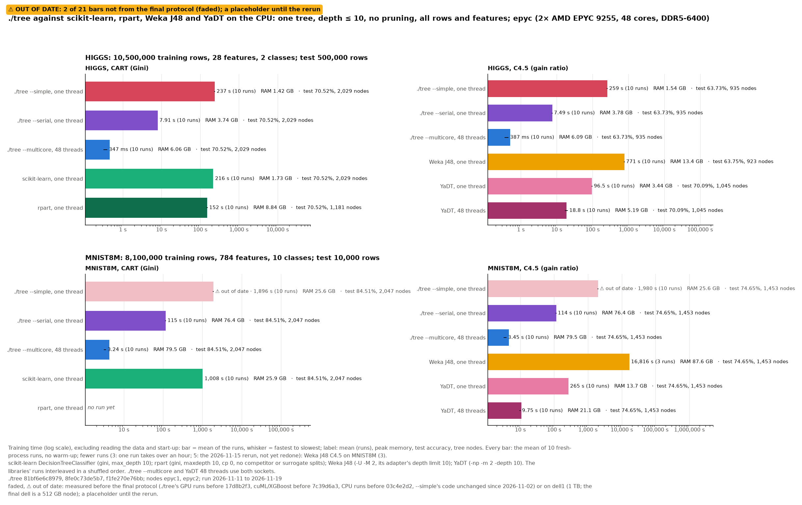

# CPU vs others: ./tree against scikit-learn, rpart, Weka J48 and YaDT on HIGGS and MNIST8M

One tree per run, grown to depth ≤ 10 without pruning on every training row and feature, scored on the dataset's test set, on epyc (2× EPYC 9255, 48 cores, 512 GB DDR5-6400).

**./tree runs in the same `run.py` as the libraries** (`vs-epyc-<data>`: `--serial` and `--multicore` with scikit-learn, rpart, YaDT and J48, one new shuffled order per repetition), so a slow stretch of the node hits every tool alike. `--simple`, whose code has not changed since 2026-11-02, comes from the test-set benchmarks (`cluster-<data>/simple-epyc-<data>`).

**Data:** 2026-11-19/20, ./tree 81bf6e6c (the same tree code as the final runs of 2026-11-17), 10 runs a case, J48 on MNIST8M 3 (a run takes 4.7 hours). HIGGS on epyc2 in two parts; MNIST8M in six parts of under 4 h each (`bench/tools/cluster/merge_parts.py`): ./tree, scikit-learn and YaDT on epyc2, J48's three runs on epyc1 (the same hardware; `machine.json` lists the parts). `--simple` from 2026-11-17 (HIGGS, 8fe0c73d) and 2026-11-11 (MNIST8M, f1fe270e). The libraries' runs before (HIGGS 2026-11-17, MNIST8M 2026-11-18, separate from ./tree's) are in git at 84b4c67e; they agree within 1%. Every label gives its number of runs.



```bash
bench/tools/cluster/final.sh            # queues vs-epyc-<data> on epyc2 (every library in one run.py) with all the other runs
bench/tools/.venv/bin/python bench/tools/vs_chart.py cpu     # chart.png
```

## What runs

| Bar | Command | Threads | From |
|---|---|--:|---|
| ./tree --simple | `tree_cpu --simple --cart -d 10` / `--c45 -d 10` | 1 | `cluster-<data>/simple-epyc-<data>` |
| ./tree --serial | `tree_cpu --serial ...` | 1 | `vs-epyc-<data>` here |
| ./tree --multicore | `tree_cpu --multicore --threads 48 ...` (both sockets) | 48 | `vs-epyc-<data>` here |
| scikit-learn 1.9.1 | `DecisionTreeClassifier(max_depth=10)`, gini, CART only | 1 | `vs-epyc-<data>` here |
| rpart 4.1.27 (R 4.6.1) | `rpart(method="class")`, gini, `maxdepth=10, cp=0, minsplit=2, minbucket=1, maxcompete=0, maxsurrogate=0, xval=0`, CART only | 1 | `vs-epyc-<data>` here |
| Weka J48 3.8.7 | `-U -M 2` with the adapter's depth limit 10, C4.5 only | 1 | `vs-epyc-<data>` here |
| YaDT 2.3.0 | `dTcmd -np -m 2 -depth 10` (only pre-pruning, its own depth limit, root at depth 0), C4.5 only | 1 and 48 | `vs-epyc-<data>` here (threads 1 and 48) |

- **Protocols:** `cart_depth10` and `c45_depth10_unpruned` from [benchlib.py](../tools/benchlib.py), the same as the test-set benchmarks.
- **YaDT is not Quinlan's C4.5 on continuous features:** on HIGGS (2026-11-17, `bench/tools/cluster/plans/f25-gain.py`) C4.5 Release 8's rule (each feature's threshold by information gain with the MDL cost, features by gain ratio) puts the root at `f25 <= 1.8379` (94% / 6% of the rows): ./tree does (it matches Quinlan's binary node by node, [docs/ALGORITHMS.md](../../docs/ALGORITHMS.md)) and J48 nearly so (63.75% test accuracy, 923 nodes against 935). YaDT 2.3.0 with `-np -m 2` puts it at `f25 <= 1.0777` (72% / 28%), which is neither the gain maximum nor the gain-ratio maximum (2.19), and grows a more CART-like tree: 1,045 nodes, 70.09% test accuracy. Its times are for that tree, so YaDT is a fast parallel C4.5-family baseline, not a reference for C4.5's trees.
- **scikit-learn and rpart have no C4.5**, so they are in the CART comparison only (an entropy tree is information gain, not C4.5's gain ratio); J48 and YaDT have no CART.
- **J48 has no depth limit.** [J48Fit](../tools/adapters/J48Fit.java) adds one: `DepthLimitedTree` grows J48's own `C45PruneableClassifierTree`, and at depth 10 it makes a leaf (`NoSplit`) instead of choosing a split. `-U` turns off J48's pruning and collapsing. Weka has no CART in its core, so CART has no Weka bar.
- **Order:** ./tree and the libraries of a dataset run in one `run.py` (`--impls tree,sklearn,rpart,yadt,j48 --threads 1,all`; MNIST8M without rpart), every repetition a new shuffled order of all their cases, so slow drift spreads over every tool. 10 runs a case; a case whose first run takes over an hour stops at 3 (`run.py --long-runs`). A long run is split into parts of under 4 h, each its own `run.py` and SLURM job, merged afterwards (`merge_parts.py`, which renumbers the repetitions).
- **Nodes:** every job owns its node (`--exclusive`). The one-thread runs are pinned to the node's first CPU, memory first-touch, as ./tree's `--serial` and `--simple`. epyc1 and epyc2 are the same hardware (within 2%; `machine.json` records the host of every part).
- **Time:** the training time, which does not include reading the data. Every run is a fresh process that fits one tree, with no warm-up fit (the warm-up code was removed on 2026-11-16; the runs before gave Python and Java an untimed warm-up fit on 50,000 rows): a run's time is the time of running the tool once. JIT compilation inside J48's build is timed. YaDT's time is its `total time` minus its `load time` (parsing the CSV); its indexing of the data, its counterpart of ./tree's presort, is timed.
- **Memory:** the peak resident memory (RSS) right after training: loading and training.
- **rpart cannot fit MNIST8M:** 8.1M rows × 784 features are 6.3 billion values, over 2^31 − 1. The adapter's single `readBin` overflowed R's integers first (job 383); reading in chunks (75faf449) gets past that, but `rpart()` itself then segfaults in its C code (dell2, 2026-11-18). The chart marks the bar "failed"; the adapter now stops with that reason. The chunked reader gives the same trees on covertype and HIGGS at the same speed and lowers rpart's peak on HIGGS from 10.2 to 8.8 GB (8.2 GiB, the HIGGS bar).
- **Same trees:** `run.py --hash-trees` records the SHA-256 of every ./tree tree; each label shows the tree's nodes and test accuracy, so a tool that grew a different tree shows it.

## Results

Means of the runs (runs in brackets); peak RSS after training. scikit-learn and rpart (CART), J48 and YaDT (C4.5).

| Dataset | Algorithm | ./tree --simple | --serial | --multicore 48 | Libraries | Nodes, test accuracy |
|---|---|--:|--:|--:|--:|---|
| HIGGS | CART | 237 s (10) | 7.91 s (10) | 0.347 s (10) | scikit-learn 216 s (10), 1.6 GiB; rpart 152 s (10), 8.2 GiB | 2,029 nodes, 70.52% (scikit-learn the same; rpart 1,181 nodes, 70.52%) |
| HIGGS | C4.5 | 259 s (10) | 7.49 s (10) | 0.387 s (10) | J48 771 s (10), 12.5 GiB; YaDT 96.5 s (10), 48 threads 18.8 s | ./tree 935 nodes, 63.73%; J48 923, 63.75%; YaDT 1,045, 70.09% |
| MNIST8M | CART | 1,896 s (10) | 115 s (10) | 3.24 s (10) | scikit-learn 1,008 s (10), 24.1 GiB; rpart cannot fit it | 2,047 nodes, 84.51% (scikit-learn the same) |
| MNIST8M | C4.5 | 1,980 s (10) | 114 s (10) | 3.45 s (10) | J48 16,816 s (3), 81.6 GiB; YaDT 265 s (10), 48 threads 9.75 s | 1,453 nodes, 74.65% (J48 and YaDT the same) |

- **Against scikit-learn (CART, the same tree):** `--serial` is 27× faster on HIGGS and 8.8× on MNIST8M on one thread; `--multicore` 620× and 310×. `--simple`, the textbook algorithm, is 1.1× scikit-learn's time on HIGGS and 1.9× on MNIST8M.
- **Against rpart (CART, HIGGS):** `--serial` 19× faster, `--multicore` 440×; its tree has 1,181 nodes against 2,029 at the same test accuracy (not investigated).
- **Against J48 (C4.5):** `--serial` is 103× faster on HIGGS and 147× on MNIST8M; `--multicore` 2,000× and 4,900×. J48 grows the same tree on MNIST8M and a slightly different one on HIGGS (923 against 935 nodes, 63.75% against 63.73% test accuracy; the cause was not investigated).
- **Against YaDT:** on MNIST8M YaDT grows ./tree's tree; `--serial` is 2.3× faster than YaDT on one thread and `--multicore` 2.8× faster than YaDT on 48. On HIGGS YaDT grows a different tree (above): 13× and 49×.
- **Memory:** ./tree `--serial` needs 3.5 GiB on HIGGS and 71 GiB on MNIST8M (presorted columns), `--multicore` 5.6–5.7 and 74 GiB; scikit-learn 1.6 and 24 GiB; rpart 8.2 GiB on HIGGS; J48 12.5 and 82 GiB; YaDT 3.2 and 12.7 GiB (48 threads 4.9 and 19.8 GiB).
