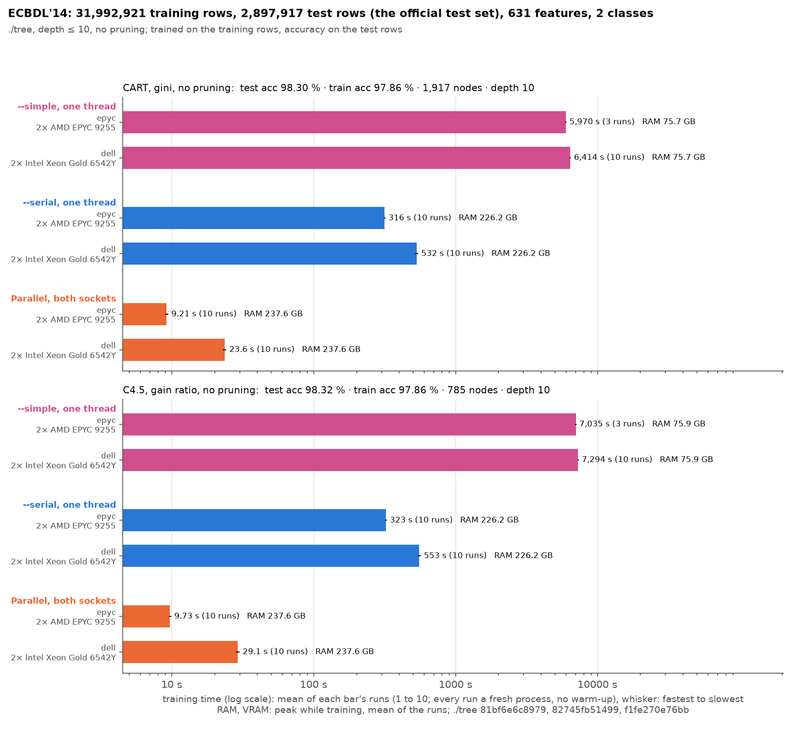
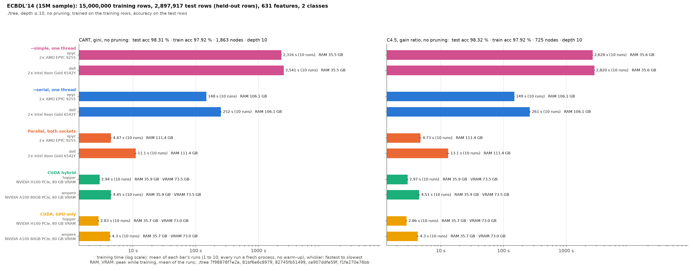

# ECBDL'14 (631 features): training set and test set

./tree only, trained on the training rows and scored on the test rows
([bench/tools/cluster/README.md](../tools/cluster/README.md#test-set-benchmarks)).

- **Training rows:** `ecbdl`: all 31,992,921 training rows, on the CPU nodes only (the GPUs would need about 160 GB); `ecbdl_15m`: the first 15,000,000 (`./tree --rows`), on every node.
- **Test rows:** the competition's labelled test set, 2,897,917 rows.
- **Protocols:** depth ≤ 10, CART (gini) and C4.5 (gain ratio), both without pruning.
- **Runs:** CUDA `--hybrid` and `--gpu` (GPU only) on hopper (H100) and ampere (A100 80 GB), with every CPU of the node; on epyc (2× EPYC 9255) and dell (2× Xeon Gold 6542Y): `--multicore` on both sockets (48 threads), `--serial` and `--simple` (one thread). Each run a fresh process with no warm-up; 10 runs a case in the final runs, 5 in the 2026-11-15 runs, `--simple` 10 on `ecbdl_15m` and 3 on `ecbdl` (about 2 hours a run).
- **Builds:** the final runs: ./tree 82745fb5 (2026-11-17, the same tree code as 8fe0c73d): `--multicore` on epyc1 (both sets) and `--serial` on `ecbdl_15m` (epyc2, dell2); ./tree 81bf6e6c (the 2026-11-19/20 rerun, the same tree code): dell's `--multicore` on dell2 (a 512 GB node), and `--serial` on the full set, 10 runs in two parts of 5 (epyc1 + epyc2, dell4; `bench/tools/cluster/merge_parts.py`). ./tree 7f98876f (2026-11-23, 10 runs a case, the same trees with less RAM and VRAM, [docs/PERFORMANCE.md](../../docs/PERFORMANCE.md#november-2026-less-memory-for---hybrid-and---gpu)): CUDA on hopper and ampere (only the bare CUDA context untimed, [bench/tools/README.md](../tools/README.md#how-time-is-measured)). `--simple` is from 2026-11-10/12 (f1fe270e on epyc, ce907ddf on dell): its code has not changed since 2026-11-02, so it stands. The CUDA runs before 7f98876f (81bf6e6c on hopper; on ampere f53347a9, 2026-11-15, 5 runs, with ./tree's GPU setup untimed) are in git at 2c9ff876. The 2026-11-15 CPU runs the final ones replace are in git at bae12944^; the runs before them (f1fe270e) at 1e655067.
- **Measured:** ./tree's training time (presort, build; not reading the CSV), peak RAM while training, peak VRAM; the tree's test and training accuracy, nodes, depth and SHA-256.
- **Chart:** `chart-ecbdl.png` (full) and `chart-ecbdl_15m.png`, `bench/tools/testset_chart.py` (log scale).

## Results

Every run of a case grew the same tree (the same `tree_sha256`). The tables give the mean of ./tree's training time (`bench/tools/testset_chart.py --table`); "runs" is the number of runs of the case, also on the chart.

- **Accuracy is not informative:** only about 1.7% of the test rows are contacts, so the majority class alone scores 98.32%. The trees match or barely miss that score. A class-weighted or AUC measure would be needed to compare them.
- **15M sample:** GPU only on the H100 takes 2.83 s (CART) and 2.86 s (C4.5), 1.6–1.7× faster than epyc's `--multicore` (4.47 and 4.73 s); hybrid 2.94–2.97 s. Of that, 1.13–1.26 s is the GPU setup (uploading 15M × 631 features included) and 1.69–1.72 s the build, the same build as before: the 2026-11-15 runs (2.42–2.59 s) left the setup untimed. The A100 takes 4.30–4.51 s (setup 1.87–2.09 s, build 2.39–2.43 s). dell (a 512 GB node) takes 11.1 and 13.1 s, 2.5–2.8× epyc (dell1, with twice the memory bandwidth, took 7.70 and 8.80 s). GPU only and hybrid need 36 GB of RAM (hybrid 107 GB before 7f98876f), `--multicore` 111 GB; VRAM 73.0 GB (GPU only) and 73.5 GB (hybrid).
- **Full set (CPU only):** epyc takes 9.21 s (CART) and 9.73 s (C4.5) with 238 GB of RAM: 2.06× the 15M sample's time for 2.13× the rows. dell takes 23.6 s and 29.1 s, 2.6–3.0× epyc (dell1 took 16.4 s and 19.1 s).
- **Serial and simple:** on the 15M sample `--serial` takes 148 s (CART) and 149 s (C4.5) on epyc, 32–33× `--multicore`, and 252 s and 261 s on dell. On the full set `--serial` takes 316 s (CART) and 323 s (C4.5) on epyc and 532 s and 553 s on dell, within 1% of the runs before; `--simple` 5,970–7,319 s (3 runs a case), with a third of the RAM, 76 GB.
- **Against the 2026-11-15 runs (f53347a9, 5 runs a case):** within 2%: `--multicore` on epyc 4.41 → 4.47 s and 9.17 → 9.21 s (CART), `--serial` 147 → 148 s on epyc and 256 → 252 s on dell.
- **The 15M tree's hash changed, not the tree:** `ecbdl_15m` is now `ecbdl`'s first 15M rows read with `./tree --rows` instead of a copied CSV (f2a4f921). The new runs hash fe35c128 (CART) and 5ca577a6 (C4.5), `--simple` (run on the copy) f45a02bf and be533fee, with the same rows, nodes, depth and accuracies; the full set's hashes are the same as before. Checked 2026-11-19 (dell1, job 498, 23436041): `./tree_cpu --serial` and `--simple`, `--cart`/`--c45 -d 10 --rows 15000000 ~/datasets/ecbdl/train.f32 --dump`, grow the same tree as the new runs (both hash the new values above), and only the names in the dump differ from the copy's: the copy's Arrow-written header was `"f0",...,"class"` (quoted, and `./tree` keeps the quotes) with labels `c0`/`c1`, the parent's the CSV's names (`separation`, ...) and `0`/`1`. Renaming feature i to `"f<i>"` and `0`/`1` to `c0`/`c1` in those dumps gives the copy's hashes exactly, for both backends; on the copy all backends had those hashes too.

### ecbdl

| Protocol | test acc | train acc | nodes | depth |
|---|---|---|---|---|
| CART, no pruning | 98.30% | 97.86% | 1,917 | 10 |
| C4.5, no pruning | 98.32% | 97.86% | 785 | 10 |

| Run | runs | CART | C4.5 | RAM GB (peak) | VRAM GB (peak) |
|---|---|---|---|---|---|
| epyc, --simple, one thread | 3 | 5,970 s | 7,035 s | 75.8 | – |
| dell, --simple, one thread | 10 | 6,414 s | 7,294 s | 75.8 | – |
| epyc, --serial, one thread | 10 | 316 s | 323 s | 226.2 | – |
| dell, --serial, one thread | 10 | 532 s | 553 s | 226.2 | – |
| epyc, parallel, both sockets | 10 | 9.21 s | 9.73 s | 237.6 | – |
| dell, parallel, both sockets | 10 | 23.6 s | 29.1 s | 237.6 | – |

### ecbdl_15m

| Protocol | test acc | train acc | nodes | depth |
|---|---|---|---|---|
| CART, no pruning | 98.31% | 97.92% | 1,863 | 10 |
| C4.5, no pruning | 98.32% | 97.92% | 725 | 10 |

| Run | runs | CART | C4.5 | RAM GB (peak) | VRAM GB (peak) |
|---|---|---|---|---|---|
| epyc, --simple, one thread | 10 | 2,316 s | 2,628 s | 35.6 | – |
| dell, --simple, one thread | 10 | 2,541 s | 2,820 s | 35.6 | – |
| epyc, --serial, one thread | 10 | 148 s | 149 s | 106.1 | – |
| dell, --serial, one thread | 10 | 252 s | 261 s | 106.1 | – |
| epyc, parallel, both sockets | 10 | 4.47 s | 4.73 s | 111.4 | – |
| dell, parallel, both sockets | 10 | 11.1 s | 13.1 s | 111.4 | – |
| hopper, CUDA hybrid | 10 | 2.94 s | 2.97 s | 35.9 | 73.5 |
| ampere, CUDA hybrid | 10 | 4.45 s | 4.51 s | 35.9 | 73.5 |
| hopper, CUDA, GPU only | 10 | 2.83 s | 2.86 s | 35.7 | 73.0 |
| ampere, CUDA, GPU only | 10 | 4.3 s | 4.3 s | 35.7 | 73.0 |
