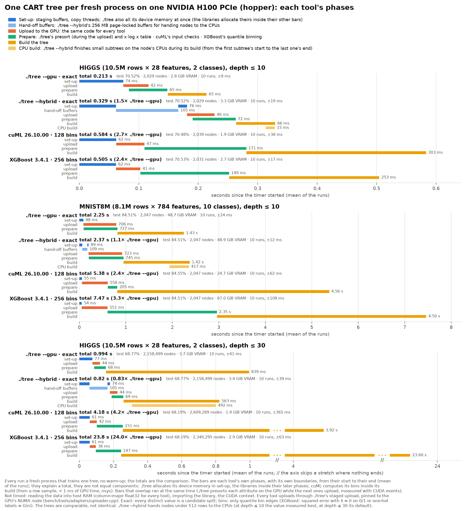

# GPU vs others: ./tree against cuML and XGBoost on HIGGS and MNIST8M (CART)

Training time of one depth-limited CART tree (depth ≤ 10, and on HIGGS also depth ≤ 30; no pruning, every training row and feature) per fresh process, on hopper's H100 PCIe 80 GB (GPU 2) with every CPU of the node: ./tree `--gpu` and `--hybrid` (exact: every distinct value is a candidate split), cuML (128 quantile bins) and XGBoost (256 bins). The trees are comparable, not identical. The four tools run in one `bench/tools/run.py` per dataset, their runs interleaved in a new shuffled order each repetition; every run is a fresh process that trains exactly one tree with no warm-up, so this is cold, one-tree latency, not the time per tree of repeated training. Every tool uploads its data through the same code, pinned to the GPU's NUMA node. Every run records a timeline: when each phase of its timed training started and ended.

**Data (2026-11-23, job 789, 10 runs a case, ./tree at 7f98876f: less RAM and VRAM for `--hybrid` and `--gpu`, the same trees; the runs before, jobs 397 and 410 of 2026-11-18, are in git at 2c9ff876):** the protocol below. Until 7c39d6a3 the libraries' copy threads were not pinned to the GPU's NUMA node (gpubench.py's lookup failed silently; jobs 395 and 396); pinned, their HIGGS upload takes 39 ms instead of 45–65 ms. **Depth ≤ 30 (HIGGS):** the same job, `--hybrid` at its default `--handoff-rows` (512). The earlier protocol (each library uploading in its own way, a warm variant, forests of 10, the A100 node) is in git history up to 8ba60fae.



```bash
bench/tools/cluster/final.sh -k gpulibs   # queues the runs on hopper (needs ~/gpu-dt-bench/venv and bench/tools/.tools/libuploader.so)
bench/tools/cluster/charts.sh             # among them gpu_steps_chart.py: chart.png, summary.csv
```

## Results

**The totals are the comparison.** Mean of 10 runs, in seconds (× slower than `./tree --gpu`; ± standard deviation):

| | ./tree --gpu (exact) | ./tree --hybrid (exact) | cuML 26.10 (128 bins) | XGBoost 3.4.1 (256 bins) |
|---|--:|--:|--:|--:|
| HIGGS | **0.213** ± 0.009 | 0.329 ± 0.019 | 0.584 ± 0.038 (2.7×) | 0.505 ± 0.017 (2.4×) |
| MNIST8M | **2.248** ± 0.024 | 2.374 ± 0.012 | 5.385 ± 0.062 (2.4×) | 7.467 ± 0.108 (3.3×) |
| test accuracy, nodes, VRAM: HIGGS | 70.52%, 2,029, 2.8 GiB | 70.52%, 2,029, 3.3 GiB | 70.48%, 2,039, 1.9 GiB | 70.53%, 2,031, 2.7 GiB |
| MNIST8M | 84.51%, 2,047, 49 GiB | 84.51%, 2,047, 49 GiB | 84.55%, 2,047, 25 GiB | 84.51%, 2,047, 67 GiB |

**The phases explain the totals; they are not equal components.** Each tool's phases have its own boundaries: ./tree allocates all its device memory in its set-up and presorts in its prepare phase, the libraries allocate theirs inside their later phases, and cuML computes its bins inside its build. Each recorded section from its start to its end, in milliseconds since the timer started; sections that overlap ran at the same time (`summary.csv` has every section):

| HIGGS | ./tree --gpu | ./tree --hybrid | cuML | XGBoost |
|---|--:|--:|--:|--:|
| staging buffers, copy threads | 0–62 | 0–62 | 0–62 | 0–62 |
| hand-off buffers | | 62–167 | | |
| device memory | 62–74 | 167–181 | | |
| upload | 74–116 | 181–228 | 62–110 | 62–103 |
| presort (GPU kernels) | 83–117 | 191–228 | | |
| x·log x table, its copy | 116–118, 118–148 | 228–230, 230–263 | | |
| input checks / quantile binning | | | 110–281 | 103–252 |
| build | 149–214 | 264–330 | 281–583 | 252–505 |
| CPU build (subtrees) | | 314–329 | | |

| MNIST8M | ./tree --gpu | ./tree --hybrid | cuML | XGBoost |
|---|--:|--:|--:|--:|
| staging buffers, copy threads | 0–64 | 0–64 | 0–55 | 0–54 |
| hand-off buffers | | 64–173 | | |
| device memory | 64–88 | 173–199 | | |
| upload | 88–794 | 199–922 | 55–612 | 54–605 |
| presort (GPU kernels) | 95–795 | 205–923 | | |
| x·log x table, its copy | 794–796, 796–822 | 922–923, 923–951 | | |
| input checks / quantile binning | | | 612–817 | 605–2,950 |
| build | 823–2,249 | 951–2,375 | 817–5,375 | 2,960–7,463 |
| CPU build (subtrees) | | 1,941–2,359 | | |

**The chart** draws the same phase names for every tool, each with that tool's boundaries: set-up, upload, prepare, build; `--hybrid` also its hand-off buffers (the whole difference between `--hybrid` and `--gpu`) and its CPU build. ./tree's sections are merged into them: set-up = staging buffers + device memory; prepare = the presort + the x·log x table and its copy. A phase in pieces that do not touch (`--hybrid`'s set-up, before and after its hand-off buffers) is drawn in pieces, labelled with their sum. The depth ≤ 30 panel's axis skips the stretches where nothing ends (// on the axis, ··· in the bars that cross them): 0–1.1 s at full scale, then short windows around cuML's end (4.5 s) and XGBoost's (23.8 s).

- **Totals:** `./tree --gpu` trains its exact tree 2.4–2.7× faster than cuML and 2.4–3.3× faster than XGBoost, from the same host data through the same upload. The libraries' upload reaches 46 GB/s on MNIST8M (HIGGS's 1.2 GB is too short a copy for full speed).
- **Where the time goes:** most of the libraries' time is in their build (cuML 302 ms and 4.56 s, XGBoost 253 ms and 4.50 s, against ./tree's 65 ms and 1.43 s) and in XGBoost's binning. These phases are not like for like: cuML's build also allocates its working memory, and ./tree's build starts from columns already presorted.
- **The presort hides inside the upload:** its first kernel starts 7–9 ms after the upload starts (the first attribute has to arrive), and its last one ends within 1 ms of the upload's end. On MNIST8M ./tree's upload takes 0.71–0.72 s against the libraries' 0.55–0.56 s for the same 25.4 GB: the presort kernels running at the same time slow the copies. Without the overlap the 0.7 s of presort would come after the upload.
- **The x·log x table's copy costs 27–34 ms** (14% of HIGGS `--gpu`), computing it 1.5–1.8 ms: a 512 KB `cudaMemcpyAsync` from pageable memory, which the host waits for. Small enough to leave as it is.
- **--hybrid against --gpu:** its 256 MB of page-locked hand-off buffers take 105–109 ms, most of the difference between the two (115 and 126 ms). Its CPU build runs during the last levels (HIGGS for 15 ms, MNIST8M for 417 ms) and ends before the GPU build does: at depth 10 it gains nothing on these datasets.
- **cuML's prepare (151–205 ms)** is its input checks: the NaN/inf scan, the classes and the lazy loading of the kernels it uses. Its binning is inside its build: `nsys` shows that cuML computes its 128 quantiles from a row sample in about 0.2 ms of GPU time, and 98% of its build's GPU time is `buildHistogramsKernel`.
- **XGBoost's prepare is its quantile binning** (`QuantileDMatrix`, then freeing the raw device copy): 149 ms on HIGGS, 2.35 s on MNIST8M (784 attributes).
- **Similar trees, not identical:** XGBoost's tree on MNIST8M is ./tree's tree (2,047 nodes, the same test accuracy); cuML's has the same size. On HIGGS the libraries' trees differ in a few nodes because of their bins (2,039 and 2,031 against 2,029). Test accuracy is within 0.05 points.
- **VRAM:** ./tree keeps presorted 8-byte entries for every value (49 GiB on MNIST8M). cuML keeps its bins and needs half as much. XGBoost needs the most (67 GiB) for its multi-output histograms (10 classes × 784 attributes × 256 bins per node), even with its histogram cache limited to 128 nodes.

## A deep tree: HIGGS, depth ≤ 30

Where `--hybrid`'s CPU subtrees pay off: the tree has 2.2M nodes, most of them small. Mean of 10 runs, in seconds (× slower than `./tree --gpu`; ± standard deviation):

| HIGGS, depth ≤ 30 | ./tree --gpu (exact) | ./tree --hybrid (exact) | cuML 26.10 (128 bins) | XGBoost 3.4.1 (256 bins) |
|---|--:|--:|--:|--:|
| total | 0.994 ± 0.041 | **0.821** ± 0.039 (0.83×) | 4.18 ± 0.37 (4.2×) | 23.84 ± 0.06 (24.0×) |
| test accuracy, nodes, VRAM | 68.77%, 2,158,499, 3.7 GiB | 68.77%, 2,158,499, 3.4 GiB | 68.19%, 2,609,289, 1.9 GiB | 68.19%, 2,340,295, 2.9 GiB |

| HIGGS, depth ≤ 30 (ms) | ./tree --gpu | ./tree --hybrid | cuML | XGBoost |
|---|--:|--:|--:|--:|
| staging buffers, copy threads | 0–63 | 0–60 | 0–61 | 0–61 |
| hand-off buffers | | 60–165 | | |
| device memory | 63–77 | 165–180 | | |
| upload | 77–121 | 180–224 | 61–103 | 61–97 |
| presort (GPU kernels) | 87–122 | 189–224 | | |
| x·log x table, its copy | 121–123, 123–155 | 224–226, 226–258 | | |
| input checks / quantile binning | | | 103–254 | 97–244 |
| build | 156–995 | 259–821 | 254–4,177 | 244–23,840 |
| CPU build (subtrees) | | 308–800 | | |

- **--hybrid is 1.21× faster than --gpu:** its build takes 563 ms against 839 ms, because its CPUs grow the small subtrees from 50 ms into the build to its end while the GPU goes on with the large nodes. Its hand-off buffers (105 ms) take back part of the gain. (hybrid-vs-gpu-only measures 1.18× at this depth on hopper, 10 runs, with the hand-off size of the sweep.)
- **The libraries fall far behind on a deep tree:** cuML 4.2× and XGBoost 24.0× slower than `--gpu`, against 2.4–3.3× at depth 10. Their build works per node (histograms of every node's rows over every attribute's bins), and this tree has a thousand times more nodes; ./tree's level costs grow with rows, not nodes. XGBoost's 23.6 s build is almost all of its time.
- **Their trees differ more:** with only 128 or 256 candidate splits per attribute, cuML grows 21% and XGBoost 8% more nodes than the exact tree, and both test 0.58 points lower (68.19% against 68.77%).

## The sections

| Section | ./tree (its `span` lines, `src/core/timeline.h`) | cuML, XGBoost (`bench/tools/cluster/gpubench.py`) |
|---|---|---|
| staging buffers, copy threads | `Staging::prepare` | `uploader.cpp`'s buffers and copy threads |
| hand-off buffers | `--hybrid`: `prepareHandOff` (2 × 128 MB page-locked) | |
| device memory | streams, events, the memory pool, `allocateDevice` | (inside the libraries' later sections) |
| upload | labels and columns through the staging buffers, to the last copy's end | the same, through `uploader.cpp` |
| presort (GPU kernels) | CUDA events: the first presort kernel's start to the last one's end, on the host's clock (an event synchronized before the upload) | |
| x·log x table, its copy | `xlog2xTable()`, then its copy to the GPU | |
| input checks | | cuML `_prepare_fit_inputs` |
| quantile binning | | XGBoost `QuantileDMatrix(max_bin=256)`, then the raw copy freed |
| build the tree | `grow()`: all levels, the hand-offs, waiting for the CPU tasks, the host tree | cuML `_fit_forest` and the rest of `fit`; XGBoost `xgb.train`, one round |
| CPU build (subtrees) | `--hybrid`: the first CPU task's start to the last one's end | |

Sections of ./tree under 2 ms (the wait for the presort's end, the host arena, the grow's set-up, assembling the tree) are not recorded on their own; they are in the gaps or in the build. Every library section ends with `cudaDeviceSynchronize`, so its GPU work is inside it. ./tree's host sections wait for their own GPU work where the code does (the upload ends with the last copy).

## What is compared

**CART only.** No public GPU implementation of C4.5 exists, and an entropy (information-gain) tree is not C4.5, so ./tree's C4.5 has no GPU competitor here. Both libraries split only at the edges of a fixed number of quantile bins per feature; ./tree tests every distinct value.

| Implementation | Version | Settings |
|---|---|---|
| **./tree --gpu** and **--hybrid** | the commit under test | `--cart -d 10` (exact Gini), no pruning, every CPU of the node (`--hybrid` finishes small subtrees on them) |
| **cuML** `RandomForestClassifier` | 26.10 | `n_estimators=1, bootstrap=False, max_samples=1.0, max_features=1.0, n_bins=128, max_depth=10` (30), ` split_criterion="gini", n_streams=1` |
| **XGBoost** | 3.4.1, `device="cuda", tree_method="hist"` | `reg:squarederror`, `eta=1, lambda=0, alpha=0, gamma=0, min_child_weight=1`, `max_bin=256`, `max_depth=10` (30), `grow_policy="depthwise"`, one round. On 0/1 labels the gain is n/2 × the drop in Gini impurity, so this is CART on the bins. MNIST8M (10 classes): one multi-output tree (`multi_strategy="multi_output_tree"`, `max_cached_hist_node=128`) on one-hot labels, whose summed squared error is again n/2 × the Gini drop. |

## The protocol

The same for every tool:

- **Not timed:** reading the files into host RAM as float32, column-major (./tree's loader holds its data column-major; the libraries get `np.asfortranarray`), and the labels (XGBoost's float32 or one-hot labels are made here); importing the library; the CUDA context alone (`cudaFree(0)`; ./tree makes it on a thread while the input loads). `CUDA_MODULE_LOADING=LAZY`, CUDA's default: each tool loads the kernels it uses inside the timed part.
- **Timed:** from the host arrays to the finished tree, in the sections above. ./tree's `train total` and the libraries' `train_seconds` are the totals; run.py also keeps the step sums (./tree's `setup_buffers/allocate/upload/finish_seconds`, `build_seconds`; gpubench's `buffers/upload/prepare/build_seconds`) next to each row's `timeline`.
- **The upload:** 4 page-locked 32 MB buffers on the GPU's NUMA node, up to 32 copy threads pinned to that node's CPUs (16 on hopper; the calling thread copies too), each 32 MB chunk copied in parallel into a free buffer, then an asynchronous copy to the GPU. cuML and XGBoost call the same code through `ctypes` (`bench/tools/.tools/libuploader.so`, built by `bench/tools/cluster/build.sh`; it finds the GPU's node with a copy of ./tree's `gpuNodeCpus()`), so neither library is slowed by its own pageable copy and ./tree gets no advantage from its upload. Each library row records `uploader_cpus` (16), and gpubench.py stops if the copies are unpinned on a machine with several NUMA nodes.
- **Not timed, after the tree:** prediction, accuracy, the tree walk (nodes, depth, root split).
- **Runs:** one `bench/tools/run.py` per dataset with `--impls tree_gpu_only,tree_cuda,cuml,xgboost`; each repetition runs every tool once in a new shuffled order. Every process runs on all CPUs of the node, the GPU's NUMA node first; the job owns the node (`--exclusive`).
- **VRAM:** peak GPU memory in use above idle, sampled from outside every 20 ms with `nvidia-smi`, for the whole process, the same for every tool.
- **GPU:** hopper's GPU 2 (H100 PCIe 80 GB), by rule (`bench/tools/cluster/job.sh`); a run on another GPU is marked out of date.
- **Test sets:** HIGGS the last 500,000 rows (UCI's split), MNIST8M the original MNIST test set (10,000).

## Run it by hand

cuML needs its own venv (`GPU_PYTHON`, default `~/gpu-dt-bench/venv/bin/python`; the pinned versions are in [`bench/tools/cluster/gpubench-requirements-freeze.txt`](../tools/cluster/gpubench-requirements-freeze.txt)):

```bash
# on the mordor3 login node, once
/usr/bin/virtualenv -p python3 ~/gpu-dt-bench/venv       # python3-venv is missing on mordor3
~/gpu-dt-bench/venv/bin/pip install -r bench/tools/cluster/gpubench-requirements-freeze.txt \
  --extra-index-url=https://pypi.nvidia.com
# a plan line for bench/tools/cluster/batch.sh (final.sh writes these)
- cluster-gpu-vs-others/one-tree vs-hopper-higgs higgs tree_gpu_only,tree_cuda,cuml,xgboost 10 cart_depth10 all 14400 ACCURACY=--test-accuracy
- cluster-gpu-vs-others/one-tree vs-hopper-higgs-depth30 higgs tree_gpu_only,tree_cuda,cuml,xgboost 10 cart_depth30 all 14400 ACCURACY=--test-accuracy,HANDOFF=default
```

## Files

| File | Content |
|---|---|
| `chart.png` | HIGGS and MNIST8M at depth ≤ 10, HIGGS at depth ≤ 30: each tool's phases (set-up, hand-off buffers, upload, prepare, build, CPU build) on a timeline, with total, test accuracy, nodes, VRAM and spread (`bench/tools/gpu_steps_chart.py`) |
| `summary.csv` | one row per dataset, depth limit, tool and recorded section (with the bar it is drawn in): mean start, end and length and the tool's total (mean, standard deviation, min, max), VRAM, test accuracy, nodes, commit |
| `one-tree/vs-hopper-<dataset>[-depth30]/` | the run folders: `results.jsonl` (every run of every tool, each step's time), `plan.json`, `machine.json`, `run.log`, and `report.md`, `runs.csv`, `summary.csv` from `bench/tools/report.py` |

The libraries' runner is in bench/tools/cluster/: `gpubench.py` (one cuML or XGBoost run, called by `bench/tools/run.py`) and `gpubench-requirements-freeze.txt` (the venv's pinned versions).
