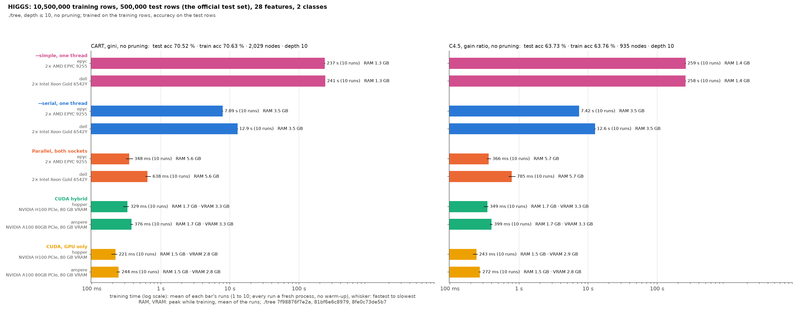

# HIGGS (28 features): training set and test set

./tree only, trained on the training rows and scored on the test rows
([bench/tools/cluster/README.md](../tools/cluster/README.md#test-set-benchmarks)).

- **Training rows:** the first 10,500,000 rows.
- **Test rows:** the last 500,000, UCI's test set.
- **Protocols:** depth ≤ 10, CART (gini) and C4.5 (gain ratio), both without pruning.
- **Runs:** CUDA `--hybrid` and `--gpu` (GPU only) on hopper (H100) and ampere (A100 80 GB), with every CPU of the node; on epyc (2× EPYC 9255) and dell (2× Xeon Gold 6542Y): `--multicore` on both sockets (48 threads), `--serial` and `--simple` (one thread). 10 runs a case, each a fresh process with no warm-up, in a shuffled, interleaved order.
- **Builds:** ./tree at 8fe0c73d (CPU runs, 2026-11-17, by `bench/tools/cluster/final.sh -D higgs,susy`) 81bf6e6c (the 2026-11-19 rerun: `--multicore` on dell2; the same tree code) and 7f98876f (CUDA on hopper and ampere, 2026-11-23, 10 runs a case: the same trees with less RAM and VRAM, [docs/PERFORMANCE.md](../../docs/PERFORMANCE.md#november-2026-less-memory-for---hybrid-and---gpu)), one build for every node ([bench/tools/cluster/README.md](../tools/cluster/README.md#the-final-rerun)): `--multicore` on epyc1 and dell2, `--serial` on epyc2 and dell3, `--simple` on epyc1 and dell3, CUDA on hopper and ampere. The GPU runs time ./tree's GPU setup (kernel loading, memory pool, page-locked staging buffers, copy threads, and for `--hybrid` its page-locked hand-off buffers) by the rule every GPU tool follows: only the bare CUDA context is untimed (`--gpu-startup context`, [bench/tools/README.md](../tools/README.md#how-time-is-measured)). The 2026-11-15 runs (f53347a9, 5 runs a case) are in git at 7d906f7d. The CUDA runs before 7f98876f (81bf6e6c on hopper; 713914b8 on ampere, before 17d8b2f3's timing rule) are in git at 2c9ff876.
- **Measured:** ./tree's training time (presort, build; not reading the CSV), peak RAM while training, peak VRAM; the tree's test and training accuracy, nodes, depth and SHA-256.
- **Chart:** `chart.png`, `bench/tools/testset_chart.py` (log scale).

## Results

Every run of a case grew the same tree (the same `tree_sha256`). The tables give the mean of ./tree's training time (`bench/tools/testset_chart.py --table`); "runs" is the number of runs of the case, also on the chart.

- **Speed:** GPU only on the H100 takes 221 ms (CART) and 243 ms (C4.5): 155–160 ms of GPU setup (kernel loading, memory pool, staging buffers; a fixed cost) and 66–83 ms of build, 1.5–1.6× faster than epyc's `--multicore` (348 and 366 ms). The A100 takes 244 and 272 ms. Hybrid's setup also makes its 256 MB of page-locked hand-off buffers (263–266 ms of setup on the H100), so at depth 10 hybrid (329–349 ms on the H100, 376–399 ms on the A100) is slower than GPU only and no faster than epyc. dell (a 512 GB node) takes 638 and 785 ms, 1.8–2.1× epyc (dell1, with twice the memory bandwidth, took 568 and 677 ms).
- **Serial and simple:** `--serial` takes 7.89 s (CART) and 7.42 s (C4.5) on epyc, 20–23× `--multicore`, and 12.9 s and 12.6 s on dell. `--simple` takes 237–259 s on both: 30–35× `--serial` on epyc, 19–20× on dell.
- **Against the 2026-11-15 runs (7d906f7d):** the CPU runs are within ±7% (the same tree code). The GPU runs take more by the setup that was untimed before (see Builds): GPU only 81–92 ms more, hybrid 194–223 ms. The 2026-11-19 rerun on hopper is within 3% of 2026-11-17's, the 2026-11-23 one (7f98876f) within 3% of 2026-11-19's.
- **Accuracy:** CART reaches 70.5% on the test set, C4.5 63.7%.
- **Memory:** VRAM 2.8–2.9 GB for GPU only, 3.3 GB for hybrid (its 512 MB hand-off ring). GPU only needs 1.5 GB of RAM, hybrid 1.7 GB, `--multicore` 5.7 GB, `--serial` 3.5 GB, `--simple` 1.4 GB. Before 7f98876f hybrid needed 4.0 GB of RAM and GPU only 3.3 GB of VRAM.

| Protocol | test acc | train acc | nodes | depth |
|---|---|---|---|---|
| CART, no pruning | 70.52% | 70.63% | 2,029 | 10 |
| C4.5, no pruning | 63.73% | 63.76% | 935 | 10 |

| Run | runs | CART | C4.5 | RAM GB (peak) | VRAM GB (peak) |
|---|---|---|---|---|---|
| epyc, --simple, one thread | 10 | 237 s | 259 s | 1.4 | – |
| dell, --simple, one thread | 10 | 241 s | 258 s | 1.4 | – |
| epyc, --serial, one thread | 10 | 7.89 s | 7.42 s | 3.5 | – |
| dell, --serial, one thread | 10 | 12.9 s | 12.6 s | 3.5 | – |
| epyc, parallel, both sockets | 10 | 348 ms | 366 ms | 5.7 | – |
| dell, parallel, both sockets | 10 | 638 ms | 785 ms | 5.7 | – |
| hopper, CUDA hybrid | 10 | 329 ms | 349 ms | 1.7 | 3.3 |
| ampere, CUDA hybrid | 10 | 376 ms | 399 ms | 1.7 | 3.3 |
| hopper, CUDA, GPU only | 10 | 221 ms | 243 ms | 1.5 | 2.9 |
| ampere, CUDA, GPU only | 10 | 244 ms | 272 ms | 1.5 | 2.8 |
