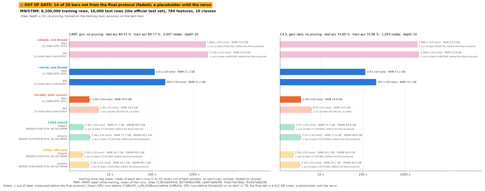

# MNIST8M (784 features, 10 classes): training set and test set

./tree only, trained on the training rows and scored on the test rows
([bench/tools/cluster/README.md](../tools/cluster/README.md#test-set-benchmarks)).

- **Training rows:** infinite MNIST's 8,100,000 distorted digits (LIBSVM `mnist8m`), 784 pixel features (0–255).
- **Test rows:** the original MNIST test set, 10,000 rows (LIBSVM `mnist.t`).
- **Protocols:** depth ≤ 10, CART (gini) and C4.5 (gain ratio), both without pruning.
- **Runs:** CUDA `--hybrid` and `--gpu` (GPU only) on hopper (H100) and ampere (A100 80 GB), with every CPU of the node; on epyc (2× EPYC 9255) and dell (2× Xeon Gold 6542Y): `--multicore` on both sockets (48 threads), `--serial` and `--simple` (one thread). 10 runs a case, each a fresh process with no warm-up, in a shuffled, interleaved order.
- **Builds:** the final runs (2026-11-17): ./tree at 82745fb5 for `--multicore` on epyc1 and `--serial` on epyc2 and dell2 (the same tree code as 8fe0c73d), at 713914b8 for CUDA on hopper and ampere (`final.sh -D higgs,susy,mnist8m -k gpu,gpulibs,e2e`: only the bare CUDA context untimed, the hand-off buffers made only for `--hybrid`, an 80 GB GPU; [bench/tools/README.md](../tools/README.md#how-time-is-measured)). **Out of date** (⚠ in the table, faded on the chart, until the rerun): dell's `--multicore` (2026-11-15, f53347a9, 5 runs: dell1 is down) and `--simple` (2026-11-10/12, f1fe270e on epyc, ce907ddf on dell). The 2026-11-15 runs are in git at bae12944^ (CPU) and 0bd04707^ (GPU); the runs before them (f1fe270e) at 1e655067.
- **Measured:** ./tree's training time (presort, build; not reading the CSV), peak RAM while training, peak VRAM; the tree's test and training accuracy, nodes, depth and SHA-256.
- **Chart:** `chart.png`, `bench/tools/testset_chart.py` (log scale).

## Results

Every run of a case grew the same tree (the same `tree_sha256`), the same as in the runs before. The table gives the mean of ./tree's training time (`bench/tools/testset_chart.py --table`); "runs" is the number of runs of the case, also on the chart.

- **Speed:** GPU only on the H100 takes 2.26 s (CART) and 2.29 s (C4.5), 1.4–1.5× faster than epyc's `--multicore` (3.26 and 3.39 s); hybrid 2.37–2.38 s. Of that, 0.83–0.97 s is the GPU setup (uploading 25 GB of features included) and 1.40–1.43 s the build. The A100 takes 3.18–3.36 s, as fast as epyc. dell's `--multicore` (out of date) took 5.45 and 6.03 s. 784 features keep the CPU close to the GPUs.
- **Serial and simple:** `--serial` takes 115 s (CART) and 114 s (C4.5) on epyc, 34–35× `--multicore`, and 205 s and 207 s on dell. `--simple` (out of date) took 1,896–2,166 s: 16–17× `--serial` on epyc, 10× on dell.
- **Against the 2026-11-15 runs (f53347a9, 5 runs a case):** `--multicore` on epyc 4–5% slower (3.10 → 3.26 s CART), `--serial` within 1% on epyc and 1–3% slower on dell. The GPU runs take 0.07–0.35 s more: the setup that was untimed before (most for hybrid on the H100, 2.03 → 2.38 s).
- **Spread:** every case within ±1.6% (standard deviation over the mean); the H100's two speeds of the 2026-11-15 runs (±6–8%) are gone.
- **Accuracy:** CART 84.5% on the test set, C4.5 74.7%. Test accuracy is above training accuracy: the training digits are distorted copies, harder than the original test digits.
- **Memory:** VRAM 49 GB. GPU only needs 24 GB of RAM, hybrid 72 GB, `--multicore` 74 GB, `--serial` 71 GB, `--simple` 24 GB.

| Protocol | test acc | train acc | nodes | depth |
|---|---|---|---|---|
| CART, no pruning | 84.51% | 80.77% | 2,047 | 10 |
| C4.5, no pruning | 74.65% | 70.96% | 1,453 | 10 |

| Run | runs | CART | C4.5 | RAM GB (peak) | VRAM GB (peak) |
|---|---|---|---|---|---|
| epyc, --simple, one thread ⚠ out of date (f1fe270e) | 10 | 1,896 s | 1,980 s | 23.8 | – |
| dell, --simple, one thread ⚠ out of date (ce907ddf) | 10 | 2,130 s | 2,166 s | 23.8 | – |
| epyc, --serial, one thread | 10 | 115 s | 114 s | 71.1 | – |
| dell, --serial, one thread | 10 | 205 s | 207 s | 71.1 | – |
| epyc, parallel, both sockets | 10 | 3.26 s | 3.39 s | 74.0 | – |
| dell, parallel, both sockets ⚠ out of date (f53347a9) | 5 | 5.45 s | 6.03 s | 74.0 | – |
| hopper, CUDA hybrid | 10 | 2.38 s | 2.37 s | 71.7 | 48.9 |
| ampere, CUDA hybrid | 10 | 3.36 s | 3.33 s | 71.7 | 49.0 |
| hopper, CUDA, GPU only | 10 | 2.26 s | 2.29 s | 24.1 | 49.2 |
| ampere, CUDA, GPU only | 10 | 3.18 s | 3.19 s | 24.1 | 49.2 |
