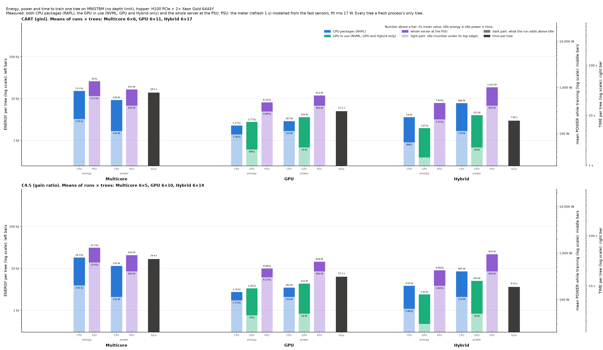

# Energy per tree without a depth limit: MNIST8M, Multicore, GPU and Hybrid on hopper

The [cluster-power](../cluster-power/BENCHMARK.md) measurement on a case where
`--hybrid` gains a lot: MNIST8M (8.1M rows × 784 features, 25 GB as `.f32`)
**without a depth limit**, CART and C4.5 without pruning. At depth ≤ 10
(cluster-power, ECBDL'14 15M) the hybrid hands almost nothing to the CPU and
is as fast as GPU only; without a limit it is 1.5–1.6× faster
([hybrid-vs-gpu-only](../hybrid-vs-gpu-only/BENCHMARK.md)). The question: does
that speed-up save energy, given that the hybrid keeps every CPU core busy
next to the GPU?

**Where and what.** hopper only (ampere was reserved), the whole node
(`--exclusive`): Supermicro SYS-741GE-TNRT, 2× Xeon Gold 6444Y (32 cores),
4× H100 PCIe, 1 TB. Three backends of ./tree: `--multicore` (`./tree_cpu`, all
32 CPUs), `--gpu` and `--hybrid` (GPU 2, NUMA node 1's CPUs first, 32 threads;
`--handoff-rows 8192`, hopper's MNIST8M no-limit value in
`bench/handoff-tuning/handoff_rows.json`). Every case grows the same tree:
CART 301,939 nodes, depth 115; C4.5 218,325 nodes, depth 147.

**When.** Job 561, 2026-11-20 23:25 – 2026-11-21 02:08, ./tree 81bf6e6c (the
final build, as cluster-power), `power_bench.sh all` with
`DATA=~/datasets/mnist8m/train.f32 SHM=1 DEPTH=-1 HANDOFF=8192
IMPLS="parallel gpuonly cuda" ALGOS="cart c45" REPS=6` and a short warm-up
check (`CHECK=1 CHECK_WARMUPS="0 2 15" CHECK_TREES=10`); the rest at the
defaults (120 s of training per process, 2 s `--repeat-warmup` for the GPU
backends, 300 s idle before and after, the 60 s calibration staircase, 20 s
idle before each process). It replaces job 415 (2026-11-18, 15 s warm-up:
GPU trees 3–5% faster than in the time benchmark; the energy per tree within
1% of this job's; in git before this change):

    TREE_GIT_DESCRIBE=81bf6e6c8979 bench/tools/power/submit.sh \
      -o bench/cluster-power-mnist8m hopper DATA=$HOME/datasets/mnist8m/train.f32 \
      SHM=1 DEPTH=-1 HANDOFF=8192 "IMPLS=parallel gpuonly cuda" "ALGOS=cart c45" \
      CHECK=1 "CHECK_WARMUPS=0 2 15" CHECK_TREES=10 REPS=6
    bench/tools/.venv/bin/python bench/tools/power/analyze.py bench/cluster-power-mnist8m

**Method** as in [cluster-power](../cluster-power/BENCHMARK.md#method): the
whole server's energy at the PSU over the training windows only, each tree a
fresh process's only tree, from hopper's meter (1 s refresh) modelled from
RAPL and NVML sampled every 0.1 s (since 2026-11-19 the simpler model
a + G_idle + b·CPU + GPU: 56 + 154 + 1.02·CPU + GPU here, rms 17 W). Choices for this run:

- **Six rounds**, round-robin over the six cases, each a process of 5–17
  trees (36–102 trees a case). Six rounds were enough: the energy per tree
  varies 0.2–0.6% between rounds (standard deviation over the mean).
- **2 s warm-up, as cluster-power** (each GPU tree's child keeps its CPU
  threads busy 2 s before its timer, as a single run's data load does), so
  the trees take as long as in the time benchmark
  ([hybrid-vs-gpu-only](../hybrid-vs-gpu-only/BENCHMARK.md), hopper, the same
  `--handoff-rows`): GPU 12.1 and 15.2 s against 12.3 and 15.3 s (−1.3%,
  −1.1%), Hybrid 7.82 and 9.52 s against 8.04 and 9.58 s (−2.8%, −0.6%). The
  job's check (CART, 10 trees each): GPU 12.3 s with no warm-up, 11.9 s with
  2 s, 11.8 s with 15 s; Hybrid 7.8 s at every warm-up. Hybrid CART stays
  2–3% under the time benchmark at every warm-up, so the warm-up is not the
  cause; it is within the 3% the time check allows
  ([summary.md](summary.md#time-check)).
- **The data in /dev/shm** (`SHM=1`): ./tree drops its input from the page
  cache, so each of the 42 processes would have read 25 GB from NFS again.
  Loading is outside the windows either way; this keeps the job short and the
  NFS out of it.
- **Long trees, so the meter itself checks the model:** the trees take
  7.8–34 s, many meter refreshes each. The meter's own readings over the same
  windows give an energy within 1.2% of the model's for every case.

## Results

| Backend | CART: t | P | E | above idle | C4.5: t | P | E | above idle |
|---|---|---|---|---|---|---|---|---|
| Multicore | 28.5 s | 913 W | 26.0 kJ ± 0.4% | 14.5 kJ | 34.4 s | 910 W | 31.3 kJ ± 0.2% | 17.4 kJ |
| GPU | 12.1 s | 672 W | 8.15 kJ ± 0.5% | 3.26 kJ | 15.2 s | 659 W | 9.99 kJ ± 0.5% | 3.87 kJ |
| Hybrid | 7.82 s | 1,015 W | **7.93 kJ** ± 0.3% | 4.78 kJ | 9.52 s | 954 W | **9.08 kJ** ± 0.2% | 5.24 kJ |

t: time per tree; P: mean power of the whole server while training; E: energy
per tree (± standard deviation over the six rounds); above idle: E minus what
the idle server (403 W) would have used in the same time. More columns
(peaks, the split into CPU sockets, memory, GPU, unused GPUs and the rest, the
model checks): [summary.md](summary.md); every process: [runs.csv](runs.csv).

- **Hybrid is the fastest and needs the least energy, by a little**: 1.55×
  (CART) and 1.59× (C4.5) faster than GPU, but it draws 1.51× and 1.45× the
  power (1,015 against 672 W), so a tree costs only 2.7% (CART) and 9.0% (C4.5)
  less energy (7.93 against 8.15 kJ, 9.08 against 9.99 kJ).
- **Where the power goes:** GPU only keeps the CPUs at 182–187 W (the
  packages' idle is 114 W) and the H100 at 222–228 W; the hybrid's 32 CPU
  threads grow the small subtrees, so the CPUs draw 407–460 W, with the H100
  at 252–254 W.
- **Above idle the hybrid costs more:** 4.78 against 3.26 kJ (CART, +47%),
  5.24 against 3.87 kJ (C4.5, +35%). Its energy advantage comes only from
  keeping the 403 W idle server on for a shorter time. Without the three
  unused H100s (about 150 W) GPU only is ahead for CART (6.28 against
  6.73 kJ, the hybrid +7%) and the two are even for C4.5 (7.65 against
  7.62 kJ).
- **Multicore needs 3.1–3.4× the energy of either GPU backend** (26.0 and
  31.3 kJ): 2.3× slower than GPU only at a power (910 W) close to the hybrid's.

## Files

- `hopper/`: the job (machine.txt, markers.txt, samples.csv.gz, out/ with
  ./tree's output of every process).
- [summary.md](summary.md), `summary.csv`, `runs.csv`, `meter.csv`: analyze.py's tables.
- Charts: [chart-cpu-gpu-hopper.png](chart-cpu-gpu-hopper.png) (above),
  [chart-energy.png](chart-energy.png), [chart-power.png](chart-power.png),
  [chart-time-energy.png](chart-time-energy.png),
  [chart-traces.png](chart-traces.png) (power over the first process of each
  case), [chart-meter.png](chart-meter.png) (the meter against the model over
  the whole job), [chart-methods.png](chart-methods.png).
- The paper's figure: `paper/figs/test-energy-mnist8m.pdf`
  (`paper/tools/charts.py energy_deep`).
