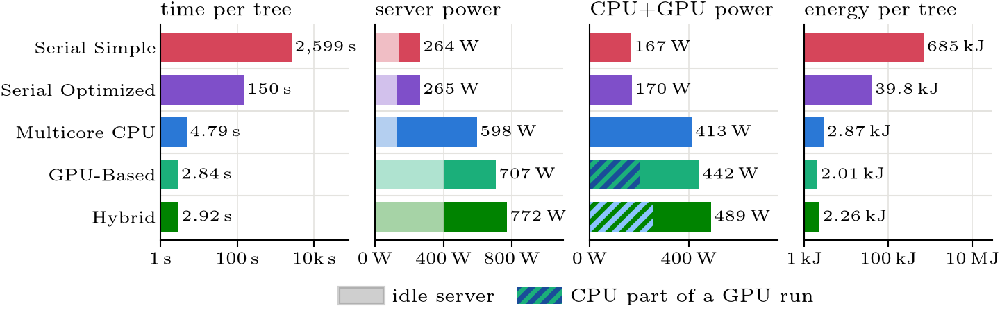
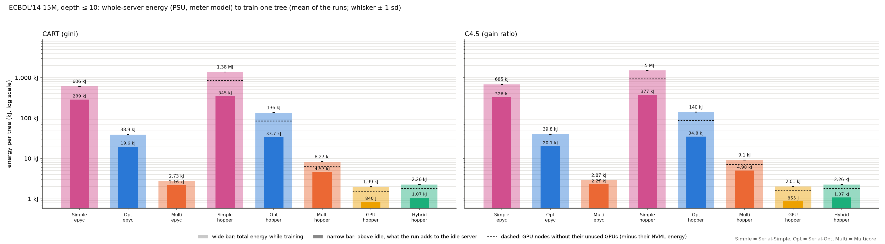
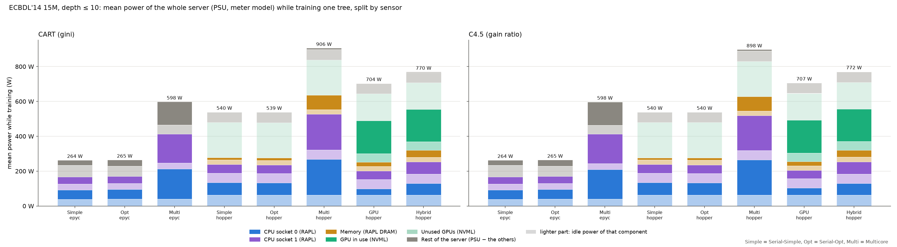
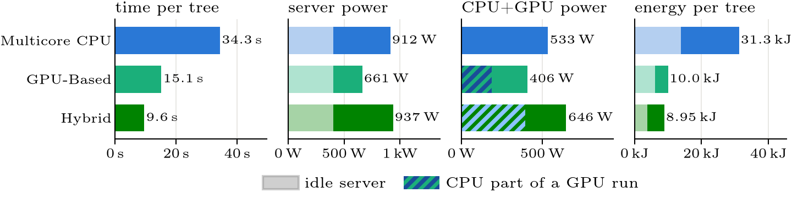
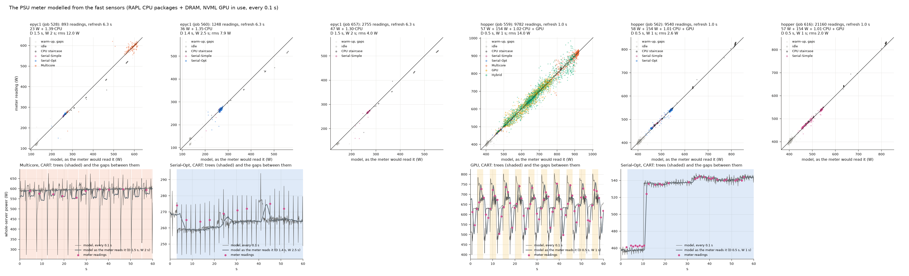

# Energy per tree: ./tree's backends on epyc1 and hopper

How much energy one tree costs on each of ./tree's backends, measured for the
whole server at the power supply (PSU). There are two measurements, with one
folder each. Both use the same method and code: 81bf6e6c, the final build of the
2026-11-19 time benchmark rerun (`~/dt-final`; GPU set-up timed).

| Measurement | Folder | What | Servers | Jobs |
|---|---|---|---|---|
| [ECBDL'14 15M, depth ≤ 10](#ecbdl14-15m-depth--10-all-five-backends) | [`ecbdl_15m-depth10/`](ecbdl_15m-depth10/summary.md) | all five backends, CART and C4.5 | epyc1, hopper | 528 + 560 + 657 (epyc1), 559 + 562 + 616 (hopper), 549 (warm-up check) |
| [MNIST8M, no depth limit](#mnist8m-no-depth-limit-where---hybrid-gains) | [`mnist8m-nodepth/`](mnist8m-nodepth/summary.md) | Multicore, GPU and Hybrid, CART and C4.5 | hopper | 561 |

**The paper's figures**, the same files as `paper/figs/` (drawn by
`paper/tools/charts.py energy energy_deep`, which writes both copies):

- Fig. `energy` (ECBDL'14 15M, C4.5):
  [paper-fig-energy-ecbdl_15m.pdf](paper-fig-energy-ecbdl_15m.pdf) (as in the paper),
  [.png](paper-fig-energy-ecbdl_15m.png) (shown below).
- Fig. `energy-deep` (MNIST8M without a depth limit):
  [paper-fig-energy-mnist8m.pdf](paper-fig-energy-mnist8m.pdf),
  [.png](paper-fig-energy-mnist8m.png).

**Two servers: epyc1 and hopper.** The power benchmark needs one CPU server
and one GPU server, and uses our best of each: epyc1 (2× EPYC 9255) and
hopper (H100 PCIe + 2× Xeon Gold 6444Y). Since 2026-11-19 it no longer runs
on ampere or dell ([why](#why-not-ampere-and-dell)). Their last results
(2026-11-16, jobs 170, 172, 173) are kept in
[ampere-dell-2026-11-16](ampere-dell-2026-11-16/BENCHMARK.md).

**Energy** is the whole server's, at the PSU, over the training windows only
(the CSV load, the gaps between trees and the evaluation are left out). It comes
from each node's meter, modelled from the fast sensors ([Method](#method)).
**Above idle** subtracts what the idle server would have used in the same time.

## ECBDL'14 15M, depth ≤ 10: all five backends

ECBDL'14 15M is the first 15M rows of ECBDL'14's train.csv, with 631 features.
The trees grow to depth ≤ 10 with no pruning, CART and C4.5.

**Jobs:**
- **hopper:** job 559 (2026-11-20 18:14–22:07, GPU and Hybrid with a 2 s warm-up).
- **epyc1:** job 528 (2026-11-20 11:03–13:29).
- **Top-ups:** each node got a second job with more Serial-Opt and Serial-Simple
  trees: 562 on hopper (2026-11-21 02:09–06:55, `hopper-2/`) and 560 on epyc1
  (2026-11-20 23:25 – 2026-11-21 03:02, `epyc1-2/`); and a third with 7 more
  Serial-Simple trees a case, to 10 like every other case: 616 on hopper
  (2026-11-21 15:54 – 2026-11-22 03:00, `hopper-3/`) and 657 on epyc1
  (2026-11-21 15:02 – 2026-11-22 01:10, `epyc1-3/`).
- **Warm-up check:** job 549 (hopper, 2026-11-20 15:08–15:41, warm-ups of 0,
  2, 5 and 15 s, 20 trees each; `check-hopper/`).

The first hopper job on this build (519, 15 s warm-up) and the 2026-11-16 check
(job 171) are in the git history. In the folder:
- every table, with more columns: [summary.md](ecbdl_15m-depth10/summary.md);
- every process: [runs.csv](ecbdl_15m-depth10/runs.csv);
- the meter models: [meter.csv](ecbdl_15m-depth10/meter.csv).

Energy per tree (± one standard deviation over the processes):

| Backend | Node | CART: t | E | above idle | C4.5: t | E | above idle |
|---|---|---|---|---|---|---|---|
| Serial-Simple | epyc1 | 2,298 s | 606 kJ ± 1.2% | 289 kJ | 2,599 s | 685 kJ ± 1.1% | 326 kJ |
| Serial-Simple | hopper | 2,550 s | 1.38 MJ ± 0.1% | 345 kJ | 2,785 s | 1.50 MJ ± 0.1% | 377 kJ |
| Serial-Opt | epyc1 | 147 s | 38.9 kJ ± 0.8% | 19.6 kJ | 150 s | 39.8 kJ ± 1.0% | 20.1 kJ |
| Serial-Opt | hopper | 251 s | 136 kJ ± 0.8% | 33.7 kJ | 259 s | 140 kJ ± 0.9% | 34.8 kJ |
| Multicore | epyc1 | 4.56 s | 2.73 kJ ± 0.3% | 2.16 kJ | 4.79 s | 2.87 kJ ± 0.6% | 2.27 kJ |
| Multicore | hopper | 9.13 s | 8.27 kJ ± 0.2% | 4.57 kJ | 10.1 s | 9.10 kJ ± 0.2% | 4.98 kJ |
| GPU | hopper (H100) | 2.82 s | **1.99 kJ** ± 1.4% | 840 J | 2.84 s | **2.01 kJ** ± 0.9% | 855 J |
| Hybrid | hopper (H100) | 2.94 s | 2.26 kJ ± 0.7% | 1.07 kJ | 2.92 s | 2.26 kJ ± 0.3% | 1.07 kJ |

Runs × trees:
- **Serial-Simple:** 10 × 1, each tree its own process, as in the time
  benchmark's 10 runs (until 2026-11-21: 3 × 1).
- **Serial-Opt:** 10 × 1, as in the time benchmark's 10 runs.
- **The others:** 3 processes of 13–44 trees (about 120 s of training each).

What it shows:

- **The H100 server uses the least energy per tree:** 1.99 and 2.01 kJ
  (GPU). That is 27% (CART) and 30% (C4.5) less than Multicore on epyc1 (2.73
  and 2.87 kJ). Above idle the gap is wider: 0.84–0.86 kJ against 2.16–2.27 kJ
  (2.6×).
- **Hybrid costs 12–14% more energy than GPU** and is 3–4% slower. Two causes:
  with the GPU set-up timed (since 81bf6e6c), its page-locked hand-off buffers
  cost about 0.1 s per tree; and its CPU threads work while the GPU does (CPU
  packages + DRAM 0.94 kJ against 0.71 kJ per tree).
- **Serial-Opt uses 10–17× less energy than Serial-Simple**, and Multicore
  another 14× less than Serial-Opt.
- **Idle power weighs on hopper's single-thread runs.** hopper idles at 404 W
  (four H100s, three of them unused by any run) and epyc1 at 119–137 W, so a
  Serial run costs 2.2–3.5× as much on hopper as on epyc1.
- **The top-up jobs agree with the first ones** on hopper within 0.8% (idle
  404–406 W; Serial-Simple's three jobs within 0.3%).
- **epyc1 idles higher in every later job:** its meter read 119 W in job
  528, 132 W in 560 and 137 W in 657 (the model's idle 124, 134 and 141 W),
  and each job had the node to itself (`--exclusive`).
  - Its one-thread trees used more energy at the same speed: Serial-Opt
    39.0–40.0 kJ in 560 against 38.5–39.3 kJ in 528; Serial-Simple
    610 / 689 kJ (CART / C4.5) in 657 against 587 / 666 kJ in 528 (+3.8%),
    and 6% less above idle.
  - The tables pool every job; the spread over the processes is then at
    most 1.2%. The cause is outside the runs (no root access to the BMC or
    fans); a one-thread tree's energy on epyc1 is therefore known to ±2%.
- **The warm-up is 2 s since job 559**, so GPU and Hybrid trees take as long
  as the time benchmark's single runs ([Time check](#time-check)).
  - With the 15 s warm-up of job 519 (same build) they were 11–12% faster
    (GPU 2.54 s, Hybrid 2.62 s) and used 6–7% less energy (GPU 1.88 kJ,
    Hybrid 2.12–2.14 kJ).
  - The CPU backends of the two hopper jobs agree within 1.4%.
- **Against the 2026-11-16 run (f53347a9, 15 s warm-up)**, epyc1 idled 19 W
  lower (119 against 138 W at the meter). So its Serial runs used 4–5% less
  energy at the same speed; its Multicore runs were within 3%.

More charts:
- per node, CPU, GPU and PSU energy and power side by side, CART above C4.5:
  [epyc1](ecbdl_15m-depth10/chart-cpu-gpu-epyc.png),
  [hopper](ecbdl_15m-depth10/chart-cpu-gpu-hopper.png);
- power over time of each case's first process:
  [chart-traces.png](ecbdl_15m-depth10/chart-traces.png);
- the meter against the model: [chart-meter.png](ecbdl_15m-depth10/chart-meter.png).

## MNIST8M, no depth limit: where `--hybrid` gains

At depth ≤ 10 (above) the hybrid hands almost nothing to the CPU and is as
fast as GPU only. On MNIST8M without a depth limit it is 1.5–1.6× faster
([hybrid-vs-gpu-only](../hybrid-vs-gpu-only/BENCHMARK.md)). The question is
whether that speed-up saves energy, given that the hybrid keeps every CPU core
busy next to the GPU.

MNIST8M has 8.1M rows × 784 features (25 GB as `.f32`). The trees have no depth
limit and no pruning, CART and C4.5.

**Where:** hopper only (ampere was reserved), the whole node
(`--exclusive`): Supermicro SYS-741GE-TNRT, 2× Xeon Gold 6444Y (32 cores),
4× H100 PCIe, 1 TB.

**Backends:**
- `--multicore` (`./tree_cpu`, all 32 CPUs);
- `--gpu` and `--hybrid` (GPU 2; NUMA node 1's CPUs first, 32 threads;
  `--handoff-rows 8192`, hopper's MNIST8M no-limit value in
  `bench/tools/handoff/handoff_rows.json`).

Every case grows the same tree: CART 301,939 nodes, depth 115; C4.5 218,325
nodes, depth 147.

**When:** job 561, 2026-11-20 23:25 – 2026-11-21 02:08, ./tree 81bf6e6c.
- It ran `power_bench.sh all` with `DATA=~/datasets/mnist8m/train.f32 SHM=1
  DEPTH=-1 HANDOFF=8192 IMPLS="parallel gpuonly cuda" ALGOS="cart c45"
  REPS=6`, plus a short warm-up check (`CHECK=1 CHECK_WARMUPS="0 2 15"
  CHECK_TREES=10`).
- Everything else is at the defaults: 120 s of training per process, a 2 s
  `--repeat-warmup` for the GPU backends, 300 s idle before and after, the 60 s
  calibration staircase, 20 s idle before each process.
- It replaces job 415 (2026-11-18, 15 s warm-up), whose GPU trees were 3–5%
  faster than in the time benchmark. Its energy per tree was within 1% of this
  job's; it is in the git history.

| Backend | CART: t | P | E | above idle | C4.5: t | P | E | above idle |
|---|---|---|---|---|---|---|---|---|
| Multicore | 28.5 s | 913 W | 26.0 kJ ± 0.4% | 14.5 kJ | 34.4 s | 910 W | 31.3 kJ ± 0.2% | 17.4 kJ |
| GPU | 12.1 s | 672 W | 8.15 kJ ± 0.5% | 3.26 kJ | 15.2 s | 659 W | 9.99 kJ ± 0.5% | 3.87 kJ |
| Hybrid | 7.82 s | 1,015 W | **7.93 kJ** ± 0.3% | 4.78 kJ | 9.52 s | 954 W | **9.08 kJ** ± 0.2% | 5.24 kJ |

Columns:
- **t:** time per tree.
- **P:** mean power of the whole server while training.
- **E:** energy per tree (± standard deviation over the six rounds).
- **Above idle:** E minus what the idle server (403 W) would have used in the
  same time.

More columns (peaks, the split into CPU sockets, memory, GPU, unused GPUs and
the rest, the model checks) are in [summary.md](mnist8m-nodepth/summary.md);
every process is in [runs.csv](mnist8m-nodepth/runs.csv).

- **Hybrid is the fastest and needs the least energy, by a little.** It is
  1.55× (CART) and 1.59× (C4.5) faster than GPU, but draws 1.51× and 1.45× the
  power (1,015 against 672 W). So a tree costs only 2.7% (CART) and 9.0% (C4.5)
  less energy (7.93 against 8.15 kJ, 9.08 against 9.99 kJ).
- **Where the power goes:**
  - GPU only keeps the CPUs at 182–187 W (the packages' idle is 114 W) and the
    H100 at 222–228 W.
  - The hybrid's 32 CPU threads grow the small subtrees, so the CPUs draw
    407–460 W, with the H100 at 252–254 W.
- **Above idle the hybrid costs more:** 4.78 against 3.26 kJ (CART, +47%) and
  5.24 against 3.87 kJ (C4.5, +35%). Its energy advantage comes only from
  keeping the 403 W idle server on for a shorter time.
- **Without the three unused H100s** (about 150 W), GPU only is ahead for
  CART (6.28 against 6.73 kJ, the hybrid +7%), and the two are even for C4.5
  (7.65 against 7.62 kJ).
- **Multicore needs 3.1–3.4× the energy of either GPU backend** (26.0 and
  31.3 kJ). It is 2.3× slower than GPU only, at a power (910 W) close to the
  hybrid's.

Choices for this run:

- **Six rounds**, round-robin over the six cases, each a process of 5–17
  trees (36–102 trees a case). Six rounds were enough: the energy per tree
  varies 0.2–0.6% between rounds (standard deviation over the mean).
- **A 2 s warm-up, as on ECBDL'14:** each GPU tree's child keeps its CPU
  threads busy for 2 s before its timer, as a single run's data load does.
  - **So the trees take as long as in the time benchmark**
    ([hybrid-vs-gpu-only](../hybrid-vs-gpu-only/BENCHMARK.md), hopper, the
    same `--handoff-rows`):
    - GPU: 12.1 and 15.2 s against 12.3 and 15.3 s (−1.3%, −1.1%);
    - Hybrid: 7.82 and 9.52 s against 8.04 and 9.58 s (−2.8%, −0.6%).
  - **The job's check** (CART, 10 trees each): GPU 12.3 s with no warm-up,
    11.9 s with 2 s, 11.8 s with 15 s; Hybrid 7.8 s at every warm-up.
  - **Hybrid CART stays 2–3% under the time benchmark at every warm-up**, so
    the warm-up is not the cause. It is within the 3% the time check allows
    ([summary.md](mnist8m-nodepth/summary.md#time-check)).
- **The data in /dev/shm** (`SHM=1`): ./tree drops its input from the page
  cache, so without it each of the 42 processes would have read 25 GB from NFS
  again. Loading is outside the windows either way; this keeps the job short
  and the NFS out of it.
- **Long trees, so the meter itself checks the model.** The trees take
  7.8–34 s, many meter refreshes each. The meter's own readings over the same
  windows give an energy within 1.2% of the model's for every case.

More charts: [chart-energy.png](mnist8m-nodepth/chart-energy.png),
[chart-power.png](mnist8m-nodepth/chart-power.png),
[chart-cpu-gpu-hopper.png](mnist8m-nodepth/chart-cpu-gpu-hopper.png),
[chart-traces.png](mnist8m-nodepth/chart-traces.png) (power over the first
process of each case), [chart-meter.png](mnist8m-nodepth/chart-meter.png) (the
meter against the model over the whole job).

## The meter model

| Node | meter refresh | readings | delay D, window W | model (W) | rms of a reading |
|---|---|---|---|---|---|
| epyc1 (job 528) | 6.3 s | 893 | 1.5 s, 2 s | 23 + 1.39·CPU | 12 W |
| epyc1 (job 560) | 6.3 s | 1,248 | 1.4 s, 2.5 s | 36 + 1.35·CPU | 8 W |
| epyc1 (job 657) | 6.3 s | 2,755 | 1.5 s, 2 s | 47 + 1.30·CPU | 4 W |
| hopper (job 559) | 1.0 s | 9,782 | 0.5 s, 1 s | 57 + 154 + 1.02·CPU + GPU | 14 W |
| hopper (job 562) | 1.0 s | 9,540 | 0.5 s, 1 s | 58 + 154 + 1.01·CPU + GPU | 3 W |
| hopper (job 616) | 1.0 s | 21,160 | 0.5 s, 1 s | 57 + 154 + 1.01·CPU + GPU | 2 W |
| hopper (job 561, MNIST8M) | 1.0 s | 8,863 | 0.5 s, 1 s | 56 + 154 + 1.02·CPU + GPU | 17 W |

Each job's processes are measured with that job's own model. The top-up jobs
run only one-thread trees besides the staircase, so their fits see a narrower
range of loads (epyc1's halves: 53 + 1.26·CPU and 10 + 1.50·CPU), but give
the same energy per tree within 0.3%.

The terms of the model:
- **CPU** = RAPL packages + DRAM (epyc1: packages only).
- **GPU** = the GPU the GPU backends use (NVML), counted as measured (× 1).
- **154 W = G_idle**, the mean NVML power of hopper's three unused GPUs over
  the job (measured, not fitted), so the constant (57 W) is the server
  without them.

Checks of the model:
- **Idle power:** the model's matches the meter's within 2 W on the ECBDL'14
  hopper jobs, 3.4 W on MNIST8M (403 against 400 W) and 5 W on epyc1 (124
  against 119 W).
- **Halves:** the model fitted on either half of a job gives the same energy
  per tree within 0.7% (Multicore on epyc1: 1.4%).
- **Model against the meter**
  ([ECBDL'14](ecbdl_15m-depth10/summary.md#psu-energy-the-model-against-the-meter),
  [MNIST8M](mnist8m-nodepth/summary.md#psu-energy-the-model-against-the-meter)):
  - On windows much longer than the meter's refresh (the Serial runs,
    Multicore on hopper, every MNIST8M case), the meter's own energy agrees
    with the model within 1.2% (the worst case: Hybrid on MNIST8M).
  - The readings inside the training windows have a mean residual within
    ±0.6% of the power on every hopper case, the 3 s H100 trees included.
  - On epyc1 the model is 0.3–0.5% low on the single-thread runs (mean
    residual inside +0.3–0.4% on Serial-Opt, +0.4–0.5% on Serial-Simple;
    −0.9% on Multicore). This is the bias the old busy term removed
    ([below](#the-simpler-model-2026-11-19)), within 2%.
- **Leaving a case out** moves its energy by ≤ 0.5%.
- **What the model replaces:** the meter's own reading of a short window. On
  the November 8 hopper job it was 3–5% low on the 3 s GPU trees.

## Time check

Each case's time per tree is checked against its time benchmark (single runs,
same build); `analyze.py` flags any gap above 3%.

- **ECBDL'14** ([../cluster-ecbdl](../cluster-ecbdl), 10 runs a case):
  - **epyc1: within 2.2%** on every backend (Multicore 4.56 s against 4.47 s).
  - **hopper's GPU and Hybrid: within 2%** (GPU 2.82 and 2.84 s against 2.81
    and 2.84 s; Hybrid 2.94 and 2.92 s against 2.94 and 2.98 s). The measured
    trees spin their CPU threads for 2 s before the timer, which leaves them as
    warm as a time benchmark run's input load does
    ([Warm-up check](#warm-up-check)).
  - **Multicore on hopper** (not in the time benchmark) varied 0.3% between
    processes; its first tree of each process was about 2% slower than the
    rest.
- **MNIST8M** ([hybrid-vs-gpu-only](../hybrid-vs-gpu-only/BENCHMARK.md),
  hopper): within 1.3% for GPU, 2.8% (CART) and 0.6% (C4.5) for Hybrid (see
  above).

## Warm-up check

GPU and Hybrid trees need their CPU threads busy before the timer starts
(`--repeat-warmup`). Without it their CPU clocks are low (hopper schedutil)
and the trees set up slower.

Mean time of trees 3 onwards of one process per warm-up, CART, ECBDL'14 15M
(job 549: 20 trees each; job 171: 10; every tree in
[warmup.csv](ecbdl_15m-depth10/warmup.csv) and
[summary.md](ecbdl_15m-depth10/summary.md#warm-up-check)):

| Job | warm-up | GPU | Hybrid | time benchmark (GPU / Hybrid) |
|---|---|---|---|---|
| 549 (2026-11-20, 81bf6e6c) | 0 s | 2.87 s | 3.02 s | 2.81 / 2.94 s |
| 549 | **2 s** | 2.82 s | 2.93 s | |
| 549 | 5 s | 2.54 s | 2.64 s | |
| 549 | 15 s | 2.57 s | 2.65 s | |
| 171 (2026-11-16, f53347a9) | 0 s | 2.77 s | 2.81 s | 2.47 / 2.42 s |
| 171 | 2 s | 2.70 s | 2.57 s | |
| 171 | 5 s | 2.48 s | 2.45 s | |
| 171 | 15 s | 2.46 s | 2.47 s | |

The measured runs use 2 s (bold). On the final build that is the warm-up
whose trees take as long as the time benchmark's (+0.4% GPU, −0.4% Hybrid);
with none they are 2–3% slower, and from 5 s on 9–10% faster. (On f53347a9,
with the GPU set-up untimed, the time benchmark had matched 15 s.) The
MNIST8M job's own check (0, 2 and 15 s) is in
[its summary.md](mnist8m-nodepth/summary.md#warm-up-check).

## Notes

- Hybrid on ECBDL'14 uses the default `--handoff-rows` of the final build
  (max(512, min(10 × features, 2^depth, 16384)) = 1024 at depth 10), like the
  time benchmark.
- Serial-Simple: ten processes per case (38–47 min each); Serial-Opt: ten
  (2.5–4.4 min).
- epyc1 has no DRAM sensor (AMD): its memory is in "rest of the server".
  hopper's three unused H100s (~51 W each, 154 W together: G_idle in the
  model) are their own component, "unused GPUs", not part of the rest.

## Why not ampere and dell

Until 2026-11-16 the benchmark also ran on ampere (A100 80 GB + 2× EPYC 7402)
and dell4 (2× Xeon Gold 6542Y). Both were dropped on 2026-11-19:

- **ampere's meter is too slow to keep.** Its PSU meter is the BMC over IPMI
  DCMI (`/run/power/psu_W`), which gives one point reading (a ~2.5 s average)
  only every ~59 s.
  - The model still worked (rms 23 W, leave-one-case-out ≤ 1.1%), but only
    with special handling: 240 s processes, 240 s staircase steps and 600 s
    idle periods (16 h jobs).
  - It also needed a separate "slow meter" path in `analyze.py`: readings
    spread over the refreshes, a 70 s delay grid, and the meter check from
    5–9 point readings per case.
  - We did not want that in the paper, and the code is gone.
- **One CPU server and one GPU server are enough.** The comparison the paper
  needs is the best CPU server against the best GPU server: epyc1 and hopper
  (the H100).
  - On 2026-11-16 (f53347a9), dell4 and the A100 were the slower of each kind
    and added no conclusion: dell4's Multicore took 7.18 kJ against epyc1's
    2.70 kJ, and the A100's GPU 2.94 kJ against the H100's 1.81 kJ.
  - dell1, where dell's Multicore time benchmark ran, is retired.

Their last results are in [ampere-dell-2026-11-16](ampere-dell-2026-11-16/BENCHMARK.md).

## Method

### The problem: the whole-server meters are slow

The number that compares a CPU server with a GPU server is the energy of the
whole server, measured at the power supply (PSU). Each node has such a
meter, but neither is fast enough for a tree that takes 2.4 s (H100)
or 4.5 s (Multicore on epyc1):

| Node | PSU meter | refresh | what a reading is |
|---|---|---|---|
| hopper | ACPI power meter (Intel Node Manager) | 1 s | an average over ~1.25 s |
| epyc1 | ACPI power meter (iDRAC) | 4–10 s (median 6.3 s) | an average over ~2.5 s |

(The averaging windows are fitted, see below.) The fast sensors, RAPL
(CPU packages and, on hopper, DRAM) and NVML (each GPU's energy
counter), cover only parts of the server. They miss the fans, disks, network,
board, the other GPUs and the PSU's own losses (on hopper about 30% of the
energy of a GPU tree).

### The solution: model the meter from the fast sensors

`pwrlog.py` reads every sensor every 0.1 s for the whole job. For each job,
`analyze.py` then fits the meter itself:

    reading(t) = mean over [t − D − W, t − D] of  a + G_idle + b·CPU + GPU

The terms:
- **CPU** = RAPL packages + DRAM (W).
- **GPU** = the NVML power of the GPU in use (W, as measured).
- **G_idle** = the mean NVML power of the node's other GPUs over the whole job
  (hopper's three idle H100s, ~154 W; none on epyc1). It is measured, not
  fitted, so a is the server without them.
- **D** is the meter's delay and **W** its averaging window.

How it is fitted:
- a and b come from least squares over **every reading of the job**: idle, a
  staircase of CPU load, every run, the gaps.
- D and W come from a grid search (D from 0 to 12 s in 0.1 s steps; W from 0.1
  to 10 s).

The PSU energy of a tree is then the integral of a + G_idle + b·CPU + GPU over
its training window, at 0.1 s resolution, whatever the meter's refresh. Why
this form, and the other models tried: [The simpler model](#the-simpler-model-2026-11-19).

The energy is split into components: "unused GPUs" is the NVML energy of the
node's other GPUs (all four for a CPU backend); "rest of the server" is PSU −
CPU packages − DRAM − every GPU.

The model is needed even on epyc1: its meter (~6 s) is slower than its
Multicore trees (~4.5 s), and the meter's own readings over short windows
include the gaps between trees (earlier meter-only runs were 3–5% low on short
GPU trees).

**Without the unused GPUs.** hopper holds four GPUs; a backend uses one (CPU
backends none), and the other cards idle at ~50 W each. So ~150 W of every GPU
tree's power (~20% of its energy) and ~200 W of a CPU backend's are cards it
does not use.
- `summary.md` and `chart-energy.png` (dashed) also give the energy minus the
  unused GPUs' NVML energy: the same server with only the GPU in use.
- This is a counterfactual (a smaller server has other fans and PSUs), for
  comparing a GPU server with a CPU server. The whole-server number stays the
  measured one.

The job gives the fit the range of loads it needs:
- idle;
- a staircase of 1, 2, 4, …, all CPUs busy (60 s per step);
- every backend it runs (all five on hopper for ECBDL'14, three on epyc1);
- on hopper, GPU and Hybrid runs with their CPU warm-ups.

**Checks** (`summary.md`, `chart-meter.png`):

1. The coefficients fitted on the first and on the second half of the job
   alone, and the energy each half's model gives.
2. The mean residual (reading − model) of the readings whose averaging
   window lies inside a case's training windows: a bias of the model during
   that backend's trees would show here.
3. The meter's own energy over the same windows (readings held, shifted back
   by D + W/2).
   - It needs windows much longer than the meter's refresh: it agrees with
     the model within ~1.5% on every long window.
   - On 2–3 s GPU trees it is 3–5% low (re-analysis of the 2026-11-08 hopper
     job), which is the error the model removes.
4. **Leave the case out:** the model fitted without any reading of the case's
   own processes (its warm-ups and checks too), so it predicts a load it has
   never seen; and the held-out readings' mean residual. On the 2026-11-16
   jobs the energy per tree moved by ≤ 0.5%, so no case's number depends on
   its own readings.

### The simpler model (2026-11-19)

Until 2026-11-19 the model was a + b·CPU + c·GPU + d·busy (busy = the number
of busy CPUs, `/proc/stat`), with hopper's three unused GPUs inside a:
- epyc1: 39 + 1.36·CPU − 0.10·busy;
- hopper: 209 + 1.03·CPU + 0.99·GPU − 0.12·busy.

The busy term had been added for the 2026-11-07 epyc job, where the model
without it was 1.5–2.3% low on single-thread runs; on the 2026-11-16 jobs it
no longer mattered. Each candidate was fitted (with its own D and W) on the
three jobs (epyc1 169, hopper 174, MNIST8M hopper 415); the ranges are over
all 22 cases:

| model | rms epyc1 / hopper / MNIST8M | E vs the old model | meter vs model | mean residual inside | leave the case out |
|---|---|---|---|---|---|
| old: a + b·CPU + c·GPU + d·busy | 13.2 / 12.3 / 18.7 W | – | ≤ 1.6% | ≤ 0.9% | ≤ 0.7% |
| no busy: a + b·CPU + c·GPU | 13.2 / 12.3 / 18.9 W | −0.35 … +0.09% | ≤ 1.4% | ≤ 1.0% | ≤ 0.5% |
| **no busy, c = 1: a + G_idle + b·CPU + GPU** | 13.2 / 12.3 / 18.9 W | −0.32 … +0.18% | ≤ 1.3% | ≤ 0.9% | ≤ 0.5% |
| no busy, c = 1, every GPU's NVML power as measured | 13.2 / 12.3 / 18.8 W | −0.36 … +0.26% | ≤ 1.3% | ≤ 0.9% | ≤ 0.5% |
| no busy, one c for all four GPUs | 13.2 / 12.3 / 18.8 W | −0.35 … +0.09% | ≤ 1.4% | ≤ 1.0% | ≤ 0.5% |
| b = c = 1: a + CPU + every GPU | 36.0 / 12.4 / 19.5 W | −13.4 … +1.3% | ≤ 14% | ≤ 13% | ≤ 1.2% |

The chosen model (bold):
- **It drops the busy term.**
- **It counts the GPU in use at its NVML power.** When fitted, c was 0.99 on
  both hopper jobs.
- **It makes the unused GPUs an explicit measured constant**, G_idle: their
  mean NVML power over the job (154.3 W in job 174, 154.7 W in job 415; 154.1 W
  in the idle windows alone, so nearly constant). As a constant it only splits
  a, so its fit is the same as a + b·CPU + GPU.

How it compares with the old model:
- its rms is within 0.2 W of the old model's;
- every other check is as good or better;
- no energy per tree moved by more than 0.32%.

b cannot be fixed to 1:
- epyc1 has no DRAM sensor, so b (1.34) carries its memory and more; without it
  the model is 13% off;
- on hopper alone b = 1 fits (rms 12.4 W) but moves the MNIST8M energies by up
  to 1.1%.

(The comparison was a one-off script, not kept.)

### The runs

Each measured process is `./tree --repeat K`.
- It loads the CSV once, then trains K trees, each in its own forked child, so
  every tree is a fresh process's only tree. It prints each tree's training
  window as Unix times.
- K = ceil(TARGET / t) + 1, with t from a warm-up run: about 120 s of training
  per process.
- There are 3 processes per case, round-robin, with 20 s of idle before each
  (MNIST8M: 6). The exceptions (`REPS_BY`): Serial-Opt runs 10 processes of
  one tree (2.5–4.4 min); Serial-Simple runs 10 (38–47 min).
- The mean energy per tree is reported.

**Warm-up of the GPU backends.** A GPU or Hybrid tree whose CPU threads were
idle before it sets up slower (the CPU clocks are low: hopper schedutil):
trees 3–12 of a process took 2.8 s instead of 2.5 s.
- A single run's tree follows the data load (every thread reads its part of
  the .f32 file). So with `--repeat-warmup S`, each child spins its threads for
  S s before its timer.
- The measured runs use 2 s, the warm-up that reproduces the time benchmark's
  single runs ([Warm-up check](#warm-up-check)). 5 s or more makes the trees
  ~10% faster than a single run.
- The warm-up is outside the training window, so it is never counted. It does
  not inflate the window either: in the warm-up checks (2026-11-16) the CPU
  packages + GPU used 1–4% *less* energy per tree after 15 s of warm-up than
  after none (hopper GPU: 1,165 against 1,217 J), because the tree is faster.
- What it must match is the time benchmark's single runs (the time check).

**Placement**, as in the time benchmark (`bench/tools/cluster/job.sh`,
`bench/tools/run.py`):
- Serial-Simple and Serial-Opt on CPU 0;
- Multicore on every CPU;
- GPU and Hybrid on hopper's GPU 2 (NUMA node 1), with every CPU of that node
  first and first-touch memory.

**Time check:** every case's time per tree against the time benchmark of the
same case (`bench/cluster-ecbdl` for ECBDL'14 15M, `bench/hybrid-vs-gpu-only`
for MNIST8M without a depth limit; `analyze.py` picks it from the jobs'
dataset and depth).

### Run it

Run from the repository root, on the login node, with ./tree and ./tree_cpu
built by `bench/tools/cluster/build.sh`. One folder per measurement
(`submit.sh -o`, default `bench/cluster-power/ecbdl_15m-depth10`); `analyze.py`
reads one folder.

**ECBDL'14 15M**, about 15 h on epyc1 and 18 h on hopper with 10 Serial-Opt
and 10 Serial-Simple trees a case (`submit.sh -t` for a longer time limit), plus
35 min for the check:

    bench/tools/power/submit.sh -c hopper           # the warm-up check (0, 2, 5, 15 s)
    bench/tools/power/submit.sh epyc1 hopper        # one job per node
    bench/tools/.venv/bin/python bench/tools/power/analyze.py bench/cluster-power/ecbdl_15m-depth10

More runs of some cases go into a node's next job folder, which `analyze.py`
pools (each job with its own meter model). This run's top-ups:

    bench/tools/power/submit.sh -s 2 epyc1 hopper "IMPLS=serial simple" REPS=7 REPS_BY=simple=2
    bench/tools/power/submit.sh -s 3 -t 13:00:00 epyc1 IMPLS=simple REPS=7 REPS_BY=simple=7
    bench/tools/power/submit.sh -s 3 -t 14:00:00 hopper IMPLS=simple REPS=7 REPS_BY=simple=7

**MNIST8M**, about 2.7 h on hopper:

    TREE_GIT_DESCRIBE=81bf6e6c8979 bench/tools/power/submit.sh \
      -o bench/cluster-power/mnist8m-nodepth hopper DATA=$HOME/datasets/mnist8m/train.f32 \
      SHM=1 DEPTH=-1 HANDOFF=8192 "IMPLS=parallel gpuonly cuda" "ALGOS=cart c45" \
      CHECK=1 "CHECK_WARMUPS=0 2 15" CHECK_TREES=10 REPS=6
    bench/tools/.venv/bin/python bench/tools/power/analyze.py bench/cluster-power/mnist8m-nodepth

`bench/tools/cluster/charts.sh` redraws both folders' charts and the paper's
figures (with their copies here).

## Files

- `ecbdl_15m-depth10/`, `mnist8m-nodepth/`: one measurement each.
  - **The jobs:** `epyc1/`, `epyc1-2/`, `epyc1-3/`, `hopper/`, `hopper-2/`, `hopper-3/`, `check-hopper/`,
    each with machine.txt, markers.txt, samples.csv.gz and out/ (./tree's
    output of every process).
  - **analyze.py's output:** `summary.md`, `summary.csv`, `runs.csv`,
    `meter.csv`, `warmup.csv` and the charts:
    - `chart-energy.png`, `chart-power.png`;
    - `chart-cpu-gpu-<node>.png`;
    - `chart-traces.png`;
    - `chart-meter.png`.
- `paper-fig-energy-ecbdl_15m.{pdf,png}`, `paper-fig-energy-mnist8m.{pdf,png}`:
  the paper's two energy figures.
- `ampere-dell-2026-11-16/`: the last run on four servers (history).
- `probe-2026-11-04/`: the first probes of each node's power sensors (history).

### Earlier runs

- Jobs 84–86 (2026-11-05) and 217, 218, 223, 300 (2026-11-07/08) measured the
  code of that week with the meters' own readings over the tree windows (long
  windows of many trees, readings shifted by a step-measured delay). They are
  in the git history.
- Also in the git history:
  - the 2026-11-16 run of this benchmark on f53347a9 (jobs 169 epyc1, 174
    hopper);
  - job 519 (hopper, the final build with a 15 s warm-up);
  - MNIST8M job 415 (15 s warm-up).
- The 2026-11-16 run on four servers (with ampere and dell4) is in
  [ampere-dell-2026-11-16](ampere-dell-2026-11-16/BENCHMARK.md).
