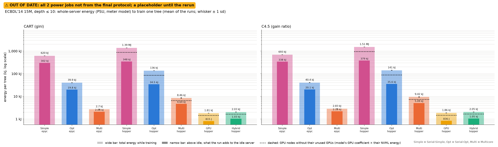
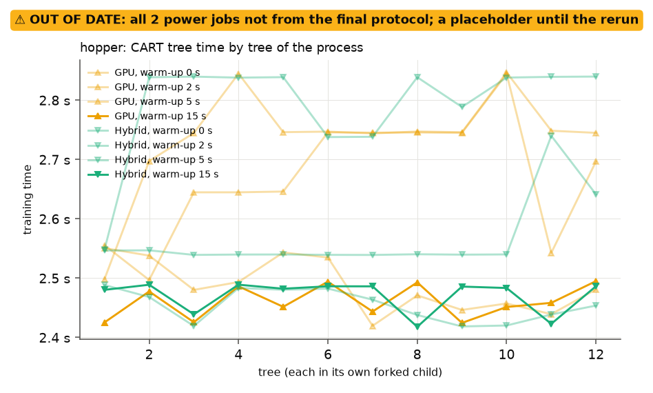

# Energy per tree: ./tree's five backends on epyc1 and hopper

ECBDL'14 15M (the first 15M rows of ECBDL'14's train.csv, 631 features),
depth ≤ 10, no pruning, CART and C4.5. Code f53347a9 (the build of the 2026-11-15
time benchmark rerun, `~/dt-final`). Jobs 169 (epyc1) and 174 (hopper),
2026-11-15/16; the warm-up check 171 (hopper).
Method: [Method](#method). Every table, with more columns:
[summary.md](summary.md); every process: [runs.csv](runs.csv); the meter
models: [meter.csv](meter.csv).
The same measurement without a depth limit, where `--hybrid` gains (MNIST8M,
Multicore, GPU and Hybrid on hopper): [cluster-power-mnist8m](../cluster-power-mnist8m/BENCHMARK.md).

**Two servers: epyc1 and hopper.** The power benchmark needs one CPU server
and one GPU server, and uses our best of each: epyc1 (2× EPYC 9255) and
hopper (H100 PCIe + 2× Xeon Gold 6444Y). Since 2026-11-19 it no longer runs
on ampere or dell ([why](#why-not-ampere-and-dell)); their last results
(2026-11-16, jobs 170, 172, 173) are kept in
[ampere-dell-2026-11-16](ampere-dell-2026-11-16/BENCHMARK.md).

**Energy** is the whole server's, at the PSU, over the training windows only
(the CSV load, the gaps between trees and the evaluation are left out), from
each node's meter modelled from the fast sensors. **Above idle** subtracts
what the idle server would have used in the same time.

## Results

Energy per tree (± one standard deviation over the processes):

| Backend | Node | CART: t | E | above idle | C4.5: t | E | above idle |
|---|---|---|---|---|---|---|---|
| Serial-Simple | epyc1 | 2,328 s | 620 kJ | 302 kJ | 2,603 s | 693 kJ | 338 kJ |
| Serial-Simple | hopper | 2,560 s | 1.39 MJ | 348 kJ | 2,792 s | 1.51 MJ | 379 kJ |
| Serial-Opt | epyc1 | 147 s | 39.9 kJ ± 0.4% | 19.8 kJ | 149 s | 40.4 kJ ± 0.5% | 20.1 kJ |
| Serial-Opt | hopper | 251 s | 136 kJ ± 0.3% | 34.5 kJ | 260 s | 141 kJ ± 0.9% | 35.6 kJ |
| Multicore | epyc1 | 4.54 s | 2.70 kJ ± 0.3% | 2.08 kJ | 4.77 s | 2.83 kJ ± 0.4% | 2.18 kJ |
| Multicore | hopper | 9.40 s | 8.46 kJ ± 2.6% | 4.64 kJ | 10.7 s | 9.42 kJ ± 2.7% | 5.09 kJ |
| GPU | hopper (H100) | 2.46 s | **1.81 kJ** ± 0.3% | 815 J | 2.51 s | **1.86 kJ** ± 0.8% | 836 J |
| Hybrid | hopper (H100) | 2.46 s | 2.03 kJ ± 0.6% | 1.03 kJ | 2.47 s | 2.05 kJ ± 0.9% | 1.05 kJ |

Runs × trees: Serial-Simple 1 × 1, Serial-Opt 3 × 1, the others 3 processes of
12–51 trees (about 120 s of training each).

What it shows:

- **The H100 server uses the least energy per tree**: 1.81 kJ (GPU), 33%
  less than Multicore on epyc1 (2.70 kJ). Above idle the gap is wider:
  0.82 kJ against 2.08 kJ (2.6×).
- **Hybrid costs 10–12% more energy than GPU** for the same time: its CPU
  threads work while the GPU does (CPU packages + DRAM 0.88 kJ against
  0.66 kJ per tree).
- **Serial-Opt uses 10–17× less energy than Serial-Simple**, and Multicore
  another 14–16× less than Serial-Opt.
- **Idle power weighs on hopper's single-thread runs**: hopper idles at
  406 W (four H100s, three of them unused by any run), epyc1 at 137 W, so a
  Serial run costs 2.2–3.5× as much on hopper as on epyc1.

Per node, CPU, GPU and PSU energy and power side by side:
[epyc1](chart-cpu-gpu-epyc.png), [hopper](chart-cpu-gpu-hopper.png)
(CART above C4.5); time against energy: [chart-time-energy.png](chart-time-energy.png); power
over time of each case's first process: [chart-traces.png](chart-traces.png).

## The meter model

| Node | meter refresh | readings | delay D, window W | model (W) | rms of a reading |
|---|---|---|---|---|---|
| epyc1 | 6.3 s | 960 | 1.3 s, 2.5 s | 39 + 1.36·CPU − 0.10·busy | 13 W |
| hopper | 1.0 s | 15,780 | 0.5 s, 1 s | 57 + 1.03·CPU + 0.99·GPUs − 0.14·busy | 12 W |

CPU = RAPL packages + DRAM, GPUs = all of the node's GPUs (NVML), busy = busy
CPUs. The model's idle power matches the meter's within about 1 W.
The model fitted on either half of a job gives the same energy per tree
within 0.2% (Multicore on epyc1: 1.6%).

**Model against the meter** ([chart-methods.png](chart-methods.png)): on
windows much longer than the meter's refresh (the Serial runs, Multicore on
hopper) the meter's own energy agrees with the model within 1.5%,
and the readings inside the training windows have a mean residual within
±0.9% of the power on every case, the 2.5 s H100 trees included. The meter's
own reading of a short window is what the model replaces: on the November 8
hopper job it was 3–5% low on the 3 s GPU trees.

## Time check

The time per tree against the time benchmark
([../cluster-ecbdl](../cluster-ecbdl), single
runs, 5 a case, same code): within 3% except

- **Multicore on epyc1, CART: +3.1%** (4.54 s against 4.41 s; C4.5 +2.6%).
- **GPU on hopper, C4.5: −3.1%** (2.51 s against 2.59 s).

Multicore on hopper (not in the time benchmark) varied 4% between processes
(9.1 s to 9.9 s per tree, the energy with it); its first tree of each process
was 4–5% slower than the rest.

## Warm-up check

GPU and Hybrid trees need their CPU threads busy before the timer starts
(`--repeat-warmup`), as a single run's CSV load keeps them: without it,
trees 3–12 of a process are 13–14% slower on the H100.

| Node | warm-up | GPU trees 3–12 | Hybrid trees 3–12 | time benchmark (GPU / Hybrid) |
|---|---|---|---|---|
| hopper | 0 s | 2.77 s | 2.81 s | 2.47 / 2.42 s |
| hopper | 2 s | 2.70 s | 2.57 s | |
| hopper | 5 s | 2.48 s | 2.45 s | |
| hopper | **15 s** | 2.46 s | 2.47 s | |

The measured runs used 15 s (bold).

## Notes

- **Hybrid's default `--handoff-rows` changed after this build** (2c688938:
  10 × features, 6310 rows for ECBDL'14; f53347a9 used the rows-based rule).
  The Hybrid rows here, like the time benchmark's, are f53347a9's.
- Serial-Simple: one process per case (39–47 min each).
- epyc1 has no DRAM sensor (AMD): its memory is in "rest of the server".
  hopper's three unused H100s (~51 W each) are their own component,
  "unused GPUs", not part of the rest.

## Why not ampere and dell

Until 2026-11-16 the benchmark also ran on ampere (A100 80 GB + 2× EPYC 7402)
and dell4 (2× Xeon Gold 6542Y). Both were dropped on 2026-11-19:

- **ampere's meter is too slow to keep.** Its PSU meter is the BMC over IPMI
  DCMI (`/run/power/psu_W`), which gives one point reading (a ~2.5 s
  average) only every ~59 s. The model still worked (rms 23 W, leave-one-case-out
  ≤ 1.1%), but only with special handling: 240 s processes, 240 s staircase
  steps and 600 s idle periods (16 h jobs), a separate "slow meter" path in
  `analyze.py` (readings spread over the refreshes, a 70 s delay grid, the
  meter check from 5–9 point readings per case). We did not want that in the
  paper, and the code is gone.
- **One CPU server and one GPU server are enough.** The comparison the paper
  needs is the best CPU server against the best GPU server: epyc1 and hopper
  (the H100). dell4 (Multicore 7.18 kJ against epyc1's 2.70 kJ) and the
  A100 (GPU 2.94 kJ against the H100's 1.81 kJ) were the slower of each kind
  and added no conclusion; dell1, where dell's Multicore time benchmark ran,
  is retired.

Their last results are in [ampere-dell-2026-11-16](ampere-dell-2026-11-16/BENCHMARK.md).

## Method

### The problem: the whole-server meters are slow

The number that compares a CPU server with a GPU server is the energy of the
whole server, measured at the power supply (PSU). Each node has such a
meter, but neither is fast enough for a tree that takes 2.4 s (H100)
or 4.5 s (Multicore on epyc1):

| Node | PSU meter | refresh | what a reading is |
|---|---|---|---|
| hopper | ACPI power meter (Intel Node Manager) | 1 s | an average over ~1.25 s |
| epyc1 | ACPI power meter (iDRAC) | 4–10 s (median 6.3 s) | an average over ~2.5 s |

(The averaging windows are fitted, see below.) The fast sensors, RAPL
(CPU packages and, on hopper, DRAM) and NVML (each GPU's energy
counter), cover only parts of the server: not the fans, disks, network,
board, the other GPUs or the PSU's own losses (on hopper about 30% of the
energy of a GPU tree).

### The solution: model the meter from the fast sensors

`pwrlog.py` reads every sensor every 0.1 s for the whole job. For each node,
`analyze.py` then fits the meter itself:

    reading(t) = mean over [t − D − W, t − D] of  a + b·CPU + c·GPUs + d·busy

where CPU = RAPL packages + DRAM (W), GPUs = the NVML power of every GPU
(W), busy = the number of busy CPUs (`/proc/stat`), D is the meter's delay
and W its averaging window. a, b, c, d come from least squares over **every
reading of the job** (idle, a staircase of CPU load, every run, the gaps); D
and W from a grid search (D from 0 to 12 s in 0.1 s steps; W from 0.1 to
10 s). The PSU energy of a tree is then the integral of
a + b·CPU + c·GPUs + d·busy over its training window, at 0.1 s resolution,
whatever the meter's refresh.
"Unused GPUs" = the NVML energy of the node's other GPUs (all four for a
CPU backend); "rest of the server" = PSU − CPU packages − DRAM − every GPU.

Why the model is needed even on epyc1: its meter (~6 s) is slower than its
Multicore trees (~4.5 s), and the meter's own readings over short windows
include the gaps between trees (earlier meter-only runs were 3–5% low on
short GPU trees).

**Without the unused GPUs.** hopper holds four GPUs; a backend uses one
(CPU backends none), and the other cards idle at ~50 W each, so ~150 W of
every GPU tree's power (~20% of its energy) and ~200 W of a CPU backend's
are cards it does not use. `summary.md` and `chart-energy.png` (dashed)
also give the energy minus c × the unused GPUs' NVML energy (c: the
model's GPU coefficient): the same server with only the GPU in use. It is
a counterfactual (a smaller server has other fans and PSUs), for comparing
a GPU server with a CPU server; the whole-server number stays the measured
one.

The job gives the fit the range of loads it needs: idle; a staircase of
1, 2, 4, …, all CPUs busy (60 s per step); all five backends (three on
epyc1); and, on hopper, GPU and Hybrid runs with their CPU warm-ups.

**Checks** (`summary.md`, `chart-meter.png`, `chart-methods.png`):

1. The coefficients fitted on the first and on the second half of the job
   alone, and the energy each half's model gives.
2. The mean residual (reading − model) of the readings whose averaging
   window lies inside a case's training windows: a bias of the model during
   that backend's trees would show here.
3. The meter's own energy over the same windows (readings held, shifted back
   by D + W/2). It needs windows much longer than the meter's refresh: it
   agrees with the model within ~1.5% on every long window, and on 2–3 s
   GPU trees it is 3–5% low (re-analysis of the 2026-11-08 hopper job), which
   is the error the model removes.
4. **Leave the case out**: the model fitted without any reading of the
   case's own processes (its warm-ups and checks too), so it predicts a
   load it has never seen; and the held-out readings' mean residual. On the
   2026-11-16 jobs the energy per tree moved by ≤ 0.7%, so no case's number
   depends on its own readings.
5. **No busy term**: the same fit without the busy-CPUs term: ≤ 0.3%.

Why busy CPUs: on epyc1 (AMD) the PSU rises more with one busy core than
RAPL accounts for. Without the term the model was 1.5–2.3% low on the
single-thread runs (re-analysis of the 2026-11-07 epyc job); with it, ≤ 0.8%.

### The runs

Each measured process is `./tree --repeat K`: it loads the CSV once, then
trains K trees, each in its own forked child, so that every tree is a fresh
process's only tree, and prints each tree's training window as Unix times.
K = ceil(TARGET / t) + 1 (t from a warm-up run): about 120 s of training per
process; 3 processes per case, round-robin, 20 s of idle before each
(Serial-Simple: one process of one tree, 39–47 min). The mean energy per
tree is reported.

**Warm-up of the GPU backends.** A GPU or Hybrid tree whose CPU threads were
idle before it sets up slower (the CPU clocks are low: hopper schedutil):
trees 3–12 of a process took 2.8 s instead of 2.5 s. A single run's tree
follows the data load (every thread reads its part of the .f32 file), so
with `--repeat-warmup S` each child spins its threads for S s before its
timer: hopper needs 5 s (with 2 s its trees were 3–10% slower) and the
measured runs used 15 s.
The warm-up is outside the training window, so it is never counted, and it
does not inflate the window: in the warm-up checks (2026-11-16) the CPU
packages + GPU used 1–4% *less* energy per tree after 15 s of warm-up than
after none (hopper GPU: 1,165 against 1,217 J), because the tree is faster.
What it must match is the time benchmark's single runs (the time check):
with no warm-up, hopper's GPU trees took 13% longer and cost ~8% more.

**Placement**, as in the time benchmark (`bench/tools/cluster/job.sh`,
`bench/tools/run.py`): Serial-Simple and Serial-Opt on CPU 0; Multicore on every
CPU; GPU and Hybrid on hopper's GPU 2 (NUMA node 1), with every CPU of that
node first and first-touch memory.

**Time check**: every case's time per tree against the time benchmark
(`bench/cluster-ecbdl`, single runs).

Run it (from the repository root, on the login node, with ./tree and
./tree_cpu built by `bench/tools/cluster/build.sh`; about 8 h on epyc1 and
12 h on hopper):

    bench/tools/power/submit.sh -c hopper           # the warm-up check (optional)
    bench/tools/power/submit.sh epyc1 hopper        # one job per node
    bench/tools/.venv/bin/python bench/tools/power/analyze.py bench/cluster-power

### Earlier runs

Jobs 84–86 (2026-11-05) and 217, 218, 223, 300 (2026-11-07/08) measured the
code of that week with the meters' own readings over the tree windows (long
windows of many trees, readings shifted by a step-measured delay). They are in
the git history. The 2026-11-16 run on four servers (with ampere and dell4):
[ampere-dell-2026-11-16](ampere-dell-2026-11-16/BENCHMARK.md).
