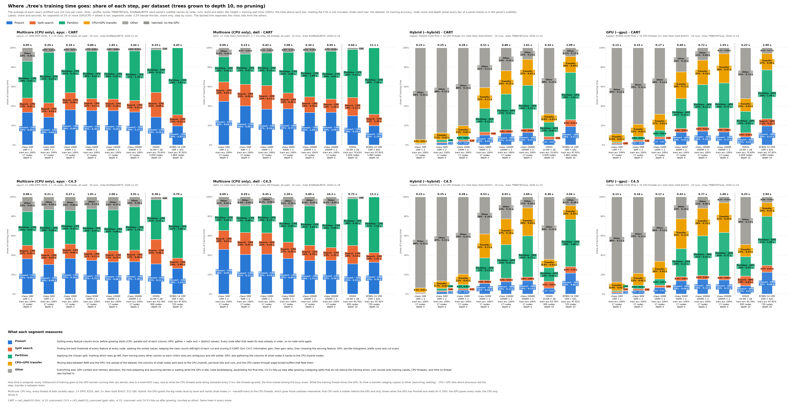

# Profiling: where CART and C4.5 spend their growing time

**Status:** the CPU runs on 2026-11-19/20 at 81bf6e6c (the same tree code as the final runs of 2026-11-17), the CUDA runs again on 2026-11-23 at 7f98876f (less RAM for `--hybrid` and less VRAM for `--gpu`, the same trees; hopper job 791); the hash is in `machine.json` and on the chart. All by `bench/tools/cluster/final.sh`, 10 runs a case. The CUDA runs time ./tree's GPU setup (memory pool, staging buffers, and for `--hybrid` its hand-off buffers): only the bare CUDA context is untimed ([bench/tools/README.md](../tools/README.md#how-time-is-measured)). hopper's 81bf6e6c runs are in git at 2c9ff876. The runs before (f53347a9, 2026-11-15/16, 5 runs a case, on epyc1, dell1 and hopper, with Airline, whose data is gone) are in git at 84b4c67e; the ones before them (ec77727, 2026-10-29/30, 30 or 10 runs) at 1e655067.
- **Machines:**
  - CUDA: hopper: H100 PCIe (GPU 2) and every CPU of the node (32 threads, the GPU's socket first, memory first-touch but for the hybrid's hand-off buffer, interleaved over both sockets), as in the test-set benchmarks.
  - Multicore: epyc2 and dell2 (a 512 GB node), 48 threads each (2× EPYC 9255, 2× Xeon Gold 6542Y).
- **Repetition:** every case ran 10 times profiled (`./tree --profile FILE`) and 10 times without (`plain/`), in two jobs on the same node, one after the other. The chart and table use the average of the profiled runs (the time and every step); `without --profile s` is the average of the plain runs. The chart's footnote gives the runs.
- **Chess only:** `chart-chess.png` is the same chart with the chess sets alone.
- **Earlier runs:** the versions of 2026-10-22 and the previous one (CART with α = 1e-5, C4.5 with CF 0.25 pruning, C4.5 unpruned, no depth limit) are in git; the second at 08c4235.



Columns: `--multicore` on epyc, `--multicore` on dell, CUDA `--hybrid`, CUDA `--gpu`. Rows: CART, C4.5.
- **Bars:** each bar is the average of the case's training runs. 100% is `train_seconds`, the total shown above the bar; reading the data is not included. The bar is split into five steps, and hatched segments ran on the GPU.
- **Under each bar:** the dataset, rows × features, the training accuracy, the node count and the depth. A fact that is the same for every bar of a panel would be shown once in the panel's subtitle; none is here, because chess stops at depth 4 and the other sets reach depth 10.
- **Divider:** the dashed line separates the six chess sets from HIGGS and ECBDL.

## What runs

```bash
bench/tools/cluster/final.sh -k profiling     # cluster-profiling/<run> (--profile) and cluster-profiling/plain/<run>, on epyc, dell and hopper
d=bench/cluster-profiling
bench/tools/.venv/bin/python bench/tools/profile_share_chart.py $d --out $d/chart.png
bench/tools/.venv/bin/python bench/tools/profile_share_chart.py $d --chess --out $d/chart-chess.png
```

**Datasets:**
- `chess_10m`, `chess_50m`, `chess_100m`, `chess_500m`, `chess_1b`, `chess_2b`: the 3×3 checkerboard, 2 features, 10M–2000M rows (all but `chess_1b` the first rows of `chess_2b`, read with `./tree --rows`).
- `higgs`: 10.5M rows × 28.
- `ecbdl_15m`: the 15M-row ECBDL'14 sample, 631 features.

**Memory:** chess 2000M fits everywhere. On hopper it uses about 53–54 GB of the H100's 80 GB and about 21 GB of RAM in both modes (the hybrid took 53 GB of RAM before 7f98876f). On epyc it uses about 87 GB of 512 GB.

**Protocols:**
- **CART** = `cart_depth10`: `--cart -d 10` (Gini).
- **C4.5** = `c45_depth10_unpruned`: `--c45 -d 10` (gain ratio). Pruning is off; only C4.5's tidy-up after growing runs, which collapses splits that do not reduce the training errors and moves cuts onto training values. The chart counts the tidy-up as other.
- Every mode grows the same trees.

## The five steps

| Step | What it measures | From which trace data |
|---|---|---|
| **Presort** | Sorting every feature column once, before growing. On the CPU this is a parallel sort of each column; on the GPU it is a gather, a radix sort and the distinct values. After it, every node reads its rows already in order. | GPU kernels `presort*`; CPU work `presort` |
| **Split search** | Finding the best threshold of every feature at every node: walking the sorted values, keeping the class counts on both sides of each cut, scoring it (Gini, or gain then gain ratio), and picking the winning feature. On the GPU: per-tile histograms, prefix sums and cut scans. | kernels `tile*`, `segment*`; CPU `sweep`, `build` |
| **Partition** | Applying the chosen split: marking the rows that go left, then moving every other column so that each child's rows are contiguous and still sorted. On the GPU this also gathers the columns of the small nodes handed to the CPU (hybrid). | kernels `markGoesLeft`, `partition`, `handOffGather`; CPU `mark`, `partition`, `partition_sweep`, `leaves` |
| **CPU↔GPU transfer** | Moving data between RAM and the GPU: the upload of the dataset, the hand-off columns, the per-level lists and cuts, and the host copies through page-locked buffers. | copy-lane spans; CPU `staging`, `page_lock` |
| **Other** | Everything else: GPU context and memory allocation, the host launching kernels or waiting while the GPU is idle, node bookkeeping, assembling the final tree, C4.5's tidy-up after growing, and untracked time. | the rest, including CPU `prune*` |

**How each millisecond is assigned** ([profile_share_chart.py](../tools/profile_share_chart.py)):
1. Running GPU kernels come first. Time when kernels of two steps overlap is shared between them.
2. Then a host↔GPU copy with no kernel running counts as transfer.
3. Then the training thread's phase decides. While it drives the GPU (gpu setup, upload, grow setup, gpu levels), the time is transfer if threads are staging or page-locking, and other otherwise.
4. Elsewhere, the time is shared among the busy CPU threads by their kind of work, taken from the 5 ms samples. If every thread is idle, it goes to the phase's step.

In hybrid mode, CPU subtree growth that hides behind the GPU is therefore not counted; it shows only when the GPU waits for it.

## Results

| Mode | Algorithm | Dataset | runs | train s | without --profile s | train acc % | nodes | depth | Presort % | Split search % | Partition % | CPU↔GPU transfer % | Other % | GPU share % |
|---|---|---|--:|--:|--:|--:|--:|--:|--:|--:|--:|--:|--:|--:|
| Multicore (CPU only), epyc | CART | chess 10M | 10 | 0.05 | 0.05 | 100.00 | 17 | 4 | 33.5 | 14.7 | 37.7 | 0.0 | 14.0 | 0.0 |
| Multicore (CPU only), epyc | CART | chess 50M | 10 | 0.20 | 0.15 | 100.00 | 17 | 4 | 28.5 | 14.7 | 51.9 | 0.0 | 4.9 | 0.0 |
| Multicore (CPU only), epyc | CART | chess 100M | 10 | 0.24 | 0.28 | 100.00 | 17 | 4 | 36.2 | 17.5 | 41.8 | 0.0 | 4.4 | 0.0 |
| Multicore (CPU only), epyc | CART | chess 500M | 10 | 0.86 | 0.89 | 100.00 | 17 | 4 | 35.3 | 12.3 | 48.7 | 0.0 | 3.7 | 0.0 |
| Multicore (CPU only), epyc | CART | chess 1000M | 10 | 1.65 | 1.65 | 100.00 | 17 | 4 | 35.2 | 11.9 | 49.2 | 0.0 | 3.6 | 0.0 |
| Multicore (CPU only), epyc | CART | chess 2000M | 10 | 3.44 | 3.44 | 100.00 | 17 | 4 | 33.9 | 11.8 | 51.0 | 0.0 | 3.4 | 0.0 |
| Multicore (CPU only), epyc | CART | HIGGS | 10 | 0.33 | 0.33 | 70.63 | 2,029 | 10 | 28.7 | 25.3 | 43.8 | 0.0 | 2.2 | 0.0 |
| Multicore (CPU only), epyc | CART | ECBDL'14 15M | 10 | 4.45 | 4.43 | 97.92 | 1,863 | 10 | 19.6 | 11.4 | 68.9 | 0.0 | 0.2 | 0.0 |
| Multicore (CPU only), epyc | C4.5 | chess 10M | 10 | 0.06 | 0.06 | 100.00 | 17 | 4 | 36.3 | 13.7 | 34.7 | 0.0 | 15.3 | 0.0 |
| Multicore (CPU only), epyc | C4.5 | chess 50M | 10 | 0.21 | 0.16 | 100.00 | 17 | 4 | 30.4 | 16.5 | 39.8 | 0.0 | 13.3 | 0.0 |
| Multicore (CPU only), epyc | C4.5 | chess 100M | 10 | 0.27 | 0.29 | 100.00 | 17 | 4 | 36.6 | 14.7 | 34.6 | 0.0 | 14.2 | 0.0 |
| Multicore (CPU only), epyc | C4.5 | chess 500M | 10 | 1.01 | 1.05 | 100.00 | 17 | 4 | 34.6 | 10.8 | 42.1 | 0.0 | 12.5 | 0.0 |
| Multicore (CPU only), epyc | C4.5 | chess 1000M | 10 | 2.00 | 1.94 | 100.00 | 17 | 4 | 33.1 | 11.5 | 41.9 | 0.0 | 13.5 | 0.0 |
| Multicore (CPU only), epyc | C4.5 | chess 2000M | 10 | 3.91 | 3.99 | 100.00 | 17 | 4 | 33.3 | 11.9 | 44.5 | 0.0 | 10.3 | 0.0 |
| Multicore (CPU only), epyc | C4.5 | HIGGS | 10 | 0.36 | 0.36 | 63.76 | 935 | 10 | 31.0 | 25.2 | 41.0 | 0.0 | 2.8 | 0.0 |
| Multicore (CPU only), epyc | C4.5 | ECBDL'14 15M | 10 | 4.70 | 4.68 | 97.92 | 725 | 10 | 26.4 | 10.5 | 62.9 | 0.0 | 0.3 | 0.0 |
| Multicore (CPU only), dell | CART | chess 10M | 10 | 0.09 | 0.08 | 100.00 | 17 | 4 | 44.8 | 20.0 | 25.8 | 0.0 | 9.4 | 0.0 |
| Multicore (CPU only), dell | CART | chess 50M | 10 | 0.23 | 0.24 | 100.00 | 17 | 4 | 40.1 | 22.3 | 31.2 | 0.0 | 6.5 | 0.0 |
| Multicore (CPU only), dell | CART | chess 100M | 10 | 0.43 | 0.38 | 100.00 | 17 | 4 | 36.7 | 24.4 | 33.6 | 0.0 | 5.3 | 0.0 |
| Multicore (CPU only), dell | CART | chess 500M | 10 | 2.06 | 2.05 | 100.00 | 17 | 4 | 37.2 | 16.3 | 41.7 | 0.0 | 4.8 | 0.0 |
| Multicore (CPU only), dell | CART | chess 1000M | 10 | 4.34 | 4.42 | 100.00 | 17 | 4 | 33.3 | 16.1 | 46.0 | 0.0 | 4.5 | 0.0 |
| Multicore (CPU only), dell | CART | chess 2000M | 10 | 9.05 | 9.02 | 100.00 | 17 | 4 | 33.5 | 13.7 | 49.1 | 0.0 | 3.7 | 0.0 |
| Multicore (CPU only), dell | CART | HIGGS | 10 | 0.64 | 0.65 | 70.63 | 2,029 | 10 | 30.0 | 18.8 | 49.4 | 0.0 | 1.8 | 0.0 |
| Multicore (CPU only), dell | CART | ECBDL'14 15M | 10 | 11.11 | 11.15 | 97.92 | 1,863 | 10 | 19.7 | 11.7 | 68.4 | 0.0 | 0.1 | 0.0 |
| Multicore (CPU only), dell | C4.5 | chess 10M | 10 | 0.09 | 0.09 | 100.00 | 17 | 4 | 45.8 | 19.6 | 24.0 | 0.0 | 10.6 | 0.0 |
| Multicore (CPU only), dell | C4.5 | chess 50M | 10 | 0.29 | 0.25 | 100.00 | 17 | 4 | 40.6 | 22.6 | 27.4 | 0.0 | 9.4 | 0.0 |
| Multicore (CPU only), dell | C4.5 | chess 100M | 10 | 0.45 | 0.48 | 100.00 | 17 | 4 | 41.0 | 21.9 | 29.0 | 0.0 | 8.2 | 0.0 |
| Multicore (CPU only), dell | C4.5 | chess 500M | 10 | 2.30 | 2.42 | 100.00 | 17 | 4 | 36.5 | 16.7 | 35.8 | 0.0 | 10.9 | 0.0 |
| Multicore (CPU only), dell | C4.5 | chess 1000M | 10 | 5.00 | 5.06 | 100.00 | 17 | 4 | 34.4 | 15.6 | 40.5 | 0.0 | 9.4 | 0.0 |
| Multicore (CPU only), dell | C4.5 | chess 2000M | 10 | 10.26 | 10.36 | 100.00 | 17 | 4 | 34.6 | 13.2 | 42.9 | 0.0 | 9.3 | 0.0 |
| Multicore (CPU only), dell | C4.5 | HIGGS | 10 | 0.75 | 0.78 | 63.76 | 935 | 10 | 31.0 | 18.9 | 48.0 | 0.0 | 2.0 | 0.0 |
| Multicore (CPU only), dell | C4.5 | ECBDL'14 15M | 10 | 13.18 | 13.14 | 97.92 | 725 | 10 | 32.6 | 9.9 | 57.3 | 0.0 | 0.2 | 0.0 |
| Hybrid (--hybrid) | CART | chess 10M | 10 | 0.23 | 0.23 | 100.00 | 17 | 4 | 0.5 | 0.7 | 0.6 | 3.7 | 94.4 | 1.8 |
| Hybrid (--hybrid) | CART | chess 50M | 10 | 0.25 | 0.25 | 100.00 | 17 | 4 | 2.1 | 0.9 | 2.3 | 7.2 | 87.6 | 5.2 |
| Hybrid (--hybrid) | CART | chess 100M | 10 | 0.28 | 0.27 | 100.00 | 17 | 4 | 3.7 | 1.3 | 4.2 | 10.6 | 80.3 | 9.2 |
| Hybrid (--hybrid) | CART | chess 500M | 10 | 0.51 | 0.50 | 100.00 | 17 | 4 | 10.1 | 3.1 | 24.1 | 21.6 | 41.0 | 37.4 |
| Hybrid (--hybrid) | CART | chess 1000M | 10 | 0.86 | 0.84 | 100.00 | 17 | 4 | 12.0 | 3.6 | 36.7 | 24.0 | 23.7 | 52.3 |
| Hybrid (--hybrid) | CART | chess 2000M | 10 | 1.61 | 1.58 | 100.00 | 17 | 4 | 12.8 | 3.9 | 44.5 | 26.8 | 12.0 | 61.2 |
| Hybrid (--hybrid) | CART | HIGGS | 10 | 0.34 | 0.32 | 70.63 | 2,029 | 10 | 5.6 | 2.9 | 14.8 | 8.6 | 68.0 | 23.3 |
| Hybrid (--hybrid) | CART | ECBDL'14 15M | 10 | 2.99 | 2.94 | 97.92 | 1,863 | 10 | 19.0 | 7.0 | 48.5 | 16.4 | 9.1 | 74.3 |
| Hybrid (--hybrid) | C4.5 | chess 10M | 10 | 0.23 | 0.22 | 100.00 | 17 | 4 | 0.6 | 0.8 | 0.6 | 4.4 | 93.7 | 1.9 |
| Hybrid (--hybrid) | C4.5 | chess 50M | 10 | 0.25 | 0.25 | 100.00 | 17 | 4 | 2.3 | 1.1 | 2.3 | 7.7 | 86.6 | 5.7 |
| Hybrid (--hybrid) | C4.5 | chess 100M | 10 | 0.28 | 0.27 | 100.00 | 17 | 4 | 4.1 | 1.5 | 4.1 | 10.9 | 79.5 | 9.6 |
| Hybrid (--hybrid) | C4.5 | chess 500M | 10 | 0.53 | 0.52 | 100.00 | 17 | 4 | 10.9 | 3.3 | 23.0 | 24.6 | 38.3 | 37.1 |
| Hybrid (--hybrid) | C4.5 | chess 1000M | 10 | 0.91 | 0.89 | 100.00 | 17 | 4 | 12.7 | 3.5 | 34.5 | 26.6 | 22.7 | 50.7 |
| Hybrid (--hybrid) | C4.5 | chess 2000M | 10 | 1.69 | 1.69 | 100.00 | 17 | 4 | 13.7 | 3.8 | 42.4 | 28.7 | 11.4 | 59.9 |
| Hybrid (--hybrid) | C4.5 | HIGGS | 10 | 0.36 | 0.35 | 63.76 | 935 | 10 | 6.1 | 7.0 | 14.0 | 8.6 | 64.3 | 27.1 |
| Hybrid (--hybrid) | C4.5 | ECBDL'14 15M | 10 | 3.04 | 2.97 | 97.92 | 725 | 10 | 21.6 | 6.6 | 48.6 | 14.1 | 9.1 | 76.8 |
| GPU (--gpu) | CART | chess 10M | 10 | 0.13 | 0.12 | 100.00 | 17 | 4 | 0.9 | 1.2 | 1.0 | 8.4 | 88.5 | 3.1 |
| GPU (--gpu) | CART | chess 50M | 10 | 0.15 | 0.14 | 100.00 | 17 | 4 | 3.5 | 1.5 | 3.8 | 12.4 | 78.8 | 8.8 |
| GPU (--gpu) | CART | chess 100M | 10 | 0.17 | 0.17 | 100.00 | 17 | 4 | 6.1 | 2.2 | 6.8 | 16.6 | 68.4 | 15.1 |
| GPU (--gpu) | CART | chess 500M | 10 | 0.40 | 0.39 | 100.00 | 17 | 4 | 12.9 | 4.0 | 30.7 | 27.5 | 24.9 | 47.6 |
| GPU (--gpu) | CART | chess 1000M | 10 | 0.72 | 0.71 | 100.00 | 17 | 4 | 14.2 | 4.3 | 43.5 | 25.2 | 12.8 | 62.0 |
| GPU (--gpu) | CART | chess 2000M | 10 | 1.55 | 1.52 | 100.00 | 17 | 4 | 13.3 | 4.0 | 46.3 | 30.2 | 6.1 | 63.7 |
| GPU (--gpu) | CART | HIGGS | 10 | 0.22 | 0.21 | 70.63 | 2,029 | 10 | 8.2 | 4.3 | 22.0 | 13.1 | 52.4 | 34.5 |
| GPU (--gpu) | CART | ECBDL'14 15M | 10 | 2.90 | 2.83 | 97.92 | 1,863 | 10 | 19.5 | 7.3 | 50.3 | 16.9 | 6.0 | 77.1 |
| GPU (--gpu) | C4.5 | chess 10M | 10 | 0.13 | 0.12 | 100.00 | 17 | 4 | 1.0 | 1.3 | 1.0 | 8.9 | 87.7 | 3.4 |
| GPU (--gpu) | C4.5 | chess 50M | 10 | 0.16 | 0.14 | 100.00 | 17 | 4 | 3.7 | 1.8 | 3.5 | 12.2 | 78.8 | 9.0 |
| GPU (--gpu) | C4.5 | chess 100M | 10 | 0.17 | 0.17 | 100.00 | 17 | 4 | 6.6 | 2.4 | 6.5 | 18.1 | 66.4 | 15.5 |
| GPU (--gpu) | C4.5 | chess 500M | 10 | 0.42 | 0.42 | 100.00 | 17 | 4 | 13.7 | 4.1 | 28.9 | 30.7 | 22.6 | 46.6 |
| GPU (--gpu) | C4.5 | chess 1000M | 10 | 0.77 | 0.77 | 100.00 | 17 | 4 | 15.0 | 4.1 | 40.8 | 28.3 | 11.8 | 59.9 |
| GPU (--gpu) | C4.5 | chess 2000M | 10 | 1.60 | 1.61 | 100.00 | 17 | 4 | 14.5 | 4.0 | 44.8 | 30.6 | 6.1 | 63.3 |
| GPU (--gpu) | C4.5 | HIGGS | 10 | 0.25 | 0.23 | 63.76 | 935 | 10 | 8.5 | 10.0 | 19.9 | 12.5 | 49.1 | 38.4 |
| GPU (--gpu) | C4.5 | ECBDL'14 15M | 10 | 2.94 | 2.86 | 97.92 | 725 | 10 | 22.4 | 7.0 | 50.5 | 14.0 | 6.0 | 79.9 |

`runs` is the number of profiled runs; each row shows their average. `without --profile s` is the average of the plain runs (`plain/`). GPU share is the share of segments that ran on the GPU.

**Run-to-run noise and profiling overhead.**
- **The CPU runs above 0.5 s:** profiled and plain averages agree within ±5%; C4.5 on chess 500M–2000M has two speeds from run to run, in profiled and plain runs alike ([below](#c45-on-big-chess-two-speeds)).
- **hopper:** within ±3%.
- **Small runs (≤ 0.4 s):** they differ by up to 0.05 s.

## Findings

- **CPU growing is partition-bound on the big sets, presort-bound on dell's small chess sets.** On epyc, partition is 38–69% of CART and 35–63% of C4.5 (the most on ECBDL).
  - Split search takes 10–25% on epyc, the most on HIGGS (25%); 10–24% on dell.
  - Presort is 29–37% on epyc's chess sets, 29–31% on HIGGS; on dell's chess sets up to 100M it is the largest step (37–46%), from 500M on partition (36–49%).
  - Other stays under 16%, under 3% outside chess; the most is C4.5 on chess on epyc (10–15%), with its two-speed build.
- **The GPU's work is mostly partition and transfer, once the set is big.** On hopper, chess 500M–2000M and the non-chess sets spend 14–51% on partition and 9–31% on transfer. The GPU's share of the time grows with size: 2–3% at chess 10M, 37–48% at 500M, 60–64% at 2000M, and 74–80% on ECBDL.
- **Small runs are fixed cost.** CUDA chess 10M–100M take 0.13–0.17 s with `--gpu` and 0.23–0.28 s with `--hybrid`: 66–94% of that is other (the timed GPU setup: memory pool, staging and hand-off buffers; launches) and 4–18% transfer.
- **Time scales linearly with chess size.**
  - CART on epyc: 0.86 s at 500M, 1.65 s at 1000M, 3.44 s at 2000M (f53347a9: 0.80, 1.54, 3.25 s; ec77727: 2.20, 4.44, 9.10 s).
  - CART on hopper, GPU only: 0.40, 0.72 and 1.55 s; hybrid 0.51, 0.86 and 1.61 s (f53347a9, setup untimed: hybrid 0.28, 0.62 and 1.31 s).
  - So the H100 is 2.2× faster than epyc for CART on chess 2000M (GPU only; hybrid 2.1×) and 2.4× for C4.5 (hybrid 2.3×). Before the timing rule it was 2.5× and 2.9×.
  - On HIGGS GPU only is 1.4–1.5× faster than epyc and hybrid as fast; on ECBDL both 1.5–1.6×.
- **dell2 takes 2.3–2.8× epyc's time** at 48 threads from chess 500M on and on ECBDL (chess 2000M CART 9.05 s against 3.44 s, C4.5 10.26 s against 3.91 s; ECBDL 11.11 s against 4.45 s), 1.9–2.1× on HIGGS and 1.1–1.8× on chess 10M–100M. dell1, with twice the memory channels, took 1.6–2.5×.
- **`--gpu` is faster than hybrid on these trees,** most where the run is short: 1.6–1.8× on chess 10M–100M and 1.4–1.5× on HIGGS, 1.04–1.06× on chess 2000M, 1.03× on ECBDL. Hybrid's setup also makes its page-locked hand-off buffers, about 0.1 s, which these trees barely use. Before the timing rule the two took the same time (within 3%).
- **C4.5 costs about the same as CART on the GPU** (within 11%, the most on HIGGS). On epyc, C4.5 is 13–21% slower on chess 100M–2000M, 9% on HIGGS and 6% on ECBDL.
- **The trees differ by algorithm.**
  - On chess, both reach 100% at depth 4 (17 nodes), well before depth 10.
  - On the other sets, C4.5's trees are half the size or smaller: HIGGS 935 nodes against 2,029, ECBDL 725 against 1,863. Its training accuracy is lower on HIGGS (63.8% against 70.6%) and equal on ECBDL (97.92%).

## C4.5 on big chess: two speeds

C4.5 on chess 500M–2000M takes one of two times from run to run on both CPU nodes, while CART on the same data spreads at most 15% (2000M: 7%). In the 2026-11-19/20 runs, on epyc chess 1000M the build takes 1.10–1.24 s or 1.43–1.57 s, on chess 2000M 2.38–2.55 s or 2.84–3.12 s, on dell2 chess 2000M 6.05–6.42 s or 6.84–7.37 s; the spread of a case is 15–39% (min to max), in the plain runs too. Every run grows the same tree with the same sweep and partition work; in the 2026-11-15 runs the extra time was in "other" and idle (the slow chess 2000M run: 31.6 against 7.7 thread-seconds of other, 15.6 against 7.9 idle), and on dell it came with more system time (121 against 83 s). It is not a measurement error and not the profiler (the plain runs have it too). The runs of ec77727 spread 5–8% on this case, so the two speeds came with the newer code; even the slow runs are 2.5–3× faster than then. Not fixed yet: [docs/PERFORMANCE.md](../../docs/PERFORMANCE.md).
