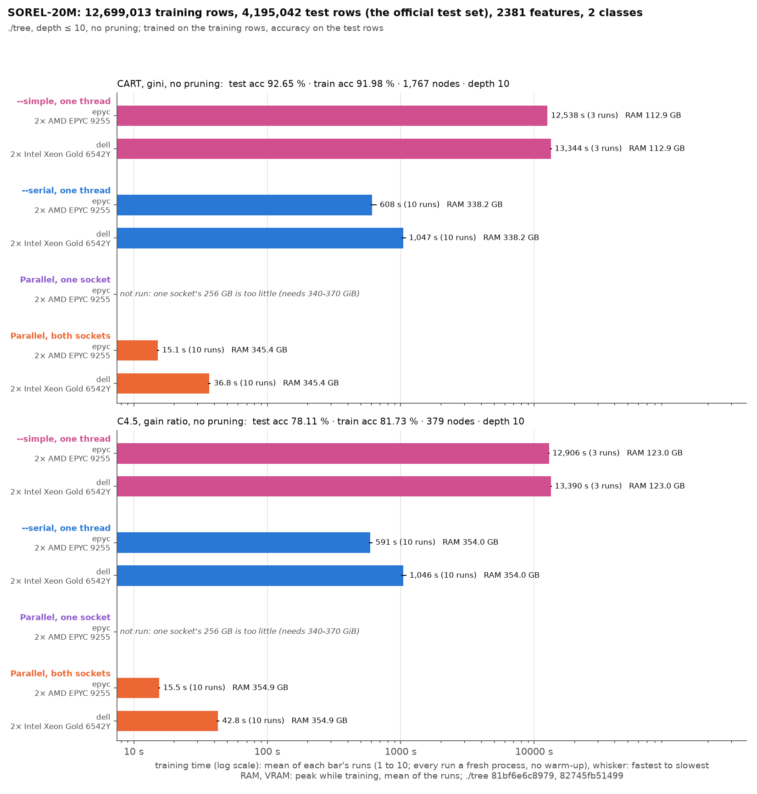
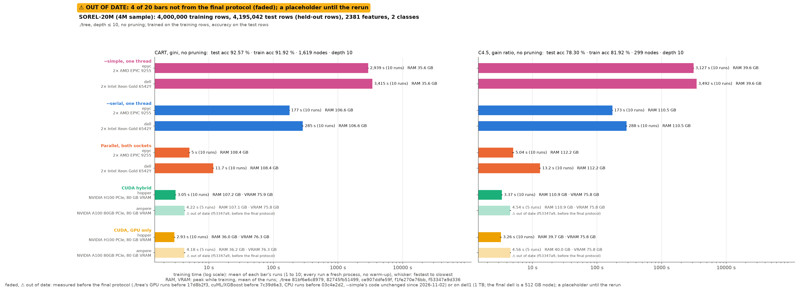

# SOREL-20M (malware, 2381 features): training set and test set

./tree only, trained on the training rows and scored on the test rows
([bench/tools/cluster/README.md](../tools/cluster/README.md#test-set-benchmarks)).

- **Training rows:** `sorel`: SOREL-20M's training set, 12,699,013 rows of EMBER v2 features (2381, float32), label malware/benign, on the CPU nodes only. The CSV is 136 GB; as float32 about 120 GB, so it does not fit an 80 GB GPU. `sorel_4m`: the first 4,000,000 training rows (`./tree --rows`; 9.52G values, about `ecbdl_15m`'s 9.47G), the most that fits an 80 GB GPU with room to spare, on every node.
- **Test rows:** SOREL-20M's test set, 4,195,042 rows, for both.
- **Protocols:** depth ≤ 10, CART (gini) and C4.5 (gain ratio), both without pruning.
- **Runs:** CUDA `--hybrid` and `--gpu` (GPU only) on hopper (H100) and ampere (A100 80 GB), with every CPU of the node; on epyc (2× EPYC 9255) and dell (2× Xeon Gold 6542Y): `--multicore` on both sockets (48 threads), `--serial` and `--simple` (one thread). Each run a fresh process with no warm-up; 10 runs a case in the final runs, 5 in the 2026-11-15 runs, `--simple` 10 on `sorel_4m` and once on `sorel` (about 3.5 hours a run).
- **Builds:** the final runs: ./tree 82745fb5 (2026-11-17, the same tree code as 8fe0c73d): `--multicore` on epyc1 (both sets) and `--serial` on `sorel_4m` on dell3; ./tree 81bf6e6c (the 2026-11-19/20 rerun, the same tree code): CUDA on hopper (only the bare CUDA context untimed, [bench/tools/README.md](../tools/README.md#how-time-is-measured)), dell's `--multicore` (dell4 full, dell2 4M; 512 GB nodes), `--serial` on `sorel_4m` on epyc2, and the long one-thread runs in parts of under 4 h each (`bench/tools/cluster/merge_parts.py`): `--serial` on the full set (10 runs: epyc2; dell3 and dell2) and `--simple` on the full set (3 runs a case: dell3 and dell4; on epyc the run of 2026-11-02 at 32cf657 plus 2 more on epyc1, C4.5's last on epyc2). `--simple` on `sorel_4m` is from 2026-11-10/11 (f1fe270e on epyc, ce907ddf on dell): its code has not changed since 2026-11-02, so it stands. **Out of date** (⚠ in the tables, faded on the charts): the CUDA runs on ampere (2026-11-15, f53347a9, 5 runs, with ./tree's GPU setup untimed), not rerun: ampere was unavailable from 2026-11-19 for two weeks. The 2026-11-15 CPU runs the final ones replace are in git at bae12944^; the runs before them (f1fe270e) at 1e655067.
- **Measured:** ./tree's training time (presort, build; not reading the CSV), peak RAM while training, peak VRAM; the tree's test and training accuracy, nodes, depth and SHA-256.
- **Chart:** `chart-sorel.png` (full) and `chart-sorel_4m.png`, `bench/tools/testset_chart.py` (log scale).

## Results

Every run of a case grew the same tree (the same `tree_sha256`). The tables give the mean of ./tree's training time (`bench/tools/testset_chart.py --table`); "runs" is the number of runs of the case, also on the chart.

- **4M sample:** GPU only on the H100 takes 2.93 s (CART) and 3.26 s (C4.5), 1.5–1.7× faster than epyc's `--multicore` (5.00 and 5.04 s); hybrid 3.05–3.37 s. Of that, 1.24–1.69 s is the GPU setup (uploading 4M × 2,381 features included) and 1.65–1.69 s the build, the same build as before: the 2026-11-15 runs (2.71–3.10 s) left the setup untimed. The A100 took 4.18–4.56 s (out of date, without its GPU setup). dell (a 512 GB node) takes 11.7 and 13.2 s, 2.3–2.6× epyc (dell1, with twice the memory bandwidth, took 8.40 and 9.03 s). GPU only needs 38 GB of RAM, hybrid and `--multicore` 109–110 GB.
- **Full set (CPU only):** epyc takes 15.1 s (CART) and 15.5 s (C4.5), with 350 GB of RAM, about 12 bytes for each of the 30 billion values. dell takes 36.8 s and 42.8 s, 2.4–2.8× epyc (dell1 took 26.6 s and 29.5 s).
- **Serial:** on the 4M sample 177 s (CART) and 173 s (C4.5) on epyc, 285 s and 288 s on dell; on the full set 608 s and 591 s on epyc, 1,047 s and 1,046 s on dell (dell1 took 975 s and 970 s).
- **Simple:** on the full set 12,538 s (CART) and 12,906 s (C4.5) on epyc, 13,344 s and 13,390 s on dell, with 118 GB of RAM, 3 runs a case. On epyc the first run of each is the rerun of 2026-11-02, with the data check in a child process (8bdf641) and the loader dropping the CSV from the page cache (da1f100): the first runs had part of the values on the other socket and were 9–11% slower on epyc ([docs/PERFORMANCE.md](../../docs/PERFORMANCE.md#november-2026-sorels---simple-and-numa)).
- **Against the 2026-11-15 runs (f53347a9, 5 runs a case):** `--multicore` on epyc within 2% (4.95 → 5.00 s and 15.3 → 15.1 s, CART); `--serial` on dell's 4M sample 2% faster (291 → 285 s, CART).
- **Accuracy:** CART 92.7% on the test set, C4.5 78.1% (4M sample: 92.6% and 78.3%).
- **The 4M tree's hash changed, not the tree:** `sorel_4m` is now `sorel`'s first 4M rows read with `./tree --rows` instead of a copied CSV (f2a4f921). The new runs hash b414ee6d (CART) and 089479c6 (C4.5), `--simple` (run on the copy) 4bf06cac and a4461fb4, with the same rows, nodes, depth and accuracies; the full set's hashes are the same as before. Checked 2026-11-19 (dell1, job 498, 23436041): `./tree_cpu --serial` and `--simple`, `--cart`/`--c45 -d 10 --rows 4000000 ~/datasets/sorel/train.f32 --dump`, grow the same tree as the new runs (both hash the new values above), and only the names in the dump differ from the copy's: the copy's Arrow-written header was `"f0",...,"class"` (quoted, and `./tree` keeps the quotes) with labels `c0`/`c1`, the parent's `f<i>` and `0`/`1`. Renaming feature i to `"f<i>"` and `0`/`1` to `c0`/`c1` in those dumps gives the copy's hashes exactly, for both backends; on the copy all backends had those hashes too.

### sorel

| Protocol | test acc | train acc | nodes | depth |
|---|---|---|---|---|
| CART, no pruning | 92.65% | 91.98% | 1,767 | 10 |
| C4.5, no pruning | 78.11% | 81.73% | 379 | 10 |

| Run | runs | CART | C4.5 | RAM GB (peak) | VRAM GB (peak) |
|---|---|---|---|---|---|
| epyc, --simple, one thread | 3 | 12,538 s | 12,906 s | 118.0 | – |
| dell, --simple, one thread | 3 | 13,344 s | 13,390 s | 118.0 | – |
| epyc, --serial, one thread | 10 | 608 s | 591 s | 346.1 | – |
| dell, --serial, one thread | 10 | 1,047 s | 1,046 s | 346.1 | – |
| epyc, parallel, both sockets | 10 | 15.1 s | 15.5 s | 350.2 | – |
| dell, parallel, both sockets | 10 | 36.8 s | 42.8 s | 350.2 | – |

### sorel_4m

| Protocol | test acc | train acc | nodes | depth |
|---|---|---|---|---|
| CART, no pruning | 92.57% | 91.92% | 1,619 | 10 |
| C4.5, no pruning | 78.30% | 81.92% | 299 | 10 |

| Run | runs | CART | C4.5 | RAM GB (peak) | VRAM GB (peak) |
|---|---|---|---|---|---|
| epyc, --simple, one thread | 10 | 2,939 s | 3,127 s | 37.6 | – |
| dell, --simple, one thread | 10 | 3,415 s | 3,492 s | 37.6 | – |
| epyc, --serial, one thread | 10 | 177 s | 173 s | 108.5 | – |
| dell, --serial, one thread | 10 | 285 s | 288 s | 108.5 | – |
| epyc, parallel, both sockets | 10 | 5 s | 5.04 s | 110.3 | – |
| dell, parallel, both sockets | 10 | 11.7 s | 13.2 s | 110.3 | – |
| hopper, CUDA hybrid | 10 | 3.05 s | 3.37 s | 109.0 | 75.9 |
| ampere, CUDA hybrid ⚠ out of date (f53347a9) | 5 | 4.22 s | 4.54 s | 109.0 | 75.8 |
| hopper, CUDA, GPU only | 10 | 2.93 s | 3.26 s | 37.9 | 76.1 |
| ampere, CUDA, GPU only ⚠ out of date (f53347a9) | 5 | 4.18 s | 4.56 s | 38.1 | 76.1 |
