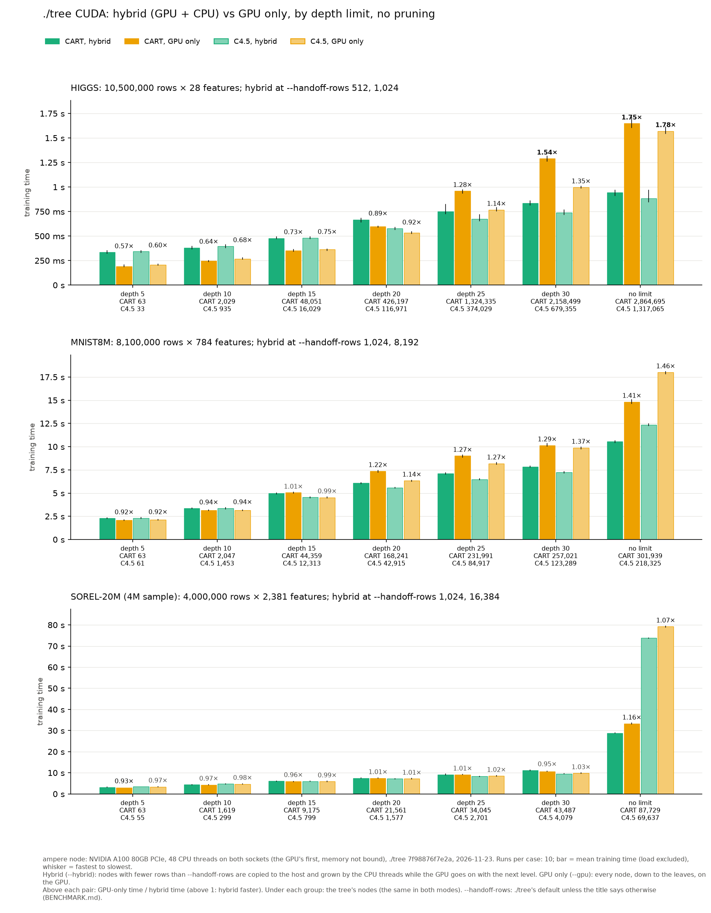
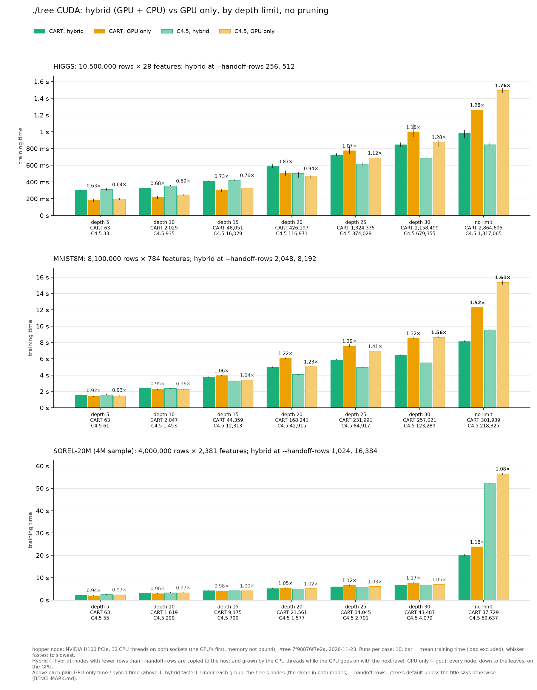
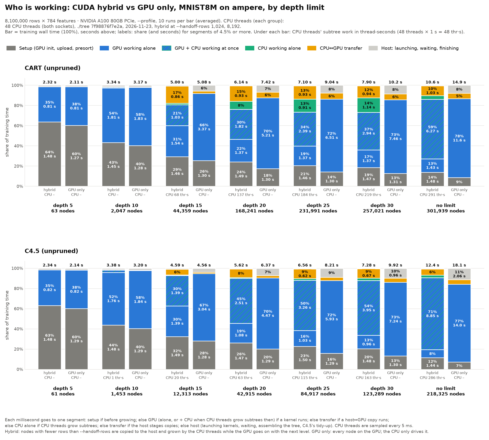
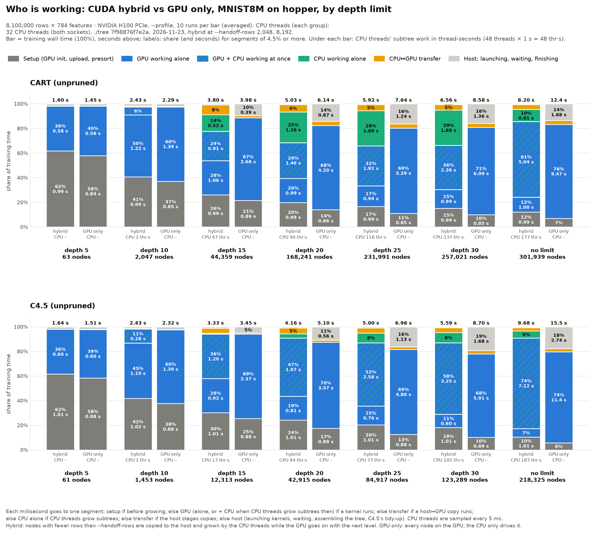
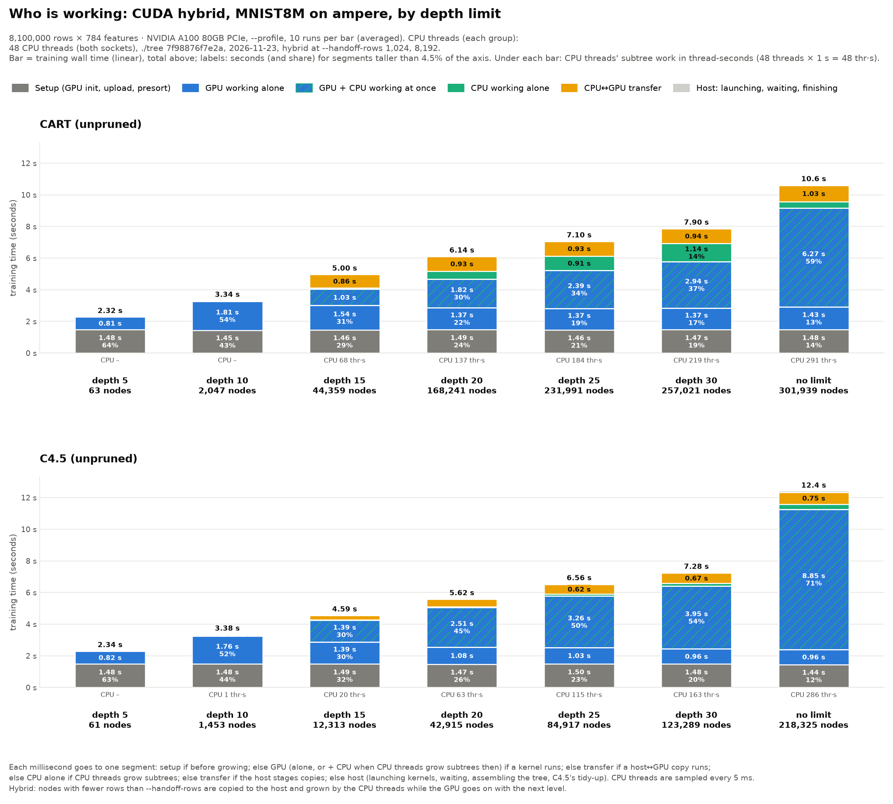
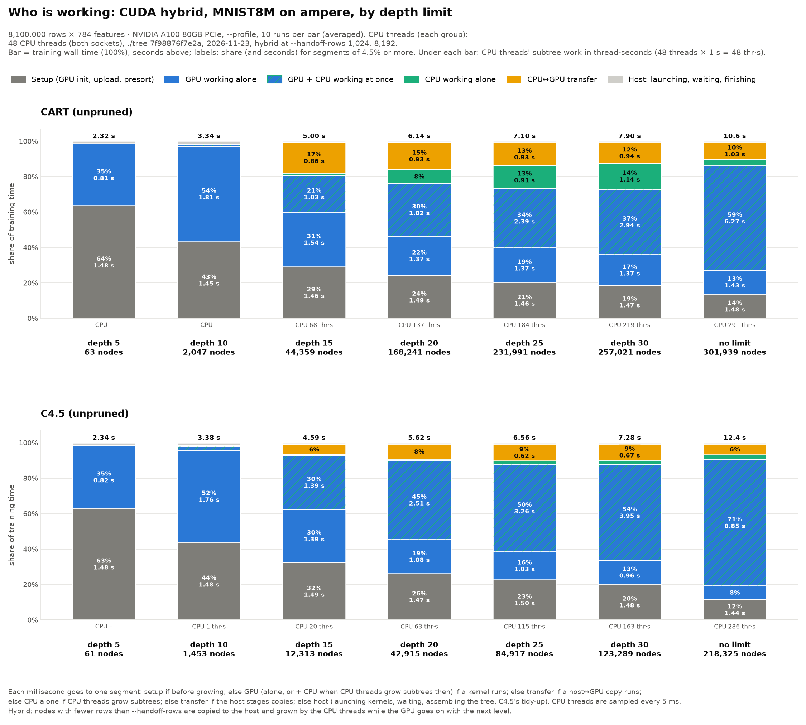

# hybrid-vs-gpu-only: ./tree's CUDA hybrid against GPU only, by depth





**What.** ./tree `--hybrid` (a node with fewer rows than `--handoff-rows` is
copied to the host and its subtree grown by the CPU threads while the GPU goes
on with the next level) against `--gpu` (every node, down to the leaves, on
the GPU). CART and C4.5 without pruning, grown to depth 5, 10, 15, 20, 25, 30
and without a depth limit, 10 runs a case on both nodes, on three of the paper's datasets, chosen by a screen of five
([below](#earlier-measurements-95b6d77)): HIGGS (10.5M rows × 28 features),
where the hybrid's lead was the largest; SOREL-20M's 4M sample (4M × 2,381),
where it was the smallest; and MNIST8M (8.1M × 784) in between. The trees are
the same in both modes (node counts under each group). The hybrid runs at the
fastest `--handoff-rows` of a sweep on the same node and dataset
([the sweep](#--handoff-rows-the-sweep)). Its picks are now stored in
`bench/tools/handoff/handoff_rows.json` ("nodepth"); later runs take them from there (and the
depth-10 sweep's value for depth 10) instead of sweeping again
([bench/tools/README.md](../tools/README.md#the-hybrids-hand-off-size)).

**Where.** The whole node (`--exclusive`), one GPU, every CPU of the node:
ampere, A100 80 GB PCIe (GPU 0, NUMA node 0), 48 threads (CPUs 0–23, then
24–47); hopper, H100 PCIe (GPU 2, NUMA node 1), 32 threads (16–31, then 0–15).
The GPU's socket's CPUs come first and the memory is not bound
([bench/tools/cluster/README.md](../tools/cluster/README.md#settings-specific-to-the-cluster)).

**When.** ./tree 7f98876f (less host memory for `--hybrid`, less VRAM for
`--gpu`, the same trees), 2026-11-23, 10 runs a case, one job a node: hopper
790 (`hopper.log`), ampere 807 (`ampere.log`); `hybrid_vs_gpu_only.sh` with
`RUNS=10`, taking the `--handoff-rows` of the 2026-11-15/16 sweep from
`bench/tools/handoff/handoff_rows.json` instead of sweeping again. The CUDA
runs time ./tree's GPU setup (memory pool, staging buffers, and for
`--hybrid` its page-locked hand-off buffers): only the bare CUDA context is
untimed ([bench/tools/README.md](../tools/README.md#how-time-is-measured)).
The sweep (both nodes) is from 2026-11-15/16; SOREL 4M's was cut short to
save time: ampere skipped 1024 and 2048, hopper 2048 (the curve falls
steadily from 512 to 16384, so they could not have won); the job was
resubmitted with the remaining values and kept the ones already measured.
The runs before, hopper 81bf6e6c (2026-11-19) and ampere f53347a9
(2026-11-15/16, GPU setup untimed), are in git at 2c9ff876; hopper's
f53347a9 runs at 84b4c67e; the runs before (95b6d77, 3 runs a case,
2026-11-06/08) at 1e655067.

## Results

Mean training time of the runs (GPU setup, presort, build; not reading the
data), 10 a case on both nodes. Hybrid / GPU only, GPU only / hybrid in
brackets (above 1: the hybrid is faster).

### ampere

| Depth | HIGGS CART | HIGGS C4.5 | MNIST8M CART | MNIST8M C4.5 | SOREL 4M CART | SOREL 4M C4.5 |
|---|---|---|---|---|---|---|
| 5 | 0.334 / 0.192 s (0.57×) | 0.344 / 0.207 s (0.60×) | 2.29 / 2.10 s (0.92×) | 2.31 / 2.12 s (0.92×) | 3.14 / 2.94 s (0.93×) | 3.46 / 3.36 s (0.97×) |
| 10 | 0.381 / 0.245 s (0.64×) | 0.397 / 0.268 s (0.68×) | 3.35 / 3.15 s (0.94×) | 3.38 / 3.16 s (0.94×) | 4.39 / 4.24 s (0.97×) | 4.76 / 4.65 s (0.98×) |
| 15 | 0.478 / 0.352 s (0.73×) | 0.481 / 0.362 s (0.75×) | 4.98 / 5.05 s (1.01×) | 4.55 / 4.52 s (0.99×) | 6.08 / 5.83 s (0.96×) | 5.95 / 5.91 s (0.99×) |
| 20 | 0.668 / 0.597 s (0.89×) | 0.577 / 0.534 s (0.92×) | 6.07 / 7.38 s (1.22×) | 5.59 / 6.35 s (1.14×) | 7.39 / 7.50 s (1.01×) | 7.17 / 7.21 s (1.01×) |
| 25 | 0.751 / 0.960 s (1.28×) | 0.675 / 0.768 s (1.14×) | 7.11 / 9.01 s (1.27×) | 6.47 / 8.19 s (1.27×) | 9.09 / 9.17 s (1.01×) | 8.33 / 8.53 s (1.02×) |
| 30 | 0.837 / 1.29 s (1.54×) | 0.737 / 0.997 s (1.35×) | 7.84 / 10.1 s (1.29×) | 7.24 / 9.89 s (1.37×) | 11.2 / 10.7 s (0.95×) | 9.55 / 9.82 s (1.03×) |
| none | 0.944 / 1.65 s (1.75×) | 0.882 / 1.57 s (1.78×) | 10.5 / 14.8 s (1.41×) | 12.4 / 18.0 s (1.46×) | 28.8 / 33.3 s (1.16×) | 73.8 / 79.3 s (1.07×) |

### hopper

| Depth | HIGGS CART | HIGGS C4.5 | MNIST8M CART | MNIST8M C4.5 | SOREL 4M CART | SOREL 4M C4.5 |
|---|---|---|---|---|---|---|
| 5 | 0.299 / 0.188 s (0.63×) | 0.313 / 0.199 s (0.64×) | 1.54 / 1.42 s (0.92×) | 1.58 / 1.47 s (0.93×) | 2.15 / 2.01 s (0.94×) | 2.45 / 2.38 s (0.97×) |
| 10 | 0.328 / 0.222 s (0.68×) | 0.356 / 0.247 s (0.69×) | 2.38 / 2.26 s (0.95×) | 2.36 / 2.27 s (0.96×) | 3.05 / 2.94 s (0.96×) | 3.35 / 3.26 s (0.97×) |
| 15 | 0.412 / 0.302 s (0.73×) | 0.422 / 0.323 s (0.76×) | 3.75 / 3.96 s (1.06×) | 3.28 / 3.41 s (1.04×) | 4.20 / 4.12 s (0.98×) | 4.20 / 4.22 s (1.00×) |
| 20 | 0.587 / 0.509 s (0.87×) | 0.505 / 0.474 s (0.94×) | 4.97 / 6.08 s (1.22×) | 4.10 / 5.04 s (1.23×) | 5.13 / 5.40 s (1.05×) | 5.04 / 5.14 s (1.02×) |
| 25 | 0.725 / 0.774 s (1.07×) | 0.617 / 0.690 s (1.12×) | 5.87 / 7.59 s (1.29×) | 4.93 / 6.93 s (1.41×) | 5.95 / 6.67 s (1.12×) | 5.88 / 6.06 s (1.03×) |
| 30 | 0.847 / 0.999 s (1.18×) | 0.688 / 0.879 s (1.28×) | 6.47 / 8.53 s (1.32×) | 5.54 / 8.64 s (1.56×) | 6.62 / 7.77 s (1.17×) | 6.72 / 7.03 s (1.05×) |
| none | 0.988 / 1.26 s (1.28×) | 0.849 / 1.50 s (1.76×) | 8.11 / 12.3 s (1.52×) | 9.56 / 15.4 s (1.61×) | 20.1 / 23.8 s (1.18×) | 52.3 / 56.6 s (1.08×) |

- **GPU only wins the shallow trees.** Both modes time their GPU setup, and
  the hybrid's setup also makes its page-locked hand-off buffers: 0.10–0.23 s
  more than GPU only (hopper: HIGGS 0.26–0.27 against 0.16 s, MNIST8M
  0.94–0.97 against 0.82–0.86 s, SOREL 4M 1.39–1.68 against 1.25–1.60 s;
  ampere: 0.29 against 0.15–0.16 s, 1.46–1.50 against 1.27–1.29 s,
  2.02–2.41 against 1.89–2.29 s). Up to depth 10 the builds are the same, so
  GPU only is faster: on HIGGS, whose trees take 0.2–0.4 s, by a lot
  (0.57–0.69×), on MNIST8M and SOREL 4M by 2–8% (0.92–0.98×). HIGGS's hybrid
  stays behind to depth 20 (there 0.87–0.94×) and leads from depth 25 (1.07–1.28×);
  MNIST8M and SOREL 4M break even at depth 15. The runs spread at most 5% on
  hopper and 6% on ampere (HIGGS up to 20% and 14%, in runs of 0.2–1.6 s).
- **Deeper, the hybrid leads:** without a depth limit on hopper HIGGS 1.28×
  (CART) and 1.76× (C4.5), MNIST8M 1.52× and 1.61×, SOREL 4M 1.18× and 1.08×;
  on ampere HIGGS 1.75× and 1.78×, MNIST8M 1.41× and 1.46×, SOREL 4M 1.16× and
  1.07×. Before d2957ff2 (95b6d77) HIGGS was 4.3–4.9×.
- **Because GPU only got faster in the deep trees**, not the hybrid: GPU only
  at no limit, HIGGS CART 3.97 → 1.65 s on ampere and 4.01 → 1.26 s on hopper
  (95b6d77 → now), MNIST8M CART 29.6 → 14.8 s and 24.5 → 12.3 s; the hybrid
  HIGGS CART 0.82 → 0.94 s on ampere and 0.81 → 0.99 s on hopper (now with
  0.27–0.29 s of setup). The deep levels of a few small nodes were GPU only's
  weakness (a whole level's kernels and synchronisation for a few rows);
  d2957ff2 skips the tiles without a cut and the earlier small-node kernels
  (bc9ea314) shorten those levels. HIGGS's unlimited trees have 2.9M (CART)
  and 1.3M (C4.5) nodes over 69–71 levels; the hybrid's CPU threads still grow
  those subtrees in one go.
- **SOREL 4M barely gains (0.93–1.18×).** Its trees are small (88k CART
  nodes, 70k C4.5) and long and thin: no limit means depth 231 (CART) and
  572 (C4.5), the levels past 30 peeling a few rows a time off nodes that
  stay above `--handoff-rows`. Those nodes, and every level's 2,381
  features, stay on the GPU in both modes. On ampere at depth 30 CART the
  hybrid is slower (0.95×).
- **Past the setup, the gap is all in the build.** Build at no depth limit on
  hopper: HIGGS CART 0.72 s hybrid, 1.11 s GPU only (C4.5 0.55 and 1.30 s);
  MNIST8M CART 7.2 s, 11.5 s; SOREL 4M CART 18.7 s, 22.6 s. On ampere: HIGGS
  CART 0.65 s, 1.50 s; MNIST8M CART 9.1 s, 13.5 s; SOREL 4M CART 26.8 s, 31.4 s.
- **hopper against ampere:** where the GPU does the work the H100 is
  about 1.4× faster (MNIST8M depth 10: 2.26–2.38 against 3.15–3.38 s; SOREL 4M
  at no limit 20.1 / 52.3 s against 28.8 / 73.8 s). HIGGS's hybrid at no
  limit is CPU bound: 0.72 s of build on hopper with 32 threads, 0.65 s on
  ampere with 48.
- **VRAM** (since 7f98876f): the two modes need about the same (hybrid
  against GPU only, both nodes: HIGGS 3.3–3.4 GiB against 2.8–3.7, MNIST8M
  48.8–49.2 against 48.3–50.7, SOREL 4M 75.8–75.9 against 75.3–75.9 of the
  80 GB). The hybrid's arena is host memory, not counted here.

## Who is working (MNIST8M, profiled)





The MNIST8M depth runs once more with `./tree --profile`, 10 runs a case on
both nodes, in the same job as the plain runs
(`profile/{cuda,gpuonly}-<node>-mnist8m/`). Profiling costs little: every
profiled mean is within 4% of the plain run's on both nodes.

Each millisecond of training goes to one segment
([hybrid_profile_chart.py](../tools/hybrid_profile_chart.py)):
- **Setup:** before growing: GPU context and memory, upload, presort.
- **GPU alone:** a GPU kernel runs and no CPU thread grows a subtree.
- **GPU + CPU at once:** a kernel runs while CPU threads grow subtrees (hybrid only).
- **CPU alone:** no kernel or copy runs, CPU threads grow subtrees.
- **Transfer:** a host↔GPU copy runs with no kernel, or the host stages copies.
- **Host:** none of these: launching kernels, waiting, assembling the tree, C4.5's tidy-up.

CPU subtree work is the threads sampled (every 5 ms) in sweep, partition,
mark, build or leaves; under each bar its thread-seconds.

- **Setup:** the hybrid's is 0.13–0.21 s longer, its page-locked hand-off
  buffers: 1.44–1.50 s against 1.27–1.31 s on ampere, 0.99–1.02 s against
  0.84–0.89 s on hopper. 58–64% of a depth-5 tree, 6–14% at no limit.
- **The CPU's subtree work grows with depth.** On ampere CART 0 → 0 → 68 →
  137 → 184 → 219 → 291 thread-seconds (depth 5 → no limit), C4.5 0 → 1 → 20 →
  63 → 115 → 163 → 286; on hopper CART 177 and C4.5 187 at no limit. At no limit that is
  26–32 of ampere's 48 threads and 22–25 of hopper's 32 busy on average while
  growing.
- **Most of it runs alongside the GPU:** the GPU + CPU segment grows to 59%
  (CART) and 71% (C4.5) of the hybrid's time on ampere at no limit, 61% and
  74% on hopper. **CPU alone**, the GPU waiting for the threads, is up to
  1.14 s (14%, CART depth 30) on ampere and 1.26–1.88 s (25–29%) on hopper
  for CART at depth 20–30: with its 32 threads, hopper's GPU waits for the
  CPU most.
- **GPU only does that work on the GPU instead:** its GPU segment at no
  limit is 11.7 s (CART) and 14.0 s (C4.5) on ampere, against the hybrid's
  7.7 s and 9.8 s of GPU time (alone + with CPU). Its host time (launching and
  synchronising many short levels) is 1.2–2.1 s (8–11%) at no limit on
  ampere and 1.7–2.7 s (14–18%) on hopper, where the hybrid's is under 0.1 s.
- **The hybrid pays 0.3–1.0 s of transfer** on ampere from depth 15 on (the
  small nodes' columns copied to the host), 0.1–0.3 s on hopper, against
  0.03–0.8 s for GPU only.
- Up to depth 10 the two modes' bars are the same, but for the hybrid's longer setup.

The hybrid alone on ampere, in seconds on a linear axis shared by both panels,
and as shares of each bar:





Table, ampere (seconds, share of the training time in brackets;
`hybrid_profile_chart.py` prints it):

| Algorithm | Depth | Mode | runs | train s | without --profile s | nodes | Setup (GPU init, upload, presort) s (%) | GPU working alone s (%) | GPU + CPU working at once s (%) | CPU working alone s (%) | CPU↔GPU transfer s (%) | Host: launching, waiting, finishing s (%) | CPU subtree thr·s |
|---|---|---|--:|--:|--:|--:|--:|--:|--:|--:|--:|--:|--:|
| CART | 5 | hybrid | 10 | 2.32 | 2.29 | 63 | 1.48 (64) | 0.81 (35) | 0.00 (0) | 0.00 (0) | 0.00 (0) | 0.03 (1) | 0 |
| CART | 5 | GPU only | 10 | 2.11 | 2.10 | 63 | 1.27 (60) | 0.81 (38) | 0.00 (0) | 0.00 (0) | 0.00 (0) | 0.03 (1) | 0 |
| CART | 10 | hybrid | 10 | 3.34 | 3.35 | 2,047 | 1.45 (43) | 1.81 (54) | 0.02 (1) | 0.00 (0) | 0.02 (0) | 0.05 (1) | 0 |
| CART | 10 | GPU only | 10 | 3.17 | 3.15 | 2,047 | 1.28 (40) | 1.83 (58) | 0.00 (0) | 0.00 (0) | 0.01 (0) | 0.05 (2) | 0 |
| CART | 15 | hybrid | 10 | 5.00 | 4.98 | 44,359 | 1.46 (29) | 1.54 (31) | 1.03 (21) | 0.08 (2) | 0.86 (17) | 0.03 (1) | 68 |
| CART | 15 | GPU only | 10 | 5.08 | 5.05 | 44,359 | 1.30 (26) | 3.37 (66) | 0.00 (0) | 0.00 (0) | 0.13 (2) | 0.29 (6) | 0 |
| CART | 20 | hybrid | 10 | 6.14 | 6.07 | 168,241 | 1.49 (24) | 1.37 (22) | 1.82 (30) | 0.49 (8) | 0.93 (15) | 0.04 (1) | 137 |
| CART | 20 | GPU only | 10 | 7.42 | 7.38 | 168,241 | 1.30 (18) | 5.21 (70) | 0.00 (0) | 0.00 (0) | 0.41 (6) | 0.51 (7) | 0 |
| CART | 25 | hybrid | 10 | 7.10 | 7.11 | 231,991 | 1.46 (21) | 1.37 (19) | 2.39 (34) | 0.91 (13) | 0.93 (13) | 0.04 (1) | 184 |
| CART | 25 | GPU only | 10 | 9.04 | 9.01 | 231,991 | 1.30 (14) | 6.51 (72) | 0.00 (0) | 0.00 (0) | 0.55 (6) | 0.69 (8) | 0 |
| CART | 30 | hybrid | 10 | 7.90 | 7.84 | 257,021 | 1.47 (19) | 1.37 (17) | 2.94 (37) | 1.14 (14) | 0.94 (12) | 0.04 (1) | 219 |
| CART | 30 | GPU only | 10 | 10.25 | 10.14 | 257,021 | 1.31 (13) | 7.46 (73) | 0.00 (0) | 0.00 (0) | 0.61 (6) | 0.87 (8) | 0 |
| CART | none | hybrid | 10 | 10.65 | 10.55 | 301,939 | 1.48 (14) | 1.43 (13) | 6.27 (59) | 0.39 (4) | 1.03 (10) | 0.06 (1) | 291 |
| CART | none | GPU only | 10 | 14.93 | 14.83 | 301,939 | 1.29 (9) | 11.65 (78) | 0.00 (0) | 0.00 (0) | 0.80 (5) | 1.18 (8) | 0 |
| C4.5 | 5 | hybrid | 10 | 2.34 | 2.31 | 61 | 1.48 (63) | 0.82 (35) | 0.00 (0) | 0.00 (0) | 0.00 (0) | 0.04 (2) | 0 |
| C4.5 | 5 | GPU only | 10 | 2.14 | 2.12 | 61 | 1.29 (60) | 0.82 (38) | 0.00 (0) | 0.00 (0) | 0.00 (0) | 0.03 (2) | 0 |
| C4.5 | 10 | hybrid | 10 | 3.38 | 3.38 | 1,453 | 1.48 (44) | 1.76 (52) | 0.08 (2) | 0.00 (0) | 0.01 (0) | 0.05 (1) | 1 |
| C4.5 | 10 | GPU only | 10 | 3.20 | 3.16 | 1,453 | 1.29 (40) | 1.84 (58) | 0.00 (0) | 0.00 (0) | 0.01 (0) | 0.06 (2) | 0 |
| C4.5 | 15 | hybrid | 10 | 4.59 | 4.55 | 12,313 | 1.49 (32) | 1.39 (30) | 1.39 (30) | 0.03 (1) | 0.26 (6) | 0.04 (1) | 20 |
| C4.5 | 15 | GPU only | 10 | 4.56 | 4.52 | 12,313 | 1.28 (28) | 3.04 (67) | 0.00 (0) | 0.00 (0) | 0.05 (1) | 0.18 (4) | 0 |
| C4.5 | 20 | hybrid | 10 | 5.62 | 5.59 | 42,915 | 1.47 (26) | 1.08 (19) | 2.51 (45) | 0.05 (1) | 0.47 (8) | 0.04 (1) | 63 |
| C4.5 | 20 | GPU only | 10 | 6.37 | 6.35 | 42,915 | 1.29 (20) | 4.47 (70) | 0.00 (0) | 0.00 (0) | 0.15 (2) | 0.46 (7) | 0 |
| C4.5 | 25 | hybrid | 10 | 6.56 | 6.47 | 84,917 | 1.50 (23) | 1.03 (16) | 3.26 (50) | 0.12 (2) | 0.62 (9) | 0.05 (1) | 115 |
| C4.5 | 25 | GPU only | 10 | 8.21 | 8.19 | 84,917 | 1.29 (16) | 5.93 (72) | 0.00 (0) | 0.00 (0) | 0.27 (3) | 0.72 (9) | 0 |
| C4.5 | 30 | hybrid | 10 | 7.28 | 7.24 | 123,289 | 1.48 (20) | 0.96 (13) | 3.95 (54) | 0.18 (2) | 0.67 (9) | 0.04 (1) | 163 |
| C4.5 | 30 | GPU only | 10 | 9.92 | 9.89 | 123,289 | 1.30 (13) | 7.24 (73) | 0.00 (0) | 0.00 (0) | 0.41 (4) | 0.96 (10) | 0 |
| C4.5 | none | hybrid | 10 | 12.42 | 12.36 | 218,325 | 1.44 (12) | 0.96 (8) | 8.85 (71) | 0.34 (3) | 0.75 (6) | 0.08 (1) | 286 |
| C4.5 | none | GPU only | 10 | 18.10 | 18.01 | 218,325 | 1.29 (7) | 13.97 (77) | 0.00 (0) | 0.00 (0) | 0.78 (4) | 2.06 (11) | 0 |

Table, hopper:

| Algorithm | Depth | Mode | runs | train s | without --profile s | nodes | Setup (GPU init, upload, presort) s (%) | GPU working alone s (%) | GPU + CPU working at once s (%) | CPU working alone s (%) | CPU↔GPU transfer s (%) | Host: launching, waiting, finishing s (%) | CPU subtree thr·s |
|---|---|---|--:|--:|--:|--:|--:|--:|--:|--:|--:|--:|--:|
| CART | 5 | hybrid | 10 | 1.60 | 1.54 | 63 | 0.99 (62) | 0.58 (36) | 0.00 (0) | 0.00 (0) | 0.00 (0) | 0.03 (2) | 0 |
| CART | 5 | GPU only | 10 | 1.45 | 1.42 | 63 | 0.84 (58) | 0.58 (40) | 0.00 (0) | 0.00 (0) | 0.00 (0) | 0.02 (2) | 0 |
| CART | 10 | hybrid | 10 | 2.43 | 2.38 | 2,047 | 0.99 (41) | 1.22 (50) | 0.15 (6) | 0.00 (0) | 0.02 (1) | 0.04 (2) | 2 |
| CART | 10 | GPU only | 10 | 2.29 | 2.26 | 2,047 | 0.85 (37) | 1.39 (60) | 0.00 (0) | 0.00 (0) | 0.01 (0) | 0.05 (2) | 0 |
| CART | 15 | hybrid | 10 | 3.80 | 3.75 | 44,359 | 0.99 (26) | 1.06 (28) | 0.91 (24) | 0.52 (14) | 0.30 (8) | 0.03 (1) | 47 |
| CART | 15 | GPU only | 10 | 3.98 | 3.96 | 44,359 | 0.86 (21) | 2.68 (67) | 0.00 (0) | 0.00 (0) | 0.07 (2) | 0.39 (10) | 0 |
| CART | 20 | hybrid | 10 | 5.03 | 4.97 | 168,241 | 0.99 (20) | 0.99 (20) | 1.46 (29) | 1.26 (25) | 0.30 (6) | 0.03 (1) | 90 |
| CART | 20 | GPU only | 10 | 6.14 | 6.08 | 168,241 | 0.86 (14) | 4.20 (68) | 0.00 (0) | 0.00 (0) | 0.22 (4) | 0.87 (14) | 0 |
| CART | 25 | hybrid | 10 | 5.92 | 5.87 | 231,991 | 0.99 (17) | 0.99 (17) | 1.92 (32) | 1.69 (28) | 0.30 (5) | 0.04 (1) | 118 |
| CART | 25 | GPU only | 10 | 7.64 | 7.59 | 231,991 | 0.85 (11) | 5.29 (69) | 0.00 (0) | 0.00 (0) | 0.26 (3) | 1.24 (16) | 0 |
| CART | 30 | hybrid | 10 | 6.56 | 6.47 | 257,021 | 0.99 (15) | 0.99 (15) | 2.36 (36) | 1.88 (29) | 0.30 (5) | 0.04 (1) | 137 |
| CART | 30 | GPU only | 10 | 8.58 | 8.53 | 257,021 | 0.85 (10) | 6.09 (71) | 0.00 (0) | 0.00 (0) | 0.28 (3) | 1.36 (16) | 0 |
| CART | none | hybrid | 10 | 8.20 | 8.11 | 301,939 | 0.99 (12) | 1.00 (12) | 5.04 (61) | 0.81 (10) | 0.33 (4) | 0.05 (1) | 177 |
| CART | none | GPU only | 10 | 12.39 | 12.30 | 301,939 | 0.86 (7) | 9.47 (76) | 0.00 (0) | 0.00 (0) | 0.39 (3) | 1.68 (14) | 0 |
| C4.5 | 5 | hybrid | 10 | 1.64 | 1.58 | 61 | 1.01 (62) | 0.60 (36) | 0.00 (0) | 0.00 (0) | 0.00 (0) | 0.03 (2) | 0 |
| C4.5 | 5 | GPU only | 10 | 1.51 | 1.47 | 61 | 0.88 (58) | 0.60 (39) | 0.00 (0) | 0.00 (0) | 0.00 (0) | 0.03 (2) | 0 |
| C4.5 | 10 | hybrid | 10 | 2.43 | 2.36 | 1,453 | 1.02 (42) | 1.10 (45) | 0.28 (11) | 0.00 (0) | 0.01 (0) | 0.03 (1) | 2 |
| C4.5 | 10 | GPU only | 10 | 2.32 | 2.27 | 1,453 | 0.88 (38) | 1.39 (60) | 0.00 (0) | 0.00 (0) | 0.01 (0) | 0.05 (2) | 0 |
| C4.5 | 15 | hybrid | 10 | 3.33 | 3.28 | 12,313 | 1.01 (30) | 0.92 (28) | 1.20 (36) | 0.02 (1) | 0.14 (4) | 0.04 (1) | 17 |
| C4.5 | 15 | GPU only | 10 | 3.45 | 3.41 | 12,313 | 0.88 (25) | 2.37 (69) | 0.00 (0) | 0.00 (0) | 0.03 (1) | 0.17 (5) | 0 |
| C4.5 | 20 | hybrid | 10 | 4.16 | 4.10 | 42,915 | 1.01 (24) | 0.81 (19) | 1.97 (47) | 0.14 (3) | 0.20 (5) | 0.04 (1) | 44 |
| C4.5 | 20 | GPU only | 10 | 5.10 | 5.04 | 42,915 | 0.89 (17) | 3.57 (70) | 0.00 (0) | 0.00 (0) | 0.09 (2) | 0.56 (11) | 0 |
| C4.5 | 25 | hybrid | 10 | 5.00 | 4.93 | 84,917 | 1.01 (20) | 0.76 (15) | 2.58 (52) | 0.39 (8) | 0.21 (4) | 0.04 (1) | 77 |
| C4.5 | 25 | GPU only | 10 | 6.96 | 6.93 | 84,917 | 0.88 (13) | 4.80 (69) | 0.00 (0) | 0.00 (0) | 0.16 (2) | 1.13 (16) | 0 |
| C4.5 | 30 | hybrid | 10 | 5.59 | 5.54 | 123,289 | 1.01 (18) | 0.60 (11) | 3.25 (58) | 0.47 (8) | 0.22 (4) | 0.04 (1) | 105 |
| C4.5 | 30 | GPU only | 10 | 8.70 | 8.64 | 123,289 | 0.89 (10) | 5.91 (68) | 0.00 (0) | 0.00 (0) | 0.23 (3) | 1.68 (19) | 0 |
| C4.5 | none | hybrid | 10 | 9.68 | 9.56 | 218,325 | 1.01 (10) | 0.66 (7) | 7.12 (74) | 0.57 (6) | 0.25 (3) | 0.07 (1) | 187 |
| C4.5 | none | GPU only | 10 | 15.48 | 15.38 | 218,325 | 0.89 (6) | 11.44 (74) | 0.00 (0) | 0.00 (0) | 0.41 (3) | 2.74 (18) | 0 |

## --handoff-rows: the sweep

Before the depth runs, each job runs the hybrid at no depth limit, CART and
C4.5, at ./tree's default (CART rows/8192 clamped to 1,024–2,048, C4.5
rows/4096 clamped to 1,024–4,096) and at fixed values, 5 runs a value, not
interleaved (`hybrid_vs_gpu_only.sh`). The value taken has the smallest mean,
over CART and C4.5, of its time over that algorithm's fastest. Results:
`sweep/cuda-<node>-<dataset>-mr<value>/`, summary `sweep/<node>-<dataset>.json`.

ampere (48 threads):

| HIGGS | default | 256 | **512** | 1024 | 2048 | 4096 | 8192 | 16384 | 32768 |
|---|---|---|---|---|---|---|---|---|---|
| CART (s) | 0.785 | 0.848 | **0.767** | 0.805 | 0.815 | 0.906 | 1.06 | 1.25 | 1.44 |
| C4.5 (s) | 0.719 | 0.749 | **0.659** | 0.657 | 0.656 | 0.714 | 0.822 | 0.986 | 1.19 |

| MNIST8M | default | 256 | 512 | 1024 | 2048 | 4096 | **8192** | 16384 | 32768 |
|---|---|---|---|---|---|---|---|---|---|
| CART (s) | 11.9 | 13.3 | 12.6 | 11.9 | 11.4 | 10.9 | **10.4** | 13.6 | 19.4 |
| C4.5 (s) | 13.3 | 16.1 | 15.0 | 14.0 | 13.3 | 12.6 | **12.2** | 14.6 | 20.1 |

| SOREL 4M | default | 256 | 512 | 4096 | 8192 | **16384** | 32768 |
|---|---|---|---|---|---|---|---|
| CART (s) | 31.2 | 32.3 | 31.7 | 29.5 | 29.2 | **28.7** | 46.7 |
| C4.5 (s) | 76.2 | 77.0 | 76.5 | 74.9 | 74.3 | **73.6** | 73.1 |

hopper (32 threads):

| HIGGS | default | **256** | 512 | 1024 | 2048 | 4096 | 8192 | 16384 | 32768 |
|---|---|---|---|---|---|---|---|---|---|
| CART (s) | 0.813 | **0.790** | 0.794 | 0.808 | 0.822 | 0.901 | 1.02 | 1.17 | 1.29 |
| C4.5 (s) | 0.682 | **0.619** | 0.640 | 0.643 | 0.671 | 0.714 | 0.795 | 0.925 | 1.06 |

| MNIST8M | default | 256 | 512 | 1024 | 2048 | 4096 | **8192** | 16384 | 32768 |
|---|---|---|---|---|---|---|---|---|---|
| CART (s) | 8.96 | 10.1 | 9.51 | 9.10 | 8.67 | 8.21 | **7.76** | 9.87 | 14.1 |
| C4.5 (s) | 10.2 | 12.4 | 11.5 | 10.9 | 10.2 | 9.79 | **9.35** | 9.79 | 13.1 |

| SOREL 4M | default | 256 | 512 | 1024 | 4096 | 8192 | **16384** | 32768 |
|---|---|---|---|---|---|---|---|---|
| CART (s) | 21.6 | 22.3 | 21.9 | 21.6 | 20.5 | 20.2 | **19.6** | 26.2 |
| C4.5 (s) | 54.0 | 54.7 | 54.3 | 53.9 | 53.2 | 52.6 | **52.1** | 52.6 |

- **HIGGS takes 512 on ampere and 256 on hopper**, and its minimum is flat:
  512–2,048 are within 6% of each other on ampere, 256–1,024 within 4% on
  hopper; ./tree's default (1,281 / 2,563) is 2–10% slower than the best. Before, both nodes took 512.
- **MNIST8M takes 8,192 on both nodes** (16,384 before, with the older GPU
  code): 16,384 is now 27–31% slower for CART. 8,192 is 13–15% (CART) and
  9% (C4.5) faster than the default (1,024 / 1,977).
- **SOREL 4M takes 16,384 on both nodes, as before.** It moves little (CART
  9–10%, C4.5 4% against the default, 1,024), as most of its work never
  reaches `--handoff-rows`; C4.5 alone would take 32,768 on ampere (under 1%
  faster), where CART is 34–63% slower.
- **The default here is 6–12% slower than the best** on every dataset. So
  after this run ./tree's default became 10 × features, between 512 and
  16,384 (HIGGS 512, MNIST8M 7,840, SOREL 4M 16,384): within 2% of the best on
  all three datasets and both nodes, judging by the sweep above (not rerun).
  The "default" columns and the depth runs here are the old rows-based default
  or the sweep's pick, so none of these numbers change.

## Earlier measurements (95b6d77)

The sections below were measured on 95b6d77 (2026-11-03/08, before d2957ff2
and the small-node kernels) with `--gpu-min-rows`, the flag's old name, and
were not rerun. The folders `sweep-one-socket/` and `screen-both-sockets/` hold
their runs, and `*-both-sockets.log`, `*-higgs-sorel.log` and
`hopper-one-socket.log` are those jobs' logs.

### Both sockets against one

Until 2026-11-06 every CUDA run of the cluster had only the CPUs and memory
of the GPU's socket (ampere 24 threads, hopper 16). MNIST8M's depth 15 and
deeper were then run again on both sockets; the hybrid's time, one socket /
both (above 1: both faster), with each placement's own swept
`--gpu-min-rows`:

| Depth | ampere MNIST8M CART | C4.5 | hopper MNIST8M CART | C4.5 |
|---|--:|--:|--:|--:|
| 15 | 1.05 | 1.03 | 1.04 | 0.95 |
| 20 | 1.13 | 1.06 | 1.18 | 1.00 |
| 25 | 1.18 | 1.08 | 1.22 | 1.04 |
| 30 | 1.14 | 1.07 | 1.21 | 1.04 |
| none | 1.11 | 1.06 | 1.12 | 1.04 |

- **The second socket pays off where the CPU grows many subtrees:** MNIST8M
  CART from depth 20 (1.11–1.22×); its C4.5 gains 0–8%. airline, in the
  benchmark until 9af6148, gained 1.15–1.37× from depth 25.
- **GPU only barely changes** (ampere 0.97–1.03×, hopper 0.94–1.02×), so the
  hybrid's lead over it grows.
- **The sweep moves up:** with more threads the CPU takes bigger nodes well,
  so MNIST8M's best `--gpu-min-rows` doubles (8,192 → 16,384 on both nodes).
- A test before these runs (ampere, HIGGS, SUSY, airline and MNIST8M, 3 runs,
  not kept) found both sockets 1.2–1.5× faster at no depth limit on HIGGS,
  SUSY and airline CART, and tried both sockets' CPUs with the memory bound
  to the GPU's node: slower than not binding it in every deep case.

### The one-socket sweeps of MNIST8M

The first, one-socket sweeps of MNIST8M (the value of its depth 5 and 10
runs) are in `sweep-one-socket/`: ampere by hand through `tune.sh`,
interleaved (`numactl --membind=0 taskset -c 0-23`, `--threads 24`;
`ampere-mnist8m.csv`, `ampere-mnist8m.json`), hopper by
`hybrid_vs_gpu_only.sh` (job 60, `cuda-hopper-mnist8m-*` and
`hopper-mnist8m.json`). Both took 8,192, half of the both-socket value: with
twice the threads the CPU keeps up with bigger nodes.

| one socket | default | 256 | 512 | 1024 | 2048 | 4096 | 8192 | 16384 | 32768 |
|---|---|---|---|---|---|---|---|---|---|
| ampere MNIST8M CART (s) | 21.4 | – | 22.3 | 21.2 | 20.5 | 20.0 | **19.0** | 20.5 | 27.0 |
| ampere MNIST8M C4.5 (s) | 25.3 | – | 27.7 | 26.3 | 25.5 | 24.2 | **23.4** | 22.7 | 26.9 |
| hopper MNIST8M CART (s) | 16.6 | 18.7 | 17.4 | 16.6 | 16.0 | 15.5 | **14.5** | 17.0 | 23.7 |
| hopper MNIST8M C4.5 (s) | 19.6 | 23.5 | 22.1 | 20.6 | 19.6 | 18.9 | **17.9** | 17.7 | 23.2 |

### Datasets: the screen

A screen on ampere, both sockets, no depth limit, unpruned, ./tree's default
`--gpu-min-rows`, one run each (job 214, 2026-11-07,
`screen-both-sockets/`), over the paper's datasets that fit in the A100's
80 GB. GPU-only time / hybrid time:

| Dataset | CART hybrid / GPU only | ratio | C4.5 hybrid / GPU only | ratio | nodes (CART / C4.5) |
|---|---|--:|---|--:|---|
| **HIGGS** | 0.86 / 4.15 s | **4.8×** | 0.67 / 2.99 s | **4.5×** | 2.86M / 1.32M |
| SUSY | 0.35 / 1.26 s | 3.6× | 0.17 / 0.20 s | 1.2× | 1.19M / 25k |
| ECBDL'14 15M | 19.8 / 30.4 s | 1.53× | 36.0 / 47.7 s | 1.32× | 553k / 389k |
| MNIST8M | 21.1 / 29.4 s | 1.40× | 24.9 / 35.3 s | 1.42× | 302k / 218k |
| **SOREL 4M** | 38.2 / 41.6 s | **1.09×** | 98.2 / 102.6 s | **1.04×** | 88k / 70k |

HIGGS has the largest lead for both algorithms and SOREL 4M the smallest;
MNIST8M, already in the benchmark, stays as the middle case. An earlier
screen on one socket (`sweep-one-socket/ampere-screen.csv`) also had airline
(5.4× / 4.1×) and Covertype (too short to count, 0.1 s); airline is not one
of the paper's datasets.

## Commands

`bench/tools/cluster/final.sh -k hybrid` queues `hybrid_vs_gpu_only.sh` on hopper
and ampere after their test-set runs. By hand, from the repository root after
`bench/tools/cluster/build.sh` (hopper has no git, so the version comes along;
`RUNS` defaults to 3):

```bash
for n in ampere hopper; do
  TREE_GIT_DESCRIBE="$(git describe --always --abbrev=12)" RUNS=10 \
    sbatch -J hvg-$n -p $n -w $n --exclusive -t 4-00:00:00 -o bench/hybrid-vs-gpu-only/$n.log \
      bench/tools/cluster/hybrid_vs_gpu_only.sh $n
done
```

Set the variables in the environment, not with `sbatch --export=...` (on
mordor3 that can hold the job). `DATASETS`, `PROTOCOLS` and
`PROFILE_DATASETS` narrow a run.

Charts and the profile tables:

```bash
d=bench/hybrid-vs-gpu-only
for n in ampere hopper; do
  bench/tools/.venv/bin/python bench/tools/hybrid_chart.py $d --node $n --datasets higgs,mnist8m,sorel_4m
  bench/tools/.venv/bin/python bench/tools/hybrid_profile_chart.py $d --node $n --dataset mnist8m
done
bench/tools/.venv/bin/python bench/tools/hybrid_profile_chart.py $d --node ampere --dataset mnist8m --hybrid-only --seconds
bench/tools/.venv/bin/python bench/tools/hybrid_profile_chart.py $d --node ampere --dataset mnist8m --hybrid-only
```
