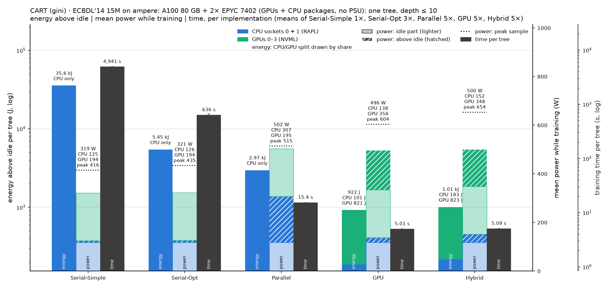
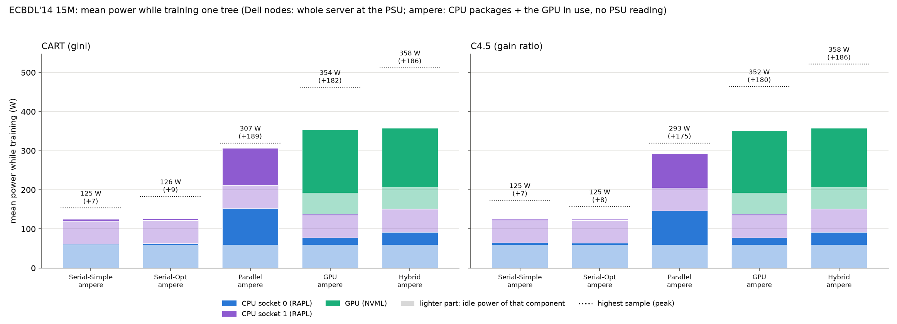
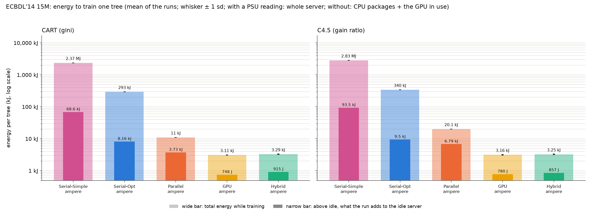
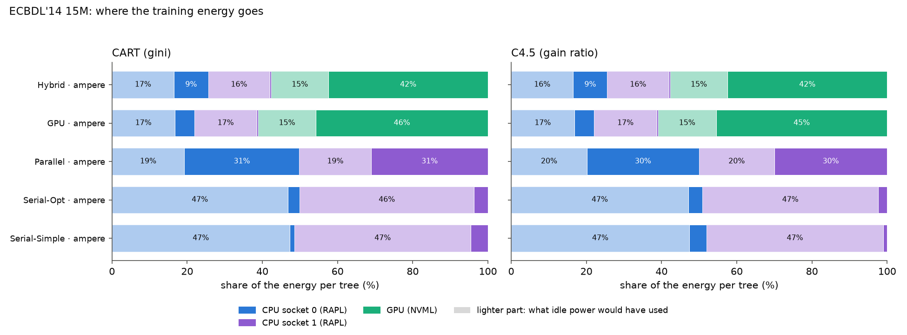
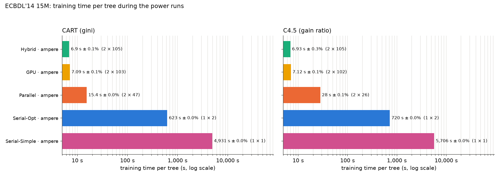
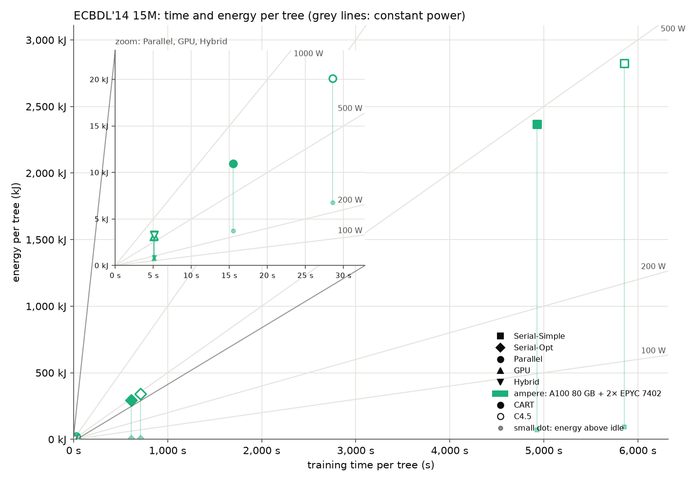
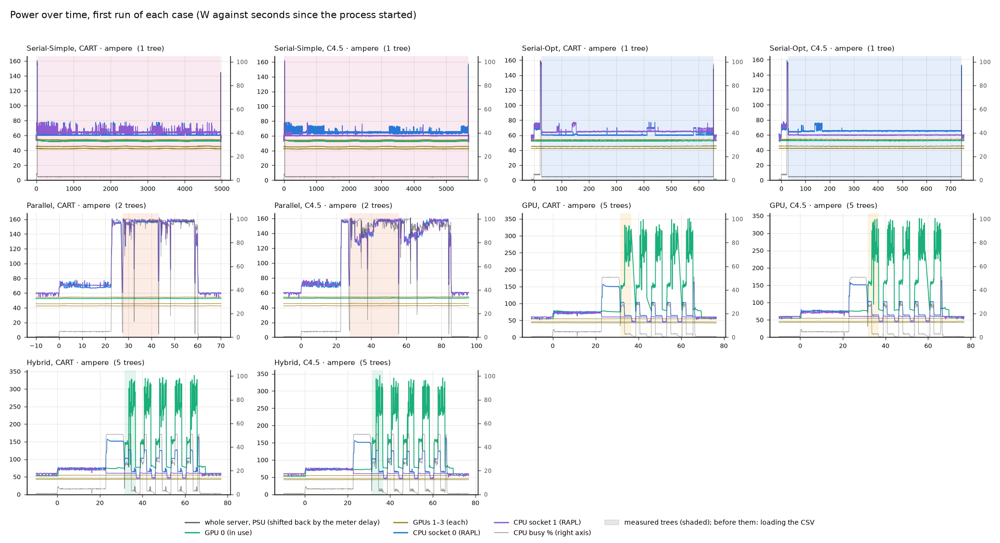

# Power and energy of the five implementations, all on ampere

This experiment measures the time and energy that ./tree's five implementations
need to train one tree on ECBDL'14 15M (15 M rows, 631 features). Settings:
depth ≤ 10, no pruning, CART (gini) and C4.5 (gain ratio). All five ran on **one
node**, ampere, in one SLURM job (job 99, 2026-11-05, 09:20–14:23). ampere is the
only mordor3 node where a user can read both CPU power (RAPL) and GPU power
(NVML), so this is the only place where every implementation gets the same
CPU/GPU split, the same sensors and the same idle reading. The first round
([../results/BENCHMARK.md](../results/BENCHMARK.md)) ran the CPU
implementations on dell4 and epyc1 instead, where only the PSU is readable.

The user allowed this one job as an exception to the rule "no CPU benchmarks on
ampere" (2026-11-05).

| Implementation | Option | Resources |
|---|---|---|
| Serial-Simple | `--simple` | 1 core |
| Serial-Opt | `--serial` | 1 core |
| Parallel ("Multicore" in the paper) | `--parallel` | all 48 cores (`-c 48`) |
| GPU | `--cuda --gpu-only` | GPU 0 (A100 80 GB) + the 24 cores of NUMA node 0 |
| Hybrid | `--cuda` | same |

Code: a clone of GitHub main at f941d7d9 (`src/` as on main that day), built on
ampere on 2026-11-05 with `bench/cluster/build.sh`. Every run built the same
tree: CART 1,863 nodes, C4.5 725 nodes, depth 10.

## What was measured

| Node | Hardware | Sensor | Readout |
|---|---|---|---|
| ampere | Supermicro AS-4124GS-TNR, 2× EPYC 7402 (Zen 2, 24 cores each), 4× A100 (2× 80 GB, 2× 40 GB), 1 TB RAM | both CPU packages (RAPL `power/energy-pkg/` via `perf stat`) + every GPU (NVML energy counter) | 0.1 s |

The sum covers **CPU packages and GPUs only**. RAM, fans, the board, disks
and PSU losses are missing, because ampere has no PSU meter a user can read. On
AMD, the package includes the I/O die, which explains most of the 59 W idle per
socket. CPU frequency governor: `acpi-cpufreq ondemand`, as the admins left it.

Mean idle power (two 60 s windows, at the start and the end of the job):
**314 W** = CPU packages 59 + 59 W + GPU 0 54.5 W + GPUs 1–3 54.7, 42.5 and
45.5 W (142 W together).

## Protocol

[../power_bench.sh](../power_bench.sh) `all` with `TARGET=30 REPS=5
REPS_BY="simple=1 serial=3"`. [../pwrlog.py](../pwrlog.py) samples the GPUs
every 0.1 s for the whole job, and `perf stat -I 100` does the same for RAPL.

1. **Warm-up.** Parallel, GPU and Hybrid each train two trees per algorithm. The
   second tree's time sets K, the number of trees per process, so that a
   process trains for at least 30 s: K = 2 for Parallel and K = 5 for GPU and
   Hybrid.
2. **Idle.** 60 s at the start and 60 s at the end. The idle power is their
   mean.
3. **Runs.** Round-robin rounds over algorithm × implementation, with 20 s of
   idle before each process. Serial-Simple ran once (82 min CART, 94 min
   C4.5), Serial-Opt 3 times, and Parallel, GPU and Hybrid 5 times each.
4. **Which tree counts.** Only the **first** tree of each process: that is the
   tree the time benchmarks time. On the GPU, later trees in the same process
   are slower (about 7 s instead of 5 s), because `gpu setup` uploads the data
   again. They are listed separately below.
5. **Integration** ([../analyze.py](../analyze.py)) over each tree's printed
   window: the GPUs' NVML energy counters are interpolated at the window's
   edges; RAPL joules are weighted by how much of each `perf` interval falls
   inside the window.

The spread between runs is 0.3–0.5% for time and 0.3–1.4% for energy on the fast
implementations. For Serial-Opt CART it is 4% (617–665 s).

### A sampler bug found and fixed in this run

NVML calls sometimes block for about 2 s. On ampere this happens every time a
GPU tree ends. pwrlog.py took the timestamp **before** its reads, so the
counters of the sample taken right after a GPU tree were read about 2 s later
than their timestamp. Every GPU window ends just before such a sample, so each
GPU and Hybrid tree got about 2 s of extra energy on all four GPUs (+0.25 kJ on
the unused GPUs alone, +0.4 kJ in all: GPU CART read 2.91 kJ instead of 2.52 kJ). The fix:

- `analyze.py` now times the counters with a corrected read time: a sample
  followed by a gap of more than 0.3 s was read just before the next sample.
- `pwrlog.py` now also writes `t_end`, the time after the reads, which
  analyze.py uses when it is there.

With the fix, the unused GPUs during GPU trees are back at their idle power
(54.7, 42.5, 45.5 W), and the energy spread between runs fell from 1.4–4.1% to
0.3–1.4%. The first round on ampere had the same error. It is reanalysed with
the fix and corrected in [../results/BENCHMARK.md](../results/BENCHMARK.md).
Both rounds now agree within 1% (GPU CART 2.53 kJ there, 2.52 kJ here). The
dell and epyc PSU numbers did not change.

## Results

`± x%` is the standard deviation over the runs, as a percentage of the mean.
"Above idle" subtracts the idle power of every component over the same window.
The full tables are in [summary.md](summary.md) and [summary.csv](summary.csv),
and every run is in [runs.csv](runs.csv).

### CART (gini)

| Implementation | Runs | Time per tree | Mean power | Above idle | Peak | Energy per tree | Energy above idle |
|---|---|---|---|---|---|---|---|
| Serial-Simple | 1 | 4,941 s | 319 W | 5 W | 416 W | 1.58 MJ | 23.5 kJ |
| Serial-Opt | 3 | 636 s ± 4.0% | 321 W | 6 W | 435 W | 204 kJ ± 4.4% | 4.13 kJ |
| Parallel | 5 | 15.4 s ± 0.3% | 502 W | 187 W | 515 W | 7.89 kJ ± 0.4% | 2.95 kJ |
| GPU | 5 | 5.01 s ± 0.3% | 496 W | 181 W | 604 W | 2.52 kJ ± 0.8% | 0.92 kJ |
| Hybrid | 5 | 5.09 s ± 0.3% | 500 W | 186 W | 654 W | 2.71 kJ ± 0.3% | 1.01 kJ |

### C4.5 (gain ratio)

| Implementation | Runs | Time per tree | Mean power | Above idle | Peak | Energy per tree | Energy above idle |
|---|---|---|---|---|---|---|---|
| Serial-Simple | 1 | 5,656 s | 319 W | 5 W | 455 W | 1.80 MJ | 26.1 kJ |
| Serial-Opt | 3 | 717 s ± 0.3% | 320 W | 5 W | 453 W | 229 kJ ± 0.4% | 3.85 kJ |
| Parallel | 5 | 27.7 s ± 0.3% | 488 W | 173 W | 515 W | 13.7 kJ ± 0.4% | 4.87 kJ |
| GPU | 5 | 5.06 s ± 0.5% | 494 W | 180 W | 606 W | 2.54 kJ ± 1.4% | 0.93 kJ |
| Hybrid | 5 | 5.12 s ± 0.3% | 500 W | 185 W | 663 W | 2.72 kJ ± 0.5% | 1.01 kJ |

### Energy split per tree

| Implementation | Algorithm | CPU socket 0 | CPU socket 1 | GPU 0 (in use) | GPUs 1–3 (unused) |
|---|---|---|---|---|---|
| Serial-Simple | CART | 300 kJ | 318 kJ | 259 kJ | 699 kJ |
| Serial-Opt | CART | 40.1 kJ | 40.3 kJ | 33.5 kJ | 90 kJ |
| Parallel | CART | 2.40 kJ | 2.42 kJ | 838 J | 2.22 kJ |
| GPU | CART | 395 J | 304 J | 1.10 kJ | 718 J |
| Hybrid | CART | 497 J | 325 J | 1.12 kJ | 769 J |
| Serial-Simple | C4.5 | 366 kJ | 339 kJ | 297 kJ | 800 kJ |
| Serial-Opt | C4.5 | 45.7 kJ | 44.3 kJ | 37.8 kJ | 102 kJ |
| Parallel | C4.5 | 4.11 kJ | 4.12 kJ | 1.49 kJ | 3.96 kJ |
| GPU | C4.5 | 400 J | 308 J | 1.10 kJ | 731 J |
| Hybrid | C4.5 | 499 J | 327 J | 1.13 kJ | 770 J |

### Later trees in the same process

| Implementation | Algorithm | First tree | Later trees (mean) |
|---|---|---|---|
| Parallel | CART | 15.4 s, 7.89 kJ | 15.4 s, 7.89 kJ |
| Parallel | C4.5 | 27.7 s, 13.7 kJ | 27.9 s, 13.8 kJ |
| GPU | CART | 5.01 s, 2.52 kJ | 7.13 s, 3.22 kJ |
| GPU | C4.5 | 5.06 s, 2.54 kJ | 7.17 s, 3.25 kJ |
| Hybrid | CART | 5.09 s, 2.71 kJ | 6.92 s, 3.30 kJ |
| Hybrid | C4.5 | 5.12 s, 2.72 kJ | 6.95 s, 3.32 kJ |

## Charts

### Energy, power and time in one chart — [CART](chart-cpu-gpu-ampere-cart.png), [C4.5](chart-cpu-gpu-ampere-c45.png)




The summary charts, one per algorithm. Each implementation has three bars,
each on its own axis:

- **Energy above idle per tree** (left axis, log): CPU (sockets 0 + 1, RAPL) in
  blue, GPU (all four, NVML) in green. On a log axis, a plain stack would hide
  a 10% part, so the boundary is drawn so that each colour's height is its
  share of the bar. The label gives both parts in joules.
  - On GPU and Hybrid, the CPU takes 11% (101 J) and 18% (183 J) of the energy
    above idle (CART).
  - For the CPU implementations the GPU part is shown as 0 ("CPU only"). It is
    slightly negative: during the long CPU runs, GPU 0 cools down and draws
    about 2 W less than in the idle windows, which follow GPU runs. That is why
    the chart's Serial-Simple bar (CPU only, 35.6 kJ CART) is higher than the
    table's 23.5 kJ, which adds the negative GPU part.
- **Mean power while training** (middle axis, linear): CPU and GPU, each split
  into its idle part (lighter) and the part above idle (hatched). The dotted
  line is the highest sample (peak). This bar shows the **CPU power during the
  GPU runs**: 138 W with GPU-only (118 W idle + 20 W) and 152 W with Hybrid
  (+34 W), against 307 W with Parallel. The GPUs draw 348–358 W there (196 W
  idle).
- **Time per tree** (right axis, log), dark grey.

### Mean power while training — [chart-power.png](chart-power.png)



Mean power per component, with each component's idle part lighter. The dotted
line is the peak.
- **Serial-Simple and Serial-Opt** draw 319–321 W: only 5–6 W above idle. A
  single busy Zen 2 core adds very little to a package that idles at 59 W, most
  of it the I/O die. Here, serial energy is 98% idle draw.
- **Parallel** raises both packages from 59 W to about 150 W, a total of
  about 500 W.
- **GPU and Hybrid** also average about 500 W, but most of it is GPU 0 (54 →
  about 215 W). CPU socket 0 is at 78 W with GPU and 92 W with Hybrid.
- The **three unused GPUs** stay at their 142 W idle level throughout, which is
  28% of the total during GPU trees and 44% during serial runs.

### Energy per tree — [chart-energy.png](chart-energy.png)



Total energy (outer bar, ± sd) on a log scale, with the part above idle as the
inner bar. On the same node and sensors (CART / C4.5):
- Serial-Simple → Serial-Opt: 7.7× / 7.9× less energy.
- Serial-Opt → Parallel: 26× / 17× less.
- Parallel → GPU: 3.1× / 5.4× less.
- Overall, GPU trains a tree with 625× / 710× less energy than Serial-Simple.

### Where the energy goes — [chart-energy-split.png](chart-energy-split.png)



Each component's share of each run's energy, with the idle and above-idle parts
shown separately. Serial runs: 39% CPU packages, 16% GPU 0, 44% the unused
GPUs, almost all of it idle. Parallel: 61% CPU. GPU: 28% CPU, 44% GPU 0, 28%
unused GPUs.

### Training time — [chart-time.png](chart-time.png)



Time per tree on a log scale. Speed-ups on ampere (CART / C4.5):
Serial-Simple → Serial-Opt 7.8× / 7.9×, Serial-Opt → Parallel 41× / 26×,
Parallel → GPU 3.1× / 5.5×.

### Time against energy — [chart-time-energy.png](chart-time-energy.png)



Each case as a point on linear axes, with the fast implementations zoomed in
the inset. Grey lines are constant mean power. The serial runs sit at 320 W
and the fast implementations on the 500 W line, so on this node energy is
almost proportional to time. The
small dots, energy above idle, show how little the serial runs add to the idle
draw.

### Power over time — [chart-traces.png](chart-traces.png)



The first run of each case, from process start to end, with the measured tree
shaded. It shows the CSV load (both sockets at about 70 W), Parallel holding both sockets at 150–160 W, and GPU 0's bursts of up to
about 330 W with CPU socket 0 following it. The unused GPUs stay flat.

## Conclusions

1. **Same node, same sensors, same order as before.** Every speed-up lowered the
   energy per tree, from 1.80 MJ (Serial-Simple C4.5) to 2.54 kJ (GPU C4.5). No
   implementation trades time for lower power. All of them run between 320 W
   and 500 W on this node, so time decides the energy.
2. **Serial runs pay almost only for idle.** On ampere, one busy core adds 5–6 W
   to the 314 W that the packages and GPUs draw idle. The serial runs' energy
   is idle power × time.
3. **GPU vs Parallel on one node.** The GPU is 3.1× (CART) and 5.5× (C4.5)
   faster than Parallel on ampere's 48 Zen 2 cores, at the same mean power
   (about 500 W). So it uses 3.1× / 5.4× less energy, and 3.2× / 5.2× less
   above idle.
4. **Hybrid costs 7% more energy than GPU-only.** Hybrid's CPU work raises
   socket 0 from 78 to 92 W, which adds about 100 J per tree, and it does not
   make the tree faster at this size (5.09 s against 5.01 s). The unused GPUs
   also add about 50 J, because the Hybrid window is longer.
5. **Unused GPUs are a fixed cost.** GPUs 1–3 draw 142 W while doing nothing:
   28% of the energy of a GPU tree. A one-GPU server would use about a quarter
   less for the same work.
6. **ampere's CPUs are older.** ampere's 2019 Zen 2 CPUs are slower than
   the CPU nodes of the first round, so its CPU numbers here are not the best
   CPU result. The same tree takes:
   - Parallel CART: 15.4 s, against 6.3 s on epyc1 and 12.2 s on dell4;
   - Serial-Opt CART: 636 s, against 225 s and 356 s;
   - Serial-Simple CART: 4,941 s, against 2,309 s and 2,556 s.

   Above idle, Parallel on ampere (2.95 kJ CART, packages only) is close to
   epyc1's 3.09 kJ (the whole server). But the two are measured differently:
   one counts the CPU packages only, the other the whole PSU.

## Limitations

- **CPU packages and GPUs only.** No RAM, fans, board, disks or PSU losses: the
  real wall-plug energy is higher, and the missing part grows with time. So the
  serial implementations are flattered the most, being the slowest. The admin
  request ([../ADMIN-REQUEST.md](../ADMIN-REQUEST.md)) would add the IPMI PSU
  reading.
- **Idle drift.** GPU 0 cools down during the 80–95-minute serial runs and drops
  about 2 W below its idle level. Energy above idle for the serial runs is
  therefore uncertain by about ±10 kJ. Total energy is not affected.
- **Serial-Simple ran once** (82 + 94 min), so it has no spread.
- **One dataset, depth 10, one node.** The GPU and Hybrid numbers are for the
  A100 80 GB. Hopper's H100 was not measured, because its node has no
  readable CPU power.
- **Governor `ondemand`.** It was left as the admins set it.

## Reproduce

From the repository root on the mordor3 login node (`./tree` built on ampere
with `bench/cluster/build.sh`; data `bench/data/ecbdl_15m/train.csv`):

```bash
mkdir -p bench/results/power-ampere/ampere
sbatch -p ampere -w ampere --exclusive -c 48 -t 9:00:00 -J pwr-all \
  --export=ALL,TARGET=30,REPS=5,REPS_BY="simple=1 serial=3" \
  -o bench/results/power-ampere/ampere/job.log bench/power/power_bench.sh all bench/results/power-ampere/ampere
```

`-c 48` matters: without it, `--exclusive` still gives the job 1 CPU, and
Parallel would run on one core. The analysis runs on a compute node:

```bash
srun -p epyc -w epyc2 -c 4 -t 0:20:00 bench/.venv/bin/python bench/power/analyze.py bench/results/power-ampere
```

`ampere/` holds `machine.txt` (node, commit, GPUs, `cpus available 48`),
`markers.txt` (every phase as Unix times), `samples.csv.gz` (NVML and CPU-busy
samples every 0.1 s), `perf_rapl.csv.gz` (`perf stat` energy per socket every
0.1 s) and `out/` (./tree's output with each tree's training window).
`job.log` is empty.
