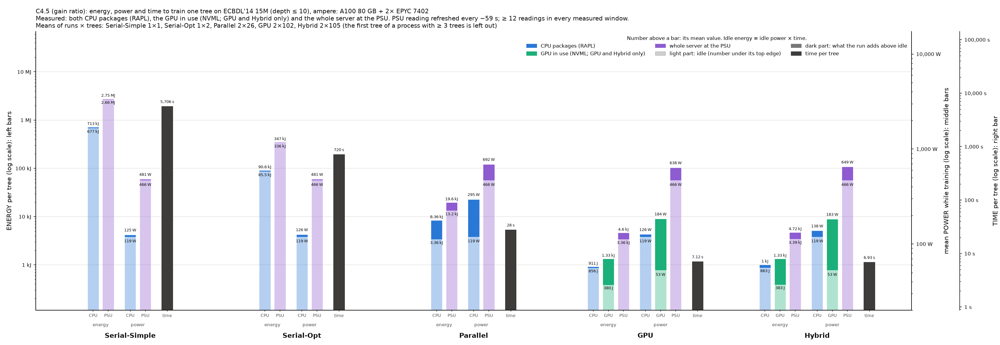

# Power and energy of the five implementations on ampere

This experiment measures the time and energy that ./tree's five implementations
need to train one tree on ECBDL'14 15M (15 M rows, 631 features). Settings:
depth ≤ 10, no pruning, CART (gini) and C4.5 (gain ratio). All five ran in one
SLURM job on ampere (job 136, 2026-11-06, 11:12–18:41).

Since 2026-11-06 a user can read ampere's CPU packages (RAPL) and its PSU
([../ADMIN-REQUEST.md](../ADMIN-REQUEST.md)), and NVML gives the GPU. So every
implementation is measured three ways at once: CPU packages, the GPU it used,
and the whole server. This replaces the first ampere round (job 99,
2026-11-05), which had no PSU reading and counted the GPU's first tree only;
its files are in the git history before commit 0ff754a.

| Implementation | Option | Resources | Runs × trees measured |
|---|---|---|---|
| Serial-Simple | `--simple` | 1 core | 1 × 1 |
| Serial-Opt | `--serial` | 1 core | 1 × 2 (two trees in one process) |
| Parallel ("Multicore" in the paper) | `--parallel` | all 48 cores | 2 × 47 (CART), 2 × 26 (C4.5) |
| GPU | `--cuda --gpu-only` | one A100 80 GB (GPU 0) + the 24 cores of its NUMA node (CPUs 0–23, memory node 0) | 2 × 103 (CART), 2 × 102 (C4.5) |
| Hybrid | `--cuda` | same | 2 × 105 |

Code: main at ebbea71, built on ampere on 2026-11-06 for sm_80 and sm_90
(`~/dt/tree`, `~/dt/tree_cpu`). Every run built the same tree: CART 1,863
nodes, C4.5 725 nodes, depth 10.

## What was measured

| Sensor | What it covers | Readout | Refresh |
|---|---|---|---|
| BMC PSU reading (`/run/power/psu_W`, the admins' IPMI DCMI poller) | whole server, PSU input | 0.1 s | **a point reading every ~59 s** |
| RAPL `package-0`, `package-1` (powercap `energy_uj`) | each CPU socket, including the I/O die | 0.1 s | ~1 ms (hardware) |
| NVML energy counter of GPU 0 | the GPU the run used; GPU and Hybrid runs only | 0.1 s | ~100 ms |

"Rest of the server" in the charts = PSU − both CPU packages − the GPU counted:
memory, fans, disks, network, the board, PSU losses and **the three other A100s,
which stay idle** (141 W together). AMD has no DRAM sensor, so memory is not
separated.

Supermicro AS-4124GS-TNR, 2× EPYC 7402 (Zen 2, 24 cores each), 4× A100 (two
80 GB, two 40 GB), 1 TB RAM. CPU frequency governor: `acpi-cpufreq ondemand`.
Idle power (mean of three windows: 900 s at the start, 900 s after the step
load, 900 s at the end): **PSU 466 W**, CPU packages 118 W (59 + 59 W), GPU 0
53 W.

## How the slow PSU meter is handled

ampere's BMC gives a point reading about once a minute, not an average, so a
short run cannot be measured from it. The protocol makes every measured window
long enough for **at least 10 readings**:

- Parallel, GPU and Hybrid train K = ceil(720 s / t) + 1 trees in one process,
  so trees 2..K last at least 720 s. Serial-Opt trains two trees (1,250 s and
  1,440 s in all); Serial-Simple's one tree lasts 82–95 min.
- The PSU energy of a window is the mean of the readings inside it × the
  window's length. The readings are found as the times the value changes, so
  a reading equal to the previous one is lost; on ampere this barely matters,
  because the value moves by a few watts every time.
- Every measured window has **at least 12 readings** (Parallel 12–13, GPU 12,
  Hybrid 13, Serial-Opt 21–24, Serial-Simple 84–97).
- No lag correction: a point reading has no averaging delay.

The CPU packages and the GPU are counters, so they are exact over any window.

## Protocol

[../power_bench.sh](../power_bench.sh) `all` with `TARGET=720 IDLE=900
STEP=600 REPS=2 REPS_BY="simple=1 serial=1" REPEAT_BY="serial=2"`.
[../pwrlog.py](../pwrlog.py) samples every sensor every 0.1 s for the whole job.

1. **Warm-up.** Parallel, GPU and Hybrid train two trees per algorithm. The
   second tree's time sets K: Parallel 48 (CART) and 27 (C4.5), GPU 104 and
   103, Hybrid 106.
2. **Idle, step, idle.** 900 s idle, 600 s with every core busy, 900 s idle.
3. **Runs.** Round-robin over algorithm × implementation, 20 s of idle before
   each process. Serial-Simple and Serial-Opt ran once, Parallel, GPU and
   Hybrid twice.
4. **Idle.** 900 s at the end.

Every number is per tree. For Parallel, GPU and Hybrid it is trees 2..K of each
process (the first tree is left out); for Serial-Opt both trees of the process.

## Results

### CART (gini)

| Implementation | t per tree | PSU power (above idle) | CPU packages | GPU | PSU energy per tree | above idle | CPU packages | GPU | rest of the server |
|---|---|---|---|---|---|---|---|---|---|
| Serial-Simple | 4,931 s | 480 W (+14) | 125 W | – | 2.37 MJ | 69.0 kJ | 618 kJ | – | 1.75 MJ |
| Serial-Opt | 623 s | 478 W (+12) | 126 W | – | 298 kJ | 7.55 kJ | 78.6 kJ | – | 220 kJ |
| Parallel | 15.4 s ± 0.0% | 700 W (+234) | 310 W | – | 11.0 kJ ± 0.6% | 3.67 kJ | 4.86 kJ | – | 6.13 kJ |
| GPU | 7.09 s ± 0.1% | 650 W (+184) | 126 W | 184 W | 4.67 kJ ± 0.7% | 1.32 kJ | 907 J | 1.32 kJ | 2.44 kJ |
| Hybrid | 6.90 s ± 0.1% | 663 W (+197) | 138 W | 182 W | 4.80 kJ ± 5.0% | 1.43 kJ | 1.00 kJ | 1.32 kJ | 2.48 kJ |

### C4.5 (gain ratio)

| Implementation | t per tree | PSU power (above idle) | CPU packages | GPU | PSU energy per tree | above idle | CPU packages | GPU | rest of the server |
|---|---|---|---|---|---|---|---|---|---|
| Serial-Simple | 5,706 s | 481 W (+15) | 125 W | – | 2.75 MJ | 85.1 kJ | 713 kJ | – | 2.03 MJ |
| Serial-Opt | 720 s | 481 W (+15) | 126 W | – | 347 kJ | 10.7 kJ | 90.6 kJ | – | 256 kJ |
| Parallel | 28.0 s ± 0.1% | 692 W (+225) | 295 W | – | 19.6 kJ ± 0.0% | 6.38 kJ | 8.36 kJ | – | 11.2 kJ |
| GPU | 7.12 s ± 0.1% | 638 W (+171) | 126 W | 184 W | 4.60 kJ ± 0.2% | 1.24 kJ | 911 J | 1.33 kJ | 2.36 kJ |
| Hybrid | 6.93 s ± 0.3% | 649 W (+183) | 138 W | 183 W | 4.72 kJ ± 5.8% | 1.33 kJ | 1.00 kJ | 1.33 kJ | 2.39 kJ |

± is one standard deviation over the runs (none for the single serial runs).
Full tables, with peaks and both sockets: [summary.md](summary.md),
[summary.csv](summary.csv), every run in [runs.csv](runs.csv).

## Charts

- **Energy, power and time in one chart:** [CART](chart-cpu-gpu-ampere-cart.png),
  [C4.5](chart-cpu-gpu-ampere-c45.png). Per implementation: energy per tree (CPU
  packages, GPU, PSU), mean power (CPU packages, GPU, PSU) and time, one bar
  each, on log axes. The light part of a bar ends at the idle value (power: the
  node's idle power, the same for every run; energy: idle power × time).
- [chart-power.png](chart-power.png): mean power, stacked socket 0, socket 1,
  GPU, rest of the server.
- [chart-energy.png](chart-energy.png), [chart-energy-split.png](chart-energy-split.png):
  energy per tree, and the share of each component.
- [chart-time.png](chart-time.png), [chart-time-energy.png](chart-time-energy.png):
  time per tree, and time against energy.
- [chart-traces.png](chart-traces.png): power over time of each case's first run.



## Findings

- **GPU needs the least energy per tree:** 4.60–4.67 kJ at the PSU, 2.4× (CART)
  and 4.3× (C4.5) less than Parallel, 64–75× less than Serial-Opt and 510–600×
  less than Serial-Simple.
- **Hybrid is 3% faster than GPU and uses about 3% more energy,** but the PSU
  numbers of its two runs differ by 7% (CART 4.63 and 4.97 kJ), while their CPU
  packages agree within 0.5%. The difference is in the rest of the server (fans
  or the meter's point readings); two runs cannot tell which.
- **The idle server dominates.** Idle is 466 W, so a serial run adds only
  12–15 W (3%) to it, and even a GPU run only 171–184 W. In a GPU tree the GPU is
  28% of the PSU energy, the CPU packages 19% and the rest of the server 52%;
  the three idle A100s alone are about 1.0 kJ (21%).
- **ampere is the weaker GPU host:** a GPU tree takes 7.1 s and 4.67 kJ here,
  against 3.6 s and 2.64 kJ on hopper's H100
  ([../results-hopper/BENCHMARK.md](../results-hopper/BENCHMARK.md)). Parallel
  CART needs 11.0 kJ here, about as much as on hopper (11.2 kJ), against
  8.55 kJ on dell4 and 3.88 kJ on epyc1.
- **Agrees with job 99** on the parts that both measured: GPU CART later trees
  2.20 kJ (CPU packages + GPU) there and 2.23 kJ here; Parallel CART CPU
  packages 4.82 and 4.86 kJ.

## Reproduce

On mordor3, from `~/dt`:

```bash
sbatch -p ampere -w ampere --exclusive -c 48 -t 12:00:00 -J pwr-psu-ampere \
  --export=ALL,TARGET=720,IDLE=900,STEP=600,REPS=2,REPS_BY="simple=1 serial=1",REPEAT_BY="serial=2" \
  -o bench/results/power-psu-ampere/ampere/job.log bench/power/power_bench.sh all bench/results/power-psu-ampere/ampere
```

Then, on the PC, after copying the job folder:

```bash
bench/.venv/bin/python bench/power/analyze.py bench/power/results-ampere
```

The raw files are in [ampere/](ampere/): `markers.txt`, `machine.txt`,
`samples.csv.gz` (pwrlog.py, which also has the RAPL counters),
`perf_rapl.csv.gz` (`perf stat` RAPL, logged too but not used) and `out/`
(./tree's output per process). `job.log` is empty.
