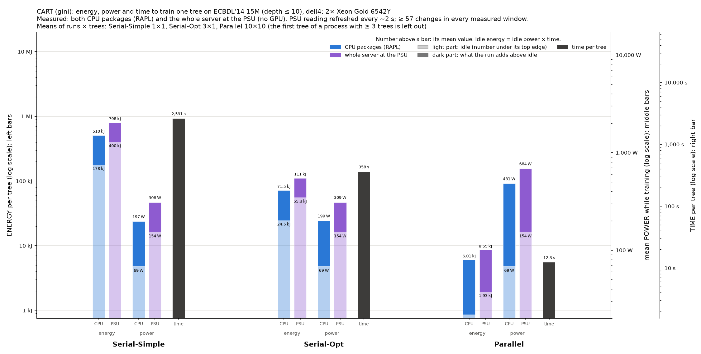

# Power and energy of the three CPU implementations on dell4

This experiment measures the time and energy that ./tree's three CPU
implementations need to train one tree on ECBDL'14 15M (15 M rows, 631
features). Settings: depth ≤ 10, no pruning, CART (gini) and C4.5 (gain ratio).
It ran in one SLURM job on dell4 (job 148, 2026-11-06, 11:45–15:28).

It repeats the first round on dell4
([../results/BENCHMARK.md](../results/BENCHMARK.md), job 85), which could read
only the PSU. Since 2026-11-06 the RAPL counters are readable by users
([../ADMIN-REQUEST.md](../ADMIN-REQUEST.md)), so this run measures the CPU
packages and the whole server at the same time.

| Implementation | Option | Resources | Runs × trees measured |
|---|---|---|---|
| Serial-Simple | `--simple` | 1 core | 1 × 1 |
| Serial-Opt | `--serial` | 1 core | 3 × 1 |
| Parallel ("Multicore" in the paper) | `--parallel` | all 48 cores | 10 × 10 (CART), 10 × 8 (C4.5) |

Code: main at ebbea71, built on ampere on 2026-11-06 (`~/dt/tree_cpu`). Every
run built the same tree: CART 1,863 nodes, C4.5 725 nodes, depth 10.

## What was measured

| Sensor | What it covers | Readout | Refresh |
|---|---|---|---|
| ACPI power meter (`hwmon power_meter`, the iDRAC) | whole server, PSU input | 0.1 s | a 2 s average, refreshed every 2.1 s |
| RAPL `package-0`, `package-1` (powercap `energy_uj`) | each CPU socket | 0.1 s | ~1 ms (hardware) |
| RAPL `dram` ×2, `psys` | memory per socket, platform | 0.1 s | logged in `samples.csv.gz`, not in the charts |

"Rest of the server" in the charts = PSU − both CPU packages: memory, fans,
disks, network, the board and PSU losses.

Dell PowerEdge R660, 2× Xeon Gold 6542Y (24 cores each), 512 GB RAM. CPU
frequency governor: `intel_pstate powersave`. Idle power (mean of three
windows: 300 s at the start, 300 s after the step load, 300 s at the end):
**PSU 154 W**, CPU packages 68 W (37 + 31 W). The PSU meter lags the load by
**4.1 s**, measured on a 300 s all-core step.

## Protocol

[../power_bench.sh](../power_bench.sh) `cpu` with `TARGET=120 IDLE=300
STEP=300 REPS=10 REPS_BY="simple=1 serial=3"`. [../pwrlog.py](../pwrlog.py)
samples every sensor every 0.1 s for the whole job.

1. **Warm-up.** Parallel trains two trees per algorithm. The second tree's time
   sets K = ceil(120 s / t) + 1 trees per process: 11 (CART) and 9 (C4.5).
2. **Idle, step, idle.** 300 s idle, 300 s with every core busy (to measure the
   meter's delay), 300 s idle.
3. **Runs.** Round-robin over algorithm × implementation, 20 s of idle before
   each process. Serial-Simple ran once, Serial-Opt 3 times, Parallel 10 times.
4. **Idle.** 300 s at the end.

Every number is per tree. For Parallel it is trees 2..K of each process (the
first tree is left out); the serial processes train one tree. The PSU energy is
its readings held until the next one, shifted back by the meter's delay. Every
measured window has at least 57 PSU changes (Parallel), 113 (Serial-Opt) and
861 (Serial-Simple).

## Results

### CART (gini)

| Implementation | t per tree | PSU power (above idle) | CPU packages | PSU energy per tree | above idle | CPU packages | rest of the server |
|---|---|---|---|---|---|---|---|
| Serial-Simple | 2,591 s | 308 W (+153) | 197 W | 798 kJ | 398 kJ | 510 kJ | 288 kJ |
| Serial-Opt | 358 s ± 0.4% | 309 W (+155) | 199 W | 111 kJ ± 0.8% | 55.5 kJ | 71.5 kJ | 39.4 kJ |
| Parallel | 12.3 s ± 0.2% | 684 W (+529) | 481 W | 8.55 kJ ± 0.9% | 6.62 kJ | 6.01 kJ | 2.54 kJ |

### C4.5 (gain ratio)

| Implementation | t per tree | PSU power (above idle) | CPU packages | PSU energy per tree | above idle | CPU packages | rest of the server |
|---|---|---|---|---|---|---|---|
| Serial-Simple | 2,859 s | 308 W (+153) | 197 W | 879 kJ | 438 kJ | 563 kJ | 316 kJ |
| Serial-Opt | 434 s ± 0.6% | 310 W (+156) | 198 W | 135 kJ ± 0.3% | 67.6 kJ | 85.9 kJ | 48.6 kJ |
| Parallel | 15.4 s ± 0.6% | 666 W (+512) | 471 W | 10.4 kJ ± 1.9% | 8.0 kJ | 7.36 kJ | 3.05 kJ |

± is one standard deviation over the runs. Full tables, with peaks and both
sockets: [summary.md](summary.md), [summary.csv](summary.csv), every run in
[runs.csv](runs.csv).

## Charts

- **Energy, power and time in one chart:** [CART](chart-cpu-gpu-dell-cart.png),
  [C4.5](chart-cpu-gpu-dell-c45.png). Per implementation: energy per tree (CPU
  packages, PSU), mean power (CPU packages, PSU) and time, on log axes; the
  lighter part of each bar is idle power × time.
- [chart-power.png](chart-power.png): mean power, stacked socket 0, socket 1,
  rest of the server.
- [chart-energy.png](chart-energy.png), [chart-energy-split.png](chart-energy-split.png):
  energy per tree, and the share of each component.
- [chart-time.png](chart-time.png), [chart-time-energy.png](chart-time-energy.png):
  time per tree, and time against energy.
- [chart-traces.png](chart-traces.png): power over time of each case's first run.



## Findings

- **Parallel needs the least energy per tree by far:** 8.55 kJ (CART) and
  10.4 kJ (C4.5), 13× less than Serial-Opt and 85–93× less than Serial-Simple.
- **The CPU packages are 64% of the server's energy** in the serial runs and
  70–71% in Parallel.
- **One busy core raises the server by ~155 W**, the CPU packages by only
  ~130 W.
- **dell4 needs 2.2× epyc1's energy per tree in Parallel** (8.55 vs 3.88 kJ
  CART, [../results-epyc/BENCHMARK.md](../results-epyc/BENCHMARK.md)): it is
  2× slower and draws 13% more power. For the serial runs the gap is
  1.3–1.8×.
- **Agrees with round 1** (job 85, PSU only, 3 runs): per-tree energy within
  1.5% (Parallel CART 8.55 vs 8.46 kJ, Serial-Simple CART 798 vs 786 kJ).

## Reproduce

On mordor3, from `~/dt`:

```bash
sbatch -p dell -w dell4 --exclusive -c 48 -t 6:00:00 -J pwr-psu-dell \
  --export=ALL,TARGET=120,IDLE=300,STEP=300,REPS=10,REPS_BY="simple=1 serial=3" \
  -o bench/results/power-psu-dell/dell/job.log bench/power/power_bench.sh cpu bench/results/power-psu-dell/dell
```

```bash
bench/.venv/bin/python bench/power/analyze.py bench/results/power-psu-dell
```

The raw files are in [dell/](dell/): `markers.txt`, `machine.txt`,
`samples.csv.gz` (pwrlog.py) and `out/` (./tree's output per process).
