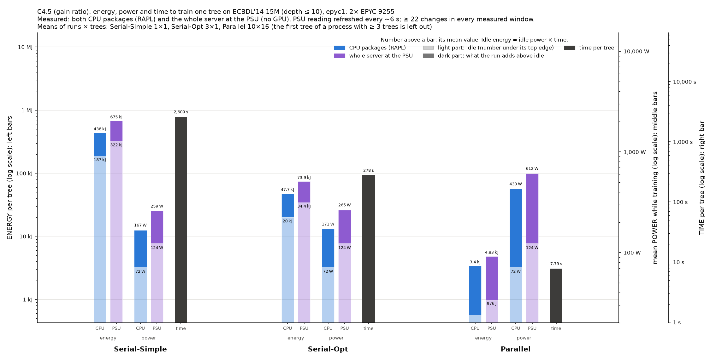

# Power and energy of the three CPU implementations on epyc1

This experiment measures the time and energy that ./tree's three CPU
implementations need to train one tree on ECBDL'14 15M (15 M rows, 631
features). Settings: depth ≤ 10, no pruning, CART (gini) and C4.5 (gain ratio).
It ran in one SLURM job on epyc1 (job 144, 2026-11-06, 11:43–15:00).

It repeats the first round on epyc1
([../results/BENCHMARK.md](../results/BENCHMARK.md), job 86), which could read
only the PSU. Since 2026-11-06 the RAPL counters are readable by users
([../ADMIN-REQUEST.md](../ADMIN-REQUEST.md)), so this run measures the CPU
packages and the whole server at the same time.

| Implementation | Option | Resources | Runs × trees measured |
|---|---|---|---|
| Serial-Simple | `--simple` | 1 core | 1 × 1 |
| Serial-Opt | `--serial` | 1 core | 3 × 1 |
| Parallel ("Multicore" in the paper) | `--parallel` | all 48 cores | 10 × 20 (CART), 10 × 16 (C4.5) |

Code: main at ebbea71, built on ampere on 2026-11-06 (`~/dt/tree_cpu`). Every
run built the same tree: CART 1,863 nodes, C4.5 725 nodes, depth 10.

## What was measured

| Sensor | What it covers | Readout | Refresh |
|---|---|---|---|
| ACPI power meter (`hwmon power_meter`, the iDRAC) | whole server, PSU input | 0.1 s | a 2 s average, refreshed every 4–10 s (median 6.3 s) |
| RAPL `package-0`, `package-1` (powercap `energy_uj`) | each CPU socket, including the I/O die | 0.1 s | ~1 ms (hardware) |

"Rest of the server" in the charts = PSU − both CPU packages: memory, fans,
disks, network, the board and PSU losses. AMD has no DRAM sensor, so memory is
not separated.

Dell PowerEdge R6725, 2× EPYC 9255 (Zen 5, 24 cores each), 512 GB RAM. CPU
frequency governor: `amd-pstate-epp performance`. Idle power (mean of three
windows: 300 s at the start, 300 s after the step load, 300 s at the end):
**PSU 124 W**, CPU packages 72 W (39 + 33 W). The PSU meter lags the load by
**4.9 s**, measured on a 300 s all-core step.

## Protocol

[../power_bench.sh](../power_bench.sh) `cpu` with `TARGET=120 IDLE=300
STEP=300 REPS=10 REPS_BY="simple=1 serial=3"`. [../pwrlog.py](../pwrlog.py)
samples both sensors every 0.1 s for the whole job.

1. **Warm-up.** Parallel trains two trees per algorithm. The second tree's time
   sets K = ceil(120 s / t) + 1 trees per process: 21 (CART) and 17 (C4.5).
2. **Idle, step, idle.** 300 s idle, 300 s with every core busy (to measure the
   meter's delay), 300 s idle.
3. **Runs.** Round-robin over algorithm × implementation, 20 s of idle before
   each process. Serial-Simple ran once, Serial-Opt 3 times, Parallel 10 times.
4. **Idle.** 300 s at the end.

Every number is per tree. For Parallel it is trees 2..K of each process (the
first tree is left out); the serial processes train one tree. The PSU energy is
its readings held until the next one, shifted back by the meter's delay. Every
measured window has at least 20 PSU changes (Parallel), 23 (Serial-Opt) and 130
(Serial-Simple).

## Results

### CART (gini)

| Implementation | t per tree | PSU power (above idle) | CPU packages | PSU energy per tree | above idle | CPU packages | rest of the server |
|---|---|---|---|---|---|---|---|
| Serial-Simple | 2,312 s | 257 W (+134) | 167 W | 594 kJ | 309 kJ | 385 kJ | 209 kJ |
| Serial-Opt | 227 s ± 0.2% | 265 W (+141) | 172 W | 60.2 kJ ± 0.7% | 32.1 kJ | 39.1 kJ | 21.1 kJ |
| Parallel | 6.29 s ± 0.1% | 606 W (+483) | 425 W | 3.88 kJ ± 1.6% | 3.09 kJ | 2.73 kJ | 1.16 kJ |

### C4.5 (gain ratio)

| Implementation | t per tree | PSU power (above idle) | CPU packages | PSU energy per tree | above idle | CPU packages | rest of the server |
|---|---|---|---|---|---|---|---|
| Serial-Simple | 2,609 s | 259 W (+135) | 167 W | 675 kJ | 352 kJ | 436 kJ | 238 kJ |
| Serial-Opt | 278 s ± 0.7% | 265 W (+142) | 171 W | 73.9 kJ ± 1.5% | 39.5 kJ | 47.7 kJ | 26.2 kJ |
| Parallel | 7.79 s ± 0.1% | 612 W (+488) | 430 W | 4.83 kJ ± 1.5% | 3.86 kJ | 3.40 kJ | 1.44 kJ |

± is one standard deviation over the runs. Full tables, with peaks and both
sockets: [summary.md](summary.md), [summary.csv](summary.csv), every run in
[runs.csv](runs.csv).

## Charts

- **Energy, power and time in one chart:** [CART](chart-cpu-gpu-epyc-cart.png),
  [C4.5](chart-cpu-gpu-epyc-c45.png). Per implementation: energy per tree (CPU
  packages, PSU), mean power (CPU packages, PSU) and time, on log axes; the
  lighter part of each bar is idle power × time.
- [chart-power.png](chart-power.png): mean power, stacked socket 0, socket 1,
  rest of the server.
- [chart-energy.png](chart-energy.png), [chart-energy-split.png](chart-energy-split.png):
  energy per tree, and the share of each component.
- [chart-time.png](chart-time.png), [chart-time-energy.png](chart-time-energy.png):
  time per tree, and time against energy.
- [chart-traces.png](chart-traces.png): power over time of each case's first run.



## Findings

- **Parallel needs the least energy per tree by far:** 3.88 kJ (CART) and
  4.83 kJ (C4.5), 15× less than Serial-Opt and 140–155× less than
  Serial-Simple. It draws 2.3× the power of a serial run but finishes 36–370×
  sooner.
- **The CPU packages are 65% of the server's energy** in the serial runs and
  70% in Parallel. The rest (124 − 72 = 52 W at idle) is mostly a fixed cost,
  so it weighs more in long runs.
- **One busy core raises the server by ~135–140 W**, but the CPU packages by
  only ~95–100 W: the remaining ~40 W is memory, fans and the rest. Serial runs
  pay this for their whole length.
- **Agrees with round 1** (job 86, PSU only, 3 runs): per-tree energy within
  2.5% (Parallel CART 3.88 vs 3.80 kJ, Serial-Simple CART 594 vs 593 kJ).

## Reproduce

On mordor3, from `~/dt`:

```bash
sbatch -p epyc -w epyc1 --exclusive -c 48 -t 6:00:00 -J pwr-psu-epyc \
  --export=ALL,TARGET=120,IDLE=300,STEP=300,REPS=10,REPS_BY="simple=1 serial=3" \
  -o bench/results/power-psu-epyc/epyc/job.log bench/power/power_bench.sh cpu bench/results/power-psu-epyc/epyc
```

```bash
bench/.venv/bin/python bench/power/analyze.py bench/results/power-psu-epyc
```

The raw files are in [epyc/](epyc/): `markers.txt`, `machine.txt`,
`samples.csv.gz` (pwrlog.py) and `out/` (./tree's output per process).
