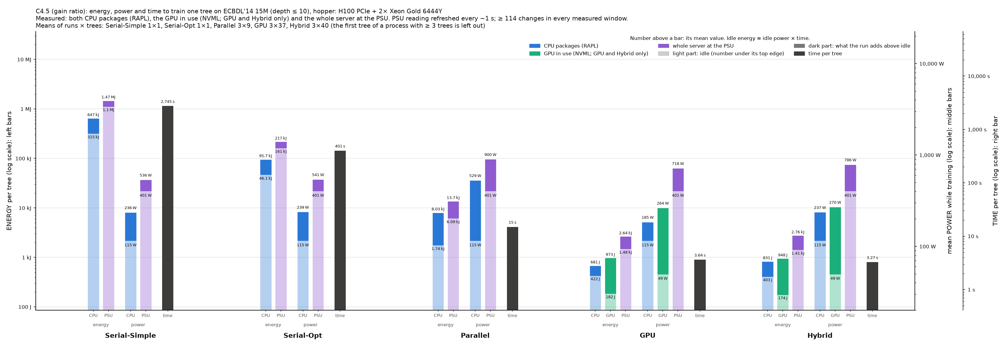

# Power and energy of the five implementations on hopper

This experiment measures the time and energy that ./tree's five implementations
need to train one tree on ECBDL'14 15M (15 M rows, 631 features). Settings:
depth ≤ 10, no pruning, CART (gini) and C4.5 (gain ratio). All five ran in one
SLURM job on hopper (job 137, 2026-11-06, 12:48–15:55).

Since 2026-11-06 a user can read hopper's CPU packages (RAPL) and its PSU
([../ADMIN-REQUEST.md](../ADMIN-REQUEST.md)), and NVML gives the GPU. So every
implementation is measured three ways at once: CPU packages, the GPU it used,
and the whole server.

| Implementation | Option | Resources | Runs × trees measured |
|---|---|---|---|
| Serial-Simple | `--simple` | 1 core | 1 × 1 |
| Serial-Opt | `--serial` | 1 core | 1 × 1 |
| Parallel ("Multicore" in the paper) | `--parallel` | all 32 cores | 3 × 10 (CART), 3 × 9 (C4.5) |
| GPU | `--cuda --gpu-only` | one H100 (GPU 2) + the 16 cores of its NUMA node (CPUs 16–31, memory node 1) | 3 × 37 |
| Hybrid | `--cuda` | same | 3 × 40 |

Code: main at ebbea71, built on ampere on 2026-11-06 for sm_80 and sm_90
(`~/dt/tree`, `~/dt/tree_cpu`). Every run built the same tree: CART 1,863
nodes, C4.5 725 nodes, depth 10.

## What was measured

| Sensor | What it covers | Readout | Refresh |
|---|---|---|---|
| ACPI power meter (`hwmon power_meter`) | whole server, PSU input | 0.1 s | ~1 s |
| RAPL `package-0`, `package-1` (powercap `energy_uj`) | each CPU socket | 0.1 s | ~1 ms (hardware) |
| NVML energy counter of GPU 2 | the GPU the run used; GPU and Hybrid runs only | 0.1 s | ~100 ms |

"Rest of the server" in the charts = PSU − both CPU packages − the GPU counted:
memory, fans, disks, network, the board, PSU losses and the rest of the
hardware. `/run/power/psu_W` (the BMC reading) is logged too; it agrees with
the ACPI meter, which the analysis uses.

Supermicro SYS-741GE-TNRT, 2× Xeon Gold 6444Y (16 cores each), H100 PCIe 80 GB,
1 TB RAM. CPU frequency governor: `intel_cpufreq schedutil`. Idle power (mean
of three windows: 300 s at the start, 300 s after the step load, 300 s at the
end): **PSU 401 W**, CPU packages 114 W (62 + 52 W), GPU 2 49 W. The PSU meter
lags the load by **1.7 s**, measured on a 300 s all-core step.

## Protocol

[../power_bench.sh](../power_bench.sh) `all` with `GPU=2 GPU_CPUS=16-31
GPU_MEM=1 GPU_THREADS=16 TARGET=120 IDLE=300 STEP=300 REPS=3
REPS_BY="simple=1 serial=1"`. [../pwrlog.py](../pwrlog.py) samples every
sensor every 0.1 s for the whole job.

1. **Warm-up.** Parallel, GPU and Hybrid train two trees per algorithm. The
   second tree's time sets K = ceil(120 s / t) + 1 trees per process: Parallel
   11 (CART) and 10 (C4.5), GPU 38, Hybrid 41.
2. **Idle, step, idle.** 300 s idle, 300 s with every core busy (to measure the
   meter's delay), 300 s idle.
3. **Runs.** Round-robin over algorithm × implementation, 20 s of idle before
   each process. Serial-Simple and Serial-Opt ran once, Parallel, GPU and
   Hybrid 3 times.
4. **Idle.** 300 s at the end.

Every number is per tree. For Parallel, GPU and Hybrid it is trees 2..K of each
process (the first tree is left out); the serial processes train one tree. The
PSU energy is its readings held until the next one, shifted back by the
meter's delay. Every measured window has at least 94 PSU changes.

## Results

### CART (gini)

| Implementation | t per tree | PSU power (above idle) | CPU packages | GPU | PSU energy per tree | above idle | CPU packages | GPU | rest of the server |
|---|---|---|---|---|---|---|---|---|---|
| Serial-Simple | 2,505 s | 536 W (+135) | 237 W | – | 1.34 MJ | 338 kJ | 593 kJ | – | 750 kJ |
| Serial-Opt | 337 s | 541 W (+141) | 238 W | – | 182 kJ | 47.3 kJ | 80.3 kJ | – | 102 kJ |
| Parallel | 12.2 s ± 0.2% | 900 W (+499) | 531 W | – | 11.2 kJ ± 0.2% | 6.21 kJ | 6.61 kJ | – | 4.59 kJ |
| GPU | 3.61 s ± 0.2% | 723 W (+322) | 185 W | 265 W | 2.64 kJ ± 0.2% | 1.18 kJ | 677 J | 968 J | 994 J |
| Hybrid | 3.24 s ± 0.1% | 787 W (+387) | 237 W | 270 W | 2.74 kJ ± 0.3% | 1.35 kJ | 825 J | 942 J | 978 J |

### C4.5 (gain ratio)

| Implementation | t per tree | PSU power (above idle) | CPU packages | GPU | PSU energy per tree | above idle | CPU packages | GPU | rest of the server |
|---|---|---|---|---|---|---|---|---|---|
| Serial-Simple | 2,745 s | 536 W (+135) | 236 W | – | 1.47 MJ | 370 kJ | 647 kJ | – | 823 kJ |
| Serial-Opt | 401 s | 541 W (+140) | 239 W | – | 217 kJ | 56.4 kJ | 95.7 kJ | – | 122 kJ |
| Parallel | 15.0 s ± 0.3% | 900 W (+499) | 529 W | – | 13.7 kJ ± 0.3% | 7.58 kJ | 8.03 kJ | – | 5.63 kJ |
| GPU | 3.64 s ± 0.4% | 718 W (+317) | 185 W | 264 W | 2.64 kJ ± 0.2% | 1.17 kJ | 681 J | 973 J | 987 J |
| Hybrid | 3.27 s ± 0.5% | 786 W (+385) | 237 W | 270 W | 2.76 kJ ± 0.3% | 1.35 kJ | 831 J | 948 J | 981 J |

± is one standard deviation over the runs (none for the single serial runs).
Full tables, with peaks and both sockets: [summary.md](summary.md),
[summary.csv](summary.csv), every run in [runs.csv](runs.csv).

## Charts

- **Energy, power and time in one chart:** [CART](chart-cpu-gpu-hopper-cart.png),
  [C4.5](chart-cpu-gpu-hopper-c45.png). Per implementation: energy per tree (CPU
  packages, GPU, PSU), mean power (CPU packages, GPU, PSU) and time, one bar
  each, on log axes. The light part of a bar ends at the idle value (power: the
  node's idle power, the same for every run; energy: idle power × time).
- [chart-power.png](chart-power.png): mean power, stacked socket 0, socket 1,
  GPU, rest of the server.
- [chart-energy.png](chart-energy.png), [chart-energy-split.png](chart-energy-split.png):
  energy per tree, and the share of each component.
- [chart-time.png](chart-time.png), [chart-time-energy.png](chart-time-energy.png):
  time per tree, and time against energy.
- [chart-traces.png](chart-traces.png): power over time of each case's first run.



## Findings

- **GPU and Hybrid need the least energy per tree:** 2.64–2.76 kJ at the PSU,
  4.1–5.2× less than Parallel, ~70–80× less than Serial-Opt and ~490–560× less
  than Serial-Simple.
- **Hybrid is 10% faster than GPU but uses 4% more energy:** its 16 CPU threads
  add ~50 W on the CPU packages (237 vs 185 W) and ~65 W at the PSU, which
  outweighs the shorter time.
- **The whole server matters more than the GPU.** In a GPU run the GPU is only
  37% of the PSU energy (968 J of 2.64 kJ); the CPU packages are 26% and the
  rest of the server 38%.
- **hopper is an expensive host for CPU-only work:** its 401 W idle is 2.6× dell4's
  and 3.2× epyc1's. Parallel needs 11.2 kJ per CART tree here against 8.55 kJ on
  dell4 and 3.88 kJ on epyc1
  ([../results-dell/BENCHMARK.md](../results-dell/BENCHMARK.md),
  [../results-epyc/BENCHMARK.md](../results-epyc/BENCHMARK.md)); for the serial
  runs the idle cost dominates (56% of the energy is the rest of the server).
- **The steady-state trees are fast on the H100:** 3.6 s (GPU) and 3.2 s (Hybrid)
  per tree, against ~7 s for the later trees on ampere's A100 (job 99).

## Reproduce

On mordor3, from `~/dt`:

```bash
sbatch -p hopper -w hopper --exclusive -c 32 -t 10:00:00 -J pwr-psu-hopper \
  --export=ALL,GPU=2,GPU_CPUS=16-31,GPU_MEM=1,GPU_THREADS=16,TARGET=120,IDLE=300,STEP=300,REPS=3,REPS_BY="simple=1 serial=1" \
  -o bench/results/power-psu-hopper/hopper/job.log bench/power/power_bench.sh all bench/results/power-psu-hopper/hopper
```

Then, on the PC, after copying the job folder:

```bash
bench/.venv/bin/python bench/power/analyze.py bench/power/results-hopper
```

The raw files are in [hopper/](hopper/): `markers.txt`, `machine.txt`,
`samples.csv.gz` (pwrlog.py) and `out/` (./tree's output per process).
