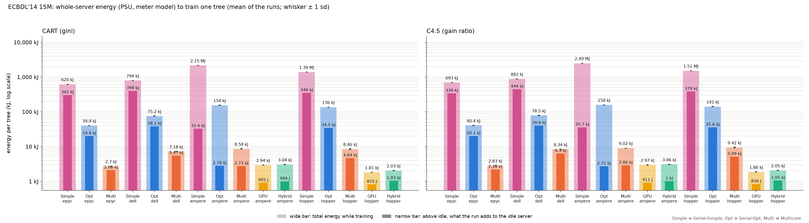
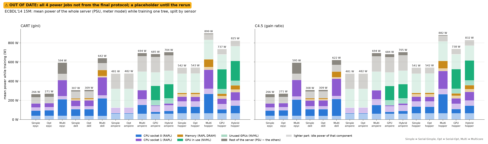
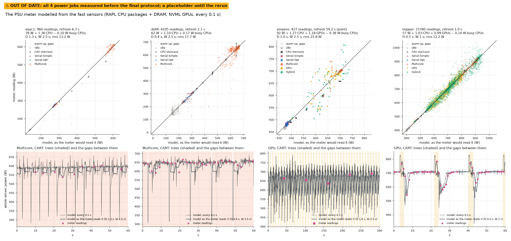
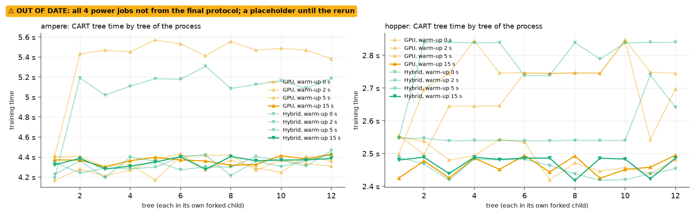

# Energy per tree: ./tree's five backends on four servers

ECBDL'14 15M (the first 15M rows of ECBDL'14's train.csv, 631 features),
depth ≤ 10, no pruning, CART and C4.5. Code f53347a9 (the build of the 2026-11-15
time benchmark rerun, `~/dt-final`). Jobs 169 (epyc1), 170 (dell4), 173
(ampere) and 174 (hopper), 2026-11-15/16; the warm-up checks 171 and 172.
Method: [../README.md](../README.md#method). Every table, with more columns:
[summary.md](summary.md); every process: [runs.csv](runs.csv); the meter
models: [meter.csv](meter.csv).

**Energy** is the whole server's, at the PSU, over the training windows only
(the CSV load, the gaps between trees and the evaluation are left out), from
each node's meter modelled from the fast sensors. **Above idle** subtracts
what the idle server would have used in the same time.

## Results

Energy per tree (± one standard deviation over the processes):

| Backend | Node | CART: t | E | above idle | C4.5: t | E | above idle |
|---|---|---|---|---|---|---|---|
| Serial-Simple | epyc1 | 2,328 s | 620 kJ | 302 kJ | 2,603 s | 693 kJ | 338 kJ |
| Serial-Simple | dell4 | 2,589 s | 794 kJ | 398 kJ | 2,867 s | 882 kJ | 444 kJ |
| Serial-Simple | ampere | 4,470 s | 2.15 MJ | 32.6 kJ | 5,185 s | 2.49 MJ | 35.7 kJ |
| Serial-Simple | hopper | 2,560 s | 1.39 MJ | 348 kJ | 2,792 s | 1.51 MJ | 379 kJ |
| Serial-Opt | epyc1 | 147 s | 39.9 kJ ± 0.4% | 19.8 kJ | 149 s | 40.4 kJ ± 0.5% | 20.1 kJ |
| Serial-Opt | dell4 | 243 s | 75.2 kJ ± 0.9% | 38.1 kJ | 254 s | 78.5 kJ ± 0.5% | 39.8 kJ |
| Serial-Opt | ampere | 319 s | 154 kJ ± 0.2% | 2.78 kJ | 328 s | 158 kJ ± 0.2% | 2.71 kJ |
| Serial-Opt | hopper | 251 s | 136 kJ ± 0.3% | 34.5 kJ | 260 s | 141 kJ ± 0.9% | 35.6 kJ |
| Multicore | epyc1 | 4.54 s | 2.70 kJ ± 0.3% | 2.08 kJ | 4.77 s | 2.83 kJ ± 0.4% | 2.18 kJ |
| Multicore | dell4 | 11.2 s | 7.18 kJ ± 0.2% | 5.47 kJ | 13.4 s | 8.34 kJ ± 0.9% | 6.30 kJ |
| Multicore | ampere | 12.4 s | 8.58 kJ ± 0.3% | 2.73 kJ | 13.0 s | 9.02 kJ ± 0.2% | 2.86 kJ |
| Multicore | hopper | 9.40 s | 8.46 kJ ± 2.6% | 4.64 kJ | 10.7 s | 9.42 kJ ± 2.7% | 5.09 kJ |
| GPU | ampere (A100) | 4.29 s | 2.94 kJ ± 0.3% | 905 J | 4.34 s | 2.97 kJ ± 1.0% | 911 J |
| GPU | hopper (H100) | 2.46 s | **1.81 kJ** ± 0.3% | 815 J | 2.51 s | **1.86 kJ** ± 0.8% | 836 J |
| Hybrid | ampere (A100) | 4.31 s | 3.04 kJ ± 0.7% | 994 J | 4.34 s | 3.06 kJ ± 0.2% | 1.00 kJ |
| Hybrid | hopper (H100) | 2.46 s | 2.03 kJ ± 0.6% | 1.03 kJ | 2.47 s | 2.05 kJ ± 0.9% | 1.05 kJ |

Runs × trees: Serial-Simple 1 × 1, Serial-Opt 3 × 1, the others 3 processes of
9–58 trees (about 120 s of training each; 240 s on ampere).

What it shows:

- **The H100 server uses the least energy per tree**: 1.81 kJ (GPU), 33%
  less than Multicore on epyc1 (2.70 kJ), the best CPU server. Above idle
  the gap is wider: 0.82 kJ against 2.08 kJ (2.6×).
- **The A100 server is about as efficient as epyc1's Multicore** (2.94 kJ
  against 2.70 kJ): ampere's idle power, 474 W with four A100s and two
  2019 EPYCs, is 70% of what it draws while training.
- **Hybrid costs 3% (A100) to 12% (H100) more energy than GPU** for the same
  time: its CPU threads work while the GPU does (CPU packages + DRAM 0.88 kJ
  against 0.66 kJ per H100 tree).
- **Serial-Opt uses 10–17× less energy than Serial-Simple**, and Multicore
  another 9–18× less than Serial-Opt.
- **Idle dominates single-thread runs on the GPU servers**: one busy core adds
  only 7–9 W to ampere's 474 W, so 98% of its Serial energy is idle power.
  The energy of a slow run is mostly the time it keeps the server on.

Per node, CPU, GPU and PSU energy and power side by side:
[epyc1](chart-cpu-gpu-epyc-cart.png), [dell4](chart-cpu-gpu-dell-cart.png),
[ampere](chart-cpu-gpu-ampere-cart.png), [hopper](chart-cpu-gpu-hopper-cart.png)
(and `-c45`); where the energy goes: [chart-energy-split.png](chart-energy-split.png);
time against energy: [chart-time-energy.png](chart-time-energy.png); power
over time of each case's first process: [chart-traces.png](chart-traces.png).

## The meter model

| Node | meter refresh | readings | delay D, window W | model (W) | rms of a reading |
|---|---|---|---|---|---|
| epyc1 | 6.3 s | 960 | 1.3 s, 2.5 s | 39 + 1.36·CPU − 0.10·busy | 13 W |
| dell4 | 2.1 s | 4,105 | 0.4 s, 2.5 s | 62 + 1.10·CPU + 0.17·busy | 18 W |
| ampere | 59 s (point) | 427 | 1.0 s, 2.5 s | 92 + 1.27·CPU + 1.18·GPUs − 0.38·busy | 23 W |
| hopper | 1.0 s | 15,780 | 0.5 s, 1 s | 57 + 1.03·CPU + 0.99·GPUs − 0.14·busy | 12 W |

CPU = RAPL packages + DRAM, GPUs = all of the node's GPUs (NVML), busy = busy
CPUs. The model's idle power matches the meter's within 2 W (ampere 6 W).
The model fitted on either half of a job gives the same energy per tree
within 0.2% on epyc1, dell4 and hopper (Multicore on epyc1: 1.6%), and within
2.7% on ampere.

**Model against the meter** ([chart-methods.png](chart-methods.png)): on
windows much longer than the meter's refresh (the Serial runs, Multicore on
dell4 and hopper) the meter's own energy agrees with the model within 1.5%,
and the readings inside the training windows have a mean residual within
±0.9% of the power on every case of the fast meters (epyc1, dell4, hopper),
the 2.5 s H100 trees included. On ampere, whose meter reads once a minute,
only 5–9 readings fall inside a case's GPU or Hybrid windows: their mean residual is
within its statistical error (≤ 3% ± 3.5%). The meter's own reading of a
short window is what the model replaces: on the November 8 hopper job it was
3–5% low on the 3 s GPU trees.

## Time check

The time per tree against the time benchmark
([../../../results/cluster-ecbdl](../../../results/cluster-ecbdl), single
runs, 5 a case, same code): within 3% except

- **Serial-Opt on dell4, 5% faster** (243 s against 256 s): the time
  benchmark ran it on dell2, which has dell4's hardware but is 5% slower on
  this run (Serial-Simple, also on dell2, is within 2%). The energy is
  dell4's, measured with its own time.
- **Multicore on epyc1, CART: +3.1%** (4.54 s against 4.41 s; C4.5 +2.6%).
- **GPU on hopper, C4.5: −3.1%** (2.51 s against 2.59 s).

Multicore on hopper (not in the time benchmark) varied 4% between processes
(9.1 s to 9.9 s per tree, the energy with it); its first tree of each process
was 4–5% slower than the rest.

## Warm-up check

GPU and Hybrid trees need their CPU threads busy before the timer starts
(`--repeat-warmup`), as a single run's CSV load keeps them: without it,
trees 3–12 of a process are 13–14% (H100) and 18–27% (A100) slower.

| Node | warm-up | GPU trees 3–12 | Hybrid trees 3–12 | time benchmark (GPU / Hybrid) |
|---|---|---|---|---|
| ampere | 0 s | 5.48 s | 5.14 s | 4.23 / 4.22 s |
| ampere | **2 s** | 4.32 s | 4.34 s | |
| ampere | 15 s | 4.37 s | 4.35 s | |
| hopper | 0 s | 2.77 s | 2.81 s | 2.47 / 2.42 s |
| hopper | 2 s | 2.70 s | 2.57 s | |
| hopper | 5 s | 2.48 s | 2.45 s | |
| hopper | **15 s** | 2.46 s | 2.47 s | |

The measured runs used 2 s on ampere and 15 s on hopper (bold).

## Notes

- **Hybrid's default `--handoff-rows` changed after this build** (2c688938:
  10 × features, 6310 rows for ECBDL'14; f53347a9 used the rows-based rule).
  The Hybrid rows here, like the time benchmark's, are f53347a9's.
- Serial-Simple: one process per case (40–90 min each).
- ampere has no DRAM sensor (AMD): its memory is in "rest of the server";
  so is epyc1's. The rest also holds the other, idle GPUs (ampere 3 × ~48 W,
  hopper 3 × ~51 W).
