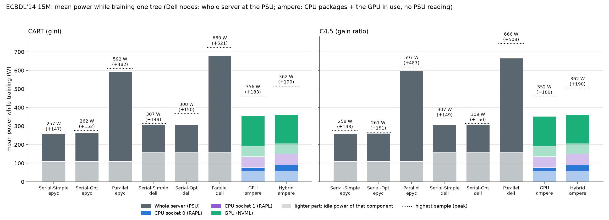
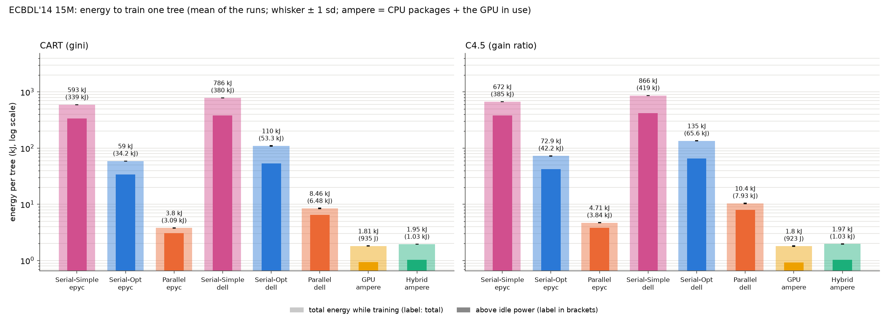
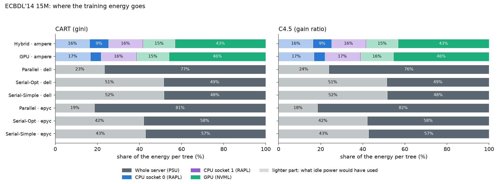
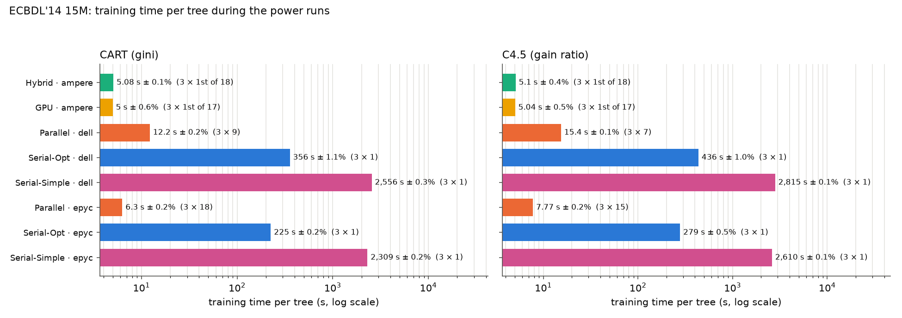
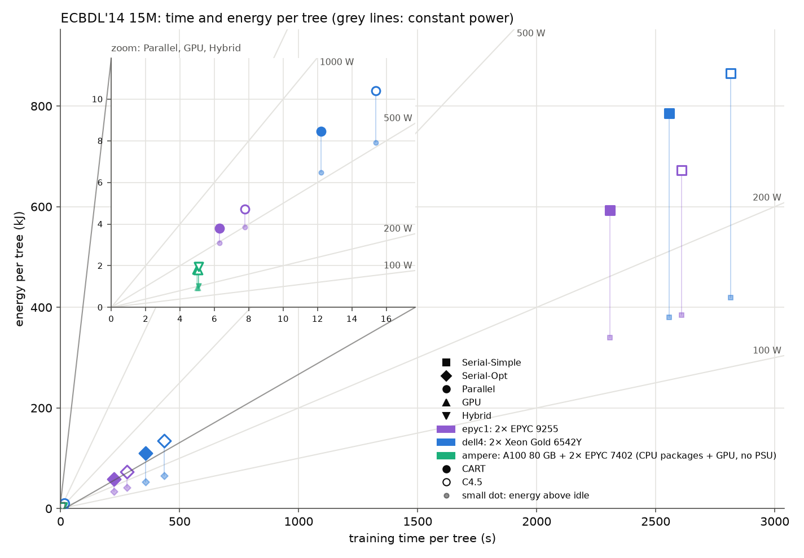
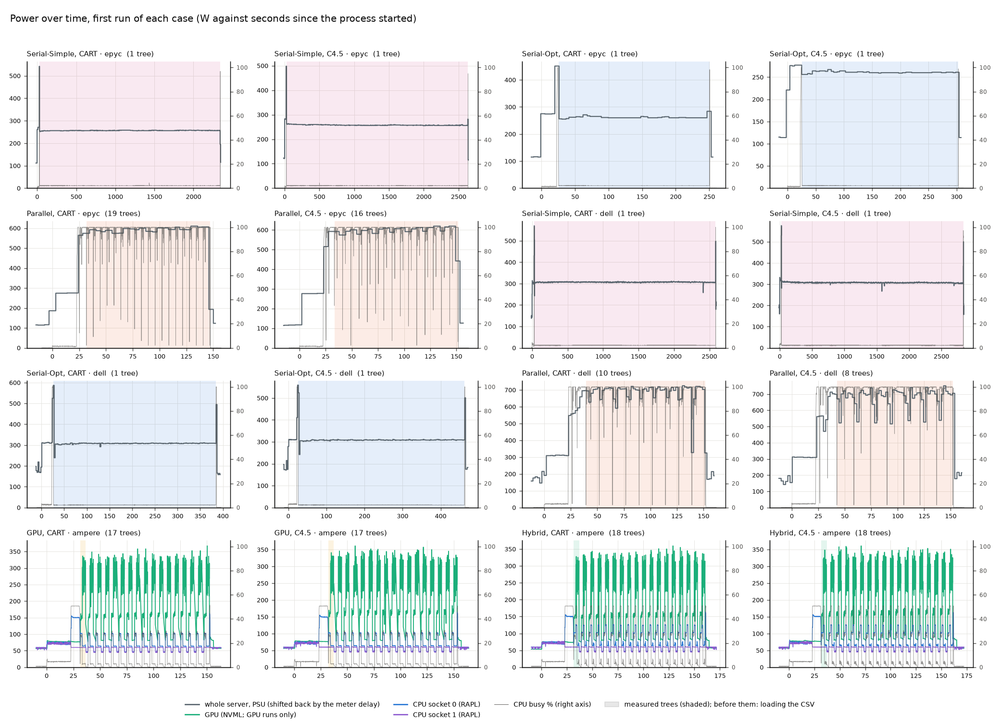

# Power and energy of the five implementations

This experiment measures the time and energy it takes ./tree's five
implementations to train one tree on ECBDL'14 15M (15 M rows, 631 features).
Settings: depth ≤ 10, no pruning, CART (gini) and C4.5 (gain ratio). Every case
ran 3 times, and the tables give the mean. Measured on 2026-11-04 with SLURM
jobs 84–86, at commit 50d29cd plus the `--repeat` option (committed together
with this folder).

**See also [../results-ampere/BENCHMARK.md](../results-ampere/BENCHMARK.md):** all
five implementations on ampere alone (job 99, 2026-11-05), with the same
sensors for every implementation.

**Corrected 2026-11-05:** the ampere numbers (GPU, Hybrid) are reanalysed with
the fixed analyze.py, with two changes. They count only the GPU the run used,
plus both CPU packages. And the GPU energy no longer includes about 2 s of
extra energy per tree: the sampler's NVML reads can block for 2 s right after a
GPU tree, and the counter was then read about 2 s after its timestamp (see the
"sampler bug" section of the ampere-only write-up). The dell and epyc numbers
did not change.

| Implementation | Option | Node |
|---|---|---|
| Serial-Simple | `--simple` | dell4, epyc1 |
| Serial-Opt | `--serial` | dell4, epyc1 |
| Parallel | `--parallel` (all cores) | dell4, epyc1 |
| GPU | `--cuda --gpu-only` (GPU 0 + the 24 cores of NUMA node 0) | ampere |
| Hybrid | `--cuda` (same) | ampere |

## What was measured

No sudo was available, so each node gives only the sensors a user can read
([../README.md](../README.md)):

| Node | Hardware | Sensor | Readout |
|---|---|---|---|
| dell4 | Dell PowerEdge R660, 2× Xeon Gold 6542Y | whole server at the PSU (ACPI `power_meter`) | about every 2 s |
| epyc1 | Dell PowerEdge R6725, 2× EPYC 9255 | whole server at the PSU (ACPI `power_meter`) | about every 6 s |
| ampere | Supermicro AS-4124GS-TNR, 2× EPYC 7402, A100 80 GB | both CPU packages (RAPL via `perf`) + the GPU the run used (NVML energy counter) | 0.1 s |

The ampere numbers do **not** include RAM, fans, the board, disks or PSU
losses, while the dell and epyc numbers include everything. So you can compare
ampere's numbers with each other, but not directly with the CPU nodes. The
comparison that is fair across nodes is the energy **above idle**, which leaves
out the constant part on both kinds of node.

Node conditions: CPU frequency governors as the admins left them (dell4
`intel_pstate powersave`, epyc1 `amd-pstate-epp performance`, ampere
`acpi-cpufreq ondemand`). Mean idle power: dell4 159 W, epyc1 110 W, and
ampere 172 W (CPU packages 59 + 59 W, GPU 54.5 W).

## Protocol

One exclusive SLURM job per node ([../power_bench.sh](../power_bench.sh)).
[../pwrlog.py](../pwrlog.py) samples every sensor every 0.1 s for the whole
job.

1. **Warm-up.** Each fast implementation (Parallel, GPU, Hybrid) trains two
   trees per algorithm. The second tree's time sets the repeat count
   K = ⌈120 s / time⌉. With K trees, the measured window lasts at least 120 s,
   which is long enough for the slow PSU meters.
2. **Idle.** 60 s of idle at the start and 60 s at the end of the job. The idle
   power is their mean.
3. **Runs.** 3 rounds, round-robin over algorithm × implementation, with 20 s
   of idle before each process. Each process is `./tree --repeat K`: it loads
   the CSV once, then trains K trees and prints each tree's start and end as
   Unix times. The serial implementations use K = 1 (225–2,815 s per tree).
4. **Integration** ([../analyze.py](../analyze.py)) over the printed windows:
   - **PSU:** each reading is held until the next one, then everything is
     shifted back by the meter's delay, measured from the process start to the
     rise in power: 2.2 s on dell4, 5.3 s on epyc1.
   - **CPU (ampere):** the joules in each `perf` interval, weighted by how
     much of the interval falls inside the window.
   - **GPU:** the difference of the NVML energy counter.
5. **Which trees count.**
   - **dell, epyc:** trees 2..K. The first tree is left out because its window
     starts while the meter is still settling after the CSV load. The result is
     the energy divided by the number of trees.
   - **ampere:** only the first tree. That is the tree the time benchmarks
     report. In a process that trains many trees, the later ones are slower,
     because `gpu setup` reuploads data (about 7 s instead of 5 s). They are
     listed separately below. The fast sensors measure a 5 s window exactly.

The whole run took 42 min on ampere, 5.7 h on dell4 and 5.0 h on epyc1. The
spread between the 3 runs is at most 1.4% on dell and epyc. On ampere it is
0.1–0.6% for time and 0.2–1.5% for energy.

## Results

`± x%` is the standard deviation over the 3 runs, as a percentage of the mean.
"runs × trees" is how many trees each mean is based on.

### CART (gini)

| Implementation | Node | runs × trees | Time per tree | Mean power | Above idle | Peak | Energy per tree | Energy above idle |
|---|---|---|---|---|---|---|---|---|
| Serial-Simple | epyc | 3 × 1 | 2,309 s ± 0.2% | 257 W | 147 W | 262 W | 593 kJ ± 0.1% | 339 kJ |
| Serial-Opt | epyc | 3 × 1 | 225 s ± 0.2% | 262 W | 152 W | 276 W | 59.0 kJ ± 0.1% | 34.2 kJ |
| Parallel | epyc | 3 × 18 | 6.30 s ± 0.2% | 592 W | 482 W | 610 W | 3.80 kJ ± 0.6% | 3.09 kJ |
| Serial-Simple | dell | 3 × 1 | 2,556 s ± 0.3% | 307 W | 149 W | 313 W | 786 kJ ± 0.2% | 380 kJ |
| Serial-Opt | dell | 3 × 1 | 356 s ± 1.1% | 308 W | 150 W | 367 W | 110 kJ ± 1.1% | 53.3 kJ |
| Parallel | dell | 3 × 9 | 12.2 s ± 0.2% | 680 W | 521 W | 724 W | 8.46 kJ ± 1.4% | 6.48 kJ |
| GPU | ampere¹ | 3 × 1st of 17 | 5.00 s ± 0.6% | 356 W | 183 W | 462 W | 1.81 kJ ± 0.6% | 935 J |
| Hybrid | ampere¹ | 3 × 1st of 18 | 5.08 s ± 0.1% | 362 W | 190 W | 516 W | 1.95 kJ ± 0.4% | 1.03 kJ |

### C4.5 (gain ratio)

| Implementation | Node | runs × trees | Time per tree | Mean power | Above idle | Peak | Energy per tree | Energy above idle |
|---|---|---|---|---|---|---|---|---|
| Serial-Simple | epyc | 3 × 1 | 2,610 s ± 0.1% | 258 W | 148 W | 275 W | 672 kJ ± 0.1% | 385 kJ |
| Serial-Opt | epyc | 3 × 1 | 279 s ± 0.5% | 261 W | 151 W | 267 W | 72.9 kJ ± 0.9% | 42.2 kJ |
| Parallel | epyc | 3 × 15 | 7.77 s ± 0.2% | 597 W | 487 W | 619 W | 4.71 kJ ± 0.4% | 3.84 kJ |
| Serial-Simple | dell | 3 × 1 | 2,815 s ± 0.1% | 307 W | 149 W | 338 W | 866 kJ ± 0.2% | 419 kJ |
| Serial-Opt | dell | 3 × 1 | 436 s ± 1.0% | 309 W | 150 W | 313 W | 135 kJ ± 0.8% | 65.6 kJ |
| Parallel | dell | 3 × 7 | 15.4 s ± 0.1% | 666 W | 508 W | 745 W | 10.4 kJ ± 1.4% | 7.93 kJ |
| GPU | ampere¹ | 3 × 1st of 17 | 5.04 s ± 0.5% | 352 W | 180 W | 461 W | 1.80 kJ ± 1.5% | 923 J |
| Hybrid | ampere¹ | 3 × 1st of 18 | 5.10 s ± 0.4% | 362 W | 190 W | 505 W | 1.97 kJ ± 0.2% | 1.03 kJ |

¹ ampere = both CPU packages + the GPU the run used, without the rest of the server.

### Energy split on ampere (per tree)

| Implementation | Algorithm | CPU socket 0 | CPU socket 1 | GPU |
|---|---|---|---|---|
| GPU | CART | 395 J | 305 J | 1.11 kJ |
| Hybrid | CART | 493 J | 323 J | 1.14 kJ |
| GPU | C4.5 | 397 J | 307 J | 1.10 kJ |
| Hybrid | C4.5 | 494 J | 325 J | 1.15 kJ |

### Later trees in the same process (ampere)

| Implementation | Algorithm | First tree | Later trees (mean) |
|---|---|---|---|
| GPU | CART | 5.00 s, 1.81 kJ | 7.11 s, 2.21 kJ |
| GPU | C4.5 | 5.04 s, 1.80 kJ | 7.14 s, 2.22 kJ |
| Hybrid | CART | 5.08 s, 1.95 kJ | 6.93 s, 2.31 kJ |
| Hybrid | C4.5 | 5.10 s, 1.97 kJ | 6.95 s, 2.33 kJ |

The full tables are in [summary.md](summary.md) and [summary.csv](summary.csv),
and every single run is in [runs.csv](runs.csv).

## Charts

### Mean power while training — [chart-power.png](chart-power.png)



One stacked bar per implementation and node, CART on the left and C4.5 on the
right. Each component is split into its idle part (lighter) and the part above
idle (full colour). The dotted line shows the peak power in the window.
- **dell, epyc:** one component, the whole server.
- **ampere:** CPU socket 0, CPU socket 1 and the GPU.

What it shows:
- One busy core adds about 150 W on both CPU nodes, whether it runs
  Serial-Simple or Serial-Opt. The two serial implementations draw the same
  power, so their energy differs only by their time.
- Parallel draws about 600 W (epyc) and 670–680 W (dell).
- On ampere, 172 W is idle draw. The GPU rises from about 55 W to about
  210–220 W. Hybrid's CPU socket 0 draws about 15 W more on average than
  with GPU-only (about 100 J more per tree).

### Energy per tree — [chart-energy.png](chart-energy.png)



Total energy per tree (outer bar, ± sd) on a log scale, with the part above idle
as the darker inner bar.
- Serial-Simple → Serial-Opt saves 6.4–10× (epyc 10.1×/9.2×, dell 7.1×/6.4× for
  CART/C4.5).
- Serial-Opt → Parallel saves another 13–15.5×.
- Overall, Serial-Simple uses 83–156× more energy than Parallel on the same
  node.
- epyc's Parallel uses 2.2× less energy than dell's: 1.9× faster, at 13% lower
  power.
- GPU and Hybrid on ampere use 1.8–2.0 kJ, against epyc's Parallel 3.8 kJ
  (CART). Above idle, the GPU uses 0.94 kJ against epyc's 3.1 kJ. This is the fairest comparison, but remember that ampere
  leaves out RAM and the rest of the board.

### Where the energy goes — [chart-energy-split.png](chart-energy-split.png)



Each component's share of each run's energy, idle and above-idle parts shown
separately.
- **dell, epyc:** a single PSU bar. For the serial runs, about half is idle
  draw. For Parallel, it is 19–24%.
- **ampere:**
  - The GPU takes about 61% (GPU-only) and 58% (Hybrid) of the measured energy.
  - The two CPU packages take the rest, 39% and 42%, most of it idle draw.

### Training time — [chart-time.png](chart-time.png)



Time per tree on a log scale. These are the same windows as in the energy
charts.

Speed-ups (CART, epyc):
- Serial-Simple → Serial-Opt: 10×.
- Serial-Opt → Parallel: 36× on epyc (dell 29×).

On ampere, Hybrid and GPU take about 5 s, so GPU is 1.26× faster than epyc's
Parallel and 2.4× faster than dell's.

### Time against energy — [chart-time-energy.png](chart-time-energy.png)



Each case as a point on linear axes. The inset zooms in on the fast
implementations (Parallel, GPU, Hybrid), which sit in the corner next to the
origin at the full scale. The marker shape is the implementation, the
colour is the node, and filled markers are CART (hollow ones C4.5). The small
dot under each marker is the energy above idle. Grey lines are constant mean
power (100, 200, 500 and 1,000 W); along them, energy grows in proportion to
time. The serial runs lie between the 200 W and 500 W lines (at 260–310 W), so making them faster saves energy in proportion. The
fast implementations move to a higher power line, but they finish so much
sooner that their energy is 1–2 orders of magnitude lower. On linear axes, the distances are real: going
from Serial-Simple to Serial-Opt saves far more joules than any later step,
while the inset shows that the GPU's advantage over epyc's Parallel is about 2 kJ. The ideal is down and
to the left: GPU and Hybrid sit lowest and furthest left, and the two Parallel
points come next.

### Power over time — [chart-traces.png](chart-traces.png)



The power during the first run of each case, from the process start to its
end, with the measured trees shaded. The thin grey line (right axis) is the
node's CPU utilisation.
- On the PSU nodes, the PSU line is already shifted by the meter's delay, and
  you can see the CSV load (all cores busy) before training.
- On ampere, every tree is a burst on the GPU (up to about 350 W) with CPU
  socket 0 following it; only the first tree (shaded) is measured.

## Conclusions

1. **Faster means less energy.** No implementation trades a little more time
   for much less power. Every speed-up lowered the energy per tree, from 866 kJ
   (Serial-Simple, dell, C4.5) to 1.80 kJ (GPU, ampere): about 480× less.
2. **Serial runs pay mainly for idle and time.** A single busy core adds only
   about 150 W to a 110–160 W idle server. Serial-Opt's 6–10× speed-up
   therefore saves the same factor in energy.
3. **Parallel uses more power but far less energy.** It draws 2.2–2.3× more
   power than Serial-Opt and runs 29–36× faster, so it uses 13–15.5× less
   energy.
4. **GPU vs Hybrid.** Hybrid's CPU work raises socket 0's power without making
   the tree faster at this size (5.08 s against 5.00 s), so Hybrid uses 8–9%
   more energy than GPU-only.

## Limitations

- **ampere does not see the whole server.** There is no readable PSU sensor, so
  RAM, fans, the board and PSU losses are missing. With the admin setup in
  [../ADMIN-REQUEST.md](../ADMIN-REQUEST.md), the IPMI reading would add them.
- **No component split on dell and epyc.** These nodes give no CPU or RAM split
  until RAPL becomes readable (also covered by the admin request).
- **One dataset, depth 10.** Only ECBDL'14 15M was run, at depth 10.
- **Governors were left as they were.** dell4 runs `powersave` (intel_pstate,
  which still boosts under load), and epyc1 runs `performance`. This may favour
  epyc in the dell-vs-epyc comparison.
- **The PSU meter delay.** The meters lag 2.2 s (dell) and 5.3 s (epyc). The
  analysis corrects for this shift, but a window can still be off by up to
  about one reading at each edge. In a ≥ 120 s window, this is a few percent at
  most. That is why the fast implementations repeat trees.

## Reproduce

From the repository root on the mordor3 login node. Data:
`bench/data/ecbdl_15m/train.csv`. Builds: `./tree` (CUDA) and `./tree_cpu`.

```bash
mkdir -p bench/results/power/{ampere,dell,epyc}
sbatch -p ampere -w ampere --exclusive -t 1:30:00 -J pwr-ampere -o bench/results/power/ampere/job.log bench/power/power_bench.sh gpu bench/results/power/ampere
sbatch -p dell -w dell4 --exclusive -t 8:00:00 -J pwr-dell -o bench/results/power/dell/job.log bench/power/power_bench.sh cpu bench/results/power/dell
sbatch -p epyc -w epyc1 --exclusive -t 8:00:00 -J pwr-epyc -o bench/results/power/epyc/job.log bench/power/power_bench.sh cpu bench/results/power/epyc
```

```bash
bench/.venv/bin/python bench/power/analyze.py bench/results/power
```

Each job folder contains:
- `machine.txt`: the node, commit, governor and GPUs;
- `markers.txt`: the start and end of every phase, as Unix times;
- `samples.csv.gz`: every 0.1 s sample;
- `perf_rapl.csv.gz` (ampere only): `perf stat` energy per socket every 0.1 s;
- `out/`: ./tree's output, including the printed training windows.
