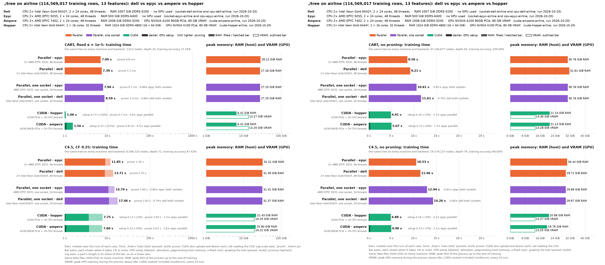

# Airline on the mordor3 cluster: ./tree CUDA on two GPU servers, parallel on two CPU servers, with and without pruning

**Status:** every row rerun on 2026-10-20, 3 runs per case, at commit 8b1ecd1: 6521330 (the class counts kept per thread in local histograms instead of a shared, false-shared array; the staged GPU copies use at least 8 threads) plus the cluster scripts' NUMA options (unused here: each run had the whole node). The same trees as before; times −5% to +4%. `machine.json` says `-dirty` only because the previous result files had been removed from the cluster's checkout for the rerun; the code was committed.
- **Before:** the CPU rows were 051949b's (2026-10-19), the CUDA rows 6f6cecb's (2026-10-19 from 20:20: the GPU's hand-offs through page-locked buffers, the host partition in blocks, [docs/PERFORMANCE.md](../../../docs/PERFORMANCE.md)). Their medians are in the history tables.
- **epyc rerun** at 1a2d9a9 later that day, with the datasets out of the page cache (`run.py --drop-cache`): see Observations.
- **Pruned trees** (the run directories here): all four nodes from 13:52, each right after its HIGGS run ([cluster-higgs](../cluster-higgs/BENCHMARK.md)).
- **Unpruned trees** (`noprunning/`): right after the pruned ones, from 13:54.
- **CUDA rows rerun** on 2026-10-20 from 18:27 at 235c431, on the GPU's socket only: GPU 0, its NUMA node 0's CPUs (16 threads on hopper, 24 on ampere), the memory bound to that node. The CPU part of a CUDA run has half the threads it had on the whole node: pruned CART the same, pruned C4.5 31–37% and the unpruned trees 33–69% slower (Observations). The same trees.
- **One socket** (`socket-*`, 2026-10-20 at 10d125d, both modes): the parallel backend on every CPU of one socket of epyc1 and dell1 (24 threads), the memory bound to that socket's NUMA nodes (`SOCKET=auto` in job.sh: the socket with the most free memory, epyc1's socket 0 (NUMA node 0) and dell1's socket 1 (NUMA nodes 2, 3)).
- **Each node ran alone** and was used whole, apart from the socket-bound runs above.
- **Same trees:** every case built the same tree on every node and backend.
- **Settings:** ./tree's defaults on every node. They were the best found for each machine; other values of `--task-rows`, `--feature-parallel-rows` and `--gpu-min-rows`, and running on one socket only, were no faster (docs/PERFORMANCE.md).

How the runs are made, and the dataset: [bench/cluster/README.md](../../cluster/README.md).
- **GPU servers run only CUDA, CPU servers only parallel.**
- **CART has no depth limit**, like C4.5. The other benchmarks cap CART at depth 30 only because rpart cannot grow deeper.
- **Accuracy is ./tree's training accuracy** (`run.py --train-accuracy-only`).

```bash
bench/cluster/submit.sh -m 3 -d airline                       # pruned: cart_alpha_nodepth, c45
bench/cluster/submit.sh -m 3 -d airline -p cart_full_nodepth,c45_unpruned \
    -o cluster-airline-old/noprunning                            # unpruned
bench/cluster/submit.sh -m 3 -d airline socket-epyc-airline socket-dell-airline   # one socket
bench/cluster/submit.sh -m 3 -d airline -p cart_full_nodepth,c45_unpruned -o cluster-airline-old/noprunning \
    socket-epyc-airline socket-dell-airline
```

The dataset is gbm-bench's airline: US flights 1987–2008, 114,569,017 training rows, 13 integer features, label "arrival delayed". It has 11× HIGGS's rows. It exists only on the cluster: the CUDA backend needs 13.3 GiB of GPU memory for it (one copy of the presorted columns, a spare column and a 512 MB ring), 19.3 GiB for pruned C4.5 when the GPU has room for the raw values (see Memory below).

| Run | Node | CPU | GPU (GPU 0 used) | Backend |
|---|---|---|---|---|
| `cuda-hopper-airline` | hopper | 2× Xeon Gold 6444Y, 32 cores | H100 PCIe 80 GB | CUDA (+ 16 CPU threads, the GPU's socket) |
| `cuda-ampere-airline` | ampere | 2× EPYC 7402, 48 cores | A100 80 GB PCIe | CUDA (+ 24 CPU threads, the GPU's socket) |
| `cpu-epyc-airline` | epyc1 | 2× EPYC 9255 (Zen 5), 48 cores | – | parallel (48 threads) |
| `cpu-dell-airline` | dell1 | 2× Xeon Gold 6542Y, 48 cores | – | parallel (48 threads) |
| `socket-epyc-airline` | epyc1 | one EPYC 9255 (socket 0), 24 cores | – | parallel (24 threads, one socket) |
| `socket-dell-airline` | dell1 | one Xeon Gold 6542Y (socket 1), 24 cores | – | parallel (24 threads, one socket) |

Each bar is ./tree's training time (`train total`: GPU setup, presort, build and pruning, not reading the 6 GB CSV).

## Pruned trees

`cart_alpha_nodepth` (CART, fixed α = 1e-5) and `c45` (C4.5, CF 0.25). A bar's darker part is the GPU setup, its lighter part the pruning, each drawn when it is at least 1% of the bar.



Training time, median of 3 runs (min–max):

| | CART | C4.5 | of which C4.5 pruning |
|---|--:|--:|--:|
| CUDA · hopper (H100 PCIe + 16 threads) | **1.06 s** (1.05–1.07) | 7.75 s (7.62–7.76) | 2.83 s |
| CUDA · ampere (A100 80GB PCIe + 24 threads) | 1.56 s (1.55–1.56) | **7.60 s** (7.58–7.61) | 2.67 s |
| Parallel · epyc (EPYC 9255, 48 threads) | 7.00 s (7.00–7.03) | 11.85 s (11.74–11.86) | 1.34 s |
| Parallel · dell (Xeon 6542Y, 48 threads) | 7.39 s (7.37–7.44) | 13.71 s (13.69–13.73) | 2.35 s |
| Parallel, one socket · epyc (24 threads) | 7.96 s (7.94–8.00) | 14.74 s (14.64–14.75) | 1.80 s |
| Parallel, one socket · dell (24 threads) | 8.59 s (8.59–9.51) | 17.46 s (17.01–17.53) | 2.83 s |

The trees:
- **CART:** 3,013 nodes, depth 25, training accuracy 71.54%. It grows 0.1 million nodes before pruning.
- **C4.5:** 8,548,725 nodes (19.6 million before pruning), depth 72, training accuracy 87.42%.
- **Accuracy:** `ActualElapsedTime` partly gives the delay away, so the accuracies say little. The dataset is here to compare speed, as in gbm-bench.

Against the earlier code (medians of 3): before the tuning for these servers (a8563b3, measured during the tuning, hopper and epyc only), after it (16cc93b, 2026-10-14 at 18:08), a83b6ec (the node store and the GPU hand-off, 2026-10-14 at 19:53), 35cf315 (C4.5 pruning from the recorded leaves, 2026-10-15 at 16:51), 8da0c12 (2026-10-15 at 23:23), cd18717 (2026-10-17 at 17:48), 6f6cecb for CUDA and 051949b for the CPUs (2026-10-19), and now (8b1ecd1, 2026-10-20, the whole node; the CUDA rows on the GPU's socket are above, not here).

| | CART: before → tuned → a83b6ec → 35cf315 → 8da0c12 → cd18717 → 6f6cecb/051949b → now | C4.5: before → tuned → a83b6ec → 35cf315 → 8da0c12 → cd18717 → 6f6cecb/051949b → now |
|---|--:|--:|
| CUDA · hopper | 11.64 → 2.31 → 2.20 → 1.19 → 1.08 → 1.12 → 1.13 → **1.10 s** | 26.03 → 15.83 → 11.26 → 7.46 → 6.07 → 5.68 → 5.92 → **5.93 s** |
| CUDA · ampere | – → 3.37 → 2.84 → 1.99 → 1.59 → 1.64 → 1.63 → **1.55 s** | – → 13.19 → 11.60 → 8.65 → 5.90 → 5.94 → 5.63 → **5.54 s** |
| Parallel · epyc | 15.98 → 7.34 → 7.34 → 7.35 → 7.10 → 7.14 → 7.05 → **7.00 s** | 24.67 → 13.96 → 13.91 → 12.34 → 11.87 → 11.92 → 11.91 → **11.85 s** |
| Parallel · dell | – → 8.36 → 8.43 → 8.36 → 7.55 → 7.52 → 7.51 → **7.39 s** | – → 16.60 → 16.41 → 14.78 → 13.96 → 14.14 → 13.80 → **13.71 s** |

## Unpruned trees

The same trees grown without pruning, so CART and C4.5 do comparable work: each grows its full tree. The bars are not split, because nothing is pruned.
- **CART** (`cart_full_nodepth`, `./tree --cart --no-prune`): without pruning, CART's early stop with a fixed α (docs/ALGORITHMS.md) does not apply. The tree grows until every leaf is pure or cannot be split.
- **C4.5** (`c45_unpruned`, `./tree --c45 --no-prune`): C4.5's collapse of useless splits still runs. It is part of growing, done with or without pruning.

Training time, median of 3 runs (min–max):

| | CART, no pruning | C4.5, no pruning |
|---|--:|--:|
| CUDA · hopper (H100 PCIe + 16 threads) | **4.91 s** (4.85–5.06) | **4.88 s** (4.86–4.90) |
| CUDA · ampere (A100 80GB PCIe + 24 threads) | 5.07 s (5.06–5.07) | 4.98 s (4.97–4.98) |
| Parallel · epyc (EPYC 9255, 48 threads) | 8.56 s (8.54–8.57) | 10.53 s (10.48–10.61) |
| Parallel · dell (Xeon 6542Y, 48 threads) | 9.21 s (9.18–9.55) | 11.46 s (11.26–11.47) |
| Parallel, one socket · epyc (24 threads) | 10.61 s (10.54–10.65) | 12.94 s (12.85–12.95) |
| Parallel, one socket · dell (24 threads) | 11.61 s (11.49–12.52) | 14.26 s (14.17–14.34) |

The trees:
- **CART:** 47,146,877 nodes, depth 65, training accuracy 100.00%: every leaf is pure.
- **C4.5:** 19,579,127 nodes, depth 74, training accuracy 90.60%. C4.5 stops earlier, at leaves of 2 rows and at splits that gain nothing.

Against the earlier code: 16cc93b (2026-10-14 at 17:58), a83b6ec (19:55), 35cf315 (2026-10-15 at 16:53), 8da0c12 (2026-10-15 at 23:25), cd18717 (2026-10-17 at 17:49), 6f6cecb for CUDA and 051949b for the CPUs (2026-10-19), now (8b1ecd1, 2026-10-20, the whole node), and CART capped at depth 30 (`cart_full`, `-d 30`, 21,600,857 nodes, run at 17:13 on 16cc93b):

| Median | CART: depth ≤ 30 (16cc93b) | CART: 16cc93b → a83b6ec → 35cf315 → 8da0c12 → cd18717 → 6f6cecb/051949b → now | C4.5: 16cc93b → a83b6ec → 35cf315 → 8da0c12 → cd18717 → 6f6cecb/051949b → now |
|---|--:|--:|--:|
| CUDA · hopper | 4.66 s | 13.80 → 4.06 → 3.37 → 3.24 → 3.13 → 2.88 → **2.90 s** | 7.17 → 4.39 → 3.66 → 3.09 → 3.06 → 2.91 → **2.90 s** |
| CUDA · ampere | 5.20 s | 7.14 → 4.67 → 4.22 → 3.77 → 3.82 → 3.81 → **3.74 s** | 7.11 → 5.39 → 4.80 → 3.67 → 3.72 → 3.54 → **3.51 s** |
| Parallel · epyc | 8.39 s | 8.89 → 8.76 → 8.74 → 8.49 → 8.63 → 8.66 → **8.56 s** | 11.13 → 11.08 → 11.10 → 10.58 → 10.71 → 10.64 → **10.53 s** |
| Parallel · dell | 9.64 s | 10.51 → 10.07 → 10.05 → 9.32 → 9.44 → 9.30 → **9.21 s** | 12.64 → 12.58 → 12.47 → 11.75 → 11.95 → 11.37 → **11.46 s** |

## Observations

- **CART, pruned:** the H100 takes 1.06 s, 6.6× the fastest CPU node (epyc, 7.00 s), and the A100 1.56 s (4.5×). The same as on the whole node: the GPU does nearly all of it.
- **C4.5, pruned:** the GPUs beat epyc by 1.5–1.6× (H100 7.75 s, A100 7.60 s, epyc 11.85 s); on the whole node they took 5.93 and 5.54 s (2.0–2.1×).
  - **Growing alone,** without the pruning, takes 4.9 s on both GPUs (3.4–3.5 s on the whole node), against epyc's 10.5 s.
  - **Pruning is 35–37% of a CUDA run.** It runs on the host CPU, apart from its first step (115M rows sorted by leaf and transposed, on the GPU).
- **Unpruned trees:** the GPUs are 1.7× epyc on CART (47.1 million nodes) and 2.1–2.2× on C4.5 (19.6 million); on the whole node 2.3–3.0× and 3.0–3.6×. Almost all of these nodes are small and grown by the CPU threads, so the GPU node's CPU matters as much as its GPU: with one socket's threads hopper's CART took 2.90 → 4.91 s.
- **One socket against both** on the CPU nodes: 1.14–1.16× as long on pruned CART, 1.23–1.27× on the rest (epyc 7.96 against 7.00 s and 14.74 against 11.85 s; dell 8.59 against 7.39 s and 17.46 against 13.71 s). Half the cores, far from half the speed: probably because the runs wait on memory more than on the cores (not profiled). The same trees and memory.
- **The depth cap hid most of CART's tree.** Without it CART grows 47.1 million nodes, 2.2× as many as up to depth 30 and 2.4× C4.5's. On the CPU nodes the extra 25 million nodes cost little (epyc 8.39 s capped on 16cc93b, 8.56 s uncapped now): they lie deep down, with a few rows each.
- **CART against C4.5 on the CPU nodes:** CART grows its 2.4× larger tree in 80–81% of C4.5's time (epyc 8.56 against 10.53 s).
- **CPU nodes:** dell takes 6–16% longer than epyc on the pruned trees and 8–9% on the unpruned ones.
- **8b1ecd1 against 6f6cecb/051949b:** the class counts in per-thread histograms (6521330). The same trees. CUDA −5% to +1% (ampere CART 1.63 → 1.55 s, unpruned −2%); CPU −2% to +1% (dell 1–2% faster, epyc 1% faster, both modes).
- **epyc rerun** at 1a2d9a9, the same code with `run.py --drop-cache`. In the first 8b1ecd1 run our own cached dataset files had filled epyc1's NUMA node 1, so the 48-thread runs allocated across the sockets: 7.21 / 12.17 s pruned and 9.02 / 10.70 s unpruned, with one slow C4.5 run of three in both modes (19.45 and 13.47 s). Rerun with the datasets out of the page cache: 7.00 / 11.85 s and 8.56 / 10.53 s, with no slow runs. The jobs now also drop the datasets from the cache when they end (99688fa).
- **CUDA, 6f6cecb against 051949b:** the hand-offs no longer page-lock the 12 GB arena (0.2 s of registration that held up the GPU loop, more on a busy node), and the host partition works in blocks. The same trees. Pruned C4.5 on the A100 5.93 → 5.63 s, unpruned trees on the H100 3.01 → 2.88 s (CART) and 2.99 → 2.91 s (C4.5), on the A100 C4.5 3.75 → 3.54 s; the rest within ±1%.
- **051949b against cd18717 (2026-10-17):** only `--profile` (off here) and the count tables' fill changed. The same trees; times within −5% to +5%. The count tables no longer zero-fill 2 × 115M doubles on one thread, which shows most on dell's C4.5 (pruned 14.14 → 13.80 s, unpruned 11.95 → 11.37 s); hopper's pruned C4.5 (5.68 → 5.95 s) is within its usual spread.
- **cd18717 against 8da0c12:** the presorted columns are kept once instead of twice, and the GPU's mirror of the hand-offs became a 512 MB ring ([docs/PERFORMANCE.md](../../../docs/PERFORMANCE.md)).
  - **GPU memory fell by 53–62%** (below), with the same trees.
  - **GPU times moved by −6% to +4%:** hopper CART 1.08 → 1.12 s and C4.5 6.07 → 5.68 s (its C4.5 varies most); ampere 1.59 → 1.64 s and 5.90 → 5.94 s; unpruned −3% to +1%. A same-job comparison on ampere, the old and the new binary interleaved, 5 runs each, gave CART 1.60 → 1.63 s (+2%) and C4.5 5.91 → 5.90 s. The 2% on CART is probably the ring: the GPU waits for the host copies of earlier hand-offs before it reuses a part, and the A100's link is the slower one (not profiled).
  - **The CPU nodes** are within 2%.
- **Memory:** the same on every node of a kind.
  - **Parallel:** pruned 27.3–28.1 GiB (CART) and 31.4–32.2 GiB (C4.5; 32.2–32.3 GiB at 051949b) peak RSS, unpruned 30.8–31.6 and 29.7–30.4 GiB (29.0, 33.0–33.1, 32.5 and 31.3–31.4 GiB before). With 13 features and 48 threads the parallel backend keeps 12 spare column slots (min(features − 1, threads)), one column fewer than a second copy: about 0.9 GiB saved.
  - **CUDA:** pruned 6.4 / 20.9–21.4 GiB RSS, unpruned 21.1 / 19.8–20.7 GiB (on the whole node 6.4 / 20.9–21.0 and 21.1–21.2 / 19.8 GiB; 8.2 / 20.7–20.8 and 20.9 / 19.5 GiB at 051949b: pruned CART no longer touches the whole hand-off arena, and two 128 MB page-locked buffers were added).
  - **GPU:** 13.2–13.3 GiB, and 19.2–19.3 GiB for pruned C4.5, CUDA context included (34.9–35.0 and 40.9 GiB before). That is one copy of the presorted columns (8 bytes per value) with one spare column and the 512 MB ring; pruned C4.5 adds a copy of the raw values (4 bytes per value) for its pruning's first step, kept only when it fits.
