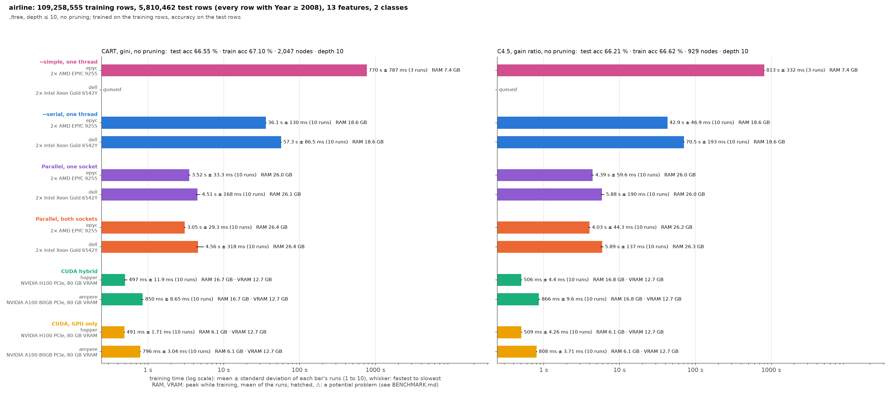

# airline (US flights, 13 features): training set and test set

./tree only, trained on the training rows and scored on the test rows
([bench/cluster/README.md](../../cluster/README.md#test-set-benchmarks)).

- **Training rows:** the flights of 1987–2007, 109,258,555 rows.
- **Test rows:** the flights of 2008 (January to October), 5,810,462 rows: every row from the first with Year ≥ 2008 (airline has no published test set; the rows are in date order, so the tree predicts flights later than those it learned from). Until 2026-10-23 a random 500,000 rows were the test set: cluster-airline-old (removed; last in f4668df).
- **Protocols:** depth ≤ 10, CART (gini) and C4.5 (gain ratio), both without pruning. The pruned runs of 2026-10-23 (CART α = 1e-5, C4.5 CF 0.25) are in git at 96705a7.
- **Runs:** CUDA hybrid and GPU only on hopper (H100) and ampere (A100 80 GB); parallel on every CPU of both sockets on epyc1 and dell1; --serial and --simple (one thread) on epyc. Three runs per case, averaged.
- **Measured:** ./tree's training time, peak RAM while training, peak VRAM; the tree's test and training accuracy, nodes and depth.
- **Chart:** `chart.png`, `bench/testset_chart.py` (log scale).
- **Reruns queued (2026-10-28, jobs 381–545, `bench/cluster/submit-variants-2026-10-28.sh` and `submit-topup-2026-10-28.sh`):** the missing variants, and more runs: a case whose run takes about 2 minutes or less (the whole process) gets 10 runs, one under about 10 minutes 5, a longer one keeps what it has. The runs here count; only the missing ones run (into `cluster-airline-new/` and `-top/` on mordor3), and `bench/merge_runs.py` adds them to the run folders here when done. CUDA hybrid and GPU only on hopper and ampere, parallel on both sockets and on one socket (new) and --serial on epyc, 10 runs each; --simple (over 10 minutes) keeps its three runs. The chart draws mean ± standard deviation and the number of runs, and marks the folders still waiting as "queued" or "still running".
- **Spin stall, fixed 2026-10-28 (rerun queued, jobs 550–570, `bench/cluster/submit-spinfix-2026-10-28.sh`):** the parallel backend partitions a big node (≥ 1M rows, few columns to move) in blocks taken in order by all threads, each block waiting for the one before it. It waited by spinning (`_mm_pause`) without end: when the thread of the block before was descheduled, the other threads spun and kept it off a CPU, so some runs took 2–8× as long (epyc chess_10m: user time 5 s instead of 2 s, the same system time; 11 of 80 runs > 2× the median). It now spins 2,048 pauses, then sleeps (`atomic::wait`, woken by the block before). On epyc2, 40 runs each of chess_10m (48 threads): CART 0.155 ± 0.131 s → 0.087 ± 0.005 s, C4.5 0.186 ± 0.163 s → 0.095 ± 0.005 s, no run above 2× the median. Only the parallel backend has those blocks (CUDA hybrid gives the CPU nodes under 4,096 rows; --serial and --simple have no pool), so only the parallel epyc runs (both sockets, one socket) start over, with 10 runs a case (full ECBDL 5), into `cluster-<dataset>-fix/`, replacing the old folders when done. The dell runs of ./tree_cpu run again too (below); until the reruns are in, the bars of old builds are marked (hatched, ⚠, from `problems.json`), as are runs more than twice the mean of the other runs.
- **One build for every epyc ./tree_cpu run (2026-10-28, `bench/cluster/submit-final-2026-10-28.sh`):** after the spin fix, C4.5's list of distinct values (its thresholds are training values) was made allocation-free: counted, then written in place on the pool, and in one pass with --serial (SOREL's C4.5 presort on epyc varied 11–34 s; see cluster-sorel). Same trees as before in every check (SOREL, HIGGS, airline, ECBDL 15M, serial and parallel). So that every epyc run of ./tree_cpu is of that one build, the parallel runs started before it (jobs 550–556) run again, and --serial runs again for every dataset (10 runs a case of about 2 minutes or less, 5 under about 10 minutes, longer ones once), into `cluster-<dataset>-fix/`, replacing the old folders. The long runs (full ECBDL and SOREL parallel, every --serial, then --simple) run one after another on epyc2, the short parallel ones on epyc1. CUDA hybrid, GPU only and --simple do not use that code and are not rerun. Every dell run of ./tree_cpu (parallel on both sockets, on one socket, dell2's 512 GB, --serial) runs again on the same build too (`bench/cluster/submit-dell-chess-2026-10-28.sh`, jobs 592–618: parallel on dell1, then --serial there; dell2 only its 512 GB runs), the same runs as before, replacing the old folders; --simple on dell stays.
- **Every run again on one build each, in batches (2026-10-28 evening, `bench/cluster/submit-batches-2026-10-28.sh`, jobs 636–645):** the pending jobs above were cancelled and replaced by a few batch jobs (`bench/cluster/batch.sh`: one SLURM job per node and group, its runs one after another). CUDA hybrid and GPU only on hopper and ampere run again on the new ./tree (67495f9, the CUDA rework: the smaller side's goes-left bitmap, the split column by position, upload overlapped with the presort, root counts on the GPU), installed by job 636 only after its trees matched the old build's (HIGGS, airline, ECBDL 15M; CART and C4.5, both GPU backends; 10–25 % faster there). On the CPU, dell and epyc for every backend (--simple, --serial, parallel on one socket, on both), on the final ./tree_cpu; the runs already done on it are kept, as are --simple's (that code did not change). Runs per case: about 2 minutes or less 10, under about 10 minutes 3, longer once; long runs on epyc2 (epyc1 stays free for the short ones), every dell run on dell1, short batch first. Test accuracy is now predicted once per distinct tree (`bench/run.py`), not once per run. The chart groups the bars by backend, the nodes under each; it reads `cluster-airline-fix/` too: a rerun done replaces the old bar, one pending marks it ("old build; rerun queued") or shows as "queued".

## Results

Run at 74a011f: the GPU and parallel runs on 2026-10-23, three runs per case. Run at 8187eb9: --serial and --simple on epyc (both sockets' memory, one thread) on 2026-10-28, three runs per case. The tables give means of ./tree's training time. Accuracies, nodes and depth are the same in every run.

- **Same tree everywhere:** every backend grew the same tree in every case.
- **Speed:** the H100 (GPU only: 0.59–0.61 s) is 5.3–6.7× faster than epyc (3.1–4.1 s). The A100 takes 0.90–1.0 s; dell 4.5–6.1 s.
- **Serial and simple:** --serial takes 36 s and 46 s, 11–12× the parallel run; --simple 770 s and 813 s, 18–21× --serial.
- **Accuracy:** 66.2–66.6% on 2008 flights, about half a point below training accuracy.
- **Memory:** GPU only needs 6.1 GiB of RAM, hybrid 16.8 GiB; VRAM 12.7 GiB. The parallel CPU runs need 26.5 GiB, --serial 18.6 GiB, --simple 7.4 GiB.

| Protocol | test acc | train acc | nodes | depth |
|---|---|---|---|---|
| CART, no pruning | 66.55% | 67.10% | 2,047 | 10 |
| C4.5, no pruning | 66.21% | 66.62% | 929 | 10 |

| Run | CART | C4.5 | RAM GiB (peak) | VRAM GiB (peak) |
|---|---|---|---|---|
| hopper, CUDA hybrid | 0.647 s | 0.666 s | 16.7–16.8 | 12.7 |
| hopper, GPU only | 0.59 s | 0.61 s | 6.1 | 12.7 |
| ampere, CUDA hybrid | 0.992 s | 0.995 s | 16.7–16.8 | 12.7 |
| ampere, GPU only | 0.904 s | 0.922 s | 6.1 | 12.7 |
| epyc, parallel, both sockets | 3.13 s | 4.09 s | 26.5 | – |
| dell, parallel, both sockets | 4.47 s | 6.09 s | 26.3 | – |
| epyc, --serial | 36.3 s | 46.4 s | 18.6 | – |
| epyc, --simple | 770 s | 813 s | 7.4 | – |
