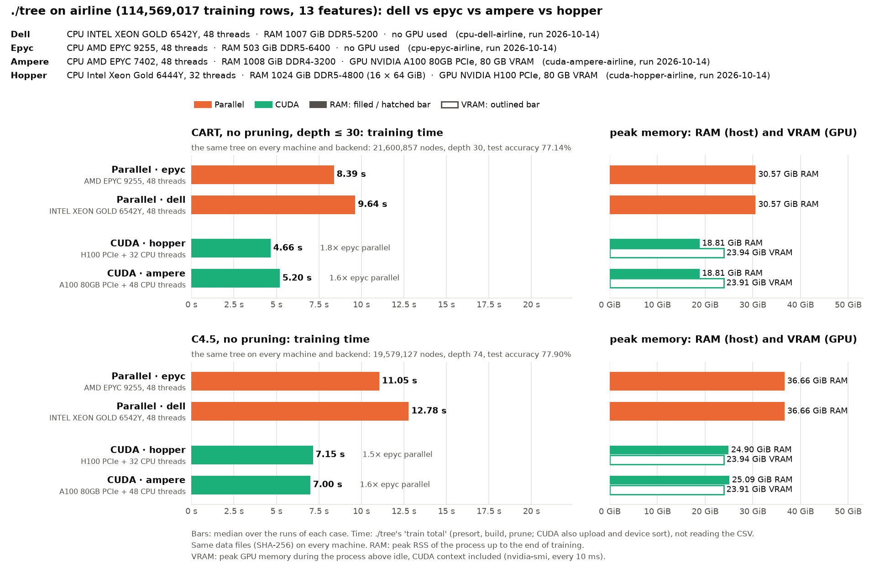

# Airline without pruning on the mordor3 cluster: ./tree CUDA and parallel on four servers

**Status:** run on 2026-10-14 from 17:13 to 17:36, 3 runs per case, at commit 2ced368 (the tuned code of 16cc93b; later commits changed only `bench/`).
- **Nodes:** each node ran alone and was used whole. All four started at 17:12:59.
- **Backends:** the GPU nodes ran CUDA only, the CPU nodes parallel only.
- **Same trees:** every case built the same tree on every node and backend.

These are the trees of [cluster-airlines](../cluster-airlines/BENCHMARK.md), grown without pruning, so CART and C4.5 do comparable work: each grows its full tree.
- **CART** (`cart_full`): `./tree --cart --no-prune -d 30`. Without pruning, the early stop of CART with a fixed α (docs/ALGORITHMS.md) does not apply, so the whole tree up to depth 30 is grown.
- **C4.5** (`c45_unpruned`): `./tree --c45 --no-prune`. C4.5's collapse of useless splits still runs: it is part of growing, done with or without pruning.

How the runs are made: [bench/cluster/README.md](../../cluster/README.md):

```bash
bench/cluster/submit.sh -m 3 -d airline -p cart_full,c45_unpruned -c -o cluster-airlines-noprunning
```

| Run | Node | CPU | GPU (GPU 0 used) | Backend |
|---|---|---|---|---|
| `cuda-hopper-airline` | hopper | 2× Xeon Gold 6444Y, 32 cores | H100 PCIe 80 GB | CUDA (+ 32 CPU threads) |
| `cuda-ampere-airline` | ampere | 2× EPYC 7402, 48 cores | A100 80 GB PCIe | CUDA (+ 48 CPU threads) |
| `cpu-epyc-airline` | epyc1 | 2× EPYC 9255 (Zen 5), 48 cores | – | parallel (48 threads) |
| `cpu-dell-airline` | dell1 | 2× Xeon Gold 6542Y, 48 cores | – | parallel (48 threads) |

Turing is not here: its RTX 2080 Ti has 11 GB, and the CUDA backend needs 23.6 GB for airline.

## Results



Each bar is ./tree's training time (`train total`: GPU setup, presort and build, not reading the 6 GB CSV). The bars are not split: nothing is pruned.

Training time, median of 3 runs (min–max):

| | CART, no pruning | C4.5, no pruning |
|---|--:|--:|
| CUDA · hopper (H100 PCIe + 32 threads) | **4.66 s** (4.47–5.05) | 7.15 s (6.57–7.27) |
| CUDA · ampere (A100 80GB PCIe + 48 threads) | 5.20 s (5.20–5.21) | **7.00 s** (6.98–7.07) |
| Parallel · epyc (EPYC 9255, 48 threads) | 8.39 s (8.38–8.44) | 11.05 s (11.04–11.22) |
| Parallel · dell (Xeon 6542Y, 48 threads) | 9.64 s (9.63–9.70) | 12.78 s (12.59–12.84) |

The trees:
- **CART:** 21,600,857 nodes, depth 30, test accuracy 77.14%.
- **C4.5:** 19,579,127 nodes, depth 74, test accuracy 77.90%.

### Against the pruned runs

From [cluster-airlines](../cluster-airlines/BENCHMARK.md); the pruned trees were 3,013 (CART) and 8,548,725 (C4.5) nodes.

| Median | CART pruned → unpruned | C4.5 pruned → unpruned |
|---|--:|--:|
| CUDA · hopper | 2.25 s → 4.66 s | 14.19 s → 7.15 s |
| CUDA · ampere | 3.35 s → 5.20 s | 13.41 s → 7.00 s |
| Parallel · epyc | 7.37 s → 8.39 s | 14.01 s → 11.05 s |
| Parallel · dell | 8.51 s → 9.64 s | 16.49 s → 12.78 s |

## Observations

- **CART and C4.5 grow at similar speeds.** CART's tree is 10% bigger, yet growing it takes 65–76% of C4.5's time. CART stops at depth 30 while C4.5 goes to 74, and C4.5's time includes its collapse of useless splits and its thresholds (0.1–0.4 s). I haven't measured how much the different split criteria (Gini against gain ratio) matter.
- **The GPU gains 1.6–1.8× over epyc on CART and 1.5–1.6× on C4.5.** On the pruned CART run the gain was 3.3×, because there only the first levels are grown, where every node has millions of rows. Here the GPU hands every node below 28 thousand rows to the CPU threads. Of the 21.6 million nodes, almost all are such small nodes.
- **CART's early stop pays off on the GPU.** Its tree takes 2.25 s with the early stop and 4.66 s without on the H100. On epyc it saves only 1.0 s (7.37 → 8.39 s): the 21 million small nodes are cheap for the CPU threads.
- **C4.5's pruning is now the big cost.** On epyc it adds 3.0 s (11.05 → 14.01 s); on the GPU nodes, whose CPUs are slower, 6.4–7.0 s, as much as growing the tree.
- **Hopper against ampere:** without pruning, the H100 is ahead on CART (4.66 against 5.20 s) and level on C4.5 (7.15 against 7.00 s). The A100's 0.8 s lead on pruned C4.5 thus came mostly from the pruning on hopper's CPU. Hopper's times also spread more (CART 4.47–5.05 s), as its CPU timings do (bench/cluster/README.md).
- **Memory:** parallel 30.6 GiB (CART) and 36.7 GiB (C4.5) peak RSS; CUDA 18.8 / 24.9–25.1 GiB RSS plus 23.9 GiB on the GPU, CUDA context included.
