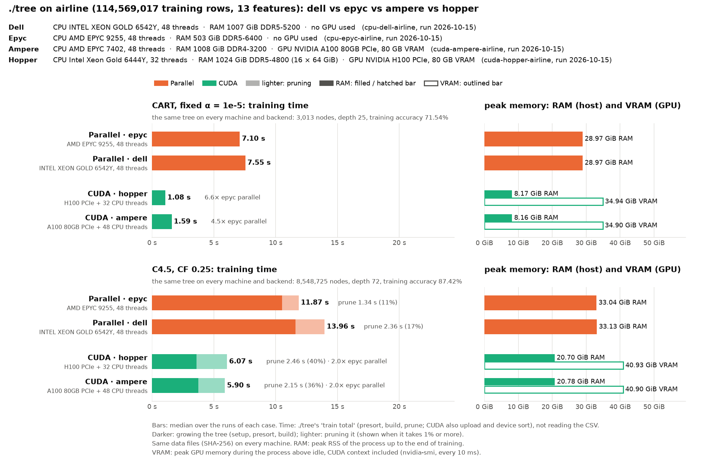
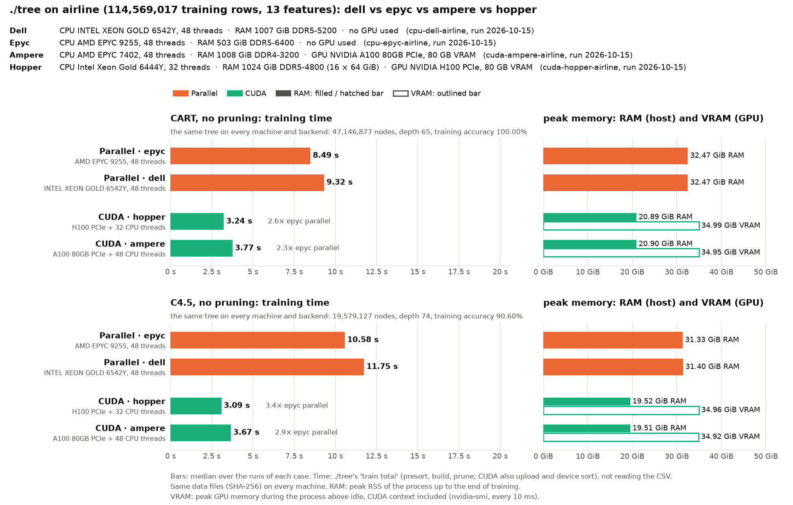

# Airline on the mordor3 cluster: ./tree CUDA on two GPU servers, parallel on two CPU servers, with and without pruning

**Status:** run on 2026-10-15, 3 runs per case, at commit 8da0c12: C4.5's distinct values found on the GPU, copies on the GPU's NUMA node, the asynchronous hand-off, the pruning's first step on the GPU and the parallel presort ([docs/PERFORMANCE.md](../../../docs/PERFORMANCE.md)). `machine.json` says `-dirty` only because the previous result files had been removed from the cluster's checkout for the rerun; the code was committed.
- **Pruned trees** (the run directories here): all four nodes from 23:23, each right after its HIGGS run ([cluster-higgs](../cluster-higgs/BENCHMARK.md)).
- **Unpruned trees** (`noprunning/`): right after the pruned ones, from 23:25.
- **Each node ran alone** and was used whole.
- **Same trees:** every case built the same tree on every node and backend.
- **Settings:** ./tree's defaults on every node. They were the best found for each machine; other values of `--task-rows`, `--feature-parallel-rows` and `--gpu-min-rows`, and running on one socket only, were no faster (docs/PERFORMANCE.md).

How the runs are made, and the dataset: [bench/cluster/README.md](../../cluster/README.md).
- **GPU servers run only CUDA, CPU servers only parallel.**
- **CART has no depth limit**, like C4.5. The other benchmarks cap CART at depth 30 only because rpart cannot grow deeper.
- **Accuracy is ./tree's training accuracy** (`run.py --train-accuracy-only`).

```bash
bench/cluster/submit.sh -m 3 -d airline                       # pruned: cart_alpha_nodepth, c45
bench/cluster/submit.sh -m 3 -d airline -p cart_full_nodepth,c45_unpruned \
    -o cluster-airlines/noprunning                            # unpruned
```

The dataset is gbm-bench's airline: US flights 1987–2008, 114,569,017 training rows, 13 integer features, label "arrival delayed". It has 11× HIGGS's rows. It exists only on the cluster: the CUDA backend needs 23.6 GB of GPU memory for it (two copies of the presorted columns), and uses up to 41 GB when the GPU has room (see Memory below).

| Run | Node | CPU | GPU (GPU 0 used) | Backend |
|---|---|---|---|---|
| `cuda-hopper-airline` | hopper | 2× Xeon Gold 6444Y, 32 cores | H100 PCIe 80 GB | CUDA (+ 32 CPU threads) |
| `cuda-ampere-airline` | ampere | 2× EPYC 7402, 48 cores | A100 80 GB PCIe | CUDA (+ 48 CPU threads) |
| `cpu-epyc-airline` | epyc1 | 2× EPYC 9255 (Zen 5), 48 cores | – | parallel (48 threads) |
| `cpu-dell-airline` | dell1 | 2× Xeon Gold 6542Y, 48 cores | – | parallel (48 threads) |

Each bar is ./tree's training time (`train total`: GPU setup, presort, build and pruning, not reading the 6 GB CSV).

## Pruned trees

`cart_alpha_nodepth` (CART, fixed α = 1e-5) and `c45` (C4.5, CF 0.25). A bar's lighter part is the pruning.



Training time, median of 3 runs (min–max):

| | CART | C4.5 | of which C4.5 pruning |
|---|--:|--:|--:|
| CUDA · hopper (H100 PCIe + 32 threads) | **1.08 s** (1.07–1.12) | 6.07 s (5.36–6.10) | 2.46 s |
| CUDA · ampere (A100 80GB PCIe + 48 threads) | 1.59 s (1.59–1.60) | **5.90 s** (5.88–5.97) | 2.15 s |
| Parallel · epyc (EPYC 9255, 48 threads) | 7.10 s (7.03–7.25) | 11.87 s (11.86–11.97) | 1.34 s |
| Parallel · dell (Xeon 6542Y, 48 threads) | 7.55 s (7.39–7.60) | 13.96 s (13.92–14.04) | 2.36 s |

The trees:
- **CART:** 3,013 nodes, depth 25, training accuracy 71.54%. It grows 0.1 million nodes before pruning.
- **C4.5:** 8,548,725 nodes (19.6 million before pruning), depth 72, training accuracy 87.42%.
- **Accuracy:** `ActualElapsedTime` partly gives the delay away, so the accuracies say little. The dataset is here to compare speed, as in gbm-bench.

Against the earlier code (medians of 3): before the tuning for these servers (a8563b3, measured during the tuning, hopper and epyc only), after it (16cc93b, 2026-10-14 at 18:08), a83b6ec (the node store and the GPU hand-off, 2026-10-14 at 19:53), the previous run (35cf315: C4.5 pruning from the recorded leaves, 2026-10-15 at 16:51), and now.

| | CART: before → tuned → a83b6ec → 35cf315 → now | C4.5: before → tuned → a83b6ec → 35cf315 → now |
|---|--:|--:|
| CUDA · hopper | 11.64 → 2.31 → 2.20 → 1.19 → **1.08 s** | 26.03 → 15.83 → 11.26 → 7.46 → **6.07 s** |
| CUDA · ampere | – → 3.37 → 2.84 → 1.99 → **1.59 s** | – → 13.19 → 11.60 → 8.65 → **5.90 s** |
| Parallel · epyc | 15.98 → 7.34 → 7.34 → 7.35 → **7.10 s** | 24.67 → 13.96 → 13.91 → 12.34 → **11.87 s** |
| Parallel · dell | – → 8.36 → 8.43 → 8.36 → **7.55 s** | – → 16.60 → 16.41 → 14.78 → **13.96 s** |

## Unpruned trees

The same trees grown without pruning, so CART and C4.5 do comparable work: each grows its full tree. The bars are not split, because nothing is pruned.
- **CART** (`cart_full_nodepth`, `./tree --cart --no-prune`): without pruning, CART's early stop with a fixed α (docs/ALGORITHMS.md) does not apply. The tree grows until every leaf is pure or cannot be split.
- **C4.5** (`c45_unpruned`, `./tree --c45 --no-prune`): C4.5's collapse of useless splits still runs. It is part of growing, done with or without pruning.



Training time, median of 3 runs (min–max):

| | CART, no pruning | C4.5, no pruning |
|---|--:|--:|
| CUDA · hopper (H100 PCIe + 32 threads) | **3.24 s** (3.11–3.27) | **3.09 s** (3.04–3.13) |
| CUDA · ampere (A100 80GB PCIe + 48 threads) | 3.77 s (3.71–3.89) | 3.67 s (3.63–3.69) |
| Parallel · epyc (EPYC 9255, 48 threads) | 8.49 s (8.44–8.53) | 10.58 s (10.56–10.64) |
| Parallel · dell (Xeon 6542Y, 48 threads) | 9.32 s (9.25–9.50) | 11.75 s (11.74–11.77) |

The trees:
- **CART:** 47,146,877 nodes, depth 65, training accuracy 100.00%: every leaf is pure.
- **C4.5:** 19,579,127 nodes, depth 74, training accuracy 90.60%. C4.5 stops earlier, at leaves of 2 rows and at splits that gain nothing.

Against the earlier code: 16cc93b (2026-10-14 at 17:58), a83b6ec (19:55), the previous run (35cf315, 2026-10-15 at 16:53), now, and CART capped at depth 30 (`cart_full`, `-d 30`, 21,600,857 nodes, run at 17:13 on 16cc93b):

| Median | CART: depth ≤ 30 (16cc93b) | CART: 16cc93b → a83b6ec → 35cf315 → now | C4.5: 16cc93b → a83b6ec → 35cf315 → now |
|---|--:|--:|--:|
| CUDA · hopper | 4.66 s | 13.80 → 4.06 → 3.37 → **3.24 s** | 7.17 → 4.39 → 3.66 → **3.09 s** |
| CUDA · ampere | 5.20 s | 7.14 → 4.67 → 4.22 → **3.77 s** | 7.11 → 5.39 → 4.80 → **3.67 s** |
| Parallel · epyc | 8.39 s | 8.89 → 8.76 → 8.74 → **8.49 s** | 11.13 → 11.08 → 11.10 → **10.58 s** |
| Parallel · dell | 9.64 s | 10.51 → 10.07 → 10.05 → **9.32 s** | 12.64 → 12.58 → 12.47 → **11.75 s** |

## Observations

- **CART, pruned:** the H100 takes 1.08 s, 6.6× the fastest CPU node (epyc, 7.10 s), and the A100 1.59 s (4.5×). Since the previous run the A100 gained 20% (1.99 → 1.59 s) and the H100 9% (1.19 → 1.08 s):
  - **Copies on the GPU's NUMA node.** ampere's A100 hangs off its first socket; staging buffers and copy threads on the second ran at 16–21 GB/s instead of 24–25. The upload (GPU setup) went from 0.64 to 0.32 s on ampere, most of its gain. hopper's link runs at about 55 GB/s from either socket and gained nothing here.
  - **The GPU no longer waits for its hand-offs** to reach the host: they are copied on a second stream and a callback starts the CPU tasks. The build went from 0.92 to 0.82 s on the H100 and from 1.24 to 1.17 s on the A100.
- **C4.5, pruned:** the GPUs now beat epyc by 2.0× (A100 5.90 s, H100 6.07 s), against 1.4–1.7× in the previous run.
  - **The presort** no longer copies every sorted value back for C4.5's thresholds, only each feature's distinct values, found on the GPU: 0.54 → 0.09 s on hopper and 0.69 → 0.11 s on ampere. ampere's upload also halved (0.63 → 0.33 s, above).
  - **Pruning got faster on the GPU nodes:** 3.38 → 2.46 s on hopper and 3.91 → 2.15 s on ampere. Its first step (115M rows sorted by leaf and transposed) now runs on the GPU, and the rows' leaf ids are no longer rewritten after every renumbering of the tree. epyc and dell prune as before (1.34 and 2.36 s).
  - **Growing alone,** without the pruning, takes 3.6 s on the H100 and 3.8 s on the A100, against epyc's 10.5 s.
  - **Pruning is 36–41% of a CUDA run**, down from 45%.
  - **Hopper's C4.5 varies the most** (5.36–6.10 s), and its median is above ampere's. Its CPU timings drift during the day (bench/cluster/README.md); a same-job comparison of both commits gave 5.19 s on hopper ([docs/PERFORMANCE.md](../../../docs/PERFORMANCE.md)).
- **Unpruned trees:** the GPUs are 2.3–2.6× epyc on CART (47.1 million nodes) and 2.9–3.4× on C4.5 (19.6 million). C4.5 gained the most (ampere 4.80 → 3.67 s, hopper 3.66 → 3.09 s), from its faster presort and the asynchronous hand-off; CART 4–11%. Almost all of these nodes are small and grown by the CPU threads, so the GPU node's CPU matters as much as its GPU.
- **The depth cap hid most of CART's tree.** Without it CART grows 47.1 million nodes, 2.2× as many as up to depth 30 and 2.4× C4.5's. On the CPU nodes the extra 25 million nodes cost little (epyc 8.39 s capped on 16cc93b, 8.49 s uncapped now): they lie deep down, with a few rows each.
- **CART against C4.5 on the CPU nodes:** CART grows its 2.4× larger tree in 79–80% of C4.5's time (epyc 8.49 against 10.58 s).
- **The parallel CPU nodes gained 3–10%,** mostly in the presort: with fewer features (13) than threads (48), each column's radix sort is now split across several threads (presort: epyc 0.68 → 0.44 s, dell 1.54 → 1.06 s). epyc gained 3–5% in all, dell 6–10% (CART pruned 8.36 → 7.55 s). dell's build was also 3–4% faster (CART 6.81 → 6.47 s), epyc's 0–2%; the build's code did not change apart from counting the root's classes in parallel.
- **CPU nodes:** dell takes 6–18% longer than epyc on the pruned trees and 10–11% on the unpruned ones.
- **Memory:** the same on every node of a kind.
  - Parallel: pruned 29.0 GiB (CART) and 33.0–33.1 GiB (C4.5) peak RSS; unpruned 32.5 and 31.3–31.4 GiB. C4.5 no longer keeps a copy of the sorted values (38.5 and 37.0 GiB before).
  - CUDA: pruned 8.2 / 20.7–20.8 GiB RSS, unpruned 20.9 / 19.5 GiB (C4.5 was 26.4 and 25.0 GiB).
  - GPU: 34.9–35.0 GiB, and 40.9 GiB for pruned C4.5, CUDA context included (23.8–24.3 GiB before). The GPU now keeps a copy of the hand-offs, and for pruned C4.5 of the raw values, when it has room for them. With less memory it does without them and needs 23.6 GB, as before.
