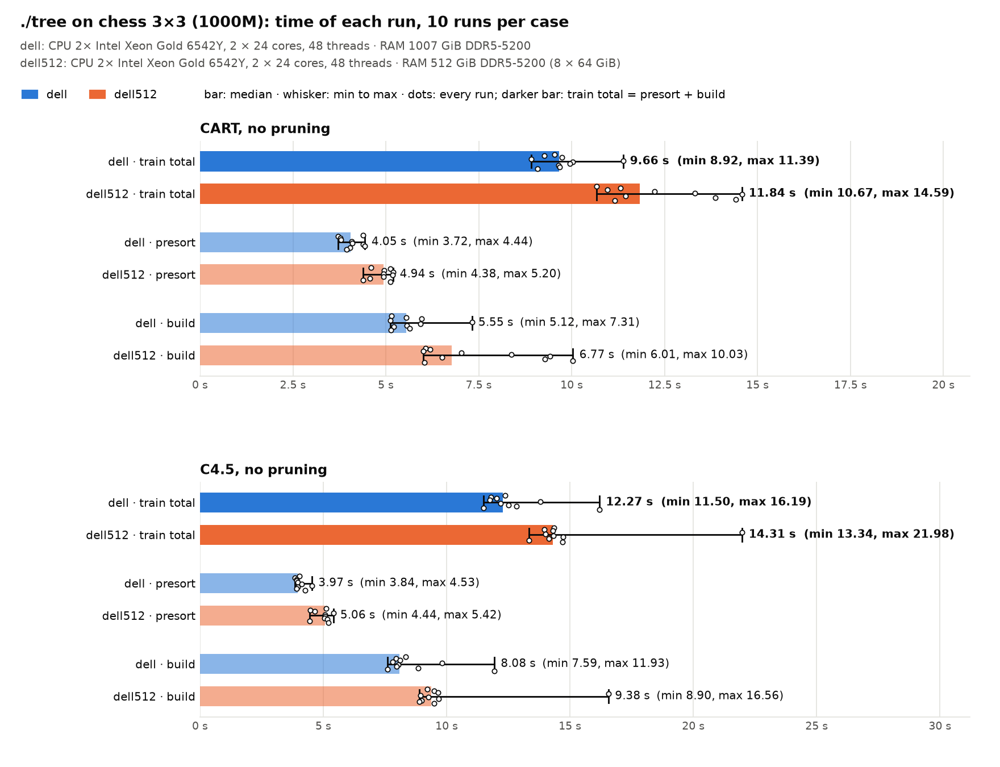
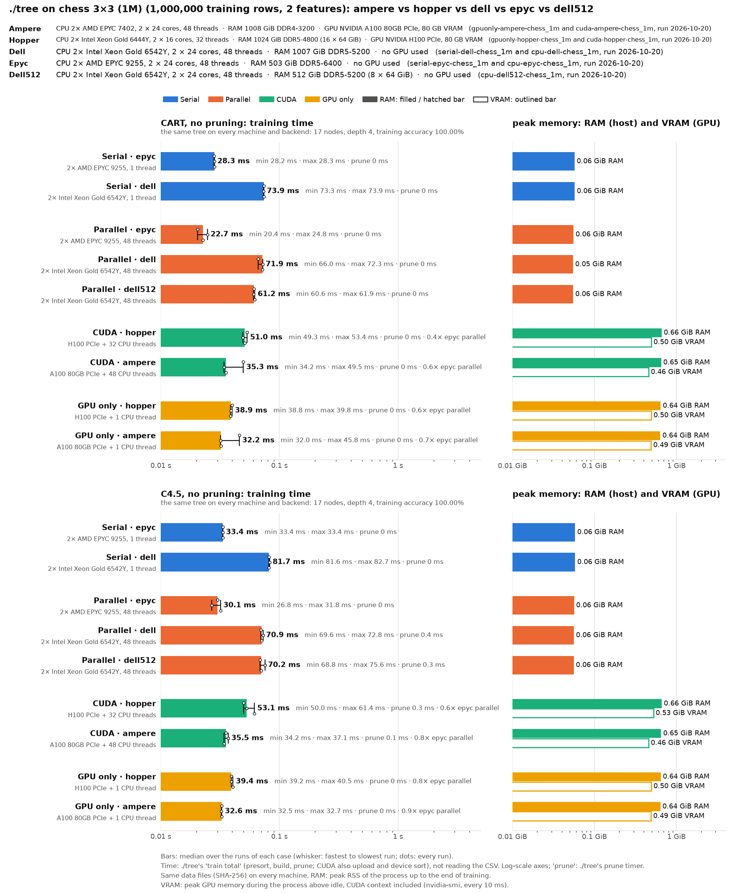
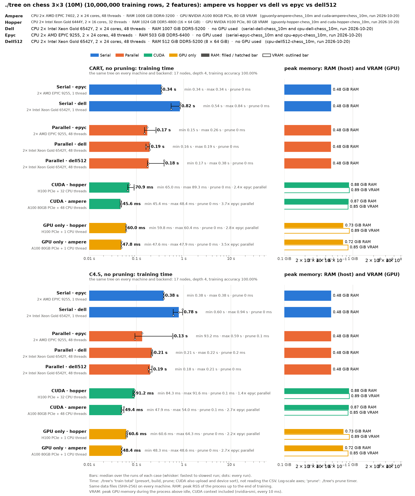
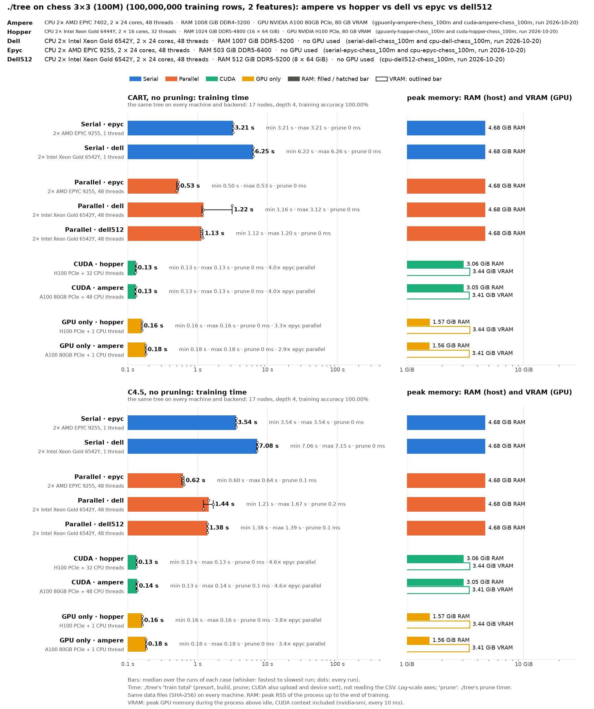
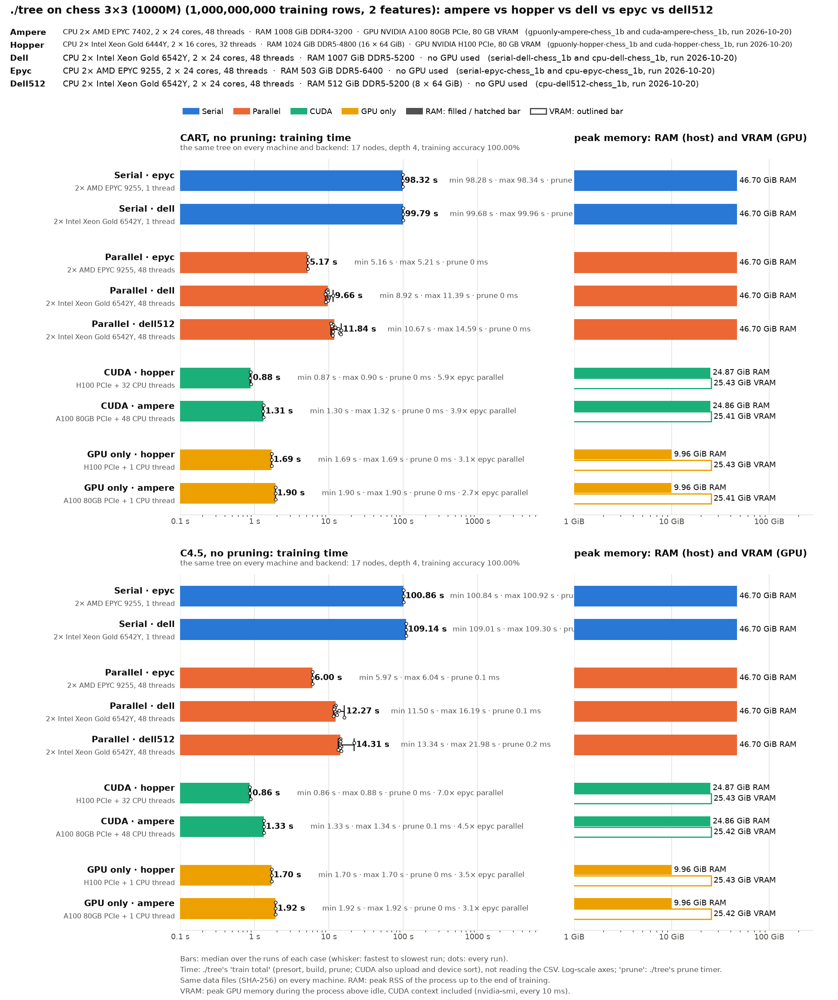

# Chess 3×3 on the mordor3 cluster: 1M to 1000M rows on two GPU and three CPU servers, unpruned CART and C4.5

**Status:** every run repeated on 2026-10-20, three runs per case (dell and dell512 at 1000M: ten). The same trees as before at every size and on every node.
- **CUDA, CPU and serial runs** (hopper, ampere, epyc, dell, dell512): commit 8b1ecd1, from 13:52. It adds 6521330 to the code of the earlier runs: the class counts are kept per thread in local histograms instead of one shared, false-shared array, and the staged GPU copies use at least 8 threads.
- **epyc's parallel runs:** repeated at 1a2d9a9 (the same ./tree), with the datasets dropped from the page cache before each run (`run.py --drop-cache`). In the 8b1ecd1 run, our own cached dataset files had filled epyc1's NUMA node 1, and the 48-thread runs allocated across the sockets.
- **GPU-only runs** (`--cuda --gpu-only --threads 1`): commit 7868bf4, from 15:05, on one CPU of the GPU's NUMA node, with the memory and the GPU on that node too (`submit.sh -n`: hopper's node 1 with GPU 2, ampere's node 0 with GPU 0). 7868bf4 keeps the staged copies from starting more copy threads than the CPUs the process may use; at 8b1ecd1 they started 8 on the one CPU, and the upload took twice as long. [Below](#gpu-only-one-cpu-thread).
- **Before:** the GPU rows were 6f6cecb's (2026-10-19), the CPU rows d9da007's, the serial rows 673217f's, the dell/dell512 10-run check 41faca9's, and the GPU-only rows 0b3a2de's (2026-10-20 morning, GPU 0, unbound). The git history has them.
- **Each node ran alone** and was used whole (`--exclusive`). The four sizes ran one after another on every node, smallest first.
- **Same trees:** every case built the same tree on every node and backend: 17 nodes (9 leaves), depth 4, 100% training accuracy, at every size. That is the exact tree of a 3×3 board.
- **Settings:** ./tree's defaults. The trees are grown without pruning (`cart_full_nodepth`, `c45_unpruned`), with no depth limit. Only training time and memory are compared; accuracy is ./tree's training accuracy (`run.py --train-accuracy-only`).

How the runs are made, and where the data came from: [bench/cluster/README.md](../../cluster/README.md).

```bash
for d in chess_1m chess_10m chess_100m chess_1b; do
  bench/cluster/submit.sh -m 3 -d $d -p cart_full_nodepth,c45_unpruned -a <prepare job> \
      cuda-hopper-$d cuda-ampere-$d cpu-epyc-$d cpu-dell-$d cpu-dell512-$d
done
```

The CPU rerun named only `cpu-epyc-$d cpu-dell-$d cpu-dell512-$d`, without `-a`. The serial runs were submitted with `serial-epyc-$d serial-dell-$d`, after a rebuild job (`-a <build job>`), and the GPU-only runs one node at a time on the GPU's NUMA node: `-n 1 gpuonly-hopper-$d` and `-n 0 gpuonly-ampere-$d`.

The charts are drawn as shown in the README:
- `chart-1m.png`, `chart-10m.png`, `chart-100m.png`, `chart-1b.png`: one `machines_chart.py --spread` chart per size. The bars are medians, the whiskers run from the fastest to the slowest run, and the dots are the single runs. Both axes are log scale (`--log`), and each bar's label gives ./tree's recorded pruning time: 0 ms everywhere, since both protocols here are unpruned (prune_seconds 0–0.3 ms), so there is no pruning segment to draw.
- `chart-rows.png`: drawn by `rows_chart.py`.

Both use the 10-run results for dell and dell512 at 1000M.

**The dataset** is a 3×3 checkerboard: two features, x and y, uniform in [0, 3] with six decimals. The class (`A`, `B`) alternates over the nine unit squares (`B` on five of them: 55.5% of the rows), with no noise. Four sizes:

| Dataset | Training rows | Test rows (own file) | CSV | Note |
|---|--:|--:|--:|---|
| `chess_1m` | 1,000,000 | 1,000 | 20 MB | the first 1M rows of `chess_10m` |
| `chess_10m` | 10,000,000 | 4,500 | 200 MB | the first 10M rows of `chess_100m` |
| `chess_100m` | 100,000,000 | 4,500 | 2.0 GB | |
| `chess_1b` | 1,000,000,000 | 1,000 | 20.0 GB | `chess_100m` ten times over: 100M distinct rows, each 10 times |

**What it measures.** The tree is tiny (4 levels, 8 splits), so a run is the presort plus a few full sweeps over all rows: time per row at the top levels, without the many small nodes of a deep tree. With two features, the CPU backend has only two columns to share among 48 threads.

| Run | Node | CPU | RAM | GPU (GPU 0 used, unless noted) | Backend |
|---|---|---|---|---|---|
| `cuda-hopper-*` | hopper | 2× Xeon Gold 6444Y, 32 cores | 1 TB DDR5-4800 | H100 PCIe 80 GB | CUDA (+ 32 CPU threads) |
| `cuda-ampere-*` | ampere | 2× EPYC 7402, 48 cores | 1 TB DDR4-3200 | A100 80 GB PCIe | CUDA (+ 48 CPU threads) |
| `cpu-epyc-*` | epyc1 | 2× EPYC 9255 (Zen 5), 48 cores | 512 GB DDR5-6400 | – | parallel (48 threads) |
| `cpu-dell-*` | dell1 | 2× Xeon Gold 6542Y, 48 cores | 1 TB DDR5-5200 (16 × 64 GB) | – | parallel (48 threads) |
| `cpu-dell512-*` | dell2 | the same as dell1 | 512 GB DDR5-5200 (8 × 64 GB) | – | parallel (48 threads) |
| `serial-epyc-*` | epyc1 | as `cpu-epyc-*` | | – | serial (1 thread, the whole node reserved) |
| `serial-dell-*` | dell1 | as `cpu-dell-*` | | – | serial (1 thread, the whole node reserved) |
| `gpuonly-hopper-*` | hopper | as `cuda-hopper-*` | | H100 PCIe 80 GB | CUDA, `--gpu-only` on GPU 2 (+ 1 CPU of NUMA node 1, the whole node reserved) |
| `gpuonly-ampere-*` | ampere | as `cuda-ampere-*` | | A100 80 GB PCIe | CUDA, `--gpu-only` on GPU 0 (+ 1 CPU of NUMA node 0, the whole node reserved) |

## Time and memory against the rows


Training time (`train total`: presort and build, on CUDA also GPU setup and upload; not reading the CSV), median of 3 runs (dell and dell512 at 1000M: of 10):

| CART, no pruning | 1M | 10M | 100M | 1000M |
|---|--:|--:|--:|--:|
| CUDA · hopper (H100 PCIe + 32 threads) | 51 ms | 71 ms | **131 ms** | **0.88 s** |
| CUDA · ampere (A100 80GB PCIe + 48 threads) | 35 ms | **46 ms** | **131 ms** | 1.31 s |
| GPU only · hopper (H100 PCIe + 1 thread) | 39 ms | 60 ms | 160 ms | 1.69 s |
| GPU only · ampere (A100 80GB PCIe + 1 thread) | 32 ms | 48 ms | 183 ms | 1.90 s |
| Parallel · epyc (EPYC 9255, 48 threads) | **23 ms** | 169 ms | 529 ms | 5.17 s |
| Parallel · dell (Xeon 6542Y, 48 threads) | 72 ms | 189 ms | 1.22 s | 9.66 s |
| Parallel · dell512 (the same, half the memory channels) | 61 ms | 179 ms | 1.13 s | 11.84 s |
| Serial · epyc (1 thread) | 28 ms | 335 ms | 3.21 s | 98.32 s |
| Serial · dell (1 thread) | 74 ms | 825 ms | 6.25 s | 99.79 s |

| C4.5, no pruning | 1M | 10M | 100M | 1000M |
|---|--:|--:|--:|--:|
| CUDA · hopper | 53 ms | 91 ms | **134 ms** | **0.86 s** |
| CUDA · ampere | 36 ms | 49 ms | 136 ms | 1.33 s |
| GPU only · hopper | 39 ms | 61 ms | 162 ms | 1.70 s |
| GPU only · ampere | 33 ms | **48 ms** | 184 ms | 1.92 s |
| Parallel · epyc | **30 ms** | 132 ms | 622 ms | 6.00 s |
| Parallel · dell | 71 ms | 211 ms | 1.44 s | 12.27 s |
| Parallel · dell512 | 70 ms | 193 ms | 1.38 s | 14.31 s |
| Serial · epyc | 33 ms | 377 ms | 3.54 s | 100.86 s |
| Serial · dell | 82 ms | 784 ms | 7.08 s | 109.14 s |

Peak memory (the same for CART and C4.5 within 0.01 GiB, except hopper's VRAM at 1M):

| | 1M | 10M | 100M | 1000M |
|---|--:|--:|--:|--:|
| RAM, CPU servers (serial and parallel) | 0.06 GiB | 0.48 GiB | 4.68 GiB | 46.70 GiB |
| RAM, CUDA (hopper / ampere) | 0.66 / 0.65 GiB | 0.88 / 0.87 GiB | 3.06 / 3.05 GiB | 24.87 / 24.86 GiB |
| RAM, GPU only (hopper and ampere) | 0.64 GiB | 0.72–0.73 GiB | 1.56–1.57 GiB | 9.96 GiB |
| VRAM (hopper / ampere; GPU only the same within 0.03 GiB) | 0.50–0.53 / 0.46 GiB | 0.89 / 0.85 GiB | 3.44 / 3.41 GiB | 25.43 / 25.41 GiB |

- **The GPUs pull away with the rows.** At 1M rows epyc is the fastest (23 ms): a GPU run's fixed costs (setup, transfers, kernel launches) are about 30–50 ms. From 10M rows on, the GPUs lead.
  - The H100 is 1.4–2.4× faster than the best CPU server at 10M, 4.0–4.6× at 100M, and **5.9× (CART) to 7.0× (C4.5) at 1000M**. In every case the best CPU server is epyc.
  - The A100 is 3.9–4.5× faster than epyc at 1000M. Up to 100M it keeps up with the H100 (at 10M it is faster: 46 against 71 ms), since the fixed costs dominate.
- **The GPU time grows slower than the rows**: 6–7× from 100M to 1000M on the H100, 10× on the A100. Even 100M rows do not keep the H100 busy; 1000M do.
- **The CPU time grows with the rows**: 8–10× from 100M to 1000M. The presort grows 9–10× (epyc 0.20 → 1.85 s, dell 0.53 → 4.05 s), and so does the build (epyc CART 0.32 → 3.32 s, dell 0.72 → 5.55 s).
- **epyc is 1.9–2.4× faster than dell and dell512** from 100M rows on, as on the other datasets.
- **dell512 against dell:** with 3 runs per case, from 15% less time (1M) to 5–8% less (10M, 100M). With 10 runs at 1000M, **dell is faster in every phase, by 16–27%** ([below](#dell-against-dell512-10-runs-at-1000m)).
- **Memory is linear in the rows:** 50 bytes per row on the CPU servers (46.7 GiB for 1000M rows, 2 G values: 25 bytes per value) and 27 bytes per row of VRAM (25.4 GiB of the 80 GB). Every size fits on every GPU; the 40 GB A100s of ampere would hold the 1000M set too. A CUDA run needs about half the host RAM of a CPU run (24.9 GiB at 1000M; 0.25 GiB of it at every size are the page-locked buffers of the uploads and hand-offs).
- **Against the earlier runs** (6f6cecb, d9da007, 673217f), with the same trees:
  - **CUDA at 1000M:** the A100 is 26–27% faster (CART 1.78 → 1.31 s, C4.5 1.80 → 1.33 s), the H100 4–11% (0.92 → 0.88 s, 0.97 → 0.86 s). The class counts of the root's 10^9 rows are no longer one shared array (6521330); at 10M the A100 is 1.7–1.9× faster (88 → 46 ms).
  - **epyc at 1000M:** 20% (CART 6.46 → 5.17 s) and 18% (C4.5 7.31 → 6.00 s) faster; at 100M CART 0.69 → 0.53 s. Both 6521330 and the page-cache fix came in between; which one gained how much was not measured separately.
  - **dell, dell512 and serial:** within −3% to +1% at 1000M (dell CART 9.95 → 9.66 s, serial epyc CART 99.5 → 98.3 s). At 100M dell512 is 14–15% faster (CART 1.32 → 1.13 s), the rest within 5%.
  - **GPU only:** 27–29% faster at 1000M ([below](#gpu-only-one-cpu-thread)).

## Serial (one thread)

Medians of 3 runs; train total = presort + build (prune ≈ 0).

| | 1M | 10M | 100M | 1000M | 1000M / 100M |
|---|--:|--:|--:|--:|--:|
| epyc CART: presort | 9 ms | 121 ms | 1.21 s | 12.17 s | 10.1× |
| epyc CART: build | 19 ms | 214 ms | 2.00 s | 86.15 s | **43.1×** |
| dell CART: presort | 33 ms | 346 ms | 2.26 s | 22.08 s | 9.8× |
| dell CART: build | 41 ms | 479 ms | 3.99 s | 77.73 s | **19.5×** |
| epyc C4.5: build | 23 ms | 246 ms | 2.24 s | 87.76 s | 39.2× |
| dell C4.5: build | 48 ms | 412 ms | 4.64 s | 85.31 s | 18.4× |

| Speed-up of 48 threads over 1 (train total) | 1M | 10M | 100M | 1000M |
|---|--:|--:|--:|--:|
| epyc CART / C4.5 | 1.2× / 1.1× | 2.0× / 2.9× | 6.1× / 5.7× | **19.0× / 16.8×** |
| dell CART / C4.5 (1000M: 10-run medians) | 1.0× / 1.2× | 4.4× / 3.7× | 5.1× / 4.9× | **10.3× / 8.9×** |

- **Up to 100M rows, the serial time grows with the rows** (about 10× per 10× rows), and epyc is 1.9–2.6× faster than dell. dell's 10M runs spread (CART 0.54–0.84 s).
- **At 1000M the serial build is 18–43× its 100M time**, while the presort stays at 10×. It is the slowdown of [the next section](#the-1000m-slowdown-and-its-fix): one thread moves a column of 1G rows. That costs about 3.5 ns per row at 100M and about 30 ns at 1000M, far beyond the caches. The fix (blocked partition by all threads) needs more than one thread, so it does not apply here.
- **At 1000M epyc loses its lead:** epyc's serial build takes 11% longer than dell's (CART 86.2 s against 77.7 s), and the train totals are within 2% (CART) and 8% (C4.5). epyc's presort is still 1.8× faster. The build here waits on memory, row by row, so it measures memory latency more than the core.
- **Parallelism pays off only with the rows.** At 1M rows, 48 threads are hardly faster than one (1.0–1.2×). The speed-up grows to 5–6× at 100M and 9–19× at 1000M. The 1000M speed-ups include the serial build's slowdown, which the threads avoid.
- **Memory is the same** as with 48 threads (46.70 GiB at 1000M).

## GPU only (one CPU thread)

`--cuda --gpu-only --threads 1`: every node is grown on the GPU, with no hand-offs to the CPU and no host arena for them, and the CPU side is one thread. The whole node was reserved, and the process ran on one CPU of the GPU's NUMA node (`taskset`), with its memory on that node (`numactl --membind`): hopper's node 1 with GPU 2, ampere's node 0 with GPU 0. The CUDA rows ran on the whole node with GPU 0. Medians of 3 runs, CART (C4.5 within 1%):

| | 1M | 10M | 100M | 1000M |
|---|--:|--:|--:|--:|
| hopper, CUDA: GPU setup / build | 47 / 4 ms | 63 / 7 ms | 97 / 23 ms | 0.25 / 0.53 s |
| hopper, GPU only: GPU setup / build | 36 / 3 ms | 50 / 9 ms | 93 / 57 ms | 0.70 / 0.89 s |
| ampere, CUDA: GPU setup / build | 32 / 3 ms | 38 / 5 ms | 86 / 31 ms | 0.49 / 0.68 s |
| ampere, GPU only: GPU setup / build | 29 / 2 ms | 37 / 9 ms | 93 / 76 ms | 0.61 / 1.16 s |
| train total, GPU only / CUDA: hopper | 0.76× | 0.85× | 1.22× | **1.91×** |
| train total, GPU only / CUDA: ampere | 0.91× | 1.05× | 1.39× | **1.45×** |
| whole process (`wall_seconds`, CSV read included), GPU only / CUDA: hopper, ampere | 1.0 / 1.1 s, 0.6 / 0.7 s | 1.7 / 1.1 s, 1.6 / 0.7 s | 7.7 / 1.3 s, 11.2 / 0.9 s | **69.9 / 4.8 s, 105.7 / 5.2 s** |

- **Up to 10M rows GPU only is about as fast or faster** (−24% to +5%): one CPU thread starts and syncs faster than 32 or 48, and the fixed costs dominate.
- **From 100M rows on it is slower:** at 1000M 1.9× the CUDA time on the H100 (1.69 s against 0.88 s) and 1.45× on the A100 (1.90 s against 1.31 s). Both the setup with the upload (H100 0.25 → 0.70 s) and the build (0.53 → 0.89 s) take longer; the presort does not change. The tree has only 17 nodes, all of them far above the hand-off size, so the hand-offs are not what the other threads speed up here; what the one thread waits on was not profiled.
- **Against the first GPU-only run** (0b3a2de, GPU 0, not bound): 27–29% faster at 1000M (H100 2.33 → 1.69 s, A100 2.61 → 1.90 s) and at 100M (226 → 160 ms, 253 → 183 ms). The build gained most (H100 1.47 → 0.89 s, A100 1.87 → 1.16 s), the setup little (0.75 → 0.70 s, 0.61 s both times). 6521330 and the NUMA binding came in between; their shares were not measured separately.
- **Still faster than every CPU server:** 3.1× (H100) and 2.7× (A100) faster than epyc's 48 threads at 1000M, and 58× and 52× faster than one epyc thread.
- **Less than half the host RAM:** 9.96 GiB at 1000M against 24.87 GiB with hand-offs (no host arena) and 46.70 GiB on the CPU servers. The VRAM is the same as with hand-offs.
- **Reading the CSV is the cost:** with one thread, the whole 1000M process takes 70 s (hopper) and 106 s (ampere) instead of 4.8 and 5.2 s, nearly all of it parsing the 20 GB CSV. The training time above excludes it.

## The 1000M slowdown and its fix

**Before the fix**, the CPU time grew 13–41× from 100M to 1000M rows, 10× the rows. The times before and after (median; after at 1000M on dell and dell512: 10 runs, otherwise 3):

| Before (2a9d64e) → after (d9da007) | 100M CART | 100M C4.5 | 1000M CART | 1000M C4.5 |
|---|--:|--:|--:|--:|
| epyc | 1.15 → 0.69 s | 1.35 → 0.66 s | 47.19 → **6.46 s** (7.3×) | 40.98 → **7.31 s** (5.6×) |
| dell | 2.43 → 1.21 s | 3.47 → 1.51 s | 34.20 → **9.95 s** (3.4×) | 43.33 → **12.32 s** (3.5×) |
| dell512 | 2.75 → 1.32 s | 3.18 → 1.63 s | 36.00 → **11.68 s** (3.1×) | 48.32 → **14.32 s** (3.4×) |

**The cause** was the partition of the big nodes.
- A node of the CPU builder is split by moving every column except the winner's into its children. Normally each column is moved by one thread, fused with the children's sweep.
- With two features, there is one column to move. So one thread moved all 1G rows of the root, and then of its children, while the other 47 waited.
- A single thread moving a column becomes much slower once the column is far beyond the caches: 3.5 ns per row at 100M rows, about 30 ns at 1000M.
- The builder already had a mode that partitions a node in blocks across all threads, but it used that mode only when spare memory ran short.

**The fix:** a node of at least 2^20 rows is also partitioned in blocks when its columns to move would keep at most one thread in 8 busy (48 threads: 1–6 columns).
- In blocks the node loses the fused sweep. Forcing the blocked mode on the other datasets cost airline (12 columns) 0–15%, and SUSY and HIGGS (17 and 27 columns) up to 50%. Those datasets are outside the new rule and keep the fused sweeps.
- The trees are unchanged: the golden tests pass, and so do checks of 3M synthetic rows with 2 and 3 features.

**Ruled out:**
- The TLB: the columns are on huge pages.
- The repeated rows of the 1000M set.
- Prefetching the partition bitmap: no gain at 1000M, and slower on airline.

**At 1M rows** (below 2^20) the code path is unchanged; the differences there (dell CART 70 → 78 ms) are run-to-run noise.

**At 10M rows** the new path is used, with mixed results:
- dell: 1.3–1.4× faster.
- dell512 C4.5: 1.4× faster.
- epyc, and dell512 CART: unchanged.

Some 10M cases had a single slow run (up to 0.77 s on epyc), which the median leaves out.

## dell against dell512: 10 runs at 1000M

The 3-run results above had dell512 sometimes faster than dell, although dell has twice the memory channels. To check, `chess_1b` ran 10 times per case on both nodes. That was first commit 41faca9, the same CPU code as d9da007, on 2026-10-19 at 20:07–20:13, and was repeated with 8b1ecd1 on 2026-10-20 from 13:57 (the table). The results are in `dell-variance/`.

```bash
bench/cluster/submit.sh -m 10 -d chess_1b -p cart_full_nodepth,c45_unpruned -o cluster-chess/dell-variance \
    cpu-dell-chess_1b cpu-dell512-chess_1b
d=bench/results/cluster-chess/dell-variance
bench/.venv/bin/python bench/runs_chart.py $d/cpu-dell-chess_1b $d/cpu-dell512-chess_1b --out $d/chart.png
```



| Median of 10 (min–max) | dell (1 TB, 16 DIMMs) | dell512 (512 GB, 8 DIMMs) | dell512 / dell |
|---|--:|--:|--:|
| CART: train total | 9.66 s (8.92–11.39) | 11.84 s (10.67–14.59) | 1.23× |
| CART: presort | 4.05 s | 4.94 s | 1.22× |
| CART: build | 5.55 s | 6.77 s | 1.22× |
| C4.5: train total | 12.27 s (11.50–16.19) | 14.31 s (13.34–21.98) | 1.17× |
| C4.5: presort | 3.97 s | 5.06 s | 1.27× |
| C4.5: build | 8.08 s | 9.38 s | 1.16× |
| Memory bandwidth, 48 threads (triad) | 379 GB/s | 220 GB/s | 0.58× |
| Memory bandwidth, 1 thread (triad) | 17.2 GB/s | 16.3 GB/s | 0.95× |

- **dell is faster in every phase**, 16–27% in the medians (12–22% at 41faca9), and in train total dell512's fastest run is slower than dell's median.
- **The earlier "dell512 faster" was noise.** The 3-run CART medians were 11.18 s (dell) against 10.74 s (dell512), but the runs of one node spread by 10–15%, and dell512 had two slow CART runs out of 10 (16.4 s; build 11–12 s instead of 6–7 s). In the 8b1ecd1 repeat dell512 again had the slowest runs (CART up to 14.6 s, C4.5 up to 22.0 s).
- **Bandwidth matters only partly.** With 48 threads dell512 has 58% of dell's bandwidth, but it takes only about 1.2× the time. So chess is partly limited by memory bandwidth, and partly by other work: the per-thread speed and the synchronisation between threads. One thread alone gets the same 16–17 GB/s on both nodes.
- **The bandwidth was measured** with `bench/cluster/triad.c`, a STREAM-style copy and triad over 3 × 4 GiB arrays, best of 10. It was compiled `gcc -O3 -fopenmp` and run on each whole node. Logs: `dell-variance/triad-dell{1,2}.log`.

## One chart per size









## Notes

- **Not timed:** reading the CSV, and the data check before each job (SHA-256 of every prepared file and every CSV row against the binary files: 113 s for `chess_1b` on ampere, 33 GB over NFS). A whole `chess_1b` process (`wall_seconds`, reading the 20 GB CSV included) took 4.8–5.3 s on the GPU nodes, 13–17 s on dell and dell512, and 24–25 s on epyc, whose runs read the CSV over NFS each time (`--drop-cache`; 9–18 s with the file cached, 37–52 s before the 1000M fix); with one thread 70 s (hopper) and 106 s (ampere) GPU only, and 154–178 s serial.
- **Hopper's and ampere's 1M and 10M runs** are dominated by fixed costs; their order there says little about the GPUs.
- **The originals** (C4.5 files from mordor3's `~/chess`) were deleted after the conversion; `datasets/chess_*.csv` on mordor3 are the only copies. Their SHA-256 and those of the originals are in [bench/cluster/README.md](../../cluster/README.md) and `bench/cluster/chess-originals.sha256`.
