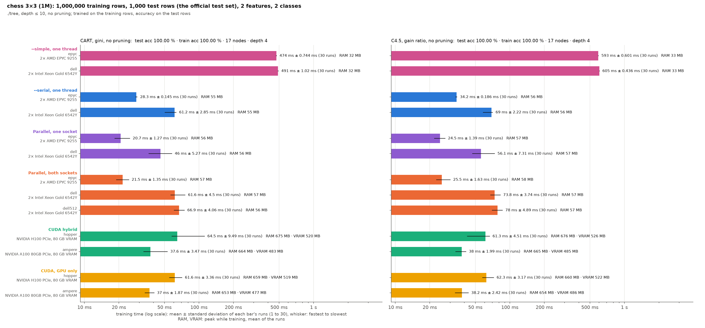
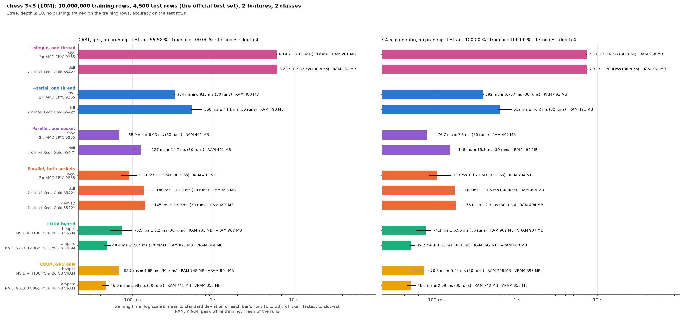
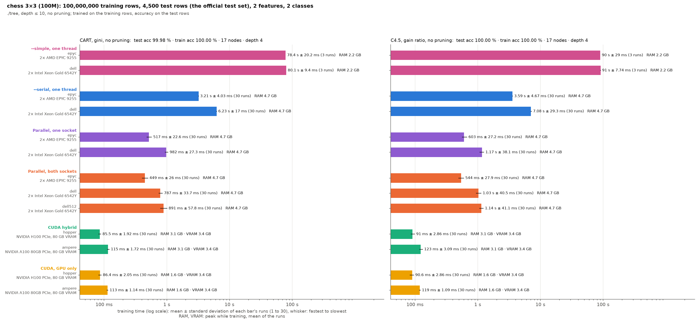
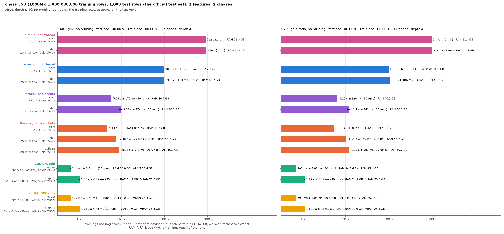

# Chess 3×3 on the mordor3 cluster: 1M to 1000M rows on two GPU and three CPU servers, CART and C4.5 at depth ≤ 10 without pruning

- **Runs:** every case on hopper and ampere (CUDA hybrid, GPU only), and on epyc and dell (parallel on both sockets, parallel on one socket, --serial, --simple); parallel on both sockets also on dell2 (`dell512`, half the memory channels). 30 runs a case, except --serial at 1000M (3), --simple at 100M (3) and at 1000M (one, about 17 minutes a run). The tables and charts give means.
- **Builds:** every run on one build of main, ./tree at ec77727 (with the CPU presort of 4fb419c and `-falign-functions=64 -falign-loops=32`), 2026-10-29/30, except `simple-epyc-chess_10m` and `simple-epyc-chess_1b` (67495f9, 2026-10-29; --simple's code is the same). Why, and the batches that ran them: [bench/cluster/README.md](../../cluster/README.md#reruns-of-2026-102930).
- **Each node ran alone** and was reserved whole (`--exclusive`). Every GPU run is on its GPU's socket: GPU 0, the CPUs of its NUMA node (16 threads on hopper, 24 on ampere) and the memory bound to that node.
- **Same trees:** every case built the same tree on every node and backend (`--hash-trees`): 17 nodes (9 leaves), depth 4, 100% training accuracy, at every size. That is the exact tree of a 3×3 board. Test accuracy: 100% for C4.5 at every size; CART 99.98% at 10M and 100M, 100% at 1M and 1000M.
- **Settings:** ./tree's defaults. `cart_depth10` and `c45_depth10_unpruned`, like every other test-set benchmark: depth ≤ 10 without pruning. The tree stops at depth 4, so the limit never acts; until 2026-10-29 these runs used the same trees without a depth limit (`cart_full_nodepth`, `c45_unpruned`). Trained on the training rows, scored on the size's test file.

How the runs are made, and where the data came from: [bench/cluster/README.md](../../cluster/README.md).

The charts:
- `chart-chess_1m.png`, `chart-chess_10m.png`, `chart-chess_100m.png`, `chart-chess_1b.png`: one `testset_chart.py` chart per size. A bar is the mean of the runs, the whisker runs from the fastest to the slowest run, and its label gives the mean ± standard deviation, the number of runs and peak RAM (and VRAM). Log scale.
- `chart-rows.png`: `rows_chart.py`, means against the rows, with whiskers from the fastest to the slowest run (without --simple).
- `dell-variance/chart.png`: `runs_chart.py`, every 1000M run on dell and dell512.

**The dataset** is a 3×3 checkerboard: two features, x and y, uniform in [0, 3] with six decimals. The class (`A`, `B`) alternates over the nine unit squares (`B` on five of them: 55.5% of the rows), with no noise. Four sizes:

| Dataset | Training rows | Test rows (own file) | CSV | Note |
|---|--:|--:|--:|---|
| `chess_1m` | 1,000,000 | 1,000 | 20 MB | the first 1M rows of `chess_10m` |
| `chess_10m` | 10,000,000 | 4,500 | 200 MB | the first 10M rows of `chess_100m` |
| `chess_100m` | 100,000,000 | 4,500 | 2.0 GB | |
| `chess_1b` | 1,000,000,000 | 1,000 | 20.0 GB | `chess_100m` ten times over: 100M distinct rows, each 10 times |

**What it measures.** The tree is tiny (4 levels, 8 splits), so a run is the presort plus a few full sweeps over all rows: time per row at the top levels, without the many small nodes of a deep tree. With two features, the CPU backend has only two columns to share among 48 threads.

| Run | Node | CPU | RAM | GPU (GPU 0) | Backend |
|---|---|---|---|---|---|
| `cuda-hopper-*` | hopper | 2× Xeon Gold 6444Y, 32 cores | 1 TB DDR5-4800 | H100 PCIe 80 GB | CUDA (+ 16 CPU threads of the GPU's socket) |
| `cuda-ampere-*` | ampere | 2× EPYC 7402, 48 cores | 1 TB DDR4-3200 | A100 80 GB PCIe | CUDA (+ 24 CPU threads of the GPU's socket) |
| `gpuonly-hopper-*`, `gpuonly-ampere-*` | hopper, ampere | as above | | as above | CUDA, `--gpu-only` (on the same CPUs) |
| `cpu-epyc-*` | epyc1 | 2× EPYC 9255 (Zen 5), 48 cores | 512 GB DDR5-6400 | – | parallel (48 threads) |
| `cpu-dell-*` | dell1 | 2× Xeon Gold 6542Y, 48 cores | 1 TB DDR5-5200 (16 × 64 GB) | – | parallel (48 threads) |
| `cpu-dell512-*` | dell2 | the same as dell1 | 512 GB DDR5-5200 (8 × 64 GB) | – | parallel (48 threads) |
| `socket-epyc-*` | epyc1 | one EPYC 9255 (socket 1), 24 cores | its NUMA node 1 | – | parallel (24 threads, one socket) |
| `socket-dell-*` | dell1 | one Xeon Gold 6542Y (socket 1), 24 cores | its NUMA nodes 2, 3 | – | parallel (24 threads, one socket) |
| `serial-epyc-*`, `simple-epyc-*` | epyc2 (same hardware as epyc1) | | | – | --serial, --simple (1 thread, the whole node reserved) |
| `serial-dell-*`, `simple-dell-*` | dell1 | | | – | --serial, --simple (1 thread, the whole node reserved) |

## Time and memory against the rows


Training time (`train total`: presort and build, on CUDA also GPU setup and upload; not reading the CSV), mean of the runs:

| CART, no pruning | 1M | 10M | 100M | 1000M |
|---|--:|--:|--:|--:|
| CUDA · hopper (H100 PCIe + 16 threads) | 65 ms | 73 ms | **85 ms** | 641 ms |
| CUDA · ampere (A100 80GB PCIe + 24 threads) | 38 ms | 48 ms | 115 ms | 1.05 s |
| GPU only · hopper | 62 ms | 68 ms | 86 ms | **640 ms** |
| GPU only · ampere | 37 ms | **47 ms** | 113 ms | 1.04 s |
| Parallel · epyc (EPYC 9255, 48 threads) | 22 ms | 91 ms | 449 ms | 4.44 s |
| Parallel, one socket · epyc (24 threads) | **21 ms** | 69 ms | 517 ms | 5.53 s |
| Parallel · dell (Xeon 6542Y, 48 threads) | 62 ms | 140 ms | 787 ms | 7.48 s |
| Parallel · dell512 (the same, half the memory channels) | 67 ms | 145 ms | 891 ms | 8.86 s |
| Parallel, one socket · dell (24 threads) | 46 ms | 127 ms | 982 ms | 9.59 s |
| Serial · epyc (1 thread) | 28 ms | 334 ms | 3.21 s | 98.63 s |
| Serial · dell (1 thread) | 61 ms | 550 ms | 6.23 s | 99.57 s |
| Simple · epyc (1 thread) | 474 ms | 6.14 s | 78.42 s | 912 s |
| Simple · dell (1 thread) | 491 ms | 6.23 s | 80.15 s | 956 s |

| C4.5, no pruning | 1M | 10M | 100M | 1000M |
|---|--:|--:|--:|--:|
| CUDA · hopper | 61 ms | 74 ms | 91 ms | **703 ms** |
| CUDA · ampere | 38 ms | 49 ms | 123 ms | 1.12 s |
| GPU only · hopper | 62 ms | 71 ms | **91 ms** | 703 ms |
| GPU only · ampere | 38 ms | **48 ms** | 119 ms | 1.11 s |
| Parallel · epyc | 25 ms | 103 ms | 544 ms | 5.45 s |
| Parallel, one socket · epyc | **25 ms** | 77 ms | 603 ms | 6.22 s |
| Parallel · dell | 74 ms | 169 ms | 1.03 s | 10.44 s |
| Parallel · dell512 | 78 ms | 176 ms | 1.14 s | 11.93 s |
| Parallel, one socket · dell | 56 ms | 148 ms | 1.17 s | 12.11 s |
| Serial · epyc | 34 ms | 382 ms | 3.59 s | 101 s |
| Serial · dell | 69 ms | 612 ms | 7.08 s | 109 s |
| Simple · epyc | 593 ms | 7.30 s | 89.98 s | 1,031 s |
| Simple · dell | 605 ms | 7.33 s | 90.99 s | 1,068 s |

Peak memory (the same for CART and C4.5 within 0.01 GiB):

| | 1M | 10M | 100M | 1000M |
|---|--:|--:|--:|--:|
| RAM, CPU servers (serial, parallel and one socket) | 0.06 GiB | 0.48 GiB | 4.68 GiB | 46.70 GiB |
| RAM, --simple | 0.03 GiB | 0.25 GiB | 2.19 GiB | 21.35 GiB |
| RAM, CUDA (hopper / ampere) | 0.66 / 0.65 GiB | 0.88 / 0.87 GiB | 3.06 / 3.05 GiB | 24.87 / 24.86 GiB |
| RAM, GPU only (hopper and ampere) | 0.64 GiB | 0.72–0.73 GiB | 1.56–1.57 GiB | 9.96 GiB |
| VRAM (hopper / ampere; GPU only the same within 0.01 GiB) | 0.51 / 0.47 GiB | 0.88 / 0.84 GiB | 3.44 / 3.41 GiB | 25.43 / 25.42 GiB |

- **The GPUs pull away with the rows.** At 1M rows epyc is the fastest (21–25 ms): a GPU run's fixed costs (setup, transfers, kernel launches) are about 35–60 ms. At 10M the A100 leads (47–49 ms against the H100's 68–74 ms and epyc's 69–103 ms), since the fixed costs still dominate; from 100M on the H100 leads.
  - The H100 is 5.3–6.0× faster than epyc at 100M, and **6.9× (CART) to 7.8× (C4.5) at 1000M** (0.64–0.70 s, GPU only and CUDA alike). In every case the best CPU server is epyc on both sockets, except at 1M and 10M, where one socket is faster. The presort speed-up narrowed the GPUs' lead: it was 8.5–9.2× at 1000M.
  - The A100 is 4.3–4.9× faster than epyc at 1000M.
- **The GPU time grows less than the rows** from 100M to 1000M: 7.4–7.7× on the H100, 9.1–9.3× on the A100.
- **The CPU time grows with the rows**: 9.5–10.1× from 100M to 1000M. The presort grows 8× (epyc 0.12 → 0.95 s, dell 0.22 → 1.62 s), the build 10–11× (CART: epyc 0.33 → 3.49 s, dell 0.57 → 5.86 s).
- **epyc is 1.7–1.9× faster than dell** from 100M rows on (dell512: 2.0–2.2×), as on the other datasets.
- **dell512 is slower than dell at every size:** 3–9% at 1M and 10M, 11–13% at 100M, 14–18% at 1000M ([below](#dell-against-dell512-at-1000m)).
- **One socket against both:** on epyc faster at 1M and 10M (0.96× and 0.74–0.76× the time), slower from 100M on (1.11–1.15× at 100M, 1.14–1.25× at 1000M); on dell the same pattern (0.75× at 1M, 0.88–0.91× at 10M, 1.13–1.25× at 100M, 1.16–1.28× at 1000M). On one socket dell is 1.7–1.9× epyc at 1000M.
- **Memory is linear in the rows:** 50 bytes per row on the CPU servers (46.7 GiB for 1000M rows, 2 G values: 25 bytes per value) and 27 bytes per row of VRAM (25.4 GiB of the 80 GB). Every size fits on every GPU; the 40 GB A100s of ampere would hold the 1000M set too. A CUDA run needs about half the host RAM of a CPU run (24.9 GiB at 1000M; 0.25 GiB of it at every size are the page-locked buffers of the uploads and hand-offs), and --simple less still (21.4 GiB).
- **Against the earlier builds** (same trees):
  - **The CPU presort** (4fb419c) against 8bdf641 (means, 2026-10-29/30 against 2026-10-29): at 1000M epyc 5.31 → 4.44 s (CART) and 6.22 → 5.45 s (C4.5), dell 10.8 → 7.48 s and 13.5 → 10.4 s, dell512 12.2 → 8.86 s and 15.8 → 11.9 s: 12–31% faster, as much at 100M (epyc 541 → 449 ms, dell 1.09 → 0.79 s). CUDA has the same code and the same times within noise.
  - **The CUDA rework** (67495f9) against 235c431 (medians of 3 runs, 2026-10-20) at 1000M: the H100 0.97 → 0.63 s with hand-offs and 0.88 → 0.62 s GPU only, the A100 1.47 → 1.05 s and 1.33 → 1.04 s: 22–35% faster.
  - **The parallel waits** (8bdf641) against the spin-fix build of 2026-10-28 (10-run means): dell about twice as fast at 100M and 1000M (`cpu-dell` CART 2.65 → 1.09 s and 23.6 → 10.8 s; dell512 2.78 → 1.19 s and 17.9 → 12.2 s), 0.56–0.82× at 10M; epyc chess_100m 0.93–0.95×. That build slept on `atomic::wait` after its spin, and waking made dell's runs about 2× slower in some node states.

## Serial (one thread)

Means of the runs; train total = presort + build (prune ≈ 0).

| | 1M | 10M | 100M | 1000M | 1000M / 100M |
|---|--:|--:|--:|--:|--:|
| epyc CART: presort | 9 ms | 122 ms | 1.22 s | 12.29 s | 10.1× |
| epyc CART: build | 19 ms | 212 ms | 1.99 s | 86.34 s | **43.4×** |
| dell CART: presort | 29 ms | 231 ms | 2.25 s | 21.67 s | 9.6× |
| dell CART: build | 32 ms | 318 ms | 3.97 s | 77.90 s | **19.6×** |
| epyc C4.5: build | 24 ms | 250 ms | 2.28 s | 88.18 s | 38.7× |
| dell C4.5: build | 37 ms | 364 ms | 4.63 s | 85.53 s | 18.5× |

| Speed-up of 48 threads over 1 (train total) | 1M | 10M | 100M | 1000M |
|---|--:|--:|--:|--:|
| epyc CART / C4.5 | 1.3× / 1.3× | 3.7× / 3.7× | 7.2× / 6.6× | **22.2× / 18.6×** |
| dell CART / C4.5 | 1.0× / 0.9× | 3.9× / 3.6× | 7.9× / 6.9× | **13.3× / 10.5×** |

- **Up to 100M rows, the serial time grows with the rows** (about 10× per 10× rows), and epyc is 1.6–2.2× faster than dell.
- **At 1000M the serial build is 19–43× its 100M time**, while the presort stays at 10×. It is the slowdown of [the section below](#the-1000m-slowdown-and-its-fix): one thread moves a column of 1G rows, which costs about 3.5 ns per row at 100M and about 30 ns at 1000M, far beyond the caches. The fix (blocked partition by all threads) needs more than one thread, so it does not apply here.
- **At 1000M epyc loses most of its lead:** epyc's serial build takes 3–11% longer than dell's (CART 86.3 s against 77.9 s); the train totals are within 1% (CART) and 8% (C4.5), as epyc's presort is still 1.8× faster. The build here waits on memory, row by row, so it measures memory latency more than the core.
- **Parallelism pays off only with the rows.** At 1M rows, 48 threads are hardly faster than one (0.9–1.3×). The speed-up grows to 7–8× at 100M and 10–22× at 1000M. The 1000M speed-ups include the serial build's slowdown, which the threads avoid.
- **--simple**, the reference implementation, takes 17× --serial's time at 1M on epyc, 24–25× at 100M and 9–10× at 1000M (where --serial has the slowdown); on dell, whose --serial is slower, 8–13×. --simple itself is the same on epyc and dell within 5%, with half the RAM of --serial.

## GPU only

`--cuda --gpu-only`: every node is grown on the GPU, with no hand-offs to the CPU and no host arena for them, on the same CPUs as the CUDA runs. Means of the runs, CART (C4.5 within 10% except the 1000M setup, which is 12–21% longer):

| | 1M | 10M | 100M | 1000M |
|---|--:|--:|--:|--:|
| hopper, CUDA: GPU setup / build | 61 / 3 ms | 69 / 5 ms | 69 / 17 ms | 0.29 / 0.35 s |
| hopper, GPU only: GPU setup / build | 59 / 3 ms | 64 / 4 ms | 70 / 16 ms | 0.29 / 0.35 s |
| ampere, CUDA: GPU setup / build | 35 / 2 ms | 43 / 5 ms | 89 / 26 ms | 0.59 / 0.47 s |
| ampere, GPU only: GPU setup / build | 35 / 2 ms | 43 / 4 ms | 90 / 24 ms | 0.59 / 0.46 s |
| train total, GPU only / CUDA: hopper | 0.95× | 0.93× | 1.01× | 1.00× |
| train total, GPU only / CUDA: ampere | 0.99× | 0.96× | 0.98× | 0.99× |
| whole process (`wall_seconds`, CSV read included), GPU only / CUDA: hopper; ampere | 1.1 / 1.1 s; 0.7 / 0.7 s | 1.1 / 1.2 s; 0.7 / 0.7 s | 2.6 / 2.6 s; 2.7 / 2.8 s | 23.6 / 23.7 s; 24.1 / 23.0 s |

- **GPU only and CUDA with hand-offs take the same time** (within 2% from 100M on, 7% below). The tree has only 17 nodes, all far above the hand-off size, so the CUDA run hands nothing to the CPU either.
- **Still the fastest on the big sets:** 6.9× (H100) and 4.3× (A100) faster than epyc's 48 threads at 1000M, and 154× and 95× faster than one epyc thread.
- **Less than half the host RAM:** 9.96 GiB at 1000M against 24.87 GiB with hand-offs (no host arena) and 46.70 GiB on the CPU servers. The VRAM is the same as with hand-offs.
- **Reading the CSV is the cost:** the whole 1000M process takes 23–25 s, most of it parsing the 20 GB CSV, which every run reads again over NFS (`--drop-cache`). The training time above excludes it.

## The 1000M slowdown and its fix

**Before the fix**, the CPU time grew 13–41× from 100M to 1000M rows, 10× the rows. The times before and after, as measured on 2026-10-19 (medians of 3 runs, at 1000M on dell and dell512 of 10; the builds are in git, the run folders were replaced since):

| Before (2a9d64e) → after (d9da007) | 100M CART | 100M C4.5 | 1000M CART | 1000M C4.5 |
|---|--:|--:|--:|--:|
| epyc | 1.15 → 0.69 s | 1.35 → 0.66 s | 47.19 → **6.46 s** (7.3×) | 40.98 → **7.31 s** (5.6×) |
| dell | 2.43 → 1.21 s | 3.47 → 1.51 s | 34.20 → **9.95 s** (3.4×) | 43.33 → **12.32 s** (3.5×) |
| dell512 | 2.75 → 1.32 s | 3.18 → 1.63 s | 36.00 → **11.68 s** (3.1×) | 48.32 → **14.32 s** (3.4×) |

**The cause** was the partition of the big nodes.
- A node of the CPU builder is split by moving every column except the winner's into its children. Normally each column is moved by one thread, fused with the children's sweep.
- With two features, there is one column to move. So one thread moved all 1G rows of the root, and then of its children, while the other 47 waited.
- A single thread moving a column becomes much slower once the column is far beyond the caches: 3.5 ns per row at 100M rows, about 30 ns at 1000M.
- The builder already had a mode that partitions a node in blocks across all threads, but it used that mode only when spare memory ran short.

**The fix:** a node of at least 2^20 rows is also partitioned in blocks when its columns to move would keep at most one thread in 8 busy (48 threads: 1–6 columns).
- In blocks the node loses the fused sweep. Forcing the blocked mode on the other datasets cost airline (12 columns) 0–15%, and SUSY and HIGGS (17 and 27 columns) up to 50%. Those datasets are outside the new rule and keep the fused sweeps.
- The trees are unchanged: the golden tests pass, and so do checks of 3M synthetic rows with 2 and 3 features.

**Ruled out:**
- The TLB: the columns are on huge pages.
- The repeated rows of the 1000M set.
- Prefetching the partition bitmap: no gain at 1000M, and slower on airline.

**At 1M rows** (below 2^20) the code path is unchanged; the differences there (dell CART 70 → 78 ms) are run-to-run noise.

**At 10M rows** the new path is used, with mixed results:
- dell: 1.3–1.4× faster.
- dell512 C4.5: 1.4× faster.
- epyc, and dell512 CART: unchanged.

Some 10M cases had a single slow run (up to 0.77 s on epyc), which the median leaves out.

## dell against dell512 at 1000M

dell2 (`dell512`) has half dell1's memory channels (8 DIMMs against 16). The 30 runs of `chess_1b` on each (`cpu-dell-chess_1b`, `cpu-dell512-chess_1b`):

```bash
d=bench/results/cluster-chess
bench/.venv/bin/python bench/runs_chart.py $d/cpu-dell-chess_1b $d/cpu-dell512-chess_1b --out $d/dell-variance/chart.png
```


| Mean of 30 (min–max) | dell (1 TB, 16 DIMMs) | dell512 (512 GB, 8 DIMMs) | dell512 / dell |
|---|--:|--:|--:|
| CART: train total | 7.48 s (6.81–8.50) | 8.86 s (8.31–9.70) | 1.18× |
| CART: presort | 1.62 s | 2.12 s | 1.31× |
| CART: build | 5.86 s | 6.74 s | 1.15× |
| C4.5: train total | 10.44 s (9.85–11.18) | 11.93 s (11.15–12.85) | 1.14× |
| C4.5: presort | 1.78 s | 2.41 s | 1.36× |
| C4.5: build | 8.66 s | 9.52 s | 1.10× |
| Memory bandwidth, 48 threads (triad) | 379 GB/s | 220 GB/s | 0.58× |
| Memory bandwidth, 1 thread (triad) | 17.2 GB/s | 16.3 GB/s | 0.95× |

- **dell is faster in every phase**, by 10–36% in the means; the runs of one node spread by 13–23% of the mean (min to max), so a few runs per case cannot order the two.
- **Bandwidth matters only partly.** With 48 threads dell512 has 58% of dell's bandwidth, but it takes only 1.10–1.36× the time, the most in the presort. So chess is partly limited by memory bandwidth, and partly by other work: the per-thread speed and the synchronisation between threads. One thread alone gets the same 16–17 GB/s on both nodes.
- **The bandwidth was measured** with `bench/cluster/triad.c`, a STREAM-style copy and triad over 3 × 4 GiB arrays, best of 10. It was compiled `gcc -O3 -fopenmp` and run on each whole node. Logs: `dell-variance/triad-dell{1,2}.log`.

## One chart per size









## Notes

- **Not timed:** reading the CSV, and the data check before each job (SHA-256 of every prepared file and every CSV row against the binary files: 113 s for `chess_1b` on ampere, 33 GB over NFS). Every run reads the CSV again over NFS (`--drop-cache`). A whole `chess_1b` process (`wall_seconds`) took 23–25 s on the GPU nodes, 35–40 s on epyc (both sockets or one), 40–47 s on dell and dell512, 176–216 s with --serial and 1,009–1,156 s with --simple.
- **Hopper's and ampere's 1M and 10M runs** are dominated by fixed costs; their order there says little about the GPUs.
- **The originals** (C4.5 files from mordor3's `~/chess`) were deleted after the conversion; `datasets/chess_*.csv` on mordor3 are the only copies. Their SHA-256 and those of the originals are in [bench/cluster/README.md](../../cluster/README.md) and `bench/cluster/chess-originals.sha256`.
