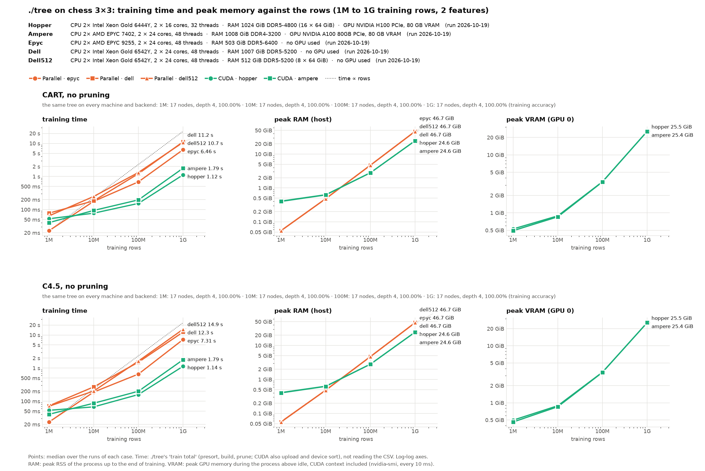
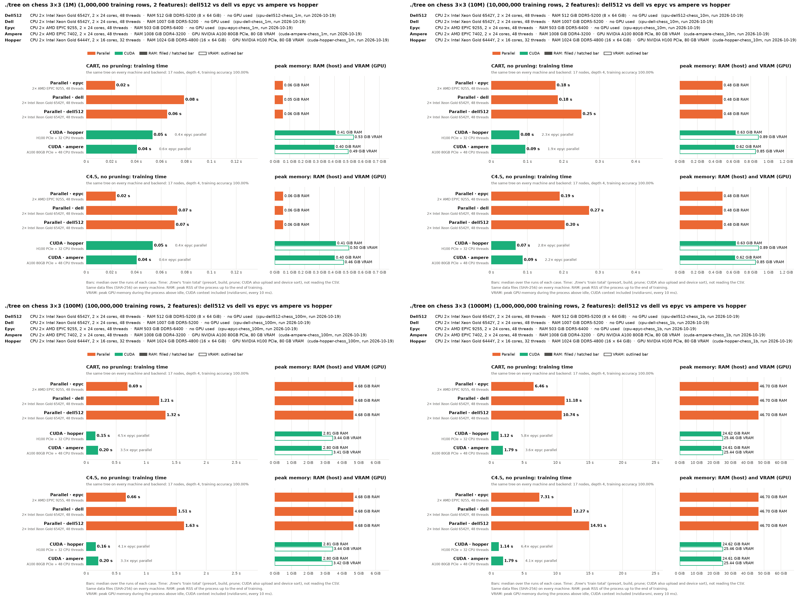

# Chess 3×3 on the mordor3 cluster: 1M to 1000M rows on two GPU and three CPU servers, unpruned CART and C4.5

**Status:** three runs per case, all on 2026-10-19.
- **GPU runs** (hopper, ampere): 17:34–17:42, with commit 2a9d64e on the cluster. On the laptop that is 5058ce1, the same change cherry-picked onto e0a9106. ./tree itself is unchanged since 051949b.
- **CPU runs** (epyc, dell, dell512): rerun 19:08–19:12 with commit d9da007, which fixes a slowdown at 1000M rows ([below](#the-1000m-slowdown-and-its-fix)). The fix changes only the CPU builder for nodes of at least 2^20 rows with few columns. The CPU subtrees of a CUDA run have at most 4096 rows, so the fix cannot change the GPU runs.
- **Each node ran alone** and was used whole (`--exclusive`). The four sizes ran one after another on every node, smallest first.
- **Same trees:** every case built the same tree on every node and backend: 17 nodes (9 leaves), depth 4, 100% training accuracy, at every size. That is the exact tree of a 3×3 board.
- **Settings:** ./tree's defaults. The trees are grown without pruning (`cart_full_nodepth`, `c45_unpruned`), with no depth limit. Only training time and memory are compared; accuracy is ./tree's training accuracy (`run.py --train-accuracy-only`).

How the runs are made, and where the data came from: [bench/cluster/README.md](../../cluster/README.md).

```bash
for d in chess_1m chess_10m chess_100m chess_1b; do
  bench/cluster/submit.sh -m 3 -d $d -p cart_full_nodepth,c45_unpruned -a <prepare job> \
      cuda-hopper-$d cuda-ampere-$d cpu-epyc-$d cpu-dell-$d cpu-dell512-$d
done
```

The CPU rerun named only `cpu-epyc-$d cpu-dell-$d cpu-dell512-$d`, without `-a`.

The charts are drawn as shown in the README: `chart.png` (one `machines_chart.py` chart per size, in a 2×2 grid) and `chart-rows.png` (`rows_chart.py`).

**The dataset** is a 3×3 checkerboard: two features, x and y, uniform in [0, 3] with six decimals. The class (`A`, `B`) alternates over the nine unit squares (`B` on five of them: 55.5% of the rows), with no noise. Four sizes:

| Dataset | Training rows | Test rows (own file) | CSV | Note |
|---|--:|--:|--:|---|
| `chess_1m` | 1,000,000 | 1,000 | 20 MB | the first 1M rows of `chess_10m` |
| `chess_10m` | 10,000,000 | 4,500 | 200 MB | the first 10M rows of `chess_100m` |
| `chess_100m` | 100,000,000 | 4,500 | 2.0 GB | |
| `chess_1b` | 1,000,000,000 | 1,000 | 20.0 GB | `chess_100m` ten times over: 100M distinct rows, each 10 times |

**What it measures.** The tree is tiny (4 levels, 8 splits), so a run is the presort plus a few full sweeps over all rows: time per row at the top levels, without the many small nodes of a deep tree. With two features, the CPU backend has only two columns to share among 48 threads.

| Run | Node | CPU | RAM | GPU (GPU 0 used) | Backend |
|---|---|---|---|---|---|
| `cuda-hopper-*` | hopper | 2× Xeon Gold 6444Y, 32 cores | 1 TB DDR5-4800 | H100 PCIe 80 GB | CUDA (+ 32 CPU threads) |
| `cuda-ampere-*` | ampere | 2× EPYC 7402, 48 cores | 1 TB DDR4-3200 | A100 80 GB PCIe | CUDA (+ 48 CPU threads) |
| `cpu-epyc-*` | epyc1 | 2× EPYC 9255 (Zen 5), 48 cores | 512 GB DDR5-6400 | – | parallel (48 threads) |
| `cpu-dell-*` | dell1 | 2× Xeon Gold 6542Y, 48 cores | 1 TB DDR5-5200 (16 × 64 GB) | – | parallel (48 threads) |
| `cpu-dell512-*` | dell2 | the same as dell1 | 512 GB DDR5-5200 (8 × 64 GB) | – | parallel (48 threads) |

## Time and memory against the rows



Training time (`train total`: presort and build, on CUDA also GPU setup and upload; not reading the CSV), median of 3 runs:

| CART, no pruning | 1M | 10M | 100M | 1000M |
|---|--:|--:|--:|--:|
| CUDA · hopper (H100 PCIe + 32 threads) | 53 ms | **78 ms** | **154 ms** | **1.12 s** |
| CUDA · ampere (A100 80GB PCIe + 48 threads) | 41 ms | 95 ms | 197 ms | 1.79 s |
| Parallel · epyc (EPYC 9255, 48 threads) | **23 ms** | 178 ms | 689 ms | 6.46 s |
| Parallel · dell (Xeon 6542Y, 48 threads) | 78 ms | 184 ms | 1.21 s | 11.18 s |
| Parallel · dell512 (the same, half the memory channels) | 65 ms | 250 ms | 1.32 s | 10.74 s |

| C4.5, no pruning | 1M | 10M | 100M | 1000M |
|---|--:|--:|--:|--:|
| CUDA · hopper | 53 ms | **68 ms** | **159 ms** | **1.14 s** |
| CUDA · ampere | 40 ms | 87 ms | 200 ms | 1.79 s |
| Parallel · epyc | **24 ms** | 190 ms | 660 ms | 7.31 s |
| Parallel · dell | 73 ms | 271 ms | 1.51 s | 12.27 s |
| Parallel · dell512 | 71 ms | 203 ms | 1.63 s | 14.91 s |

Peak memory (the same for CART and C4.5 within 0.01 GiB):

| | 1M | 10M | 100M | 1000M |
|---|--:|--:|--:|--:|
| RAM, CPU servers | 0.06 GiB | 0.48 GiB | 4.68 GiB | 46.70 GiB |
| RAM, CUDA (hopper / ampere) | 0.41 / 0.40 GiB | 0.63 / 0.62 GiB | 2.81 / 2.80 GiB | 24.62 / 24.61 GiB |
| VRAM, GPU 0 (hopper / ampere) | 0.53 / 0.49 GiB | 0.89 / 0.85 GiB | 3.44 / 3.41 GiB | 25.46 / 25.44 GiB |

- **The GPUs pull away with the rows.** At 1M rows epyc is the fastest (23 ms): a GPU run's fixed costs (setup, transfers, kernel launches) are about 40–50 ms. From 10M rows on, the GPUs lead.
  - The H100 is 2.3–2.8× faster than the best CPU server at 10M, 4.1–4.5× at 100M, and **5.8× (CART) to 6.4× (C4.5) at 1000M**. In every case the best CPU server is epyc.
  - The A100 is 3.6–4.1× faster than epyc at 1000M.
- **The GPU time grows slower than the rows**: 7× from 100M to 1000M on the H100, 9× on the A100. Even 100M rows do not keep a GPU busy; 1000M do.
- **The CPU time grows with the rows**: 8–11× from 100M to 1000M. The presort grows 10× (epyc 0.20 → 1.91 s, dell 0.54 → 4.39 s), and so does the build (epyc CART 0.47 → 4.55 s, dell 0.69 → 6.65 s).
- **epyc is 1.7–2.3× faster than dell** from 100M rows on, as on the other datasets.
- **dell512 against dell:** from 25% less time to 36% more (both at 10M, where the runs are noisy), 4% less to 22% more at 1000M, unlike ECBDL'14, where half the memory channels made dell2 1.35–1.55× slower. With two features, the build is not bound by memory bandwidth.
- **Memory is linear in the rows:** 50 bytes per row on the CPU servers (46.7 GiB for 1000M rows, 2 G values: 25 bytes per value) and 27 bytes per row of VRAM (25.5 GiB of the 80 GB). Every size fits on every GPU; the 40 GB A100s of ampere would hold the 1000M set too. A CUDA run needs about half the host RAM of a CPU run (24.6 GiB at 1000M).

## The 1000M slowdown and its fix

**Before the fix**, the CPU time grew 13–41× from 100M to 1000M rows, 10× the rows. With commit 2a9d64e the times were (3 runs, median):

| Before (2a9d64e) → after (d9da007) | 100M CART | 100M C4.5 | 1000M CART | 1000M C4.5 |
|---|--:|--:|--:|--:|
| epyc | 1.15 → 0.69 s | 1.35 → 0.66 s | 47.19 → **6.46 s** (7.3×) | 40.98 → **7.31 s** (5.6×) |
| dell | 2.43 → 1.21 s | 3.47 → 1.51 s | 34.20 → **11.18 s** (3.1×) | 43.33 → **12.27 s** (3.5×) |
| dell512 | 2.75 → 1.32 s | 3.18 → 1.63 s | 36.00 → **10.74 s** (3.4×) | 48.32 → **14.91 s** (3.2×) |

**The cause** was the partition of the big nodes.
- A node of the CPU builder is split by moving every column except the winner's into its children. Normally each column is moved by one thread, fused with the children's sweep.
- With two features, there is one column to move. So one thread moved all 1G rows of the root, and then of its children, while the other 47 waited.
- A single thread moving a column becomes much slower once the column is far beyond the caches: 3.5 ns per row at 100M rows, about 30 ns at 1000M.
- The builder already had a mode that partitions a node in blocks across all threads, but it used that mode only when spare memory ran short.

**The fix:** a node of at least 2^20 rows is also partitioned in blocks when its columns to move would keep at most one thread in 8 busy (48 threads: 1–6 columns).
- In blocks the node loses the fused sweep. Forcing the blocked mode on the other datasets cost airline (12 columns) 0–15%, and SUSY and HIGGS (17 and 27 columns) up to 50%. Those datasets are outside the new rule and keep the fused sweeps.
- The trees are unchanged: the golden tests pass, and so do checks of 3M synthetic rows with 2 and 3 features.

**Ruled out:**
- The TLB: the columns are on huge pages.
- The repeated rows of the 1000M set.
- Prefetching the partition bitmap: no gain at 1000M, and slower on airline.

**At 1M rows** (below 2^20) the code path is unchanged; the differences there (dell CART 70 → 78 ms) are run-to-run noise.

**At 10M rows** the new path is used, with mixed results:
- dell: 1.3–1.4× faster.
- dell512 C4.5: 1.4× faster.
- epyc, and dell512 CART: unchanged.

Some 10M cases had a single slow run (up to 0.77 s on epyc), which the median leaves out.

## One chart per size



## Notes

- **Not timed:** reading the CSV, and the data check before each job (SHA-256 of every prepared file and every CSV row against the binary files: 113 s for `chess_1b` on ampere, 33 GB over NFS). A whole `chess_1b` process (`wall_seconds`, reading the 20 GB CSV included) took 5.2–6.5 s on the GPU nodes and 9–18 s on the CPU nodes (37–52 s before the fix).
- **Hopper's and ampere's 1M and 10M runs** are dominated by fixed costs; their order there says little about the GPUs.
- **The originals** (C4.5 files from mordor3's `~/chess`) were deleted after the conversion; `datasets/chess_*.csv` on mordor3 are the only copies. Their SHA-256 and those of the originals are in [bench/cluster/README.md](../../cluster/README.md) and `bench/cluster/chess-originals.sha256`.
