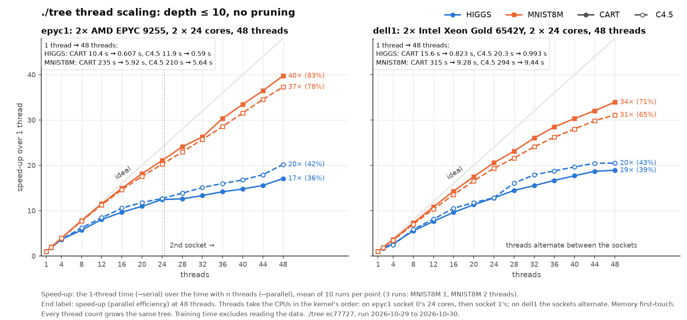

# Thread scaling on the mordor3 CPU servers: ./tree with 1 to 48 threads on HIGGS and MNIST8M

**Final data (2026-11-09/10):** one build of main (f1fe270, `bench/cluster/final.sh`), 10 runs per point, run with every other benchmark of the paper. Every tree is grown to depth ≤ 10 without pruning, as in the test-set benchmarks; every thread count built the same tree on both nodes.



```bash
bench/cluster/final.sh            # queues these runs with all the others (cpu-epyc-<data>, cpu-dell-<data>)
bench/.venv/bin/python bench/scaling_chart.py bench/results/cluster-cpu-scaling   # chart.png, <run>/scaling.csv
```

- **Protocols:** `cart_depth10` and `c45_depth10_unpruned`.
- **Threads:** 1, 2, 4, then every 4 up to 48.
  - **1 thread** is the serial backend (`--serial`); more threads use `--parallel --threads N`. Speed-up is the serial time divided by the N-thread time, so it includes the parallel backend's own overhead. Efficiency is the speed-up divided by N.
  - **Pinning:** N threads are pinned to the first N CPUs in the kernel's order (`--cpus 0-47`), memory first-touch. `run.log` records that order (`lscpu`).
- **Measurements:** as in every benchmark here: training time timed inside ./tree (presort, build; no file reading), and peak RSS up to the end of training, from the same process. `scaling.csv` in each run directory has every point with its min–max, speed-up, efficiency and peak RSS.

| Node | CPU | RAM | CPU order (`lscpu`) | Governor |
|---|---|---|---|---|
| epyc1 | 2× EPYC 9255 (Zen 5), 24 cores each, no SMT | 512 GB DDR5-6400 | CPUs 0–23 on socket 0, 24–47 on socket 1 (one NUMA node each) | `performance` |
| dell1 | 2× Xeon Gold 6542Y (Emerald Rapids), 24 cores each, no SMT | 1 TB DDR5-5200 | CPUs alternate between the sockets and their 4 NUMA nodes (0, 2, 1, 3, 0, …) | `powersave` (intel_pstate, boosts) |

So on epyc up to 24 threads stay on one socket, and the second socket joins from 28 on (the dotted line in the chart). On dell1 every thread count from 2 on is spread over both sockets.

## HIGGS

10.5M rows, 28 features. Training time, mean of 10 runs, and speedup over 1 thread:

| Threads | epyc CART | speedup | epyc C4.5 | speedup | dell CART | speedup | dell C4.5 | speedup |
|--:|--:|--:|--:|--:|--:|--:|--:|--:|
| 1 (serial) | 10.41 s | 1.0× | 12.12 s | 1.0× | 15.49 s | 1.0× | 22.99 s | 1.0× |
| 2 | 5.53 s | 1.9× | 6.42 s | 1.9× | 8.76 s | 1.8× | 14.42 s | 1.6× |
| 4 | 2.84 s | 3.7× | 3.30 s | 3.7× | 5.53 s | 2.8× | 7.58 s | 3.0× |
| 8 | 1.78 s | 5.9× | 1.96 s | 6.2× | 2.83 s | 5.5× | 4.00 s | 5.7× |
| 12 | 1.29 s | 8.0× | 1.42 s | 8.5× | 1.96 s | 7.9× | 2.86 s | 8.0× |
| 16 | 1.08 s | 9.6× | 1.15 s | 10.6× | 1.61 s | 9.6× | 2.21 s | 10.4× |
| 20 | 0.93 s | 11.1× | 1.02 s | 11.9× | 1.37 s | 11.3× | 1.99 s | 11.5× |
| 24 | 0.82 s | 12.8× | 0.95 s | 12.8× | 1.18 s | 13.1× | 1.84 s | 12.5× |
| 28 | 0.81 s | 12.8× | 0.87 s | 14.0× | 1.07 s | 14.5× | 1.46 s | 15.8× |
| 32 | 0.77 s | 13.5× | 0.80 s | 15.1× | 0.99 s | 15.6× | 1.31 s | 17.5× |
| 36 | 0.71 s | 14.6× | 0.73 s | 16.7× | 0.93 s | 16.7× | 1.26 s | 18.3× |
| 40 | 0.68 s | 15.3× | 0.67 s | 18.1× | 0.88 s | 17.6× | 1.19 s | 19.4× |
| 44 | 0.64 s | 16.2× | 0.66 s | 18.2× | 0.84 s | 18.5× | 1.15 s | 19.9× |
| 48 | 0.63 s | 16.6× | 0.63 s | 19.3× | 0.80 s | 19.3× | 1.11 s | 20.7× |

The trees are CART 2,029 nodes (training accuracy 70.63%) and C4.5 935 nodes (63.76%), depth 10, at every point on both nodes. `scaling.csv` in each run directory has every point with its min–max, efficiency and peak RSS.

- **With all 48 threads epyc is faster:** CART 0.63 against 0.80 s, C4.5 0.63 against 1.11 s.
- **On one thread dell is 1.5–1.9× slower** (CART 15.5 against 10.4 s, C4.5 23.0 against 12.1 s), so its speedups (19–21×) look better than epyc's (17–19×) though its times are not. Why was not investigated: its governor still boosts, and a single thread's memory is local to one of four NUMA nodes.
- **epyc gains nothing where the second socket comes in:** CART 12.8× at 24 threads and at 28, then up to 16.6× at 48.
- **Efficiency at 48 threads:** 35% (CART) and 40% (C4.5) on epyc, 40% and 43% on dell. The big nodes near the root are bound by memory bandwidth.
- **Spread:** under 0.1 s, but up to 21–25% of the mean at 48 threads on epyc and 29–32% at 2 and 4 threads on dell (min–max of the 10 runs, `scaling.csv`).
- **Memory:** 3.6 GiB serial, rising with the spare column slots to 5.6 GiB from 28 threads on (27 spare slots for 28 features).

## MNIST8M

8.1M rows, 784 features, 10 classes. Training time, mean of 10 runs, and speedup over 1 thread:

| Threads | epyc CART | speedup | epyc C4.5 | speedup | dell CART | speedup | dell C4.5 | speedup |
|--:|--:|--:|--:|--:|--:|--:|--:|--:|
| 1 (serial) | 233.98 s | 1.0× | 219.36 s | 1.0× | 314.38 s | 1.0× | 293.36 s | 1.0× |
| 2 | 117.46 s | 2.0× | 111.94 s | 2.0× | 166.17 s | 1.9× | 165.19 s | 1.8× |
| 4 | 59.06 s | 4.0× | 56.18 s | 3.9× | 85.11 s | 3.7× | 82.94 s | 3.5× |
| 8 | 29.98 s | 7.8× | 28.63 s | 7.7× | 43.41 s | 7.2× | 42.04 s | 7.0× |
| 12 | 20.27 s | 11.5× | 19.47 s | 11.3× | 28.99 s | 10.8× | 28.71 s | 10.2× |
| 16 | 15.63 s | 15.0× | 15.03 s | 14.6× | 22.04 s | 14.3× | 21.59 s | 13.6× |
| 20 | 12.87 s | 18.2× | 12.46 s | 17.6× | 17.85 s | 17.6× | 17.43 s | 16.8× |
| 24 | 11.12 s | 21.0× | 10.83 s | 20.3× | 15.21 s | 20.7× | 14.96 s | 19.6× |
| 28 | 9.72 s | 24.1× | 9.57 s | 22.9× | 13.67 s | 23.0× | 13.20 s | 22.2× |
| 32 | 8.64 s | 27.1× | 8.51 s | 25.8× | 11.97 s | 26.3× | 12.25 s | 24.0× |
| 36 | 7.73 s | 30.3× | 7.65 s | 28.7× | 11.20 s | 28.1× | 11.10 s | 26.4× |
| 40 | 7.05 s | 33.2× | 6.92 s | 31.7× | 10.38 s | 30.3× | 10.47 s | 28.0× |
| 44 | 6.36 s | 36.8× | 6.27 s | 35.0× | 9.55 s | 32.9× | 9.81 s | 29.9× |
| 48 | 5.92 s | 39.5× | 5.86 s | 37.4× | 9.20 s | 34.2× | 9.26 s | 31.7× |

The trees are CART 2,047 nodes (training accuracy 80.77%) and C4.5 1,453 nodes (70.96%), depth 10, at every point on both nodes.

- **Nearly linear to 48 threads on epyc:** 39.5× (CART) and 37.4× (C4.5), 82% and 78% efficiency, against 35–40% on HIGGS. With 784 features there are many columns to share among the threads.
- **dell scales a little less:** 34.2× and 31.7×, 71% and 66% efficiency, and takes 1.6× epyc's time at 48 threads.
- **No step at the second socket:** both nodes keep gaining at every thread count.
- **Memory:** 71.2 GiB serial to 74.0 GiB at 48 threads: the spare slots are small against the data.

## dell1: the noisy low thread counts

On dell1 the HIGGS runs at 2 and 4 threads spread by up to 32% of the mean (min–max of 10 runs), as on 2026-10-30 (4 threads: 4.8–7.1 s CART); dell1's batches also differed by up to 35% then. The cause was not found ([docs/PERFORMANCE.md](../../../docs/PERFORMANCE.md)); compare low thread counts on epyc. The A/B runs of that check are in git at 3354a8a (`dell-ab/`).
