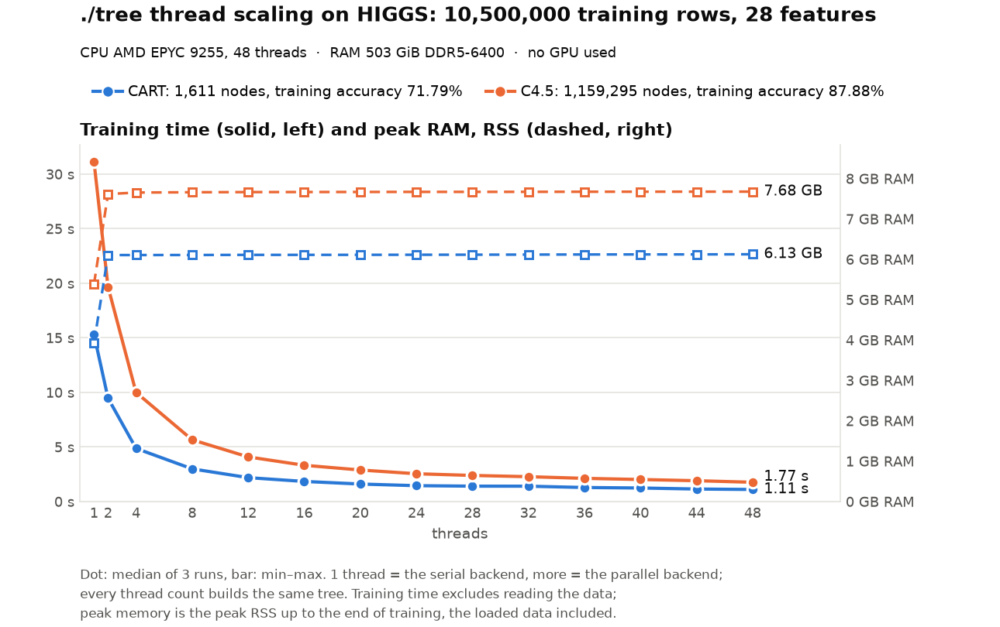
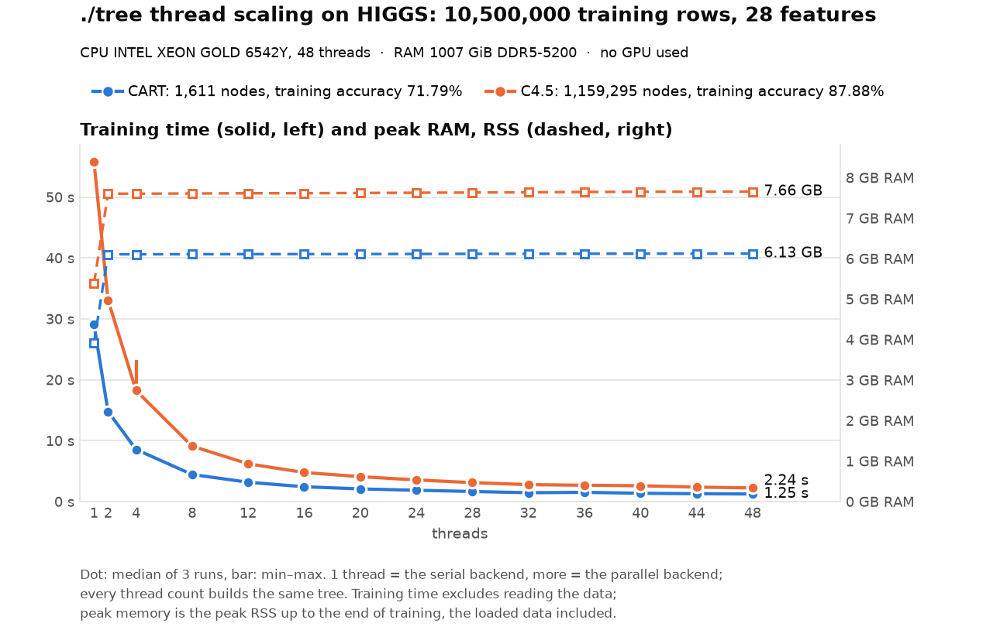
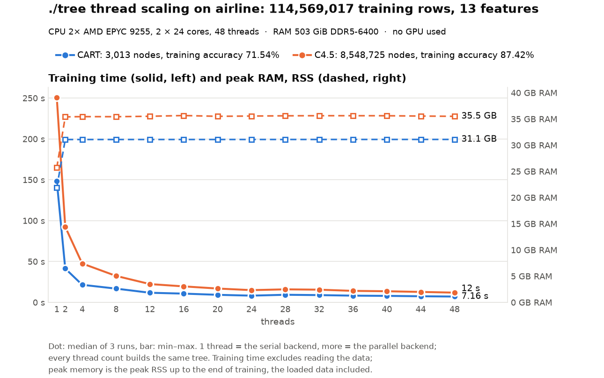
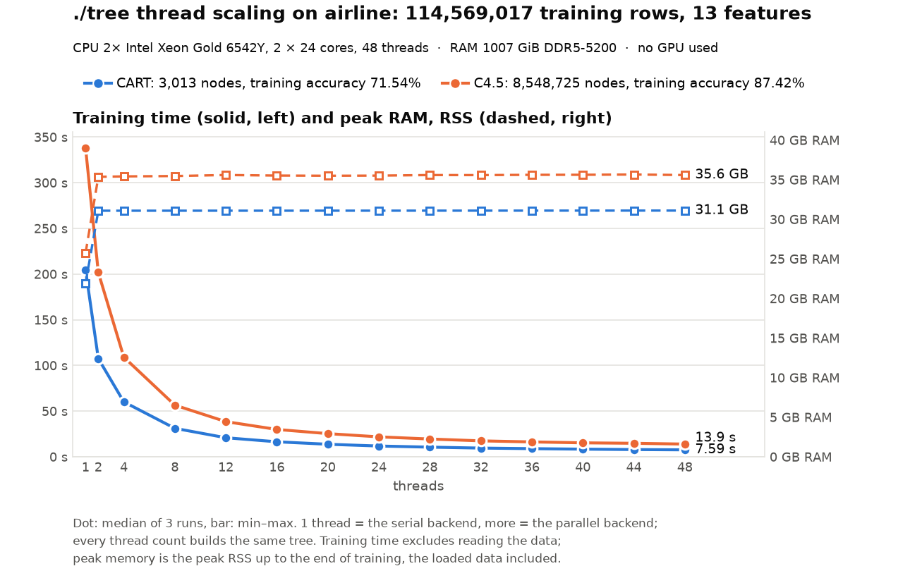

# Thread scaling on the mordor3 CPU servers: ./tree with 1 to 48 threads on HIGGS and airline

**Status:** HIGGS run on 2026-10-15, 3 runs per point, at commit 8da0c12 (GPU hand-off and C4.5 changes, parallel presort: [docs/PERFORMANCE.md](../../../docs/PERFORMANCE.md)), with ./tree's defaults (the fastest settings found on these servers). `machine.json` says `-dirty` only because the previous result files had been removed from the cluster's checkout for the rerun; the code was committed.
- **epyc1:** 23:26–23:35.
- **dell1:** 23:27–23:41.
- **Airline** (`cpu-epyc-airline`, `cpu-dell-airline`): run on 2026-10-17, 3 runs per point, at commit 6c7a43b (the same ./tree code and binaries as 8da0c12). epyc1 10:11–11:08, dell1 10:11–11:37.
- **Each node ran alone** and was used whole.
- **Same trees:** every thread count built the same tree on both nodes, the same as in [cluster-higgs](../cluster-higgs/BENCHMARK.md).

The cluster's counterpart of the desktop's and laptop's scaling runs ([cpu-pc-susy-scaling](../cpu-pc-susy-scaling/BENCHMARK.md)), on HIGGS (10.5M rows, 28 features) and airline (115M rows, 13 features), on the two CPU servers only. The GPU servers are not benchmarked on their CPUs.

```bash
bench/cluster/scaling.sh -m 3              # on the login node: one job on epyc1, one on dell1
bench/cluster/scaling.sh -m 3 -d airline   # airline
```

- **Protocols:**
  - `cart_alpha_nodepth`: pruned CART at the fixed α = 1e-5, no depth limit.
  - `c45`: C4.5, CF 0.25, min 2 rows.
- **Threads:** 1, 2, 4, then every 4 up to 48.
  - **1 thread** is the serial backend (`--serial`); more threads use `--parallel --threads N`. Speedup is the serial time divided by the N-thread time, so it includes the parallel backend's own overhead.
  - **Pinning:** N threads are pinned to the first N CPUs in the kernel's order (`--cpus 0-47`). `run.log` records that order (`lscpu`).
- **Measurements:** as in every benchmark here: training time timed inside ./tree (presort, build, pruning; no file reading), and peak RSS up to the end of training, from the same process. Accuracy is ./tree's training accuracy (`run.py --train-accuracy-only`).

| Node | CPU | RAM | CPU order (`lscpu`) | Governor |
|---|---|---|---|---|
| epyc1 | 2× EPYC 9255 (Zen 5), 24 cores each, no SMT | 512 GB DDR5-6400 | CPUs 0–23 on socket 0, 24–47 on socket 1 (one NUMA node each) | `performance` |
| dell1 | 2× Xeon Gold 6542Y (Emerald Rapids), 24 cores each, no SMT | 1 TB DDR5-5200 | CPUs alternate between the sockets and their 4 NUMA nodes (0, 2, 1, 3, 0, …) | `powersave` (intel_pstate, boosts) |

So on epyc1 up to 24 threads stay on one socket, and the second socket joins from 28 on. On dell1 every thread count from 2 on is spread over both sockets.

## HIGGS





Training time, median of 3 runs, and speedup over 1 thread:

| Threads | epyc CART | speedup | epyc C4.5 | speedup | dell CART | speedup | dell C4.5 | speedup |
|--:|--:|--:|--:|--:|--:|--:|--:|--:|
| 1 (serial) | 15.32 s | 1.0× | 30.50 s | 1.0× | 29.31 s | 1.0× | 54.43 s | 1.0× |
| 2 | 9.50 s | 1.6× | 19.01 s | 1.6× | 15.15 s | 1.9× | 31.87 s | 1.7× |
| 4 | 4.91 s | 3.1× | 9.70 s | 3.1× | 8.72 s | 3.4× | 17.77 s | 3.1× |
| 8 | 3.01 s | 5.1× | 5.52 s | 5.5× | 4.48 s | 6.5× | 8.70 s | 6.3× |
| 12 | 2.23 s | 6.9× | 4.03 s | 7.6× | 3.20 s | 9.2× | 6.16 s | 8.8× |
| 16 | 1.89 s | 8.1× | 3.30 s | 9.2× | 2.47 s | 11.9× | 4.75 s | 11.4× |
| 20 | 1.66 s | 9.2× | 2.85 s | 10.7× | 2.13 s | 13.8× | 3.91 s | 13.9× |
| 24 | 1.48 s | 10.4× | 2.52 s | 12.1× | 1.85 s | 15.9× | 3.43 s | 15.9× |
| 28 | 1.47 s | 10.4× | 2.36 s | 12.9× | 1.74 s | 16.8× | 3.05 s | 17.8× |
| 32 | 1.47 s | 10.4× | 2.32 s | 13.2× | 1.56 s | 18.8× | 2.77 s | 19.6× |
| 36 | 1.37 s | 11.2× | 2.13 s | 14.3× | 1.58 s | 18.6× | 2.64 s | 20.6× |
| 40 | 1.29 s | 11.9× | 1.98 s | 15.4× | 1.42 s | 20.7× | 2.54 s | 21.5× |
| 44 | 1.23 s | 12.4× | 1.91 s | 16.0× | 1.36 s | 21.6× | 2.36 s | 23.0× |
| 48 | **1.12 s** | 13.7× | **1.77 s** | 17.2× | 1.26 s | 23.2× | 2.25 s | 24.1× |

The trees are CART 1,611 nodes (depth 19, training accuracy 71.79%) and C4.5 1,159,295 nodes (depth 71, 87.88%) at every point on both nodes. `scaling.csv` in each run directory has every point with its min–max, efficiency and peak RSS.

### Observations

- **With all 48 threads epyc is faster:** CART 1.12 against 1.26 s, C4.5 1.77 against 2.25 s.
- **On one thread dell is much slower:** 29.3 against 15.3 s (CART) and 54.4 against 30.5 s (C4.5), 1.8–1.9× epyc's time. That is why dell's speedups look better (23–24× against 14–17× at 48 threads). The parallel times are closer.
  - Why dell's single thread is this slow was not investigated. Its governor (`powersave` with intel_pstate) still boosts, and a single thread's memory is local to one of four NUMA nodes.
- **epyc stalls where the second socket comes in:** CART takes 1.48 s at 24 threads and 1.47 s at 28 and 32. After that it gains again, to 1.12 s at 48. dell, whose threads span both sockets from the start, has no such step; it has a small dip at 36 threads (1.56 → 1.58 s on CART), seen in every run of this benchmark.
- **Efficiency falls steadily:** at 48 threads it is 28% (CART) and 36% (C4.5) on epyc, and 48% and 50% on dell (each against its own serial time). The big nodes near the root are bound by memory bandwidth, and CART's 1,611-node tree has little else to share out.
- **C4.5 scales better than CART** on epyc (17.2× against 13.7× at 48). Its 1.16-million-node tree has many more subtrees to grow in parallel. Its pruning runs on all threads too: 2.15 s serial, 0.19 s on 48 threads (epyc).
- **Against the previous run** (2026-10-15 at 16:54, commit 35cf315), little changed: the CPU-side changes of this commit help most with few features and many rows (airline), and HIGGS has 28 features.
  - **C4.5** is 1–3% faster up to 28 threads on epyc (serial 31.13 → 30.50 s) and within 2% from 32 on (48 threads: 1.77 s both). dell is within −3% to +4%, except 4 threads (16.75 → 17.77 s, whose runs spread over 17.0–18.6 s).
  - **CART** is 1–7% slower from 12 threads on, on both nodes (and dell's 4 threads 8%) (epyc 36 threads 1.29 → 1.37 s, 48 threads 1.11 → 1.12 s; dell 48 threads 1.23 → 1.26 s). Its CPU code did not change apart from counting the root's classes in parallel, and the previous run showed swings of the same size between commits with the same CART code; this was not checked with a same-job comparison on HIGGS.
- **Memory:** the serial run needs 3.7 GiB (CART) and 4.0 GiB (C4.5). From 2 threads on, the parallel backend keeps a second copy of the columns for its out-of-place partition, so the peak is a constant 5.7 GiB and 6.1 GiB, the same on both nodes. C4.5 no longer keeps a copy of the sorted values (5.0 GiB serial and 7.1–7.2 GiB parallel before).

## Airline





Training time, median of 3 runs, and speedup over 1 thread:

| Threads | epyc CART | speedup | epyc C4.5 | speedup | dell CART | speedup | dell C4.5 | speedup |
|--:|--:|--:|--:|--:|--:|--:|--:|--:|
| 1 (serial) | 148.54 s | 1.0× | 250.61 s | 1.0× | 204.67 s | 1.0× | 338.34 s | 1.0× |
| 2 | 41.41 s | 3.6× | 92.39 s | 2.7× | 107.54 s | 1.9× | 201.80 s | 1.7× |
| 4 | 21.54 s | 6.9× | 47.60 s | 5.3× | 60.15 s | 3.4× | 109.09 s | 3.1× |
| 8 | 16.86 s | 8.8× | 32.43 s | 7.7× | 31.19 s | 6.6× | 56.58 s | 6.0× |
| 12 | 11.80 s | 12.6× | 22.43 s | 11.2× | 20.88 s | 9.8× | 38.51 s | 8.8× |
| 16 | 10.75 s | 13.8× | 19.60 s | 12.8× | 16.44 s | 12.5× | 29.95 s | 11.3× |
| 20 | 9.28 s | 16.0× | 16.98 s | 14.8× | 13.73 s | 14.9× | 25.37 s | 13.3× |
| 24 | 8.27 s | 18.0× | 15.01 s | 16.7× | 11.80 s | 17.3× | 21.83 s | 15.5× |
| 28 | 9.34 s | 15.9× | 15.98 s | 15.7× | 10.58 s | 19.3× | 19.47 s | 17.4× |
| 32 | 8.93 s | 16.6× | 15.57 s | 16.1× | 9.53 s | 21.5× | 17.45 s | 19.4× |
| 36 | 8.26 s | 18.0× | 14.12 s | 17.8× | 8.94 s | 22.9× | 16.30 s | 20.8× |
| 40 | 7.98 s | 18.6× | 13.64 s | 18.4× | 8.38 s | 24.4× | 15.29 s | 22.1× |
| 44 | 7.51 s | 19.8× | 12.82 s | 19.5× | 7.90 s | 25.9× | 14.80 s | 22.9× |
| 48 | **7.16 s** | 20.7× | **11.95 s** | 21.0× | 7.59 s | 27.0× | 13.93 s | 24.3× |

The trees are CART 3,013 nodes (depth 25, training accuracy 71.54%) and C4.5 8,548,725 nodes (depth 72, 87.42%) at every point on both nodes, the same as in [cluster-airlines](../cluster-airlines/BENCHMARK.md), whose 48-thread times these match within 1%.

### Observations

- **Airline scales further than HIGGS:** 20.7× (CART) and 21.0× (C4.5) on epyc at 48 threads against 13.7× and 17.2× on HIGGS; 27.0× and 24.3× on dell against 23.2× and 24.1×. With 11× HIGGS's rows the big nodes near the root, where the threads share one node's features, have far more work per feature.
- **epyc's step from 1 to 2 threads is more than 2×:** 3.6× for CART (148.5 → 41.4 s) and 2.7× for C4.5; dell's is 1.9× and 1.7×, as on HIGGS (1.6–1.9×). One thread is the serial backend, which partitions in place; two threads are the parallel backend with its out-of-place partition and a second copy of the columns (the memory step below). On airline's 115M rows that seems to suit epyc's single core much better than the serial path; it was not investigated further.
- **epyc again loses time where its second socket comes in:** CART 8.27 s at 24 threads, 9.34 s at 28 and 8.93 s at 32, then down to 7.16 s at 48 (C4.5 15.01 → 15.98 → 15.57 → 11.95 s). dell, whose threads span both sockets from 2 on, keeps improving at every step.
- **At 48 threads the two nodes are close:** CART 7.16 s (epyc) against 7.59 s (dell), C4.5 11.95 against 13.93 s. dell's single thread is 1.4× slower than epyc's (204.7 against 148.5 s, CART), less than on HIGGS (1.9×).
- **Memory:** 20.4 GiB (CART) and 24.0 GiB (C4.5) on one thread; from 2 threads on a constant 29.0 and 33.1 GiB with the parallel backend's second copy of the columns, the same on both nodes.
