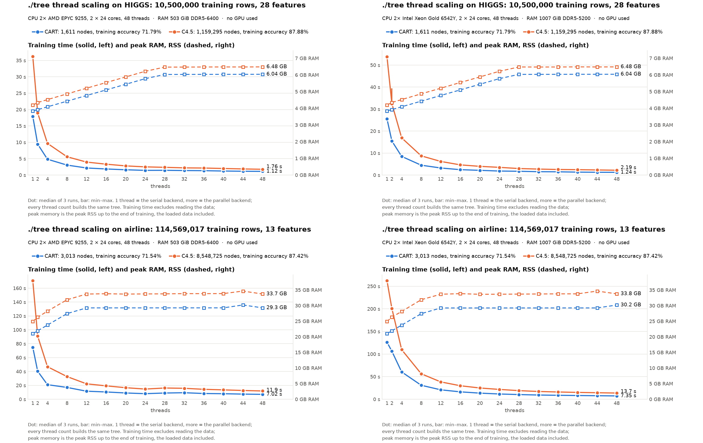

# Thread scaling on the mordor3 CPU servers: ./tree with 1 to 48 threads on HIGGS and airline

**Status:** run on 2026-10-20, 3 runs per point: dell1 at commit 8b1ecd1 (051949b plus each thread counting the classes in its own histogram, 6521330, and the GPU changes), epyc1 at 1a2d9a9 (8b1ecd1 plus `run.py --drop-cache`: the datasets leave the page cache before every run, see below). In cd18717 the columns are kept once, in column slots, with min(features − 1, threads) spare slots (one for `--serial`) instead of a second copy of every column ([docs/CPU.md](../../../docs/CPU.md)); ./tree's defaults otherwise (the fastest settings found on these servers). epyc's `machine.json` says `-dirty` only because result files of the cluster's checkout had changed; the code was committed.
- **HIGGS:** dell1 14:41–14:54 (job 1309), epyc1 16:25–16:35 (job 1343).
- **Airline:** dell1 14:55–16:12 (job 1311), epyc1 16:36–17:31 (job 1344).
- **Why epyc was rerun:** its first run at 8b1ecd1 found NUMA node 1 nearly full with our own cached dataset files (236 of 252 GiB), so the 48-thread runs' memory partly landed on the other socket ([cluster-ecbdl](../cluster-ecbdl/BENCHMARK.md)). With `--drop-cache` the page cache no longer holds the datasets between runs.
- **Each node ran alone** and was used whole.
- **Same trees:** every thread count built the same tree on both nodes, the same as in [cluster-higgs](../cluster-higgs/BENCHMARK.md).

The cluster's counterpart of the desktop's and laptop's scaling runs ([cpu-pc-susy-scaling](../cpu-pc-susy-scaling/BENCHMARK.md)), on HIGGS (10.5M rows, 28 features) and airline (115M rows, 13 features), on the two CPU servers only. The GPU servers are not benchmarked on their CPUs.

```bash
bench/cluster/scaling.sh -m 3              # on the login node: one job on epyc1, one on dell1
bench/cluster/scaling.sh -m 3 -d airline   # airline
```

- **Protocols:**
  - `cart_alpha_nodepth`: pruned CART at the fixed α = 1e-5, no depth limit.
  - `c45`: C4.5, CF 0.25, min 2 rows.
- **Threads:** 1, 2, 4, then every 4 up to 48.
  - **1 thread** is the serial backend (`--serial`); more threads use `--parallel --threads N`. Speedup is the serial time divided by the N-thread time, so it includes the parallel backend's own overhead.
  - **Pinning:** N threads are pinned to the first N CPUs in the kernel's order (`--cpus 0-47`). `run.log` records that order (`lscpu`).
- **Measurements:** as in every benchmark here: training time timed inside ./tree (presort, build, pruning; no file reading), and peak RSS up to the end of training, from the same process. Accuracy is ./tree's training accuracy (`run.py --train-accuracy-only`).

| Node | CPU | RAM | CPU order (`lscpu`) | Governor |
|---|---|---|---|---|
| epyc1 | 2× EPYC 9255 (Zen 5), 24 cores each, no SMT | 512 GB DDR5-6400 | CPUs 0–23 on socket 0, 24–47 on socket 1 (one NUMA node each) | `performance` |
| dell1 | 2× Xeon Gold 6542Y (Emerald Rapids), 24 cores each, no SMT | 1 TB DDR5-5200 | CPUs alternate between the sockets and their 4 NUMA nodes (0, 2, 1, 3, 0, …) | `powersave` (intel_pstate, boosts) |

So on epyc1 up to 24 threads stay on one socket, and the second socket joins from 28 on. On dell1 every thread count from 2 on is spread over both sockets.

All four charts in one image (HIGGS above airline, epyc left, dell right):



### Against the previous runs

**Against 051949b** (2026-10-19): the same trees and memory at every point, every time within −5.5% to +2.4% (most within ±2%; the largest changes are faster: epyc HIGGS C4.5 at 8 threads 5.91 → 5.58 s and at 32 threads 2.31 → 2.19 s, dell HIGGS C4.5 at 4 threads 17.73 → 16.90 s).

**Against cd18717** (2026-10-17): the same trees at every point; every time within −5.2% to +2.8%, the memory unchanged. The count tables no longer zero-fill 2 × (rows + 1) doubles on one thread, which shows most at high thread counts on airline (dell CART at 48 threads 7.79 → 7.38 s, at 32 threads 9.70 → 9.29 s). The rest of this section compares cd18717 with the runs before it.

The runs before cd18717 (HIGGS 2026-10-15 on 8da0c12, airline 2026-10-17 on 6c7a43b, their one-thread points rerun on 3bd3a46 after `--serial` moved to the parallel backend's out-of-place partition) kept a second copy of every column at every thread count.
- **Memory now grows with the thread count** instead of being constant: a partition needs one free column slot per column it moves at a time, and ./tree keeps min(features − 1, threads) spare slots (1 for `--serial`).
  - HIGGS (28 features): CART 3.6 GiB serial → 5.6 GiB from 28 threads on, C4.5 3.9 → 6.0 GiB (5.7 and 6.0–6.1 GiB at every count before).
  - Airline (13 features): CART 19.6 GiB serial → 27.2–28.1 GiB from 12 threads on, C4.5 23.2 → 31.3–32.3 GiB (29.0 and 32.6–33.2 GiB before).
- **Times are within ±4% at almost every point,** on both nodes and both datasets. Exceptions: epyc's serial C4.5 got faster (HIGGS 37.82 → 36.16 s, airline 178.63 → 170.88 s), and epyc HIGGS C4.5 at 8 threads slower (5.52 → 5.94 s).
- **The same trees** at every point, as before.

## HIGGS

Training time, median of 3 runs, and speedup over 1 thread:

| Threads | epyc CART | speedup | epyc C4.5 | speedup | dell CART | speedup | dell C4.5 | speedup |
|--:|--:|--:|--:|--:|--:|--:|--:|--:|
| 1 (serial) | 17.92 s | 1.0× | 36.20 s | 1.0× | 25.52 s | 1.0× | 53.75 s | 1.0× |
| 2 | 9.44 s | 1.9× | 18.97 s | 1.9× | 15.47 s | 1.7× | 32.46 s | 1.7× |
| 4 | 4.83 s | 3.7× | 9.67 s | 3.7× | 8.47 s | 3.0× | 16.90 s | 3.2× |
| 8 | 3.04 s | 5.9× | 5.58 s | 6.5× | 4.48 s | 5.7× | 8.72 s | 6.2× |
| 12 | 2.16 s | 8.3× | 3.96 s | 9.1× | 3.21 s | 8.0× | 6.18 s | 8.7× |
| 16 | 1.85 s | 9.7× | 3.32 s | 10.9× | 2.44 s | 10.5× | 4.62 s | 11.6× |
| 20 | 1.61 s | 11.1× | 2.80 s | 12.9× | 2.14 s | 11.9× | 3.95 s | 13.6× |
| 24 | 1.43 s | 12.6× | 2.49 s | 14.5× | 1.82 s | 14.0× | 3.50 s | 15.4× |
| 28 | 1.44 s | 12.4× | 2.36 s | 15.3× | 1.71 s | 14.9× | 2.95 s | 18.2× |
| 32 | 1.38 s | 13.0× | 2.19 s | 16.5× | 1.52 s | 16.7× | 2.71 s | 19.8× |
| 36 | 1.33 s | 13.4× | 2.14 s | 16.9× | 1.47 s | 17.4× | 2.53 s | 21.3× |
| 40 | 1.23 s | 14.6× | 2.00 s | 18.1× | 1.33 s | 19.2× | 2.44 s | 22.0× |
| 44 | 1.16 s | 15.5× | 1.86 s | 19.4× | 1.26 s | 20.3× | 2.31 s | 23.2× |
| 48 | **1.12 s** | 16.0× | **1.76 s** | 20.6× | 1.24 s | 20.7× | 2.19 s | 24.6× |

The trees are CART 1,611 nodes (depth 19, training accuracy 71.79%) and C4.5 1,159,295 nodes (depth 71, 87.88%) at every point on both nodes. `scaling.csv` in each run directory has every point with its min–max, efficiency and peak RSS.

### Observations

- **With all 48 threads epyc is faster:** CART 1.12 against 1.24 s, C4.5 1.76 against 2.19 s.
- **On one thread dell is slower:** 25.5 against 17.9 s (CART) and 53.8 against 36.2 s (C4.5), 1.4–1.5× epyc's time. That is why dell's speedups look better (21–25× against 16–21× at 48 threads). The parallel times are closer.
  - Why dell's single thread is slower was not investigated. Its governor (`powersave` with intel_pstate) still boosts, and a single thread's memory is local to one of four NUMA nodes.
- **epyc stalls where the second socket comes in:** CART takes 1.43 s at 24 threads, 1.44 s at 28 and 1.38 s at 32. After that it gains again, to 1.12 s at 48. dell, whose threads span both sockets from the start, has no such step.
- **Efficiency falls steadily:** at 48 threads it is 33% (CART) and 43% (C4.5) on epyc, and 43% and 51% on dell (each against its own serial time). The big nodes near the root are bound by memory bandwidth, and CART's 1,611-node tree has little else to share out.
- **C4.5 scales better than CART** on epyc (20.6× against 16.0× at 48). Its 1.16-million-node tree has many more subtrees to grow in parallel. Its pruning runs on all threads too: 2.12 s serial, 0.19 s on 48 threads (epyc).
- **Memory:** 3.6 GiB (CART) and 3.9 GiB (C4.5) serial, rising with the spare column slots to 5.6 and 6.0 GiB from 28 threads on (27 spare slots for 28 features), the same on both nodes.

## Airline

Training time, median of 3 runs, and speedup over 1 thread:

| Threads | epyc CART | speedup | epyc C4.5 | speedup | dell CART | speedup | dell C4.5 | speedup |
|--:|--:|--:|--:|--:|--:|--:|--:|--:|
| 1 (serial) | 74.76 s | 1.0× | 170.88 s | 1.0× | 126.22 s | 1.0× | 262.31 s | 1.0× |
| 2 | 40.34 s | 1.9× | 90.92 s | 1.9× | 106.11 s | 1.2× | 200.67 s | 1.3× |
| 4 | 20.99 s | 3.6× | 46.87 s | 3.6× | 60.43 s | 2.1× | 109.70 s | 2.4× |
| 8 | 17.01 s | 4.4× | 32.65 s | 5.2× | 30.93 s | 4.1× | 56.36 s | 4.7× |
| 12 | 11.59 s | 6.4× | 22.20 s | 7.7× | 20.84 s | 6.1× | 38.36 s | 6.8× |
| 16 | 10.48 s | 7.1× | 19.28 s | 8.9× | 16.36 s | 7.7× | 29.87 s | 8.8× |
| 20 | 9.02 s | 8.3× | 16.63 s | 10.3× | 13.53 s | 9.3× | 24.90 s | 10.5× |
| 24 | 8.02 s | 9.3× | 14.66 s | 11.7× | 11.62 s | 10.9× | 21.72 s | 12.1× |
| 28 | 8.95 s | 8.3× | 16.18 s | 10.6× | 10.34 s | 12.2× | 19.03 s | 13.8× |
| 32 | 9.40 s | 8.0× | 15.76 s | 10.8× | 9.33 s | 13.5× | 17.18 s | 15.3× |
| 36 | 8.26 s | 9.0× | 14.29 s | 12.0× | 8.72 s | 14.5× | 16.05 s | 16.3× |
| 40 | 7.96 s | 9.4× | 13.49 s | 12.7× | 8.24 s | 15.3× | 15.12 s | 17.4× |
| 44 | 7.41 s | 10.1× | 12.62 s | 13.5× | 7.78 s | 16.2× | 14.38 s | 18.2× |
| 48 | **7.02 s** | 10.6× | **11.89 s** | 14.4× | 7.35 s | 17.2× | 13.71 s | 19.1× |

The trees are CART 3,013 nodes (depth 25, training accuracy 71.54%) and C4.5 8,548,725 nodes (depth 72, 87.42%) at every point on both nodes, the same as in [cluster-airlines](../cluster-airlines/BENCHMARK.md), whose 48-thread times these match within 1% (dell's CART 7.35 against 7.39 s).

### Observations

- **Airline's speedups are lower than HIGGS's:** 10.6× (CART) and 14.4× (C4.5) on epyc at 48 threads against 16.0× and 20.6× on HIGGS; 17.2× and 19.1× on dell against 20.7× and 24.6×.
- **From 1 to 2 threads:** 1.9× (CART, 74.8 → 40.3 s) and 1.9× (C4.5) on epyc; only 1.2× and 1.3× on dell (1.7× on HIGGS). dell's first two CPUs sit on different sockets, so half of each thread's memory is on the other socket, which may weigh more with airline's 115M rows; this was not investigated.
- **epyc again loses time where its second socket comes in:** CART 8.02 s at 24 threads, 8.95 s at 28 and 9.40 s at 32, then down to 7.02 s at 48 (C4.5 14.66 → 16.18 → 15.76 → 11.89 s). dell, whose threads span both sockets from 2 on, keeps improving at every step.
- **At 48 threads the two nodes are close:** CART 7.02 s (epyc) against 7.35 s (dell), C4.5 11.89 against 13.71 s. dell's single thread is 1.7× (CART, 126.2 against 74.8 s) and 1.5× (C4.5) slower than epyc's.
- **Memory:** 19.6 GiB (CART) and 23.2 GiB (C4.5) serial, rising to 27.2–28.1 and 31.3–32.4 GiB from 12 threads on (12 spare slots for 13 features), the same on both nodes.
