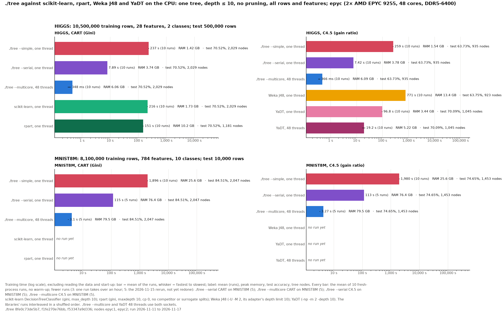

# CPU vs others: ./tree against scikit-learn, rpart, Weka J48 and YaDT on HIGGS and MNIST8M

One tree per run, grown to depth ≤ 10 without pruning on every training row and feature, scored on the dataset's test set, on epyc (2× EPYC 9255, 48 cores, 512 GB DDR5-6400).

**Data:** ./tree rerun on 2026-11-15/16 (f53347a9, `src/` = d2957ff2; `--serial` and `--multicore` 5 runs, `--simple` 10 from 2026-11-11, not rerun as its code has not changed); scikit-learn and J48 from 2026-11-09 (10 runs, J48 on MNIST8M 3: a run takes over 5 hours), not rerun: their code and ./tree's trees have not changed. Every label gives its number of runs.



```bash
bench/cluster/final.sh            # queues vs-epyc-<data>-<tool>-<algorithm> on epyc2 with all the other runs
bench/.venv/bin/python bench/vs_chart.py cpu     # chart.png
```

## What runs

| Bar | Command | Threads | From |
|---|---|--:|---|
| ./tree --simple | `tree_cpu --simple --cart -d 10` / `--c45 -d 10` | 1 | `cluster-<data>/simple-epyc-<data>` |
| ./tree --serial | `tree_cpu --serial ...` | 1 | `cluster-<data>/serial-epyc-<data>` |
| ./tree --multicore | `tree_cpu --multicore --threads 48 ...` (both sockets) | 48 | `cluster-<data>/cpu-epyc-<data>` |
| scikit-learn 1.9.1 | `DecisionTreeClassifier(max_depth=10)`, gini, CART only | 1 | `vs-epyc-<data>-sklearn-cart` here |
| rpart 4.1.27 (R 4.6.1) | `rpart(method="class")`, gini, `maxdepth=10, cp=0, minsplit=2, minbucket=1, maxcompete=0, maxsurrogate=0, xval=0`, CART only | 1 | `vs-epyc-<data>-rpart-cart` here |
| Weka J48 3.8.7 | `-U -M 2` with the adapter's depth limit 10, C4.5 only | 1 | `vs-epyc-<data>-j48-c45` here |
| YaDT 2.3.0 | `dTcmd -np -m 2 -depth 10` (only pre-pruning, its own depth limit, root at depth 0), C4.5 only | 1 and 48 | `vs-epyc-<data>-yadt-c45`, `vs-epyc-<data>-yadt-c45-multi` here |

- **Protocols:** `cart_depth10` and `c45_depth10_unpruned` from [benchlib.py](../../benchlib.py), the same as the test-set benchmarks.
- **scikit-learn and rpart have no C4.5**, so they are in the CART comparison only (an entropy tree is information gain, not C4.5's gain ratio); J48 and YaDT have no CART.
- **J48 has no depth limit.** [J48Fit](../../adapters/J48Fit.java) adds one: `DepthLimitedTree` grows J48's own `C45PruneableClassifierTree`, and at depth 10 it makes a leaf (`NoSplit`) instead of choosing a split. `-U` turns off J48's pruning and collapsing. Weka has no CART in its core, so CART has no Weka bar.
- **Nodes:** every job owns its node (`--exclusive`). The one-thread runs are pinned to the node's first CPU, memory first-touch, as ./tree's `--serial` and `--simple`. The libraries run on epyc2, the same hardware as epyc1 (within 2%; `machine.json` records the host).
- **Time:** the training time, which does not include reading the data. Every run is a fresh process that fits one tree, with no warm-up fit (from 2026-11-16, `benchlib.WARMUP_ROWS = 0`; the runs before gave Python and Java an untimed warm-up fit on 50,000 rows): a run's time is the time of running the tool once. YaDT's time is its `total time` minus its `load time` (parsing the CSV); its indexing of the data, its counterpart of ./tree's presort, is timed.
- **Memory:** the peak resident memory (RSS) right after training: loading and training.
- **Same trees:** `run.py --hash-trees` records the SHA-256 of every ./tree tree; each label shows the tree's nodes and test accuracy, so a tool that grew a different tree shows it.

## Results

Means of the runs (runs in brackets); peak RAM after training.

| Dataset | Algorithm | ./tree --simple | --serial | --multicore 48 | scikit-learn / J48 | Nodes, test accuracy |
|---|---|--:|--:|--:|--:|---|
| HIGGS | CART | 237 s (10) | 7.90 s (5) | 0.327 s (5) | 217 s (10), 1.6 GiB | 2,029 nodes, 70.52% (scikit-learn the same) |
| HIGGS | C4.5 | 259 s (10) | 7.41 s (5) | 0.342 s (5) | 833 s (10), 12.3 GiB | ./tree 935 nodes, 63.73%; J48 923 nodes, 63.75% |
| MNIST8M | CART | 1,896 s (10) | 115 s (5) | 3.10 s (5) | 1,005 s (10), 24.1 GiB | 2,047 nodes, 84.51% (scikit-learn the same) |
| MNIST8M | C4.5 | 1,980 s (10) | 113 s (5) | 3.27 s (5) | 18,998 s (3), 81.6 GiB | 1,453 nodes, 74.65% (J48 the same) |

- **Against scikit-learn (CART, the same tree):** `--serial` is 27× faster on HIGGS and 8.7× on MNIST8M on one thread; `--multicore` 660× and 320×. `--simple`, the textbook algorithm, is 1.1× scikit-learn's time on HIGGS and 1.9× on MNIST8M.
- **Against J48 (C4.5):** `--serial` is 112× faster on HIGGS and 168× on MNIST8M; `--multicore` 2,400× and 5,800×. J48 grows the same tree on MNIST8M and a slightly different one on HIGGS (923 against 935 nodes, 63.75% against 63.73% test accuracy; the cause was not investigated).
- **Memory:** ./tree `--serial` needs 3.5 GiB on HIGGS and 71 GiB on MNIST8M (presorted columns), `--multicore` 5.7 and 74 GiB; scikit-learn 1.6 and 24 GiB; J48 12.3 and 82 GiB.
- **Against the runs before:** ./tree's `--serial` and `--multicore` are 24–51% faster (f1fe270e → f53347a9); the ratios to the libraries grew by as much.
