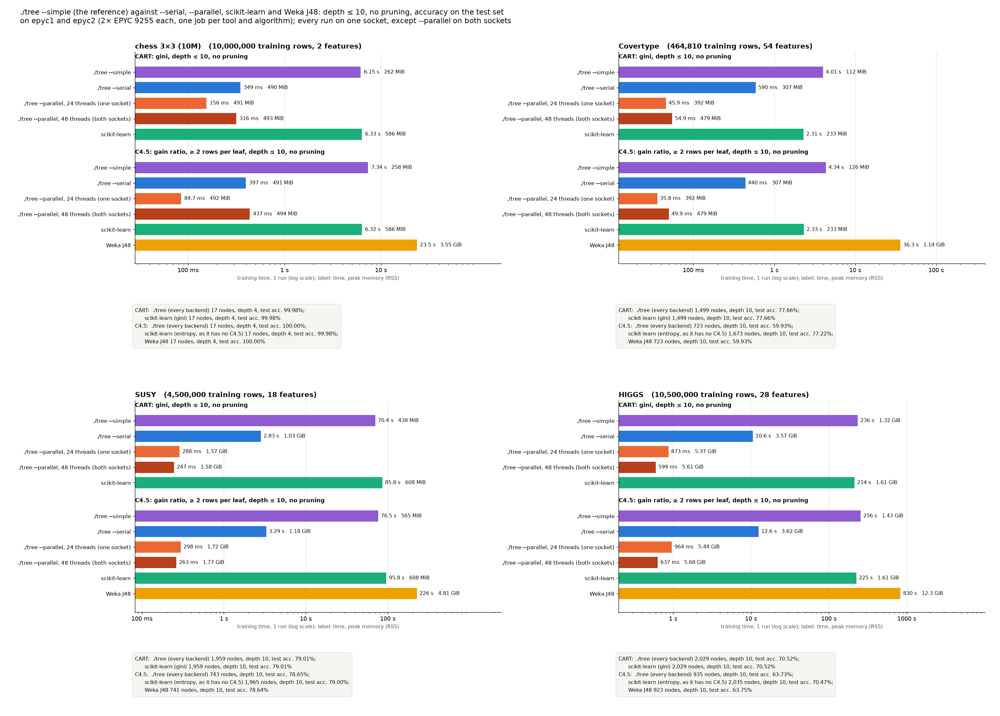

# CPU vs others: ./tree's backends against scikit-learn and Weka J48, depth 10, no pruning

**Status:** run on 2026-10-27 at commit 872a9a2 (run as 1cf89a9 on mordor3, the same tree). One SLURM job per dataset, tool and algorithm (`vs-epyc-<data>-<tool>-<protocol>`), one run each, split over epyc1 and epyc2, which have the same hardware (2× EPYC 9255):
- **epyc1:** SUSY, and HIGGS apart from J48.
- **epyc2:** HIGGS's J48, chess 10M and Covertype.

Every tree is grown to depth ≤ 10 without pruning, and its accuracy is measured on the dataset's test set. Every job finished; none came near its time limit.

The previous version of this benchmark (every tree pruned, no depth limit, training accuracy, 2026-10-21/22) is in [cluster-cpu-vs-others-old](../cluster-cpu-vs-others-old/BENCHMARK.md).



## What runs

| Bar | Command | Threads | CPUs and memory |
|---|---|--:|---|
| ./tree --simple | `tree_cpu --simple --cart --no-prune -d 10` / `--simple --c45 --no-prune -d 10` | 1 | one socket |
| ./tree --serial | `tree_cpu --serial ...` | 1 | one socket |
| ./tree --parallel, one socket | `tree_cpu --parallel --threads 24 ...` | 24 | one socket |
| ./tree --parallel, both sockets | `tree_cpu --parallel --threads 48 ...` | 48 | the whole node |
| scikit-learn 1.9.1 | `DecisionTreeClassifier(max_depth=10)`: gini for CART; `criterion="entropy", min_samples_leaf=2` for C4.5 | 1 | one socket |
| Weka J48 3.8.7 | `-U -M 2` with the adapter's depth limit 10, C4.5 only | 1 | one socket |

- **Protocols:** `cart_depth10` and `c45_depth10_unpruned` from [benchlib.py](../../benchlib.py), the same ones as the test-set benchmarks (cluster-higgs, cluster-susy).
- **scikit-learn has no C4.5.** Its entropy tree (information gain, at least 2 rows per leaf) is the nearest stand-in; C4.5 uses gain ratio.
- **J48 has no depth limit.** [J48Fit](../../adapters/J48Fit.java) adds one: `DepthLimitedTree` grows J48's own `C45PruneableClassifierTree`, and at depth 10 it makes a leaf (`NoSplit`) instead of choosing a split. `-U` turns off J48's pruning and collapsing. Weka has no CART in its core (SimpleCart is a separate package that prunes by cross-validation), so CART has no Weka bar.
- **Test sets:** HIGGS and SUSY use UCI's official test rows (the last 500,000). chess 10M uses its own test file (4,500 rows), and Covertype uses its prepared test split (116,202 rows). Every tool predicts the same test rows (`run.py --test-accuracy`).
- **One socket:** every job owned its node (`--exclusive`).
  - Every run except the dual-socket bar was pinned to one socket (24 CPUs), with its memory bound to that socket's NUMA node (job.sh `SOCKET=auto`). The one-thread runs use that socket's first CPU.
  - The dual-socket jobs use all 48 CPUs and both NUMA nodes, with no pinning.
- **Time:** the training time, which does not include reading the data. Python and Java first get one untimed warm-up fit on 50,000 rows.
- **Memory:** the peak resident memory (RSS) right after training: loading, warm-up and training.

## Same trees

`run.py --hash-trees` records the SHA-256 of every ./tree tree (`--dump`). For each dataset and protocol, every ./tree backend (--simple, --serial, and --parallel on one socket and on both) grew the same tree:

| Dataset | Protocol | Tree SHA-256 (first 16) | Nodes | Depth | Test accuracy |
|---|---|---|--:|--:|--:|
| chess_10m | CART | a537d8753d217de7 | 17 | 4 | 99.98% |
| chess_10m | C4.5 | a7a65727f69d848a | 17 | 4 | 100.00% |
| covertype | CART | 474aeff3e34e323d | 1,499 | 10 | 77.66% |
| covertype | C4.5 | 7d7954ba222d8f5b | 723 | 10 | 59.93% |
| susy | CART | b4b927530b8265bb | 1,959 | 10 | 79.01% |
| susy | C4.5 | c4948bc23841a3fc | 743 | 10 | 78.65% |
| higgs | CART | 4c01bec85a4914cd | 2,029 | 10 | 70.52% |
| higgs | C4.5 | 0978d478e2f50bb7 | 935 | 10 | 63.73% |

The other tools:

| Dataset | scikit-learn, gini | scikit-learn, entropy | Weka J48 |
|---|--:|--:|--:|
| chess_10m | 17 nodes, 99.98% | 17 nodes, 99.98% | 17 nodes, 100.00% |
| covertype | 1,499 nodes, 77.66% | 1,673 nodes, 77.22% | 723 nodes, 59.93% |
| susy | 1,959 nodes, 79.01% | 1,965 nodes, 79.00% | 741 nodes, 78.64% |
| higgs | 2,029 nodes, 70.52% | 2,035 nodes, 70.47% | 923 nodes, 63.75% |

- **CART:** scikit-learn's gini tree has the same node count and the same test accuracy as ./tree's on every dataset.
- **C4.5:** Weka J48 grows the same tree size and accuracy as ./tree on chess and Covertype, and nearly the same on SUSY (741 against 743 nodes) and HIGGS (923 against 935). ./tree follows C4.5 Release 8; J48 differs from R8 in small details.
- **C4.5 is less accurate here:** on Covertype 59.9% against CART's 77.7%, and on HIGGS 63.7% against 70.5%. Both C4.5 implementations agree, so this comes from the algorithm, not from ./tree. scikit-learn's entropy tree, which uses plain information gain, is as accurate as CART, so the cause is gain ratio. A likely explanation (not checked node by node): gain ratio favours splits that cut off a small group of rows, whose split information is low. At a depth limit of 10 those splits use up the levels, and C4.5's trees have half as many nodes as CART's. Without a depth limit, C4.5 grows on to depth 38–71 (see cluster-cpu-vs-others-old).

## Results (training time, one run; peak memory)

| Dataset | Protocol | --simple | --serial | --parallel, 24 (one socket) | --parallel, 48 (both) | scikit-learn | Weka J48 |
|---|---|--:|--:|--:|--:|--:|--:|
| chess_10m | CART | 6.15 s, 262 MiB | 349 ms, 490 MiB | 156 ms, 491 MiB | 316 ms, 493 MiB | 6.33 s, 586 MiB | – |
| chess_10m | C4.5 | 7.34 s, 258 MiB | 397 ms, 491 MiB | 84.7 ms, 492 MiB | 437 ms, 494 MiB | 6.32 s, 586 MiB | 23.5 s, 3.55 GiB |
| covertype | CART | 4.01 s, 112 MiB | 590 ms, 307 MiB | 45.9 ms, 392 MiB | 54.9 ms, 479 MiB | 2.31 s, 233 MiB | – |
| covertype | C4.5 | 4.34 s, 126 MiB | 440 ms, 307 MiB | 35.8 ms, 392 MiB | 49.9 ms, 479 MiB | 2.33 s, 233 MiB | 36.3 s, 1.14 GiB |
| susy | CART | 70.4 s, 438 MiB | 2.83 s, 1.03 GiB | 288 ms, 1.57 GiB | 247 ms, 1.58 GiB | 85.8 s, 608 MiB | – |
| susy | C4.5 | 76.5 s, 565 MiB | 3.29 s, 1.18 GiB | 298 ms, 1.72 GiB | 263 ms, 1.77 GiB | 95.8 s, 608 MiB | 226 s, 4.81 GiB |
| higgs | CART | 236 s, 1.32 GiB | 10.6 s, 3.57 GiB | 873 ms, 5.37 GiB | 599 ms, 5.61 GiB | 214 s, 1.61 GiB | – |
| higgs | C4.5 | 256 s, 1.43 GiB | 12.6 s, 3.62 GiB | 964 ms, 5.44 GiB | 637 ms, 5.68 GiB | 225 s, 1.61 GiB | 830 s, 12.3 GiB |

- **--serial against --simple:** --serial is faster by:
  - 18× on chess 10M and 7–10× on Covertype;
  - 23–25× on SUSY and 20–22× on HIGGS.

  --simple sorts each node's rows again for every feature; --serial sorts once and keeps the order while it partitions ([paper/simple-vs-serial.md](../../../paper/simple-vs-serial.md)).
- **--parallel on one socket against --serial:** 2.2–4.7× faster on chess, which has only two features to share among 24 threads. 12–13× faster on Covertype, 10–11× on SUSY and 12–13× on HIGGS.
- **Both sockets against one:** the second socket helps only on the big datasets: 1.5× faster on HIGGS and 1.1× on SUSY. It is 1.2–1.4× slower on Covertype and 2–5× slower on chess 10M, where the threads on the other socket mostly cost cross-socket memory traffic and synchronisation.
- **--simple against the libraries:**
  - About as fast as scikit-learn on chess (6.2–7.3 s against 6.3 s), 1.7–1.9× slower on Covertype, 1.2× faster on SUSY and 1.1× slower on HIGGS. Without pruning, the two grow at about the same speed: the old benchmark's 6–13× lead on SUSY and HIGGS came from scikit-learn's quadratic pruning (cluster-cpu-vs-others-old).
  - 3.0–3.2× faster than J48 on chess, SUSY and HIGGS, and 8.4× faster on Covertype.
- **--serial against the libraries:** 16–18× faster than scikit-learn on chess, 4–5× on Covertype, 29–30× on SUSY and 18–20× on HIGGS; 59–83× faster than J48.
- **--parallel on one socket against the libraries:** 41–75× faster than scikit-learn on chess, 50–65× on Covertype, 300–320× on SUSY and 230–245× on HIGGS; 280–1,000× faster than J48.
- **Memory:**
  - --simple uses the least of the ./tree backends, as it keeps no presorted orders: 0.1–1.4 GiB.
  - --serial uses 2–3× as much (sorted feature orders), and --parallel up to 1.5× more than --serial (per-thread buffers; about the same on chess).
  - scikit-learn uses 0.2–1.6 GiB.
  - J48 uses the most: 1.1–12.3 GiB. Weka keeps every row as a Java object of doubles.

### Why J48 on HIGGS took 19 hours before and 14 minutes now

In the old benchmark J48 grew HIGGS without a depth limit: 1,152,747 nodes, depth 71, 68,662 s of growing. Here it stops at depth 10: 923 nodes, 830 s. The rows per level are the same (all 10.5M at every level down to the limit), so the extra time came from the deep levels' half a million internal nodes. After choosing a numeric split, J48's `C45ModelSelection` calls `setSplitPoint` on the whole training set, to move the threshold to a value that occurs in the data. That is one scan of all 10.5M rows per internal node: 576k scans without a depth limit, 461 at depth 10. This is the likely cause; it was not profiled.

## Reproduce

```bash
# on mordor3, after build.sh, setup.sh (compiles J48Fit) and prepare.sh (bench/cluster/README.md)
jobs() { d=$1; for t in parallel dual serial sklearn simple; do
  echo vs-epyc-$d-$t-cart vs-epyc-$d-$t-c45; done; echo vs-epyc-$d-j48-c45; }
bench/cluster/submit.sh -m 1 -e -d susy  -o cluster-cpu-vs-others -w epyc1 $(jobs susy)
bench/cluster/submit.sh -m 1 -e -d higgs -o cluster-cpu-vs-others -w epyc1 $(jobs higgs | sed 's/ *vs-epyc-higgs-j48-c45//')
bench/cluster/submit.sh -m 1 -e -d higgs -o cluster-cpu-vs-others -w epyc2 vs-epyc-higgs-j48-c45
for d in chess_10m covertype; do
  bench/cluster/submit.sh -m 1 -e -d $d -o cluster-cpu-vs-others -w epyc2 $(jobs $d)
done
bench/.venv/bin/python bench/simple_chart.py bench/results/cluster-cpu-vs-others
```

- Each `vs-epyc-<data>-<tool>-<protocol>` job runs one tool, with a time limit that fits it. `-w` picks the node, and `-e` adds the test accuracy.
- Every vs job passes `RUN_EXTRA=--hash-trees` to job.sh, and all but the `dual` ones pass `SOCKET=auto`.
- `simple_chart.py` refuses to draw if the ./tree backends' tree hashes differ, or if a case failed or ran twice.
