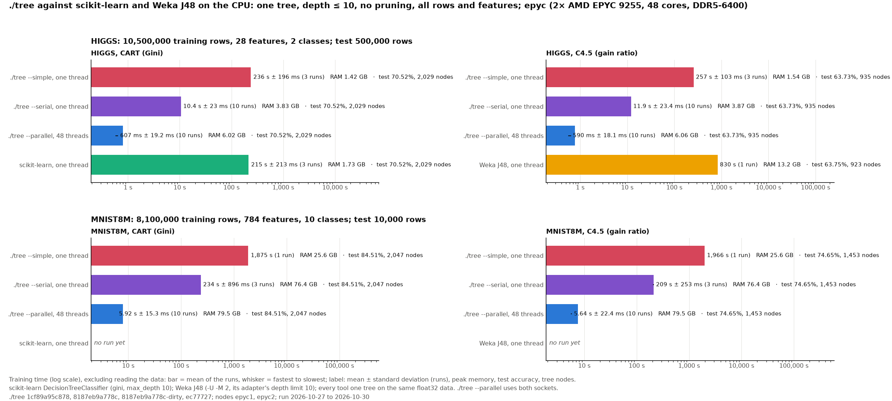

# CPU vs others: ./tree against scikit-learn and Weka J48 on HIGGS and MNIST8M

One tree per run, grown to depth ≤ 10 without pruning on every training row and feature, scored on the dataset's test set, on epyc (2× EPYC 9255, 48 cores, 512 GB DDR5-6400).

**Status (2026-11-09):** being rerun on one build of main with every other benchmark (`bench/cluster/final.sh`): scikit-learn and J48 10 runs per case, J48 on MNIST8M 3 (a run takes hours). The chart below still shows the 2026-10 runs (./tree ec77727; scikit-learn and J48 on HIGGS 3 and 1 runs); MNIST8M's libraries have not run yet. Until 2026-11-09 this benchmark also had SUSY, Covertype, chess 10M and 1000M, ECBDL'14 15M and ./tree on one socket; those runs are in git at 3354a8a.



```bash
bench/cluster/final.sh            # queues vs-epyc-<data>-<tool>-<algorithm> on epyc2 with all the other runs
bench/.venv/bin/python bench/vs_chart.py cpu     # chart.png
```

## What runs

| Bar | Command | Threads | From |
|---|---|--:|---|
| ./tree --simple | `tree_cpu --simple --cart --no-prune -d 10` / `--c45 --no-prune -d 10` | 1 | `cluster-<data>/simple-epyc-<data>` |
| ./tree --serial | `tree_cpu --serial ...` | 1 | `cluster-<data>/serial-epyc-<data>` |
| ./tree --parallel | `tree_cpu --parallel --threads 48 ...` (both sockets) | 48 | `cluster-<data>/cpu-epyc-<data>` |
| scikit-learn 1.9.1 | `DecisionTreeClassifier(max_depth=10)`, gini, CART only | 1 | `vs-epyc-<data>-sklearn-cart` here |
| Weka J48 3.8.7 | `-U -M 2` with the adapter's depth limit 10, C4.5 only | 1 | `vs-epyc-<data>-j48-c45` here |

- **Protocols:** `cart_depth10` and `c45_depth10_unpruned` from [benchlib.py](../../benchlib.py), the same as the test-set benchmarks.
- **scikit-learn has no C4.5**, so it is in the CART comparison only (its entropy tree is information gain, not C4.5's gain ratio).
- **J48 has no depth limit.** [J48Fit](../../adapters/J48Fit.java) adds one: `DepthLimitedTree` grows J48's own `C45PruneableClassifierTree`, and at depth 10 it makes a leaf (`NoSplit`) instead of choosing a split. `-U` turns off J48's pruning and collapsing. Weka has no CART in its core, so CART has no Weka bar.
- **Nodes:** every job owns its node (`--exclusive`). The one-thread runs are pinned to the node's first CPU, memory first-touch, as ./tree's `--serial` and `--simple`. The libraries run on epyc2, the same hardware as epyc1 (within 2%; `machine.json` records the host).
- **Time:** the training time, which does not include reading the data. Python and Java first get one untimed warm-up fit on 50,000 rows in the same process; every run is a fresh process.
- **Memory:** the peak resident memory (RSS) right after training: loading, warm-up and training.
- **Same trees:** `run.py --hash-trees` records the SHA-256 of every ./tree tree; each label shows the tree's nodes and test accuracy, so a tool that grew a different tree shows it.

## Results of 2026-10 (to be replaced)

| Dataset | Algorithm | ./tree --simple | --serial | --parallel 48 | scikit-learn / J48 | Nodes, test accuracy |
|---|---|--:|--:|--:|--:|---|
| HIGGS | CART | 236 s | 10.4 s | 0.607 s | 215 s | 2,029 nodes, 70.52% (scikit-learn the same) |
| HIGGS | C4.5 | 257 s | 11.9 s | 0.590 s | 830 s | ./tree 935 nodes, 63.73%; J48 923 nodes, 63.75% |
| MNIST8M | CART | 1,875 s | 234 s | 5.92 s | – | 2,047 nodes, 84.51% |
| MNIST8M | C4.5 | 1,966 s | 209 s | 5.64 s | – | 1,453 nodes, 74.65% |
