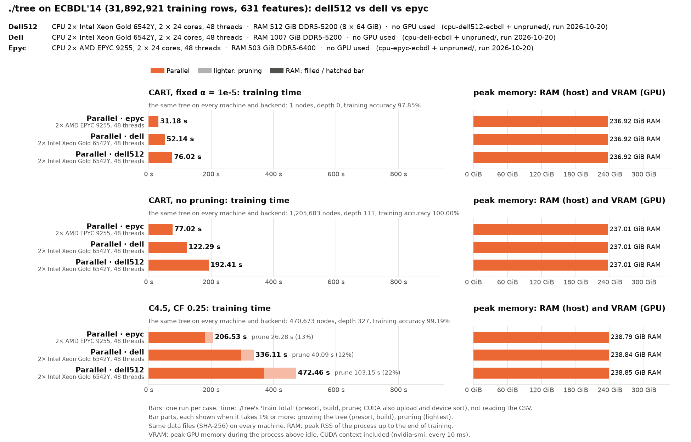

# ECBDL'14 on the mordor3 cluster: a 15M-row sample on two GPU and three CPU servers, the full 32M rows on the CPU servers

**Status:** one run per case, every row repeated on 2026-10-20. The same trees as before on every node and backend.
- **dell and dell512** (`cpu-dell*`, pruned and `unpruned/`): commit 8b1ecd1, 13:44–14:40. It adds 6521330 to the earlier code: the class counts kept per thread in local histograms instead of one shared, false-shared array, and the staged GPU copies use at least 8 threads.
- **epyc** (`cpu-epyc-*`): 1a2d9a9 (the same ./tree), 15:22–16:00, with the datasets dropped from the page cache before each run (`run.py --drop-cache`). In the 8b1ecd1 run our own cached dataset files had filled epyc1's NUMA node 1 (236 of 252 GiB), and the 48-thread runs allocated across the sockets (the 15M sample's presort 1.6 → 2.3 s).
- **CUDA** (`cuda-*`, pruned and `unpruned/`): commit 235c431, from 18:43, on the GPU's socket only: GPU 0, the CPUs of its NUMA node 0 (16 threads on hopper, 24 on ampere), the memory bound to that node. Before, at 8b1ecd1 (13:44–14:40), they ran on the whole node.
- **One socket** (`socket-*`, pruned and `unpruned/`): commit 10d125d, from 18:56: the parallel backend on every CPU of one socket of epyc1 and dell1 (24 threads), the memory bound to that socket's NUMA nodes (`SOCKET=auto` in job.sh: epyc1's socket 0, dell1's socket 1). The sample only.
- **GPU only rows** (`gpuonly-*-ecbdl_15m`, `--cuda --gpu-only`, all three protocols in one directory): the runs without `--profile` of [cluster-ecbdl-profile/gpu-only](../cluster-ecbdl-profile/gpu-only/BENCHMARK.md) (`plain/`, copied here), commit 10d125d (with 3ccf4ba: GPU only uses every CPU it may), 19:32–19:46, on the same CPUs, memory and GPU as the CUDA rows: GPU 0 and its NUMA node 0 (16 threads on hopper, 24 on ampere).
- **Before:** the CPU rows were 051949b's (2026-10-19), the CUDA rows 6f6cecb's (2026-10-19 evening), the GPU-only rows 7868bf4's (2026-10-20 afternoon, one CPU thread) and before that 6da527e's and ba22356's (the morning, GPU 0, not bound); the git history has them. The changes are below each table.
- **Each node ran alone** and was reserved whole. The jobs ran one after another on each node, after the other cluster benchmarks of the same commit.
- **Settings:** ./tree's defaults, as in [cluster-airline-old](../cluster-airline-old/BENCHMARK.md). Only training time and memory are compared; accuracy is ./tree's training accuracy (`run.py --train-accuracy-only`).
- **The sample grew from 6M to 15M rows** on 2026-10-17: the GPU now needs 8 bytes per value instead of 16, so 15M rows fill the 80 GB GPUs about as much as 6M did before. The 6M results (commit 8da0c12 and 6c7a43b) are in the git history up to commit cd18717.

How the runs are made, and the dataset: [bench/cluster/README.md](../../cluster/README.md).

```bash
P="-p cart_full_nodepth -o cluster-ecbdl-old/unpruned"
bench/cluster/submit.sh -d ecbdl_15m -a <prepare job>    # pruned, four nodes
bench/cluster/submit.sh -d ecbdl                         # pruned, full set: epyc1 and dell1
bench/cluster/submit.sh -d ecbdl_15m -a <prepare job> $P # unpruned CART
bench/cluster/submit.sh -d ecbdl $P
bench/cluster/submit.sh -d ecbdl_15m cpu-dell512-ecbdl_15m     # dell2, by name
bench/cluster/submit.sh -d ecbdl cpu-dell512-ecbdl
bench/cluster/submit.sh -d ecbdl_15m $P cpu-dell512-ecbdl_15m
bench/cluster/submit.sh -d ecbdl $P cpu-dell512-ecbdl
bench/cluster/submit.sh -d ecbdl_15m socket-epyc-ecbdl_15m socket-dell-ecbdl_15m     # one socket
bench/cluster/submit.sh -d ecbdl_15m $P socket-epyc-ecbdl_15m socket-dell-ecbdl_15m
bench/cluster/profile.sh -o cluster-ecbdl-profile/gpu-only gpuonly-hopper-ecbdl_15m gpuonly-ampere-ecbdl_15m   # see cluster-ecbdl-profile
cp -r bench/results/cluster-ecbdl-profile/gpu-only/plain/gpuonly-* bench/results/cluster-ecbdl-old/   # GPU only rows
d=bench/results/cluster-ecbdl-old                            # the charts
bench/.venv/bin/python bench/machines_chart.py --protocols cart_alpha_nodepth,cart_full_nodepth,c45 \
    --more $d/unpruned $d/cuda-hopper-ecbdl_15m $d/cuda-ampere-ecbdl_15m $d/cpu-epyc-ecbdl_15m \
    $d/cpu-dell-ecbdl_15m $d/cpu-dell512-ecbdl_15m $d/socket-epyc-ecbdl_15m $d/socket-dell-ecbdl_15m \
    $d/gpuonly-hopper-ecbdl_15m $d/gpuonly-ampere-ecbdl_15m --out $d/chart.png
bench/.venv/bin/python bench/machines_chart.py --protocols cart_alpha_nodepth,cart_full_nodepth,c45 \
    --more $d/unpruned $d/cpu-epyc-ecbdl $d/cpu-dell-ecbdl $d/cpu-dell512-ecbdl --out $d/chart-full.png
```

The dataset is ECBDL'14 (protein contact-map prediction, the GECCO 2014 big data competition): 631 features (539 real, 92 nominal as integer codes), label 0/1 with 2.15% contacts. The full set had 31,892,921 training rows here (100,000 random rows held out; since 2026-10-23 `ecbdl` trains on all 31,992,921 and tests on the competition's test set, see `bench/cluster/README.md`), 20.1 G values (65× HIGGS's, 81 GB as float32). The CUDA backend needs 8 bytes per value on the GPU (one copy of the presorted columns, plus one spare column), about 160 GB for the full set, so the GPUs get `ecbdl_15m`, a random 15M of those rows (9.5 G values; the first 15M of the shuffled training rows, so the earlier 6M sample is part of it). The CPU servers run both.

| Run | Node | CPU | RAM | GPU (GPU 0 used) | Backend |
|---|---|---|---|---|---|
| `cuda-hopper-ecbdl_15m` | hopper | 2× Xeon Gold 6444Y, 32 cores | 1 TB DDR5-4800 | H100 PCIe 80 GB | CUDA (+ 16 CPU threads of the GPU's socket) |
| `cuda-ampere-ecbdl_15m` | ampere | 2× EPYC 7402, 48 cores | 1 TB DDR4-3200 | A100 80 GB PCIe | CUDA (+ 24 CPU threads of the GPU's socket) |
| `gpuonly-hopper-ecbdl_15m` | hopper | the same | | the same | CUDA, every node on the GPU (+ 16 CPU threads of the GPU's socket) |
| `gpuonly-ampere-ecbdl_15m` | ampere | the same | | the same | CUDA, every node on the GPU (+ 24 CPU threads of the GPU's socket) |
| `cpu-epyc-*` | epyc1 | 2× EPYC 9255 (Zen 5), 48 cores | 512 GB DDR5-6400 | – | parallel (48 threads) |
| `cpu-dell-*` | dell1 | 2× Xeon Gold 6542Y, 48 cores | 1 TB DDR5-5200 (16 × 64 GB) | – | parallel (48 threads) |
| `cpu-dell512-*` | dell2 | the same as dell1 | 512 GB DDR5-5200 (8 × 64 GB) | – | parallel (48 threads) |
| `socket-epyc-ecbdl_15m` | epyc1 | one EPYC 9255 (socket 0), 24 cores | its NUMA node 0 | – | parallel (24 threads, one socket) |
| `socket-dell-ecbdl_15m` | dell1 | one Xeon Gold 6542Y (socket 1), 24 cores | its NUMA nodes 2, 3 | – | parallel (24 threads, one socket) |

**dell2 is not dell1 with less RAM:** its 8 modules fill half of the CPUs' 16 memory channels (8 per socket), so it has about half of dell1's memory bandwidth, and ./tree is bound by memory bandwidth. It is 1.2–1.6× slower than dell1 on the sample and 1.4–1.6× on the full set.

Each bar is ./tree's training time (`train total`: GPU setup, presort, build and pruning, not reading the CSV). Three protocols, one section each:
- `cart_alpha_nodepth`: CART pruned at the fixed α = 1e-5, no depth limit.
- `cart_full_nodepth`: CART grown to pure leaves, no pruning, no depth limit.
- `c45`: C4.5, CF 0.25.

A bar's darker part is the GPU setup, its lighter part the pruning, each drawn when it is at least 1% of the bar.

## 15M-row sample


| | CART | CART unpruned | C4.5 (of which pruning) | RAM CART / unpruned / C4.5 | VRAM CART / unpruned / C4.5 |
|---|--:|--:|--:|--:|--:|
| CUDA · hopper (H100 PCIe + 16 threads) | **7.94 s** | **17.42 s** | **49.04 s** (22.22 s) | 37.5 / 106.7 / 107.2 GiB | 73.4 / 73.5 / 73.4 GiB |
| CUDA · ampere (A100 80GB PCIe + 24 threads) | 11.60 s | 23.64 s | 69.31 s (32.63 s) | 37.4 / 106.7 / 107.4 GiB | 73.3 / 73.4 / 73.4 GiB |
| Parallel · epyc (EPYC 9255, 48 threads) | 15.91 s | 34.21 s | 76.06 s (10.23 s) | 111.4 / 111.5 / 112.8 GiB | – |
| Parallel · dell (Xeon 6542Y, 48 threads) | 24.87 s | 51.40 s | 114.96 s (16.00 s) | 111.4 / 111.5 / 112.8 GiB | – |
| Parallel · dell512 (the same, half the memory channels) | 32.62 s | 80.27 s | 140.98 s (25.45 s) | 111.4 / 111.5 / 112.8 GiB | – |
| Parallel, one socket · epyc (24 threads) | 28.75 s | 61.52 s | 136.25 s (15.64 s) | 108.8 / 108.8 / 109.6 GiB | – |
| Parallel, one socket · dell (24 threads) | 43.85 s | 88.85 s | 201.42 s (19.85 s) | 108.8 / 108.8 / 109.6 GiB | – |
| GPU only · hopper (H100 + 16 threads) | 7.99 s | 27.02 s | 60.06 s (22.86 s) | 36.0 / 36.5 / 104.7 GiB | 73.4 / 74.3 / 73.7 GiB |
| GPU only · ampere (A100 + 24 threads) | 11.64 s | 34.86 s | 83.01 s (33.66 s) | 36.0 / 36.5 / 104.9 GiB | 73.3 / 74.3 / 73.7 GiB |

- **GPU only** (every node on the GPU) against CUDA with hand-offs, on the same CPUs and GPU: pruned CART the same (1.01× and 1.00×), unpruned CART 1.55× (H100) and 1.47× (A100), C4.5 1.22× and 1.20×. The pruning takes the same time (22.9 against 22.2 s, 33.7 against 32.6 s); the difference is the growing. Unpruned CART on the GPU alone grows 3 levels deeper (94 against 91) and sweeps on the GPU the 49,187 small nodes (5.9M rows) that CUDA hands to the CPU, which the GPU does slower: the GPU levels take 25.9 against 15.9 s (H100) and 32.3 against 21.2 s (A100). Unpruned CART on the GPU alone is still faster than epyc on the H100 (27.0 against 34.2 s), about as fast on the A100, and faster than dell and dell512. Without the host arena, unpruned CART needs 36.5 GiB of RAM instead of 106.7; VRAM is the same as with hand-offs, 73.3–74.3 GiB. Profiled in [cluster-ecbdl-profile/gpu-only](../cluster-ecbdl-profile/gpu-only/BENCHMARK.md).
- **GPU only with the socket's threads against one thread** (7868bf4, the afternoon of the same day, hopper's NUMA node 1 with GPU 2): C4.5 241.7 → 60.1 s (H100) and 226.4 → 83.0 s (A100), nearly all of it the pruning on the host (203.0 → 22.9 s, 177.2 → 33.7 s); pruned CART 9.74 → 7.99 s on the H100 (the upload's staging), 12.01 → 11.64 s on the A100; unpruned CART 28.96 → 27.02 s and unchanged. Before that, the first, unbound one-thread runs (the morning, GPU 0) were slower still on hopper (C4.5 377.6 s), whose NUMA node 0 was then nearly full with another user's data.
- **ampere's GPU only VRAM was first not recorded** in the morning runs (a flat 425 MiB): run.py read nvidia-smi's 10 ms samples from a pipe only at the end, and a full pipe (64 KiB, about 170 s of samples) blocks nvidia-smi during the long one-thread CSV read. Since ba22356 the samples go to a file.
- **The H100 is 2.0× (CART), 2.0× (unpruned CART) and 1.6× (C4.5) faster than epyc**, about as on the 6M sample (1.8×, 1.7× and 1.6×), and less than on airline (6.4× for pruned CART). Profiled in [cluster-ecbdl-profile](../cluster-ecbdl-profile/gpu-plus-cpu/BENCHMARK.md): the H100 grows faster than epyc, but C4.5's pruning runs on the slower host CPUs.
- **CUDA on the GPU's socket** (235c431) **against the whole node** (8b1ecd1), one run each, the same trees: pruned CART unchanged (7.95 → 7.94 s, 11.59 → 11.60 s); C4.5 3% (H100, 47.65 → 49.04 s) and 6% (A100, 65.15 → 69.31 s) slower, in the pruning on the host (20.3 → 22.2 s, 28.7 → 32.6 s), which has half the threads; unpruned CART on the H100 8% faster (18.94 → 17.42 s), on the A100 unchanged (23.61 → 23.64 s).
- **One socket against both** on the CPU servers: 1.73–1.81× the time (epyc CART 28.75 against 15.91 s, unpruned CART 61.52 against 34.21 s, C4.5 136.25 against 76.06 s; dell 1.73–1.76×), the largest gap of the cluster benchmarks (HIGGS 1.3–1.7×, airline 1.1–1.3×, chess at 1000M 1.2–1.4×): probably because with 631 features there is work for every thread, and the 110 GiB run uses the bandwidth of both sockets' memory (not profiled). RAM 2.6–3.2 GiB less (23 spare column slots instead of 47).
- **8b1ecd1 against 6f6cecb/051949b** (one run each, the same trees):
  - **CUDA:** within 1%, except hopper: C4.5 50.70 → 47.65 s (the pruning on the host, 24.0 → 20.3 s) and unpruned CART 17.35 → 18.94 s (the build 16.1 → 17.7 s; not looked into).
  - **epyc** (with the page cache dropped): CART 16.69 → 15.91 s, unpruned CART 35.78 → 34.21 s, C4.5 77.95 → 76.06 s; the presort 1.7–1.9 → 1.4–1.6 s.
  - **dell:** within 1.3%. **dell512:** pruned CART 38.50 → 32.62 s and C4.5 163.59 → 140.98 s (−15%), unpruned CART unchanged.
- **6f6cecb against 051949b on the GPUs:** the page-locking of the 75 GB hand-off arena is gone (it held up the GPU loop 1.2–1.9 s): unpruned CART 18.28 → 17.35 s (H100) and 25.93 → 23.69 s (A100), A100 C4.5 66.95 → 65.53 s; pruned CART, which hands over little, is unchanged. The H100's C4.5 went 46.56 → 50.70 s, all in the pruning on the host CPUs (18.7 → 24.0 s; growing 27.9 → 26.7 s). Pruning does not touch the changed code: in a same-job comparison that evening both builds pruned equally slowly (52.7 s against 51.3 s in total), with hopper's NUMA node 0 nearly full (11–28 GB free of 516).
- **C4.5's pruning is 45–47% of a CUDA run** (43–44% on the whole node, 27–31% on the 6M sample) and slower than on the CPU servers (22.2 and 32.6 s against epyc's 10.2 s). It runs on the GPU nodes' slower host CPUs, and its first step (the rows sorted by leaf) runs on the host too: a copy of the raw values for doing it on the GPU (4 bytes per value, 35 GiB) no longer fits beside the columns, and ./tree keeps it only when it fits.
- **VRAM: 73.3–73.5 GiB of the 80 GB** (79.6 GiB usable on the H100). The columns take 70.6 GiB: 632 slots (631 features and one spare) of 15M rows at 8 bytes; the rest is the 512 MB hand-off ring, the per-level arrays and the CUDA context.
- **RAM:** the CPU servers hold the loaded float32 data (35 GiB) and the columns in 631 + 47 slots (76 GiB): 111–113 GiB. A CUDA run keeps 37.4–37.5 GiB on the host for pruned CART (the loaded data and the CPU's share of small subtrees; 39.8 GiB at 051949b, which touched the whole hand-off arena), about 107 GiB for C4.5 and unpruned CART, whose many small subtrees are grown on the host from a host copy of the columns.

## Full set (31.9M rows), CPU servers



| | CART | CART unpruned | C4.5 (of which pruning) | RAM CART / unpruned / C4.5 |
|---|--:|--:|--:|--:|
| Parallel · epyc (EPYC 9255, 48 threads) | **31.18 s** | **77.02 s** | **206.53 s** (26.28 s) | 236.9 / 237.0 / 238.8 GiB |
| Parallel · dell (Xeon 6542Y, 48 threads) | 52.14 s | 122.29 s | 336.11 s (40.09 s) | 236.9 / 237.0 / 238.8 GiB |
| Parallel · dell512 (the same, half the memory channels) | 76.02 s | 192.41 s | 472.46 s (103.15 s) | 236.9 / 237.0 / 238.9 GiB |

- **About 12.6 bytes per value of RAM** (254 GB): 4 for the loaded data and 8 × 678/631 for the columns in 631 + 47 slots (min(features − 1, threads) spare ones). It was 20 bytes per value (375.5–377.4 GiB) with the second copy of every column; 37% less.
- **epyc is 1.6–1.7× faster than dell** on every case (CART 31.2 against 52.1 s, unpruned CART 77.0 against 122.3 s, C4.5 206.5 against 336.1 s).
- **2.1× the sample's rows:** unpruned CART takes 2.3× (epyc) and 2.4× (dell) the sample's time, C4.5 2.7× and 2.9×; their trees have 2.0× and 2.2× the nodes.
- **8b1ecd1 against 051949b** (one run each): epyc, with the page cache dropped, is 6–12% faster (CART 35.46 → 31.18 s, unpruned CART 83.40 → 77.02 s, C4.5 220.88 → 206.53 s, its pruning 35.9 → 26.3 s); dell within 1%. dell512 is 3–9% slower (CART 73.36 → 76.02 s, unpruned CART 176.70 → 192.41 s, C4.5 458.24 → 472.46 s, its pruning 86.3 → 103.2 s), probably for the same reason epyc was slower before: the page cache of the data files beside a 237 GiB run on a 512 GB node (its presort 10.2 → 11.8 s). It was not rerun with `--drop-cache`.
- **051949b against cd18717** (2026-10-17, the same trees): within −2% to +2.2% on the full set, dell's and dell2's sample and the GPUs (largest: H100 C4.5 45.58 → 46.56 s, A100 unpruned CART 25.38 → 25.93 s); epyc's sample +2% to +5% (CART 15.96 → 16.69 s, unpruned 34.31 → 35.78 s, C4.5 76.11 → 77.95 s), in one run each. Only `--profile` (off here) and the count tables' fill changed.
- **cd18717 against 8da0c12** (2026-10-17 00:29–10:35, the same trees): dell within 1–2% (C4.5 338.5 → 336.7 s, unpruned CART 123.0 → 121.9 s); dell512 −7% to +2% (CART 78.3 → 72.8 s, C4.5 452.4 → 458.6 s); epyc's pruned CART 51.6 → 35.4 s, its presort no longer 21 s (below), unpruned CART 83.6 → 84.3 s and C4.5 209.8 → 220.8 s (+5%, mostly the pruning, 27.4 → 35.9 s, in one run each; not looked into).

### Filling the memory of a 512 GB node

The presort is where ./tree first touches its memory. Presort time (and kernel time, `sys`, all threads together):

| Presort (sys) | pruned CART | C4.5 | unpruned CART |
|---|--:|--:|--:|
| epyc (512 GB) | 2.94 s (41 s) | 3.35 s (92 s) | 2.91 s (48 s) |
| dell512 (512 GB, half the channels) | 11.79 s (250 s) | 13.33 s (201 s) | 12.04 s (253 s) |
| dell (1 TB) | 5.02 s (113 s) | 6.36 s (151 s) | 5.02 s (147 s) |

- **epyc's slow presorts are gone.** With 375 GiB to fill (before cd18717), epyc's presort took 5.4–21.2 s (191–972 s of `sys`), most likely because the page cache of the data files (81 GB `train.f32`, 59 GB `train.csv`, read before each process) and ./tree's memory did not fit side by side, so the kernel dropped cache pages while ./tree's threads faulted in their memory. With 237 GiB it took 5.0–5.7 s (139–181 s of `sys`) at 051949b, and now, with the data files dropped from the page cache before each run, 2.9–3.4 s (41–92 s): 1.7–1.9× faster than dell.
- **dell512's presort is 1.5–1.8× dell's on the 15M sample** (3.6–4.6 s against 2.3–2.9 s), where nothing comes near 512 GB, so its half memory bandwidth explains most of it. On the full set it is 2.1–2.4×, probably with the page cache adding to it (above). On the 6M sample the gap was 1.4–1.5×.

## The trees

- **Pruned CART is a single leaf:** at α = 1e-5 every subtree costs more than it saves (with 2.15% contacts a split must fix more than α · n rows per extra leaf), so the pruned tree predicts "no contact" everywhere (training accuracy 97.85%, the majority share). With a fixed α ./tree does not split nodes that misclassify fewer than α · n rows ([docs/ALGORITHMS.md](../../../docs/ALGORITHMS.md)), so the tree it grows before pruning is much smaller than the unpruned one.
- **Unpruned CART:** 604,225 nodes, depth 94 (sample); 1,205,683 nodes, depth 111 (full); training accuracy 100%.
- **C4.5:** 209,799 nodes, depth 266, training accuracy 99.09% (sample); 470,673 nodes, depth 327, 99.19% (full).
