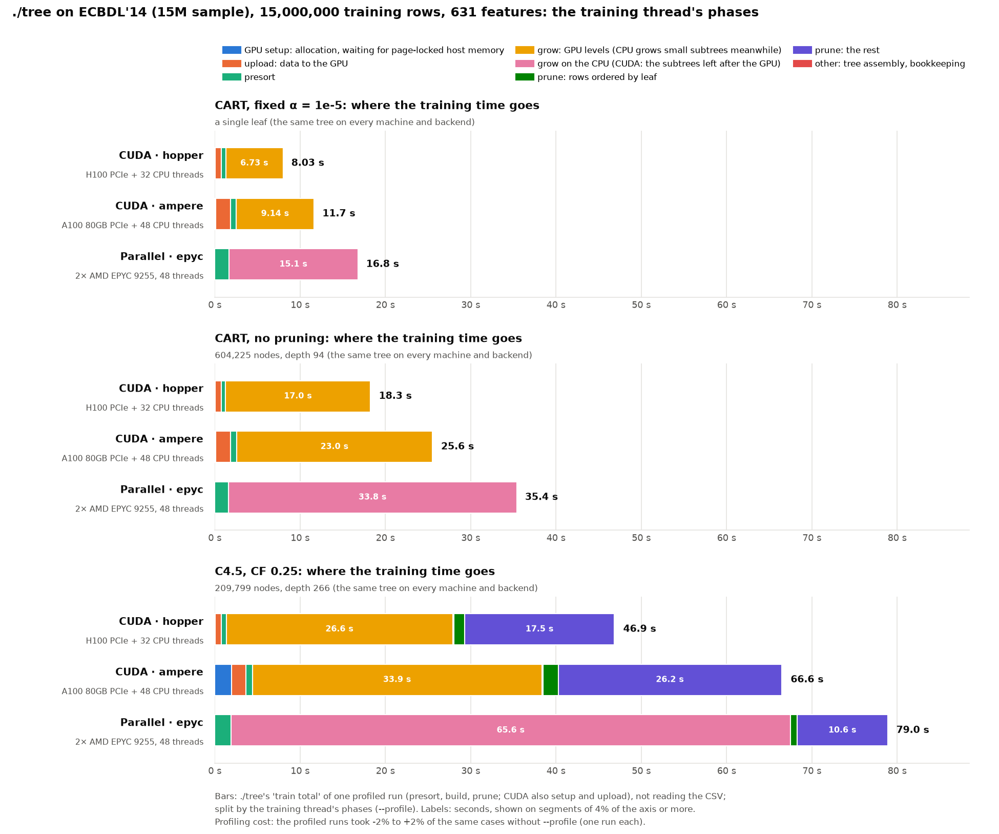
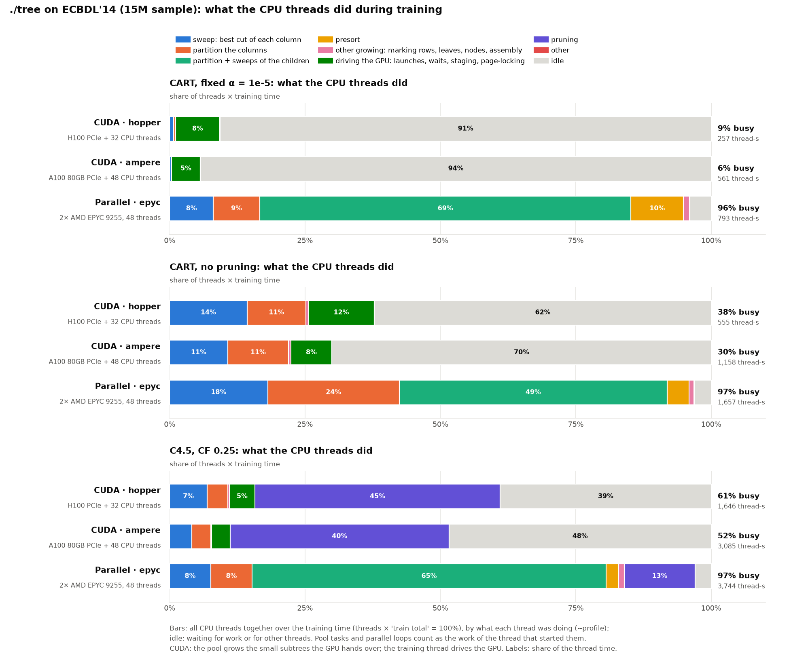
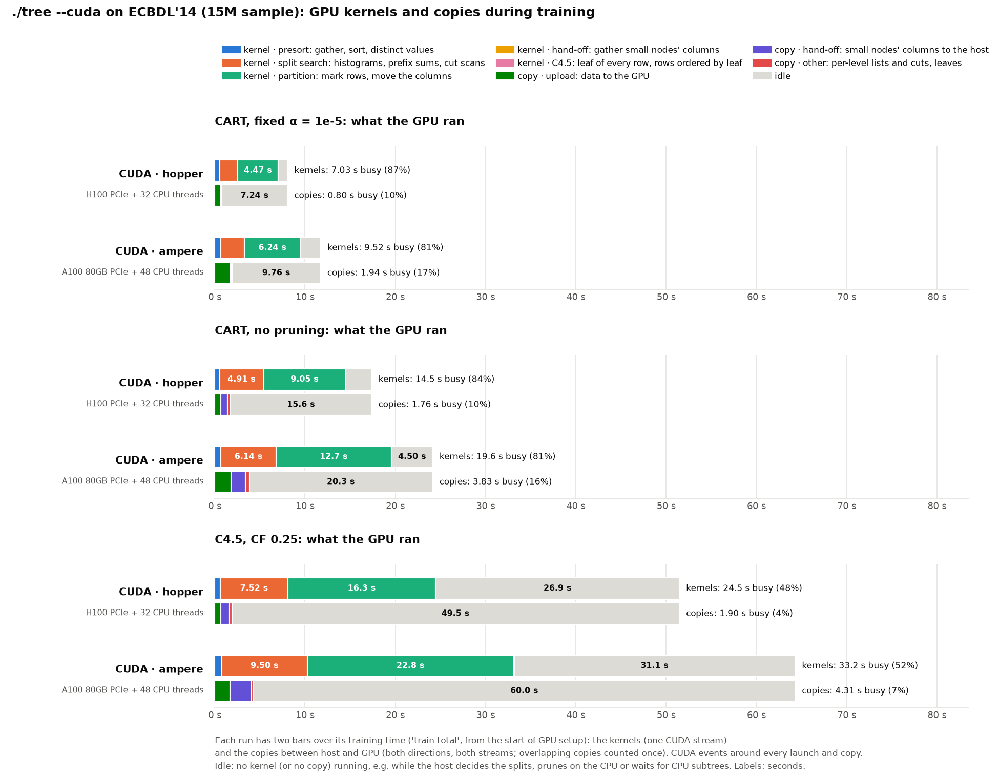
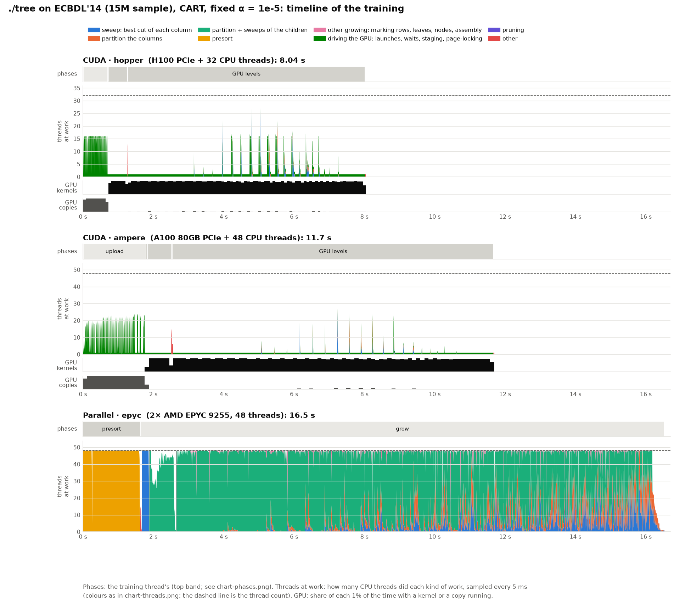
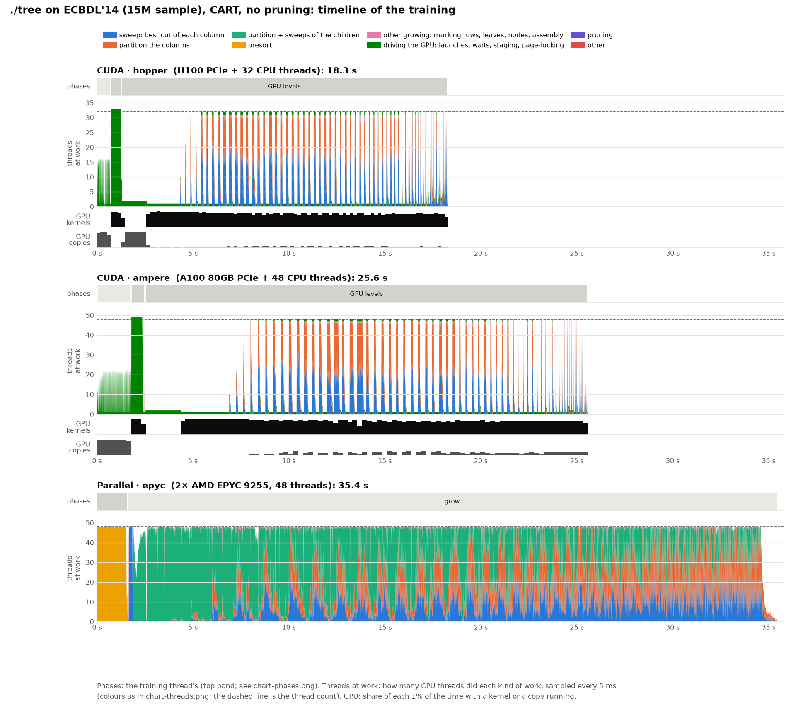
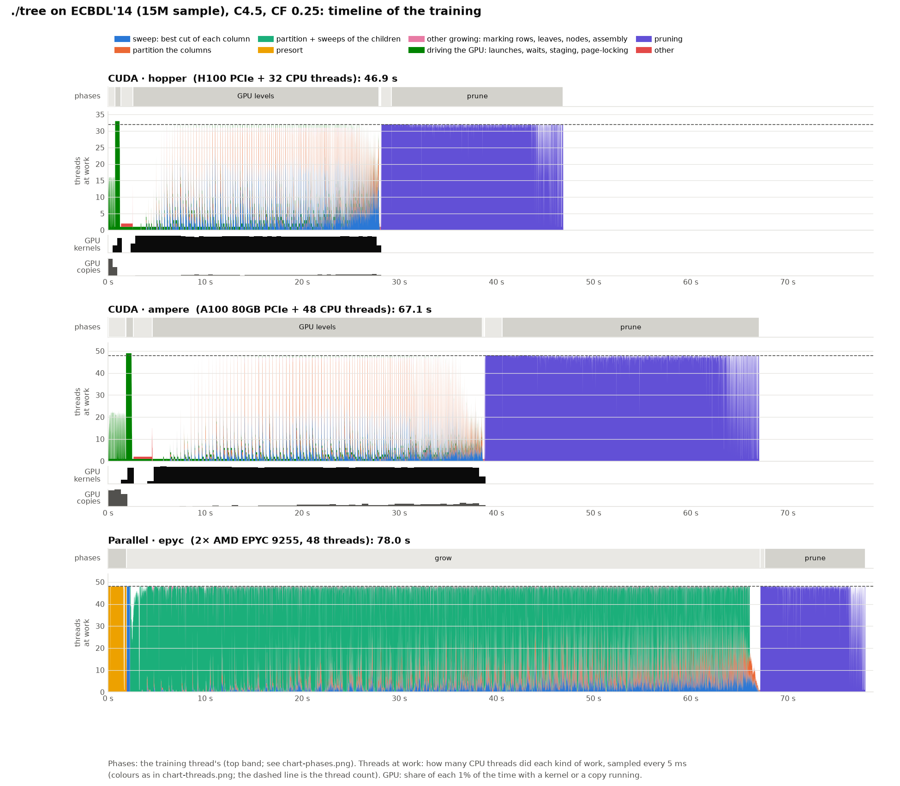

# Where the training time goes: ECBDL'14 15M sample, profiled on the mordor3 cluster

**Status:** one profiled run per case on 2026-10-19, commit 051949b (hopper and ampere 15:26–15:34, epyc1 15:51–15:58, each node alone, after the other cluster benchmarks of the same commit). Then the same cases without `--profile` (`plain/`, hopper and ampere 15:34–15:42, epyc1 15:58–16:04) to see what profiling costs. Every case built the same tree with and without `--profile`, on every node, and the same tree as [cluster-ecbdl](../cluster-ecbdl/BENCHMARK.md). The first profile (2026-10-18, f77d39d) is in the git history; since then the count tables are no longer zero-filled on one thread (follow-up below).

`./tree --profile FILE` writes where the training time went as JSON ([src/core/trace.h](../../../src/core/trace.h), and *What is measured* below). `bench/profile_chart.py` draws the charts and `profile.md` (every number behind them) from the `profiles/*.json` files.

```bash
bench/cluster/profile.sh          # on mordor3's login node: hopper, ampere and epyc1, with and without --profile
d=bench/results/cluster-ecbdl-profile
bench/.venv/bin/python bench/profile_chart.py $d/cuda-hopper-ecbdl_15m $d/cuda-ampere-ecbdl_15m \
    $d/cpu-epyc-ecbdl_15m --plain $d/plain --out-dir $d
```

The dataset and the nodes are those of [cluster-ecbdl](../cluster-ecbdl/BENCHMARK.md): ECBDL'14's 15M-row sample (631 features, 9.5 G values, 2.15% positives), ./tree's defaults, the whole node.

| Run | Node | CPU | GPU (GPU 0 used) | Backend |
|---|---|---|---|---|
| `cuda-hopper-ecbdl_15m` | hopper | 2× Xeon Gold 6444Y, 32 cores, DDR5-4800 | H100 PCIe 80 GB (PCIe 5) | CUDA (+ 32 CPU threads) |
| `cuda-ampere-ecbdl_15m` | ampere | 2× EPYC 7402 (Zen 2), 48 cores, DDR4-3200 | A100 80 GB PCIe (PCIe 4) | CUDA (+ 48 CPU threads) |
| `cpu-epyc-ecbdl_15m` | epyc1 | 2× EPYC 9255 (Zen 5), 48 cores, DDR5-6400 | – | parallel (48 threads) |

Three protocols:
- CART pruned at α = 1e-5: a single leaf on ECBDL, but the GPU still grows 53 levels before the pruning.
- CART without pruning: 604,225 nodes, depth 94.
- C4.5 with CF 0.25: 209,799 nodes after pruning, depth 266.

**In short:**
- On the GPU nodes, the GPU grows the tree and the CPU threads mostly wait. They grow the small subtrees the GPU hands over, in bursts after each level, and do C4.5's pruning.
- The pruning is why C4.5 gains less from the GPU than CART. The H100 grows the C4.5 tree 2.6× faster than epyc's 48 threads, but prunes it 1.7× slower: the GPU nodes' host CPUs prune, and they are slower than epyc's.
- On the GPU, moving the columns (partition) is about 2/3 of the kernel time, and the split search most of the rest.
- On epyc, the partition fused with the children's sweeps is half to two thirds of all thread time. The 48 threads are busy 96–97% of the run.

## The training thread's phases



| Seconds | GPU setup | upload | presort | grow | arrange rows | prune | total |
|---|--:|--:|--:|--:|--:|--:|--:|
| CART · hopper | 0.05 | 0.70 | 0.53 | 6.74 | – | – | 8.04 |
| CART · ampere | 0.08 | 1.74 | 0.68 | 9.14 | – | – | 11.68 |
| CART · epyc | – | – | 1.63 | 14.90 | – | – | 16.53 |
| unpruned CART · hopper | 0.04 | 0.70 | 0.53 | 17.17 | – | – | 18.48 |
| unpruned CART · ampere | 0.15 | 1.69 | 0.69 | 23.10 | – | – | 25.67 |
| unpruned CART · epyc | – | – | 1.40 | 33.11 | – | – | 34.51 |
| C4.5 · hopper | 1.25 | 0.70 | 0.61 | 25.44 | 1.10 | 17.70 | 46.88 |
| C4.5 · ampere | 2.02 | 1.78 | 0.78 | 34.09 | 1.82 | 26.46 | 67.05 |
| C4.5 · epyc | – | – | 1.90 | 65.23 | 0.48 | 10.36 | 77.99 |

(grow: the GPU levels on CUDA, with the CPU subtrees that are left after them, up to 0.14 s; the remaining up to 0.10 s, tree assembly and C4.5's collapsing, are in `profile.md`.)

- **Growing: the H100 is 2.2× (CART), 1.9× (unpruned CART) and 2.6× (C4.5) faster than epyc**, the A100 1.6×, 1.4× and 1.9×. The GPU presorts in 0.53–0.78 s, against epyc's 1.4–1.9 s.
- **C4.5's pruning takes 40% of a hopper run and 42% of an ampere run** (18.8 and 28.3 s with arranging the rows), against 14% on epyc (10.8 s). It runs on the host CPUs. Their thread time for the same pruning: epyc 489 thread-s, hopper 580, ampere 1,299; all three keep 31 of 32 or 44–46 of 48 threads busy on average. So an ampere thread (Zen 2, DDR4) prunes 2.7× slower than an epyc thread. **That is why C4.5 on the H100 is only 1.7× epyc, against 2.1× for CART.**
- **The upload of the data** (37.9 GB of float32) takes 0.70 s on hopper (54 GB/s, PCIe 5) and 1.7–1.8 s on ampere (22 GB/s, PCIe 4): 9% and 15% of pruned CART.
- **The page-locking of the hand-off arena stalls the GPU 1.2 s (hopper) to 1.8–1.9 s (ampere)** in unpruned CART and C4.5. These two hand most rows to the CPU, so ./tree page-locks the whole host arena for the hand-offs (75 GB) at once after the presort, in a background thread. `cudaHostRegister` holds the CUDA driver's lock meanwhile, so the next CUDA call of the training thread waits. In unpruned CART that call is in the first GPU level: level 0 takes 1.36 s (hopper) and 1.97 s (ampere), the next levels 0.25–0.35 s. In C4.5 it is the setup before the levels: 1.25 and 2.02 s of GPU setup (in the first profile hopper's C4.5 stalled in level 0 instead). That is 7% of unpruned CART and 3% of C4.5. Pruned CART hands few rows over and page-locks in small chunks, as it needs them: no stall. (On airline the arena's registration was measured at 0.2 s, and one registration was faster than 12 chunks of 1 GB.)

## What the CPU threads do



Each bar is threads × training time. The training thread counts as busy while it drives the GPU, including waiting for it ("driving the GPU").

- **On the GPU nodes the CPU threads are mostly idle:** 92–94% of the thread time for pruned CART, where only the training thread works (it drives the GPU); 68–73% for unpruned CART, whose pool grows the 49,187 small subtrees the GPU hands over (5.9M rows); 46–50% for C4.5, of which most of the busy time is the pruning (39–40% of all thread time).
- **On epyc the threads are busy 96–97% of the run.** The partition fused with the children's sweeps takes 69% of the thread time (CART), 49% (unpruned CART) and 65% (C4.5). The separate sweeps and partitions take 17%, 42% and 15%, the presort 10%, 4% and 2%.

## What the GPU runs



| Busy seconds | kernels: presort | split search | partition | other | copies: upload | hand-off | other | GPU busy |
|---|--:|--:|--:|--:|--:|--:|--:|--:|
| CART · hopper | 0.52 | 2.04 | 4.47 | – | 0.69 | 0.04 | 0.07 | 87% |
| CART · ampere | 0.68 | 2.59 | 6.24 | – | 1.73 | 0.13 | 0.09 | 81% |
| unpruned CART · hopper | 0.53 | 4.91 | 9.05 | 0.05 | 0.69 | 0.55 | 1.64 | 79% |
| unpruned CART · ampere | 0.68 | 6.13 | 12.73 | 0.07 | 1.69 | 1.97 | 0.59 | 76% |
| C4.5 · hopper | 0.60 | 7.58 | 16.43 | 0.07 | 0.69 | 0.89 | 0.17 | 53% |
| C4.5 · ampere | 0.77 | 9.49 | 22.81 | 0.08 | 1.77 | 2.99 | 0.22 | 49% |

(GPU busy: share of the training time with a kernel running.)

- **The partition (marking the rows that go left, moving every column) is 62–69% of the kernel time**, the split search (histograms, prefix sums, exact cut scans) 27–34%. The A100 takes 1.4× the H100's time for the partition and 1.25–1.3× for the search.
- **The kernels run 87% (H100) and 81% (A100) of pruned CART**, 76–79% of unpruned CART, half of C4.5: the GPU is idle while the host prunes.
- **Copies overlap with the kernels** (a separate copy stream) and are short: hand-offs move 29.8 GB to the host for unpruned CART and 44.6 GB for C4.5, in 0.55 and 0.89 s on hopper and 2.0 and 3.0 s on ampere. The upload of the data comes before the kernels.
- **GPU levels:** 53 (CART), 91 (unpruned CART), 272 (C4.5). Hand-offs: 236 nodes and 0.3M rows (CART), 49,187 nodes and 5.9M rows (unpruned CART), 21,972 nodes and 8.8M rows (C4.5).

## Timelines

One chart per protocol, the three runs one above the other on the same time axis: the training thread's phases, how many CPU threads do each kind of work (every 5 ms), and how busy the GPU's kernels and copies are.





- **CUDA: the CPU pool works in bursts**, one per GPU level: each level's hand-offs are grown on all threads in a fraction of the level's time, then the pool waits for the next level. The CPU side has room for more hand-offs.
- **The page-locking stall** (level 0 of unpruned CART, the setup of C4.5) shows as a gap in the kernels while two threads page-lock.
- **epyc: short single-thread stretches.** In the first profile (f77d39d), 0.27 s after the presort: the tables of x·log x and 1/x for every count up to the row count (2 × 15M doubles) were zero-filled on one thread (`std::vector::resize`) before the pool filled them (`fillCountTables`). Now the pool writes them first, and fewer than half the threads are busy for only 0.03 s after the presort (follow-up below). The last 0.5 s of the C4.5 grow run on 1–10 threads (the last deep subtrees). Arranging the rows by leaf now takes 0.48 s, 0.02 s of it on one thread (0.78 and 0.34 s in the first profile; one run each, not looked into).

## Follow-up: the two findings (2026-10-18/19)

- **The zero-filled count tables are fixed:** they are no longer zero-filled (`CountTable` in `src/build/cpu_builder.h`), so the pool writes them first.
  - On epyc1 (ECBDL 15M, parallel, 48 threads) the three trees (CART α 1e-4, unpruned CART, C4.5) are byte-identical before and after.
  - Train totals are unchanged within noise (unpruned CART 36.7/35.9 → 35.0/35.4 s, C4.5 78.8 → 79.3 s).
  - In this profile (051949b) the stretch after the presort on epyc, where fewer than half the threads work, shrank from 0.27 to 0.03 s (C4.5). The cluster benchmarks of 051949b built the same trees as cd18717 everywhere, within −5% to +5% of its times.
- **The arena's page-locking was not changed in this follow-up.**
  - **Huge pages are already in use.** The arena comes from `new`, which puts every block of 2 MiB or more on transparent huge pages (`src/core/memory.cpp`). On hopper all 75.7 GB of it was on huge pages; `--gpu-profile` now prints this after the touch.
  - **Ampere:** registering 75 GB takes 1.8–1.9 s in ./tree, as in a standalone `cudaHostRegister` of a touched huge-page buffer. That is the cost of registration.
  - **Hopper** usually takes 1.2–1.3 s, but on 2026-10-18/19 it took 4.2–5.9 s in some jobs, whether the registration ran after the presort, during it, or with the level loop waiting. The standalone test reproduced this (2.4–6.6 s) only with 120 GB of other memory touched first, and only some of the time. At the time, NUMA node 0 held 156 GB of another user's `/dev/shm` and 382 GB of page cache (125 GB free of 516). Binding the process to either socket's CPUs made the standalone test fast again. Binding ./tree's page-locking thread to the GPU's node gave no gain in a run where hopper was fast either way, so it was not kept.
  - **Dropped: page-locking arenas over 16 GB in 1 GB chunks, ahead of the hand-offs.** It cut level 0 on hopper from 5.9 to 0.15 s (unpruned CART 23.0 → 18.6 s, C4.5 51.7 → 47.5 s). On ampere, though, the registrations during the GPU levels delayed the level copies, and C4.5 went from 67.0 to 68.5 s. Forcing chunks on airline also crashed C4.5 (`invalid argument` in a later CUDA call), so some later step assumes the arena is one registration.
  - **Fixed afterwards (2026-10-19), without page-locking the arena:** the hand-offs now go through two page-locked 128 MB buffers, one per copy stream, and are copied into the pageable arena on the staging threads. Same trees; ECBDL C4.5 −2.8% (hopper) and −12% (ampere), unpruned CART −6% and −25%, no stall left. See [cluster-handoff-staging](../cluster-handoff-staging/BENCHMARK.md).

## What profiling costs

| Train total (s) | profiled | plain | difference |
|---|--:|--:|--:|
| CART · hopper | 8.04 | 8.02 | +0.2% |
| CART · ampere | 11.68 | 11.57 | +1.0% |
| CART · epyc | 16.53 | 16.81 | −1.7% |
| unpruned CART · hopper | 18.48 | 18.39 | +0.5% |
| unpruned CART · ampere | 25.67 | 25.56 | +0.4% |
| unpruned CART · epyc | 34.51 | 35.35 | −2.4% |
| C4.5 · hopper | 46.88 | 46.74 | +0.3% |
| C4.5 · ampere | 67.05 | 65.89 | +1.8% |
| C4.5 · epyc | 77.99 | 79.29 | −1.6% |

Within −2.4% to +1.8%, one run each (−1.5% to +2.0% in the first profile): as far as one run can tell, profiling costs nothing measurable. The peak RAM differs by under 0.1%, the VRAM by at most 32 MB (hopper, CART).

## What is measured

`--profile FILE` ([src/core/trace.h](../../../src/core/trace.h)) records, from the start of the training to the end of the pruning:
- **Phases:** wall-time spans of the training thread (GPU setup, upload, presort, GPU levels, CPU subtrees, pruning steps, tree assembly), also as NVTX ranges for Nsight Systems.
- **What every thread does:** each thread is in one state at a time (sweep, partition, fused partition + sweeps, presort, marking rows, leaves, node bookkeeping, driving the GPU, staging copies, page-locking, pruning, idle...).
  - The time in each state is summed per thread (`work_seconds`, thread-seconds).
  - A sampler thread counts the threads in each state every 5 ms (`samples`, the timelines).
  - Pool tasks and parallel-loop items count as the work of the thread that made them.
  - A thread blocked on a condition variable, on a parallel loop's end or on another thread's column is idle.
- **GPU kernels and copies:** a CUDA event before and after every kernel launch and copy, on the compute stream and the copy stream (`gpu`: name, lane, start, end). The kernels run on one stream, so they never overlap; copies on the two streams may, and are counted once.
- **Per GPU level** (`tables.gpu_levels`): nodes, rows, segments, time.
- **Facts:** bytes copied each way, hand-offs (nodes, rows, bytes), CUDA context and allocation time.

When off (the default), every hook is one relaxed atomic load and a branch. When on, a state change is a few relaxed atomic stores to the thread's own record. The CUDA events are those `--gpu-profile` already used (it prints a per-kernel summary to stderr).

The charts group the states, phases and kernels: `profile_chart.py`'s `PHASES`, `WORKS`, `KERNELS` and `COPIES` list which belong to which group.
