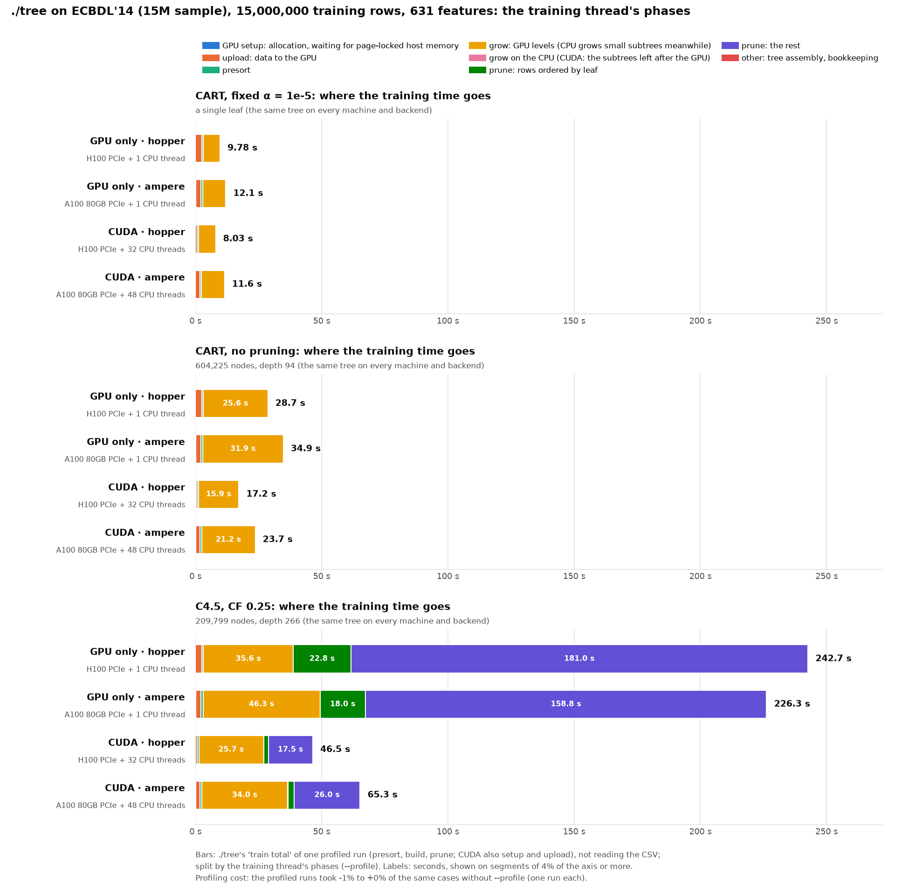
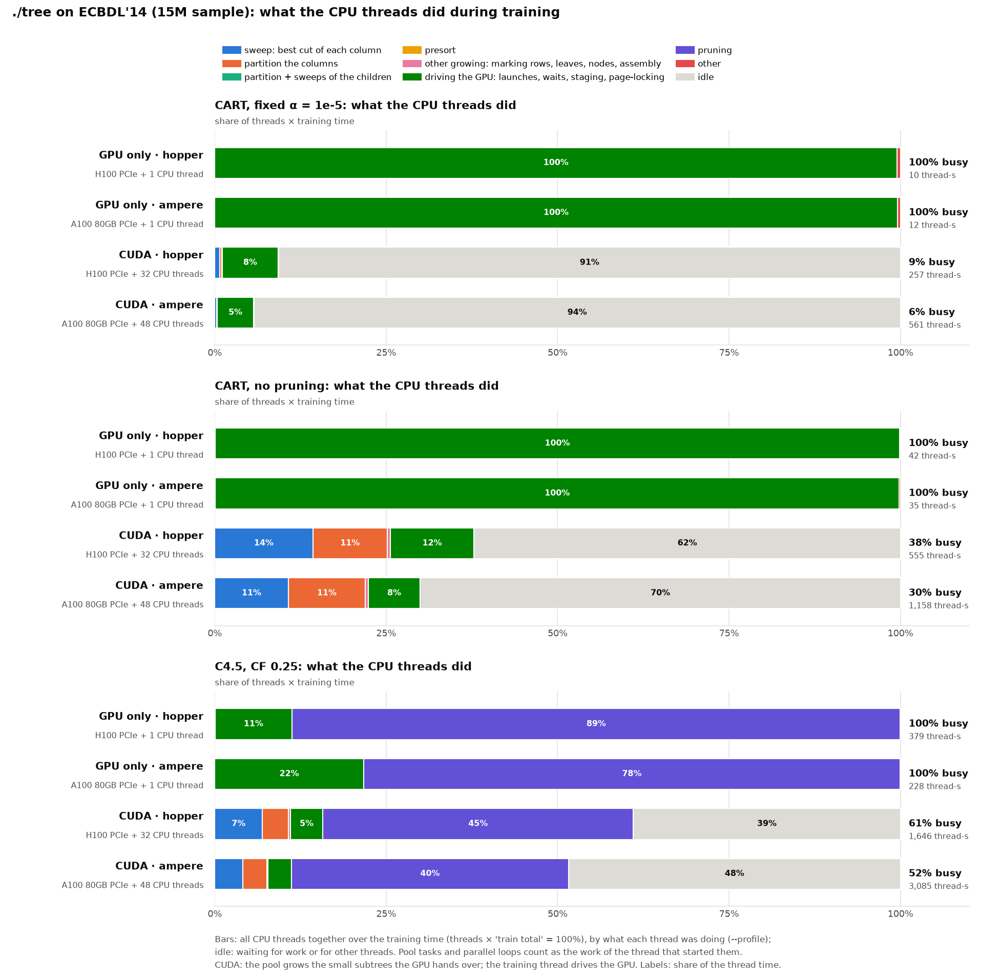
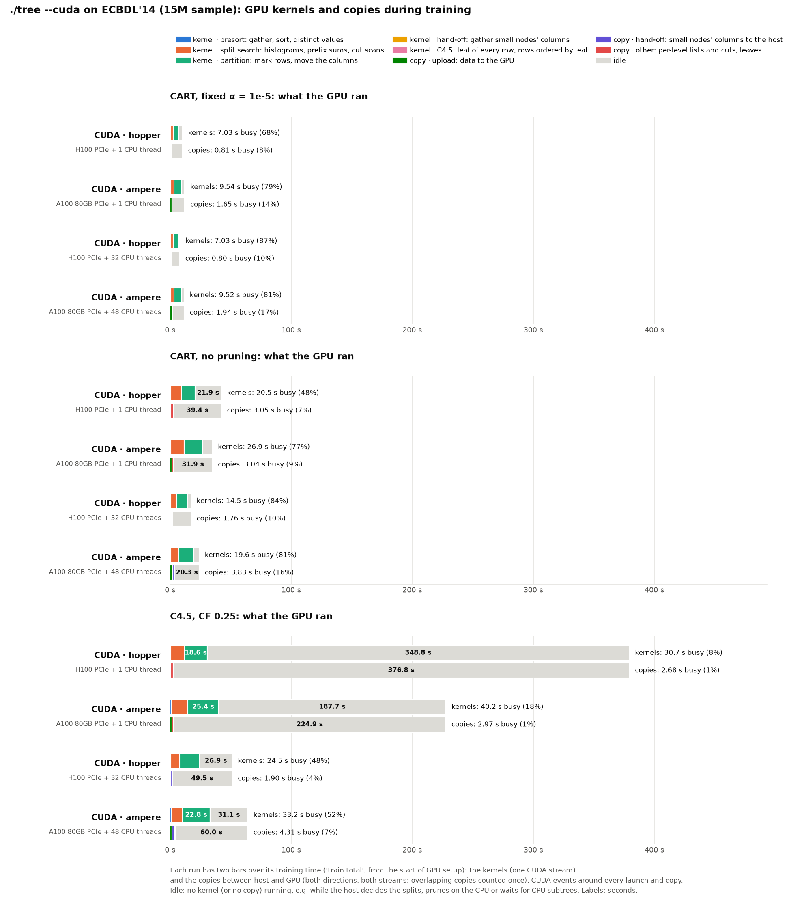
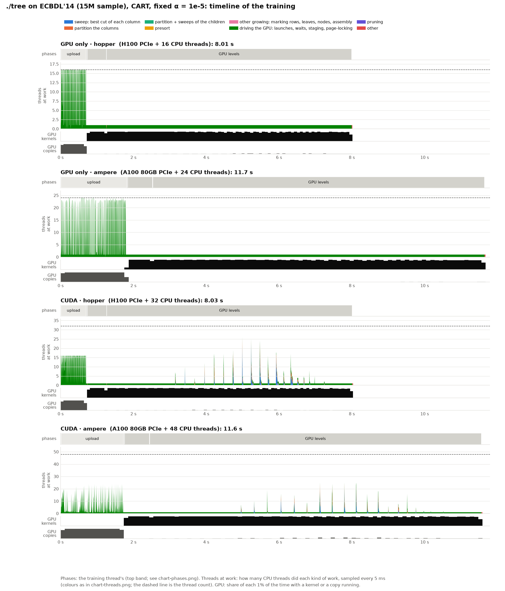
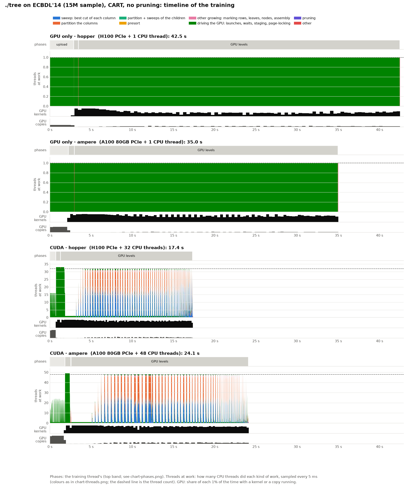
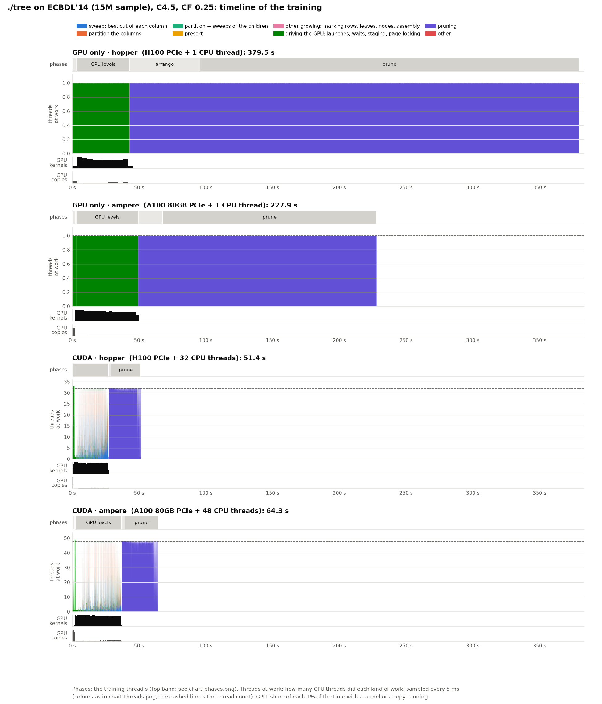

# Where the training time goes with `--gpu-only`: ECBDL'14 15M sample, one CPU thread

**Status:** one profiled run per case on 2026-10-20, commit 6da527e (./tree as in 6f6cecb, plus `--gpu-only`): hopper 08:55–09:16, ampere 08:59–09:20, each node alone and reserved whole. Then the same cases without `--profile` (`plain/`, hopper 09:16–09:36, ampere 09:20–09:40). The CUDA rows for comparison are those of [gpu-plus-cpu](../gpu-plus-cpu/BENCHMARK.md) (6f6cecb, 2026-10-19, 32 and 48 CPU threads). Every case built the same tree as there: 1 leaf (pruned CART), 604,225 nodes (unpruned CART), 209,799 nodes (C4.5).

`--cuda --gpu-only --threads 1`: every node is grown on the GPU, with no hand-offs to the CPU and no host arena for them, and the CPU side is a single thread. That thread feeds the GPU, then does C4.5's pruning alone.

```bash
bench/cluster/profile.sh -o cluster-ecbdl-profile/gpu-only gpuonly-hopper-ecbdl_15m gpuonly-ampere-ecbdl_15m
p=bench/results/cluster-ecbdl-profile
bench/.venv/bin/python bench/profile_chart.py $p/gpu-only/gpuonly-hopper-ecbdl_15m $p/gpu-only/gpuonly-ampere-ecbdl_15m \
    $p/gpu-plus-cpu/cuda-hopper-ecbdl_15m $p/gpu-plus-cpu/cuda-ampere-ecbdl_15m --out-dir $p/gpu-only
```

The charts and `profile.md` (every number behind them) are drawn as in [gpu-plus-cpu](../gpu-plus-cpu/BENCHMARK.md), where *What is measured* explains the phases and kinds of work. Each run's `without --profile` time comes from its sibling `plain/`.

## The training thread's phases



| Train total (s) | GPU only | CUDA | GPU only / CUDA |
|---|--:|--:|--:|
| CART, α = 1e-5 · hopper | 10.31 | 8.04 | 1.28× |
| CART, α = 1e-5 · ampere | 12.11 | 11.69 | 1.04× |
| CART, no pruning · hopper | 42.48 | 17.35 | **2.45×** |
| CART, no pruning · ampere | 34.99 | 24.12 | 1.45× |
| C4.5 · hopper | 379.48 | 51.43 | **7.4×** |
| C4.5 · ampere | 227.90 | 64.26 | 3.5× |

- **C4.5's pruning on one thread is the big cost.** The prune takes 283.8 s on hopper (22.6 s with 32 threads, 12.5×) and 160.1 s on ampere (24.7 s with 48 threads, 6.5×). Ordering the rows by leaf for it takes 52.8 and 18.2 s (1.7 and 2.5 s). On one thread, ampere's EPYC 7402 prunes 1.8× faster than hopper's Xeon 6444Y; C4.5 is 1.7× faster on ampere overall.
- **The GPU grows the small nodes itself, and slower.** Unpruned CART's GPU levels take 39.0 s on the H100 (16.0 s with hand-offs) and 32.0 s on the A100 (21.5 s). With hand-offs, 49,187 nodes (5.9M rows) go to the CPU; here the GPU sweeps them, three more levels (94 against 91). Search and partition kernels: 20.0 s against 14.0 s on the H100, 26.2 against 18.9 s on the A100.
- **The upload waits on the one thread.** 2.9 s on hopper against 0.7 s with 32 threads, though the copies keep the GPU busy only 0.69 s in both: one thread stages the data into the page-locked buffers. On ampere 2.2 s against 1.8 s.
- **Pruned CART** (a single leaf) is only the upload and the top levels: 1.28× on hopper (the upload), 1.04× on ampere.
- **The presort and the GPU setup are unchanged.**

## What the CPU thread does



The one thread is never idle: feeding the GPU (`feed`) for the whole build, then C4.5's prune (336.6 s on hopper, 178.4 s on ampere). With hand-offs, 32 or 48 threads spend most of their time idle (233–1,493 thread-seconds).

## What the GPU runs



No hand-off kernels or copies; device→host is 0.1 GB for C4.5 (44.7 GB with hand-offs). The extra time is in the search and partition kernels and in `copy other` (1.4–2.4 s against 0.2–0.5 s).

## Timelines





## Memory

| Peak | GPU only | CUDA |
|---|--:|--:|
| RAM, CART α = 1e-5 | 36.0 GiB | 37.4–37.5 GiB |
| RAM, CART, no pruning | 36.5–36.6 GiB | 106.7 GiB |
| RAM, C4.5 | 104.2 GiB | 107.6–107.9 GiB |
| VRAM, hopper | 73.3–74.3 GiB | 73.3–73.4 GiB |

- **Without the host arena,** unpruned CART needs 36.5 GiB of RAM instead of 106.7 GiB. C4.5's pruning needs about 104 GiB in both.
- **ampere's VRAM was not recorded:** the nvidia-smi sampler reported a flat 425 MiB in every gpu-only case on ampere (also in `plain/`), while on hopper it saw 73–74 GiB. run.py read the samples from a pipe only at the end, and the full pipe (64 KiB, about 170 s of 10 ms samples) blocked nvidia-smi during ampere's 210–216 s one-thread CSV read, before training (hopper's took 141–146 s). Fixed in ba22356; the rerun without `--profile` in [cluster-ecbdl](../../cluster-ecbdl/BENCHMARK.md) measured 73.3 / 74.3 / 73.6 GiB (CART α / unpruned / C4.5).

## What profiling costs

The profiled runs took 0.2% to 1.4% more than without `--profile` (`profile.md`).

## Notes

- **Reading the CSV on one thread** takes most of each process: 151–222 s for pruned CART (14–19 s with all threads), not part of the train total.
- One run per case: the differences under about 2% are within run-to-run noise.
