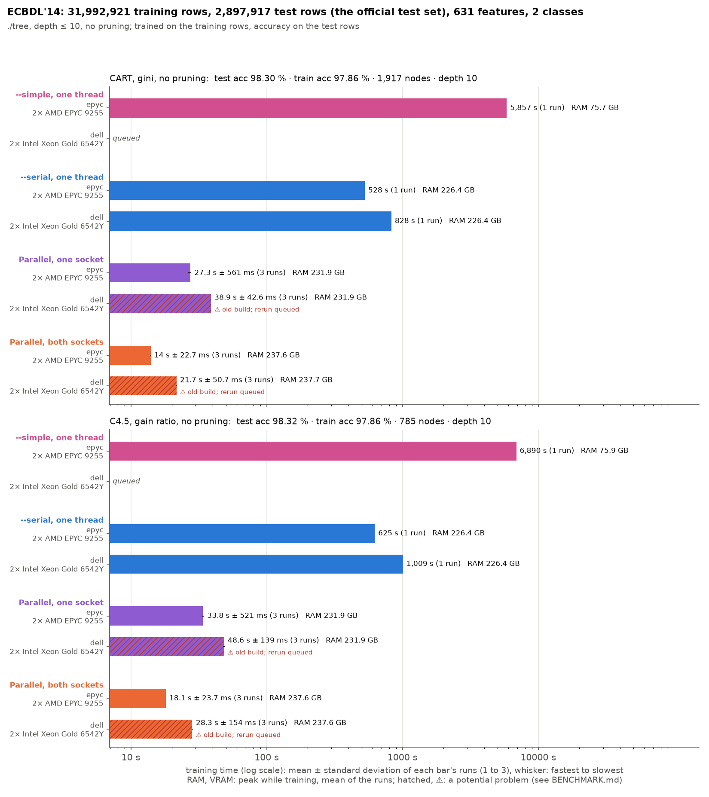
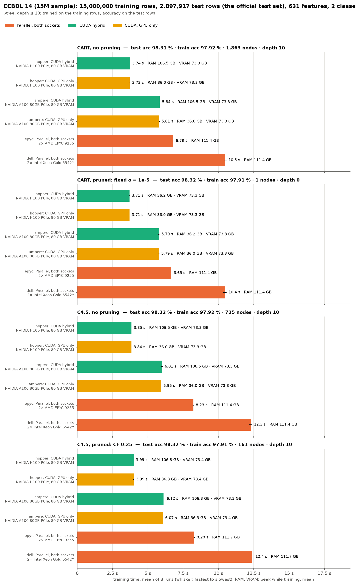

# ECBDL'14 (631 features): training set and test set

./tree only, trained on the training rows and scored on the test rows
([bench/cluster/README.md](../../cluster/README.md#test-set-benchmarks)).

- **Training rows:** `ecbdl`: all 31,992,921 training rows, on the CPU nodes only (the GPUs would need about 160 GB); `ecbdl_15m`: the first 15,000,000, on every node.
- **Test rows:** the competition's labelled test set, 2,897,917 rows. Until 2026-10-23 100,000 random training rows were the test set: cluster-ecbdl-old (removed; last in f4668df).
- **Protocols:** depth ≤ 10; CART without pruning and pruned at α = 1e-5, C4.5 without pruning and pruned at CF 0.25.
- **Runs:** CUDA hybrid and GPU only on hopper (H100) and ampere (A100 80 GB), parallel on every CPU of both sockets on epyc1 and dell1; no serial runs. Three runs per case, averaged.
- **Measured:** ./tree's training time, peak RAM while training, peak VRAM; the tree's test and training accuracy, nodes and depth.
- **Chart:** `chart-ecbdl.png` (full) and `chart-ecbdl_15m.png`, `bench/testset_chart.py`.

## Results

Run on 2026-10-23 at 74a011f. Each case ran 3 times; the tables give means of ./tree's training time. Accuracies, nodes and depth are the same in every run.

- **Same tree everywhere:** on each training set, every backend grew the same tree in every case.
- **Accuracy is not informative:** only about 1.7% of the test rows are contacts, so the majority class alone scores 98.32%. Pruned CART (α = 1e-5) is a single leaf, and the other trees match or barely miss that score. A class-weighted or AUC measure would be needed to compare them.
- **15M sample:** the H100 takes 3.7–4.0 s, 1.8–2.1× faster than epyc (6.7–8.3 s); the A100 takes 5.8–6.1 s. VRAM is 73.3 GiB of 80. GPU only needs 36 GiB of RAM, against up to 107 GiB for hybrid (unpruned CART). epyc and dell use 111 GiB.
- **Full set (CPU only):** epyc takes 14.3–18.5 s, dell 22–28 s, with 238 GiB of RAM. That is 2.1–2.3× the 15M sample's time for 2.1× the rows.

### ecbdl

| Protocol | test acc | train acc | nodes | depth |
|---|---|---|---|---|
| CART, no pruning | 98.30% | 97.86% | 1,917 | 10 |
| CART, α 1e-5 | 98.32% | 97.85% | 1 | 0 |
| C4.5, no pruning | 98.32% | 97.86% | 785 | 10 |
| C4.5, CF 0.25 | 98.32% | 97.85% | 189 | 10 |

| Run | CART, no pruning | CART, α 1e-5 | C4.5, no pruning | C4.5, CF 0.25 | RAM GiB (peak, range over protocols) | VRAM GiB (peak, range over protocols) |
|---|---|---|---|---|---|---|
| epyc, parallel | 14.5 s | 14.3 s | 18.5 s | 18.5 s | 237.6–238.3 | – |
| dell, parallel | 22 s | 22.6 s | 27.8 s | 28 s | 237.6–238.3 | – |

### ecbdl_15m

| Protocol | test acc | train acc | nodes | depth |
|---|---|---|---|---|
| CART, no pruning | 98.31% | 97.92% | 1,863 | 10 |
| CART, α 1e-5 | 98.32% | 97.91% | 1 | 0 |
| C4.5, no pruning | 98.32% | 97.92% | 725 | 10 |
| C4.5, CF 0.25 | 98.32% | 97.91% | 161 | 10 |

| Run | CART, no pruning | CART, α 1e-5 | C4.5, no pruning | C4.5, CF 0.25 | RAM GiB (peak, range over protocols) | VRAM GiB (peak, range over protocols) |
|---|---|---|---|---|---|---|
| hopper, CUDA hybrid | 3.74 s | 3.71 s | 3.85 s | 3.99 s | 36.2–106.8 | 73.3–73.4 |
| hopper, GPU only | 3.73 s | 3.71 s | 3.84 s | 3.99 s | 36.0–36.3 | 73.3–73.4 |
| ampere, CUDA hybrid | 5.84 s | 5.79 s | 6.01 s | 6.12 s | 36.2–106.8 | 73.3–73.3 |
| ampere, GPU only | 5.81 s | 5.79 s | 5.95 s | 6.07 s | 36.0–36.3 | 73.3–73.4 |
| epyc, parallel | 6.79 s | 6.65 s | 8.23 s | 8.28 s | 111.4–111.7 | – |
| dell, parallel | 10.5 s | 10.4 s | 12.3 s | 12.4 s | 111.4–111.7 | – |
