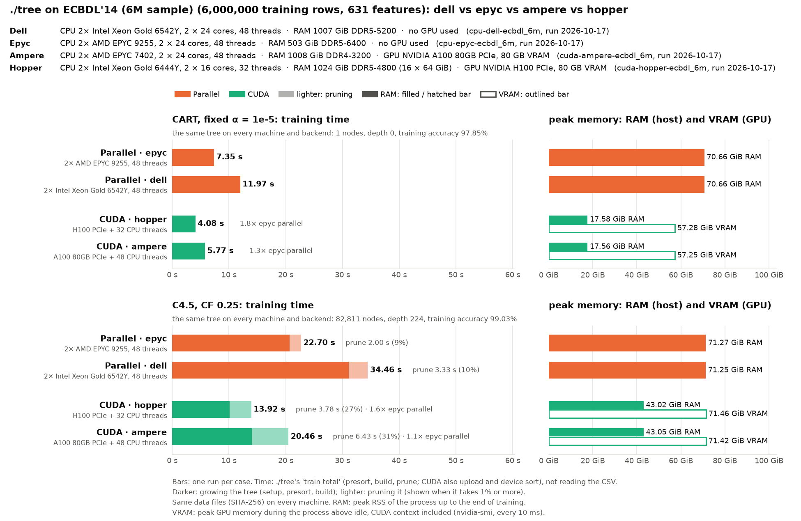
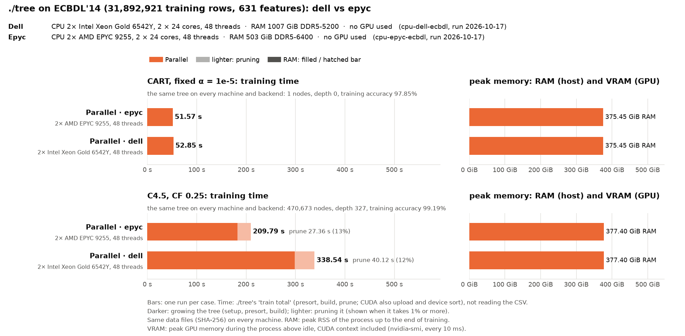

# ECBDL'14 on the mordor3 cluster: a 6M-row sample on two GPU and two CPU servers, the full 32M rows on the CPU servers

**Status:** run on 2026-10-17 (00:06–01:07), one run per case, at commit 49ebb6d (the code of 8da0c12; 49ebb6d only adds the ECBDL scripts).
- **Each node ran alone** and was used whole. The jobs started when the data was prepared (SLURM dependency), the CPU jobs right after the SUSY-vs-others jobs on the same nodes.
- **Same trees:** every case built the same tree on every node and backend.
- **Settings:** ./tree's defaults, as in [cluster-airlines](../cluster-airlines/BENCHMARK.md). Only training time and memory are compared; accuracy is ./tree's training accuracy (`run.py --train-accuracy-only`).

How the runs are made, and the dataset: [bench/cluster/README.md](../../cluster/README.md).

```bash
bench/cluster/submit.sh -d ecbdl_6m -a <prepare job>   # all four nodes
bench/cluster/submit.sh -d ecbdl -a <prepare job>      # full set: epyc1 and dell1
```

The dataset is ECBDL'14 (protein contact-map prediction, the GECCO 2014 big data competition): 631 features (539 real, 92 nominal as integer codes), label 0/1 with 2.15% contacts. The full set has 31,892,921 training rows, 20.1 G values (65× HIGGS's, 81 GB as float32). The CUDA backend needs 16 bytes per value on the GPU, about 320 GB for the full set, so the GPUs get `ecbdl_6m`, a random 6M of those rows (3.8 G values). The CPU servers run both.

| Run | Node | CPU | GPU (GPU 0 used) | Backend |
|---|---|---|---|---|
| `cuda-hopper-ecbdl_6m` | hopper | 2× Xeon Gold 6444Y, 32 cores | H100 PCIe 80 GB | CUDA (+ 32 CPU threads) |
| `cuda-ampere-ecbdl_6m` | ampere | 2× EPYC 7402, 48 cores | A100 80 GB PCIe | CUDA (+ 48 CPU threads) |
| `cpu-epyc-ecbdl_6m`, `cpu-epyc-ecbdl` | epyc1 | 2× EPYC 9255 (Zen 5), 48 cores, 512 GB | – | parallel (48 threads) |
| `cpu-dell-ecbdl_6m`, `cpu-dell-ecbdl` | dell1 | 2× Xeon Gold 6542Y, 48 cores, 1 TB | – | parallel (48 threads) |

Each bar is ./tree's training time (`train total`: GPU setup, presort, build and pruning, not reading the CSV). `cart_alpha_nodepth` (CART, fixed α = 1e-5, no depth limit) and `c45` (C4.5, CF 0.25).

## 6M-row sample, all four nodes



| | CART | C4.5 | of which C4.5 pruning | RAM CART / C4.5 | VRAM CART / C4.5 |
|---|--:|--:|--:|--:|--:|
| CUDA · hopper (H100 PCIe + 32 threads) | **4.08 s** | **13.92 s** | 3.78 s | 17.6 / 43.0 GiB | 57.3 / 71.5 GiB |
| CUDA · ampere (A100 80GB PCIe + 48 threads) | 5.77 s | 20.46 s | 6.43 s | 17.6 / 43.1 GiB | 57.2 / 71.4 GiB |
| Parallel · epyc (EPYC 9255, 48 threads) | 7.35 s | 22.70 s | 2.00 s | 70.7 / 71.3 GiB | – |
| Parallel · dell (Xeon 6542Y, 48 threads) | 11.97 s | 34.46 s | 3.33 s | 70.7 / 71.3 GiB | – |

- **The H100 is 1.8× (CART) and 1.6× (C4.5) faster than epyc**, less than on airline (6.6× for CART): the GPU has no room for the mirror of the CPU hand-off (another 8 bytes per value), so its copies to the host no longer overlap the next levels, and C4.5's pruning on the host CPU is 27–31% of a CUDA run.
- **VRAM is as computed from the allocations:** two copies of the presorted columns (16 bytes per value, 56.4 GiB) plus the CUDA context and per-level arrays; C4.5 also keeps the raw values for its pruning (4 bytes per value, 14.1 GiB). C4.5 uses 71.5 of the 80 GB.
- **The CPU servers hold the same columns in RAM** (8 bytes per value, twice for the out-of-place partition, plus the loaded float32 data): 70.7 GiB. A CUDA run keeps 17.6 GiB on the host for CART (the loaded data and the CPU's share of small subtrees), 43 GiB for C4.5.

## Full set (31.9M rows), CPU servers



| | CART | C4.5 | of which C4.5 pruning | RAM CART / C4.5 |
|---|--:|--:|--:|--:|
| Parallel · epyc (EPYC 9255, 48 threads) | **51.57 s** | **209.79 s** | 27.36 s | 375.5 / 377.4 GiB |
| Parallel · dell (Xeon 6542Y, 48 threads) | 52.85 s | 338.54 s | 40.12 s | 375.5 / 377.4 GiB |

- **About 20 bytes per value of RAM** (403 GB): 4 for the loaded data, 8 for the presorted columns, 8 for their second copy. It fits on epyc1's 512 GB.
- **epyc's CART presort took 21.2 s against dell's 5.7 s**, with 972 s of system time (dell: 145 s): the kernel's page faults on first touch of 375 GiB on the 512 GB node. Its build was faster (30.4 s against 47.1 s), so the totals are equal. C4.5, which grows a deeper tree, is 1.6× faster on epyc.
- **5.3× the sample's rows:** CART takes 7.0× (epyc) and 4.4× (dell) the sample's time, C4.5 9.2× and 9.8×: its tree has 5.7× the nodes (470,673 against 82,811) and depth 327 against 224.

## The trees

- **CART is pruned to its root:** at α = 1e-5 every subtree costs more than it saves (with 2.15% contacts a split must fix more than α · n rows per extra leaf), so the pruned tree is one leaf predicting "no contact" (training accuracy 97.85%, the majority share). The time still includes growing the tree; with a fixed α ./tree does not split nodes that misclassify fewer than α · n rows, so the tree grown is smaller than an unpruned one ([docs/ALGORITHMS.md](../../../docs/ALGORITHMS.md)).
- **C4.5:** 82,811 nodes, depth 224, training accuracy 99.03% (sample); 470,673 nodes, depth 327, 99.19% (full).
