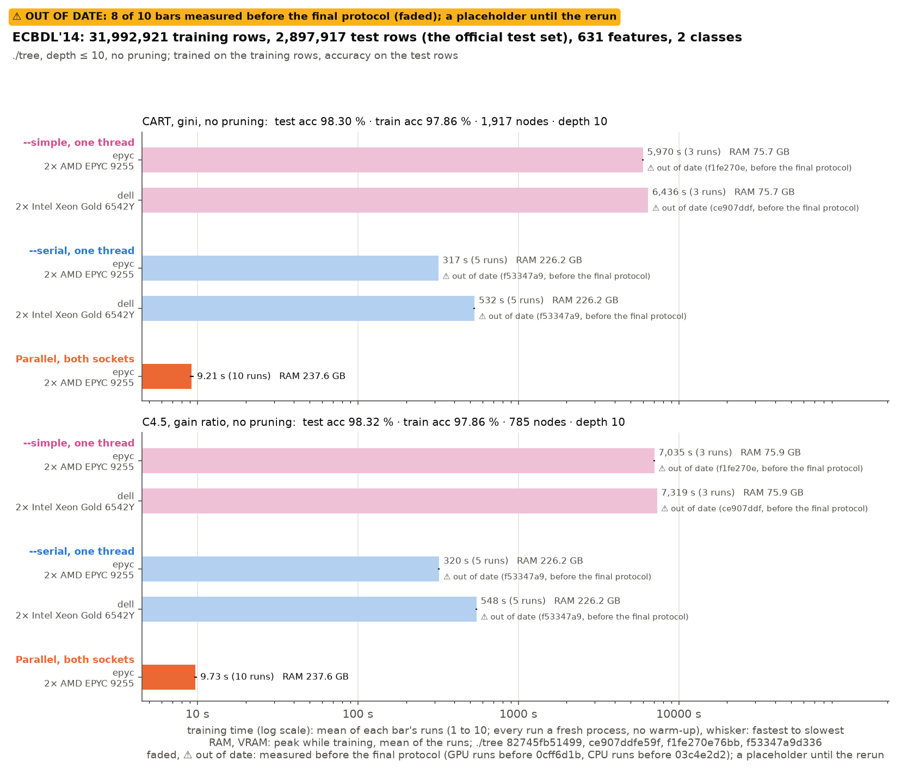
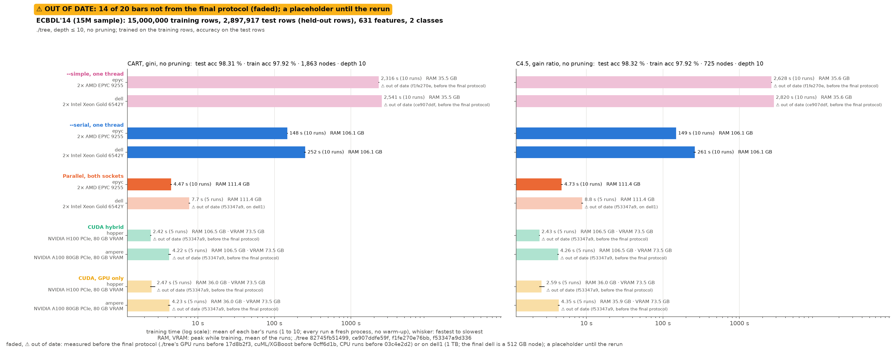

# ECBDL'14 (631 features): training set and test set

./tree only, trained on the training rows and scored on the test rows
([bench/cluster/README.md](../../cluster/README.md#test-set-benchmarks)).

- **Training rows:** `ecbdl`: all 31,992,921 training rows, on the CPU nodes only (the GPUs would need about 160 GB); `ecbdl_15m`: the first 15,000,000 (`./tree --rows`), on every node.
- **Test rows:** the competition's labelled test set, 2,897,917 rows.
- **Protocols:** depth ≤ 10, CART (gini) and C4.5 (gain ratio), both without pruning.
- **Runs:** CUDA `--hybrid` and `--gpu` (GPU only) on hopper (H100) and ampere (A100 80 GB), with every CPU of the node; on epyc (2× EPYC 9255) and dell (2× Xeon Gold 6542Y): `--multicore` on both sockets (48 threads), `--serial` and `--simple` (one thread). Runs per case: 5; `--simple` 10 on `ecbdl_15m`, 3 on `ecbdl` (about 2 hours a run).
- **Builds:** ./tree at f53347a9 (`src/` = d2957ff2: presort of big columns in cache, GPU tiles without a cut skipped, CART bound per node), one build for every node, run on 2026-11-15/16 by `bench/cluster/final.sh -m 5` ([bench/cluster/README.md](../../cluster/README.md#the-final-rerun)): `--multicore` and CUDA on epyc1, dell1, hopper and ampere, `--serial` spread over epyc1/epyc2 and dell1/dell2/dell3 (the same hardware). `--simple` was not rerun, its code has not changed: its runs are from 2026-11-10/12, f1fe270e on epyc and ce907ddf on dell (`machine.json` says which). The runs before (f1fe270e, 10 runs per case, 2026-11-09/12) are in git at 1e655067.
- **Measured:** ./tree's training time (presort, build; not reading the CSV), peak RAM while training, peak VRAM; the tree's test and training accuracy, nodes, depth and SHA-256.
- **Chart:** `chart-ecbdl.png` (full) and `chart-ecbdl_15m.png`, `bench/testset_chart.py` (log scale).

## Results

Every run of a case grew the same tree (the same `tree_sha256`). The tables give the mean ± standard deviation of ./tree's training time (`bench/testset_chart.py --table`); "runs" is the number of runs of the case, also on the chart.

- **Accuracy is not informative:** only about 1.7% of the test rows are contacts, so the majority class alone scores 98.32%. The trees match or barely miss that score. A class-weighted or AUC measure would be needed to compare them.
- **15M sample:** the H100 takes 2.42–2.59 s (hybrid and GPU only alike), 1.8–1.9× faster than epyc's `--multicore` (4.41 and 4.65 s); the A100 4.22–4.35 s, as fast as epyc; dell 7.70 and 8.80 s, 1.7–1.9× epyc. GPU only needs 36 GB of RAM, against 107 GB for hybrid and 111 GB for `--multicore`.
- **Full set (CPU only):** epyc takes 9.17 s (CART) and 9.70 s (C4.5), dell 16.4 s and 19.1 s (1.8–2.0× epyc), with 238 GB of RAM: 2.1× the 15M sample's time for 2.1× the rows.
- **Serial and simple:** `--serial` takes 29–35× `--multicore` on both nodes (full set: 317 s and 320 s on epyc, 532 s and 548 s on dell). `--simple` takes 5,970–7,319 s on the full set, 19–22× `--serial` on epyc and 12–13× on dell, with a third of the RAM (76 GB).
- **Against the runs before (f1fe270e):** `--multicore` 30–45% faster on epyc and 22–33% on dell, `--serial` 35–47% on epyc and 26–44% on dell, the GPUs 14–21%.
- **The 15M tree's hash changed, not the tree:** `ecbdl_15m` is now `ecbdl`'s first 15M rows read with `./tree --rows` instead of a copied CSV (f2a4f921). The new runs hash fe35c128 (CART) and 5ca577a6 (C4.5), `--simple` (run on the copy) f45a02bf and be533fee, with the same rows, nodes, depth and accuracies; the full set's hashes are the same as before.

### ecbdl

| Protocol | test acc | train acc | nodes | depth |
|---|---|---|---|---|
| CART, no pruning | 98.30% | 97.86% | 1,917 | 10 |
| C4.5, no pruning | 98.32% | 97.86% | 785 | 10 |

| Run | runs | CART | C4.5 | RAM GB (peak) | VRAM GB (peak) |
|---|---|---|---|---|---|
| epyc, --simple, one thread | 3 | 5,970 s ± 22.1 s | 7,035 s ± 5.35 s | 75.8 | – |
| dell, --simple, one thread | 3 | 6,436 s ± 4.49 s | 7,319 s ± 832 ms | 75.8 | – |
| epyc, --serial, one thread | 5 | 317 s ± 201 ms | 320 s ± 1.48 s | 226.2 | – |
| dell, --serial, one thread | 5 | 532 s ± 1.94 s | 548 s ± 1.54 s | 226.2 | – |
| epyc, parallel, both sockets | 5 | 9.17 s ± 71.2 ms | 9.7 s ± 76 ms | 237.6 | – |
| dell, parallel, both sockets | 5 | 16.4 s ± 139 ms | 19.1 s ± 184 ms | 237.6 | – |

### ecbdl_15m

| Protocol | test acc | train acc | nodes | depth |
|---|---|---|---|---|
| CART, no pruning | 98.31% | 97.92% | 1,863 | 10 |
| C4.5, no pruning | 98.32% | 97.92% | 725 | 10 |

| Run | runs | CART | C4.5 | RAM GB (peak) | VRAM GB (peak) |
|---|---|---|---|---|---|
| epyc, --simple, one thread | 10 | 2,316 s ± 6.32 s | 2,628 s ± 8.8 s | 35.6 | – |
| dell, --simple, one thread | 10 | 2,541 s ± 2.02 s | 2,820 s ± 2.62 s | 35.6 | – |
| epyc, --serial, one thread | 5 | 147 s ± 212 ms | 149 s ± 673 ms | 106.1 | – |
| dell, --serial, one thread | 5 | 256 s ± 3.08 s | 266 s ± 1.29 s | 106.1 | – |
| epyc, parallel, both sockets | 5 | 4.41 s ± 29.4 ms | 4.65 s ± 54.2 ms | 111.4 | – |
| dell, parallel, both sockets | 5 | 7.7 s ± 71.6 ms | 8.8 s ± 118 ms | 111.4 | – |
| hopper, CUDA hybrid | 5 | 2.42 s ± 12 ms | 2.43 s ± 7.2 ms | 106.5 | 73.5 |
| ampere, CUDA hybrid | 5 | 4.22 s ± 94.6 ms | 4.26 s ± 48 ms | 106.5 | 73.5 |
| hopper, CUDA, GPU only | 5 | 2.47 s ± 147 ms | 2.59 s ± 163 ms | 36.0 | 73.5 |
| ampere, CUDA, GPU only | 5 | 4.23 s ± 80.6 ms | 4.35 s ± 64 ms | 36.0 | 73.5 |
