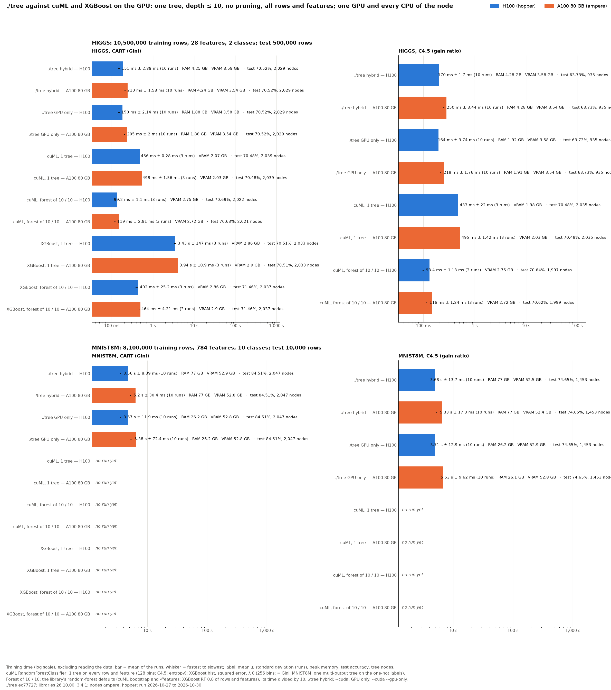

# GPU vs others: ./tree against cuML and XGBoost on HIGGS and MNIST8M

One tree per run, grown to depth ≤ 10 without pruning on every training row and feature, scored on the dataset's test set, on the H100 PCIe of hopper and the A100 80 GB PCIe of ampere: one GPU and every CPU of the node, as ./tree's CUDA runs. cuML and XGBoost also grow a forest of 10 trees with their own random-forest defaults; its time divided by 10 is the bar "forest of 10 / 10".

**Final data (2026-11-09/10):** ./tree f1fe270 (`bench/cluster/final.sh`, 10 runs per case), cuML and XGBoost 10 timed fits per case. XGBoost on MNIST8M first ran out of memory and stalled in `gpubench.py`'s tree walk; it was rerun on 2026-11-10 with the fixes (538fc78; `logs/*-first.log` are the first pass, with every other library run). Until 2026-11-09 this benchmark also had SUSY, airline, ECBDL'14 15M and chess 1000M; those runs are in git at 3354a8a.



```bash
bench/cluster/final.sh            # queues the libraries on hopper and ampere after ./tree's runs
# then copy ~/gpu-dt-bench/results-final/<dataset>/<node>/ to <dataset>/<node>/ here, and:
bench/.venv/bin/python bench/vs_chart.py gpu     # chart.png, summary.csv
```

## Results

Mean of 10 runs, H100 (A100 in brackets); the chart has every bar with its spread, memory, test accuracy and nodes.

| | ./tree hybrid | cuML, 1 tree | XGBoost, 1 tree | ./tree faster than cuML / XGBoost |
|---|--:|--:|--:|--:|
| HIGGS CART | 0.159 s (0.208) | 0.450 s (0.507) | 2.62 s (2.72) | 2.8× / 16× (2.4× / 13×) |
| HIGGS C4.5 (cuML: entropy) | 0.168 s (0.222) | 0.453 s (0.506) | — | 2.7× (2.3×) |
| MNIST8M CART | 3.74 s (5.18) | 7.96 s (10.4) | 26.7 s (29.0) | 2.1× / 7.1× (2.0× / 5.6×) |
| MNIST8M C4.5 (cuML: entropy) | 3.90 s (5.31) | 7.99 s (10.4) | — | 2.0× (2.0×) |

- **./tree --gpu-only** takes the same time as the hybrid (within 3%) with less than half its RAM (MNIST8M 26 against 77 GB).
- **XGBoost's time is mostly `QuantileDMatrix`:** the binning takes about 2.4 s of 2.6 s on HIGGS and 20–21 s of 27 s on MNIST8M; the tree itself takes 0.2–0.4 s and 6 s. Its one tree is ./tree's CART tree on MNIST8M (2,047 nodes, training 80.77%, test 84.51%) and nearly on HIGGS (2,033 against 2,029 nodes, test 70.51% against 70.52%).
- **XGBoost needs 79 GB of VRAM on MNIST8M:** the multi-output tree's histograms (10 classes × 784 features × 256 bins per node). Its default cache of up to 65,536 nodes' histograms does not fit in 80 GB, nor does 256; `gpubench.py` keeps 128 (`max_cached_hist_node`, the same tree). ./tree uses 53 GB, cuML 27 GB.
- **A forest's tree is cheaper than one full tree:** cuML's default forest takes 0.10 s (HIGGS) and 0.45 s (MNIST8M) per tree on the H100, faster than ./tree's one tree, because each tree sees a bootstrap sample and √features per split; its trees are not the full-data tree (it is a forest, test 90.4% against one tree's 84.5% on MNIST8M).
- **H100 against A100:** ./tree 1.3–1.4× faster on the H100, cuML 1.1–1.3×, XGBoost 1.04–1.09× (its binning runs mostly on the CPUs).

## What is compared

No public CUDA implementation of C4.5 was found (the GPU C4.5 papers publish no code). Every GPU tree library still in use builds binary Gini, entropy or second-order-gain trees on histogram bins: it splits only at the edges of a fixed number of quantile bins per feature (cuML 128, XGBoost 256). ./tree tests every distinct value.

| Implementation | Version | Settings |
|---|---|---|
| **./tree --cuda** (hybrid) and **--cuda --gpu-only** | the build of the test-set benchmarks | `--cart --no-prune -d 10` (exact Gini), `--c45 --no-prune -d 10` (C4.5 gain ratio); its bars are `cluster-<data>/cuda-<node>-<data>` and `gpuonly-<node>-<data>` |
| **cuML** `RandomForestClassifier` | 26.10 | 1 tree: `n_estimators=1, bootstrap=False, max_features=1.0, n_bins=128, max_depth=10`. CART: Gini. C4.5 stand-in: entropy (information gain), `min_samples_leaf=2` |
| **XGBoost** | 3.4.1, `device="cuda", tree_method="hist"` | `reg:squarederror` with `eta=1, lambda=0`, 256 bins, `max_depth=10`, one round: on 0/1 labels the gain is n/2 × the drop in Gini impurity, so the CART split on bins. MNIST8M (10 classes): one multi-output tree (`multi_strategy="multi_output_tree"`) on the one-hot labels, whose summed squared error is again n/2 × the Gini drop. No entropy criterion, so CART only |

- **Forest of 10 / 10** (`gpubench.py FOREST=default`): each library's own random-forest defaults, only the criterion and `max_depth=10` set. cuML: bootstrap samples, `max_features="sqrt"`, 128 bins, `n_streams=4`. XGBoost (as `XGBRFClassifier`): `binary:logistic` (MNIST8M: `multi:softprob` with multi-output trees), `subsample=0.8`, `colsample_bynode=0.8`, `lambda=1e-5`, `eta=1`, one round of 10 parallel trees. A forest is not one tree: the comparison is per unit of work, not of result.
- **Time:** from host memory to the finished tree. ./tree: its `train total` (GPU setup and upload, presort, build), a fresh process per run. Libraries: one Python process per case: an untimed full-size warm-up fit, then 10 timed fits on the float32 NumPy arrays; a fit includes the copy to the GPU and the binning (`QuantileDMatrix` for XGBoost).
- **VRAM:** peak GPU memory in use above its idle value, sampled with nvidia-smi every 20 ms, for the whole process.
- **Nodes:** each job owns its node (`--exclusive`); the GPU is the first on the NUMA node with the most free memory (hopper GPU 2, ampere GPU 0), nothing is bound (every CPU, memory first-touch), as in ./tree's `bench/cluster/job.sh`.
- **Test sets:** HIGGS the last 500,000 rows (UCI's split), MNIST8M the original MNIST test set (10,000).

## Run it by hand

The harness runs on mordor3 in `~/gpu-dt-bench`, outside this repository (cuML needs its own venv). The scripts are in [`scripts/`](scripts/): `job.sh` (one SLURM job per node: every library, case and dataset), `gpubench.py` (one library and case: warm-up, timed fits, test predictions), `build.sh` and `treebench.py` (./tree inside the harness, `IMPLS=tree`, not used now), `requirements-freeze.txt` (pinned versions). The data is the prepared datasets of [bench/cluster](../../cluster/README.md) (`~/dt/bench/data/<dataset>`: `train.f32`, `train.y.i32`, `test.*`).

```bash
# on the mordor3 login node, once: the harness and the venv
mkdir ~/gpu-dt-bench && cd ~/gpu-dt-bench && cp ~/dt/bench/results/cluster-gpu-vs-others/scripts/* .
/usr/bin/virtualenv -p python3 venv          # python3-venv is missing on mordor3
venv/bin/pip install --extra-index-url=https://pypi.nvidia.com cuml-cu12 xgboost
# one tree, then the default forests (final.sh submits these)
TREES=1 RESULTS=$PWD/results-final sbatch -p hopper -w hopper --exclusive -t 1-00:00:00 -o results-final/hopper-trees1.log job.sh hopper
TREES=10 FOREST=default RESULTS=$PWD/results-final sbatch -p hopper -w hopper --exclusive -t 1-00:00:00 -o results-final/hopper-trees10.log job.sh hopper
```

- **Never `scancel` a running `job.sh` started without `timeout --foreground`:** SLURM's kill on mordor3 once left the benchmark running in its own process group. `job.sh` uses `--foreground`.
- **Earlier versions:** the depth-19 comparison and the identical-tree forests are in the git history (325039f, 8187eb9).

## Files

| File | Content |
|---|---|
| `chart.png` | HIGGS and MNIST8M, CART and C4.5: time of one tree per implementation and GPU, with its runs, RAM and VRAM, test accuracy and nodes |
| `summary.csv` | One row per dataset, algorithm, implementation and GPU: mean, standard deviation, runs, min, max, VRAM, test accuracy, nodes |
| `<dataset>/<node>/` | `results.jsonl` (every cuML and XGBoost fit), `machine.json` |
| `logs/` | the SLURM logs: `<node>-trees<1|10>-first.log` every library run but XGBoost on MNIST8M, `<node>-trees<1|10>.log` its rerun |
| `scripts/` | the harness (above) |
