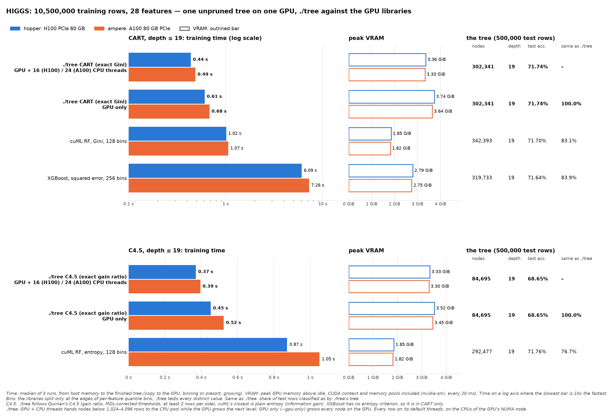
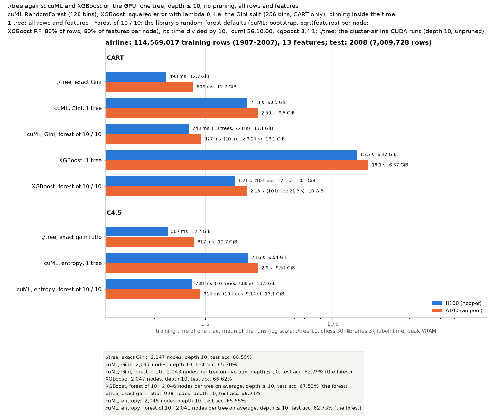
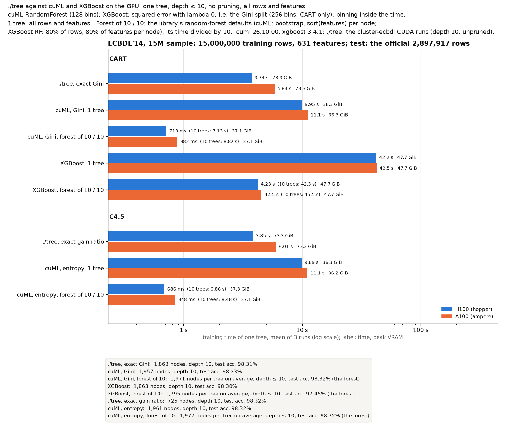
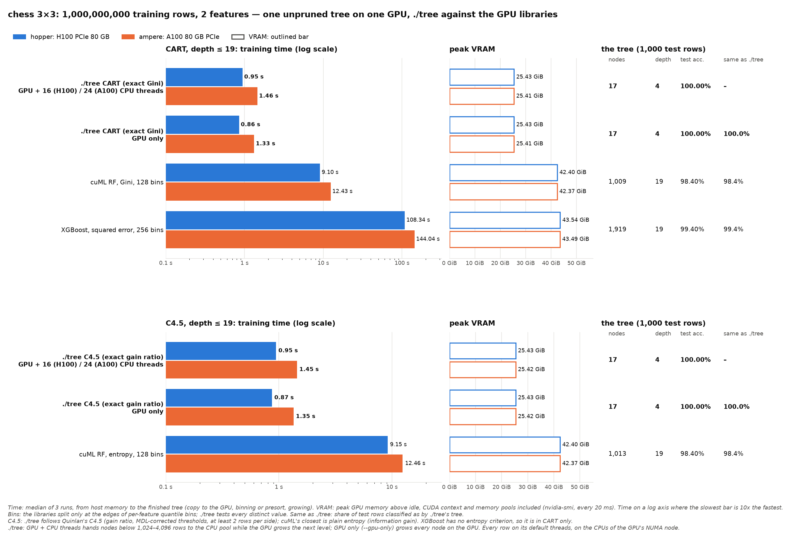

# HIGGS, airline, ECBDL'14 and chess 1000M on the mordor3 GPUs: ./tree against other GPU decision-tree builders

**Status:** rerun on 2026-10-20 with **every tool on its default threads, all bound to the GPU's NUMA node**, 3 runs per case.
- **./tree and XGBoost** ran 16:27–16:46 (jobs 1357 on hopper, 1358 on ampere). ./tree is at b014290, built for sm_80 and sm_90 in a separate clone (`~/gpu-dt-bench/dt`).
- **cuML** ran 14:25–15:23 the same day (jobs 1314 and 1315), with the same harness and binding; `machine.json` records it, `machine-<job>.json` the later job.
- **The GPU and its NUMA node:** on hopper, GPU 2 on NUMA node 1 (16 CPUs; most of node 0's memory is taken by another user's /dev/shm). On ampere, GPU 0 on node 0 (24 CPUs). Every run is under `numactl --cpunodebind --membind`, and `--exclusive` holds the whole node.
- **Defaults:**
  - **./tree `--cuda`:** without `--threads`, it takes the CPUs it may run on (since b014290, the affinity mask instead of the machine's CPU count): 16 on hopper, 24 on ampere.
  - **./tree GPU only:** plain `--gpu-only` (before: `--threads 1`).
  - **XGBoost:** runs without `nthread` (before: `os.cpu_count()`, 32 and 48).
  - **cuML:** has no thread setting.
- **The trees** have the same node counts, test accuracies and agreement as in the previous run (2026-10-17 to 19, in the git history).

**One unpruned tree with depth ≤ 19 per case, CART and C4.5, on HIGGS, airline, ECBDL and chess.** 19 is the depth of ./tree's pruned CART tree on HIGGS. Each library runs with its default bins, its faster setting; the earlier 1024-bin runs were slower and agreed with ./tree only 1–2 points more.

**Bottom line:** ./tree is the fastest single-tree GPU builder found, and the only one with exact splits.
- **Against cuML (the fastest of the others):** 2.2–2.7× faster on HIGGS, 2.7–3.7× on airline, 2.4–3.3× on ECBDL and 8.5–9.6× on chess 1000M, for CART and for C4.5 against cuML's entropy tree.
- **Against XGBoost (CART only):** 14–20× faster on HIGGS and airline, 5.6–8.2× on ECBDL, 99–114× on chess 1000M.
- **Chess 1000M (2 features, 10^9 rows):** ./tree builds the exact 17-node board tree in 0.95 s (H100) and 1.46 s (A100), GPU only in 0.86 and 1.33 s, with 25.4 GiB of VRAM. cuML takes 9.1 and 12.4 s, XGBoost 108 and 144 s, both with 42–44 GiB. Their binned trees fill all 19 levels (1,009–1,919 nodes) at 98.4–99.4% test accuracy.
- **CART test accuracy is the same within 0.3 points.** The histogram trees classify 83–91% of test rows the same as ./tree's exact tree on HIGGS and airline, 99.4–99.6% on ECBDL (mostly its 97.8% majority class).
- **C4.5 is a different algorithm from cuML's entropy tree.** ./tree's C4.5 (gain ratio) builds a smaller tree at the same depth limit, with 1.2–3.1 points lower test accuracy (below).
- **GPU only** (`--gpu-only`, every node on the GPU, the node's CPUs only for host work) builds the same trees, node for node (100% the same test predictions).
  - **Against the GPU + CPU threads:** 3–39% slower on HIGGS, airline and ECBDL, and 7–9% faster on chess.
  - **Against cuML:** still 1.6–10.6× faster.
- **Memory:** ./tree uses 3.3–3.4 GiB on HIGGS and 13.3 GiB on airline. The libraries use 1.8–2.8 GiB and 7.1–10.0 GiB: cuML 1.8× less on HIGGS and 1.3–1.4× less on airline, XGBoost 1.9× less on airline. On ECBDL ./tree fills 73.3–73.4 GiB of the 80 GB, against 36.2 GiB for cuML and 47.9 GiB for XGBoost.









**Bins:** cuML and XGBoost don't test every possible split. Before growing the tree, they sort each feature's values into a fixed number of ranges (bins) with about the same number of rows each, and split only at bin edges. That gives at most 127 (cuML, 128 bins) or 255 (XGBoost, 256 bins) candidate thresholds per feature. ./tree tests every distinct value: millions per feature on HIGGS; on airline, from 7 (DayofWeek) to about 7,900 (FlightNum) in the 500,000 test rows.

## What is compared

I found no public CUDA implementation of C4.5. The GPU C4.5 papers (CUDT, GPU C4.5 for traffic classification) publish no code, and Weka's GPUTree package (Java with CUDA, numeric attributes only) was not tried. Every GPU tree library still in use builds **binary Gini, entropy or second-order-gain trees on histogram bins**.
- **CART** is the same split criterion as the libraries' Gini, but their thresholds are approximate.
- **C4.5's closest library tree is cuML with `split_criterion="entropy"`.** It uses information gain, while C4.5 uses gain ratio with an MDL-corrected threshold. cuML also lacks C4.5's minimum split size of 0.1·n/K rows (clamped to 2–25), and C4.5's collapse of useless splits. cuML is set to C4.5's smallest split, at least 2 rows per side.
- **XGBoost** has no entropy criterion, so it runs CART only.

| Implementation | Version | How it builds one tree |
|---|---|---|
| **./tree --cuda** | b014290 | `--cart --no-prune -d 19`: exact Gini splits over every distinct value (presorted). `--c45 --no-prune -d 19`: Quinlan's C4.5 rules (docs/ALGORITHMS.md), without the error-based pruning. |
| **cuML** `RandomForestClassifier` | 26.10 (RAPIDS, pip `cuml-cu12`) | `n_estimators=1, bootstrap=False, max_features=1.0, n_bins=128` (default). CART: `split_criterion="gini"`, `min_samples_leaf=1`. C4.5: `"entropy"`, `min_samples_leaf=2, min_samples_split=4`. Thresholds are per-feature quantiles. |
| **XGBoost** | 3.4.1, `device="cuda", tree_method="hist"` | One round of `reg:squarederror` on the 0/1 label with `eta=1, lambda=0, alpha=0, gamma=0, min_child_weight=1`, `base_score` = the class-1 share. Every row has hessian 1, so the gain is the drop in squared error, which is n/2 × the drop in Gini impurity: **the CART split, on histogram bins** (`max_bin` 256, the default). `depthwise` growth to the depth limit. |
| CudaTree | 0.6 (2013) | **Not run.** It is Python 2 code, and its kernels use texture references, which CUDA 12 removed. |

Settings shared by every case: all training rows and all features, no bootstrap or feature sampling, no pruning, depth ≤ 19.

| Dataset | Training rows | Features | Test rows |
|---|--:|--:|--:|
| HIGGS | 10,500,000 | 28 (real-valued) | 500,000: the published split's last rows |
| airline (gbm-bench, US flights 1987–2008) | 114,569,017 | 13 (integer) | 500,000: a random sample held out when the data was prepared |
| ECBDL'14, 15M sample ([cluster-ecbdl-old](../cluster-ecbdl-old/BENCHMARK.md)) | 15,000,000 | 631 (539 real, 92 nominal as integer codes) | 100,000: a random sample held out when the data was prepared; 2.16% positives |
| chess 3×3, 1000M ([cluster-chess](../cluster-chess/BENCHMARK.md)) | 1,000,000,000 | 2 (x, y on a 3×3 board) | 1,000: a separate file (`chess_1b_test.csv`) |

No tool trains on the test rows, and no extra 80/20 split is needed. On airline, `ActualElapsedTime` partly gives the delay away, so its accuracies say little ([cluster-airline-old](../cluster-airline-old/BENCHMARK.md)).

### Measurement

- **Time:** from host memory to the finished tree.
  - **./tree:** its `train total` (GPU setup and upload, presort, build). Reading the CSV isn't timed, and the CUDA context is created while the CSV loads. Each run is a fresh process.
  - **Libraries:** one Python process per case. The process first runs one untimed warm-up fit on 50,000 rows (imports, CUDA context, JIT), then 3 timed fits on the full float32 NumPy arrays.
  - **What a library fit includes:** the copy to the GPU and the binning. That is `QuantileDMatrix` for XGBoost; cuML bins inside `fit`.
- **Accuracy:** each library's own `predict`. ./tree's test accuracy comes from its `--dump` tree (`treebench.py`, the same walk as `bench/benchlib.py`).
- **Same as ./tree:** the share of the test rows (500,000; ECBDL 100,000; chess 1,000) a tree classifies the same as ./tree's tree in the same case: its CART tree for CART, its C4.5 tree for C4.5.
- **VRAM:** peak `memory.used` of the GPU used above its idle value (nvidia-smi every 20 ms; the idle value is read before the process starts). It includes the CUDA context and memory pools. For a library it is the peak of the whole process: the warm-up and all 3 fits.
- **Determinism:** every tree is identical on the H100 and the A100. The test predictions are the same, byte for byte.

| Node | CPU | GPU used | Bound to (`numactl`) | Driver, CUDA |
|---|---|---|---|---|
| hopper | 2× Xeon Gold 6444Y, 32 cores | H100 PCIe 80 GB (GPU 2) | NUMA node 1: 16 CPUs and its memory | 615.71.09, CUDA 12.9 |
| ampere | 2× EPYC 7402, 48 cores | A100 80 GB PCIe (GPU 0) | NUMA node 0: 24 CPUs and its memory | 615.71.09, CUDA 12.9 |

## Results

Median of 3 runs (min–max). The node count, depth and accuracies are for the last run's tree, which is the same on both GPUs. The root split is `feature <= threshold` (XGBoost: `<`).

### HIGGS: CART, depth ≤ 19

| Implementation | H100 time | A100 time | Nodes | Depth | Train acc. | Test acc. | Same as ./tree | VRAM H100 | VRAM A100 | Root split |
|---|--:|--:|--:|--:|--:|--:|--:|--:|--:|---|
| ./tree CART (exact Gini), GPU + 16 (H100) / 24 (A100) CPU threads | 0.44 s (0.42–0.44) | 0.49 s (0.49–0.49) | 302,341 | 19 | 77.85% | 71.74% | – | 3.36 GiB | 3.33 GiB | `f25 <= 1.077748` |
| ./tree CART (exact Gini), GPU only | 0.61 s (0.59–0.64) | 0.68 s (0.68–0.68) | 302,341 | 19 | 77.85% | 71.74% | 100.00% | 3.74 GiB | 3.64 GiB | `f25 <= 1.077748` |
| cuML RF, Gini, 128 bins | 1.02 s (0.94–1.93) | 1.07 s (1.03–2.10) | 342,393 | 19 | 77.78% | 71.70% | 83.12% | 1.85 GiB | 1.82 GiB | `f25 <= 1.080328` |
| XGBoost, squared error, 256 bins | 6.09 s (5.99–6.55) | 7.26 s (7.18–7.43) | 319,733 | 19 | 77.79% | 71.64% | 83.95% | 2.79 GiB | 2.75 GiB | `f25 < 1.075816` |

### HIGGS: C4.5, depth ≤ 19

| Implementation | H100 time | A100 time | Nodes | Depth | Train acc. | Test acc. | Same as ./tree | VRAM H100 | VRAM A100 | Root split |
|---|--:|--:|--:|--:|--:|--:|--:|--:|--:|---|
| ./tree C4.5 (exact gain ratio), GPU + 16 (H100) / 24 (A100) CPU threads | 0.37 s (0.36–0.37) | 0.39 s (0.39–0.40) | 84,695 | 19 | 70.43% | 68.65% | – | 3.33 GiB | 3.30 GiB | `f25 <= 1.837873` |
| ./tree C4.5 (exact gain ratio), GPU only | 0.45 s (0.44–0.47) | 0.52 s (0.52–0.53) | 84,695 | 19 | 70.43% | 68.65% | 100.00% | 3.52 GiB | 3.45 GiB | `f25 <= 1.837873` |
| cuML RF, entropy, 128 bins | 0.87 s (0.86–1.60) | 1.05 s (1.03–2.04) | 292,477 | 19 | 76.73% | 71.76% | 76.72% | 1.85 GiB | 1.82 GiB | `f25 <= 1.080328` |

### airline: CART, depth ≤ 19

| Implementation | H100 time | A100 time | Nodes | Depth | Train acc. | Test acc. | Same as ./tree | VRAM H100 | VRAM A100 | Root split |
|---|--:|--:|--:|--:|--:|--:|--:|--:|--:|---|
| ./tree CART (exact Gini), GPU + 16 (H100) / 24 (A100) CPU threads | 1.13 s (1.13–1.15) | 1.72 s (1.70–1.72) | 621,689 | 19 | 75.31% | 74.88% | – | 13.30 GiB | 13.28 GiB | `f8 <= 70.5` |
| ./tree CART (exact Gini), GPU only | 1.30 s (1.23–1.34) | 1.79 s (1.78–1.79) | 621,689 | 19 | 75.31% | 74.88% | 100.00% | 13.68 GiB | 13.62 GiB | `f8 <= 70.5` |
| cuML RF, Gini, 128 bins | 4.19 s (4.19–7.63) | 4.63 s (4.60–8.59) | 655,631 | 19 | 75.00% | 74.59% | 86.80% | 9.47 GiB | 9.95 GiB | `f8 <= 70` |
| XGBoost, squared error, 256 bins | 22.85 s (22.43–23.63) | 24.98 s (24.64–25.49) | 641,161 | 19 | 75.20% | 74.76% | 90.80% | 7.10 GiB | 7.05 GiB | `f8 < 71` |

### airline: C4.5, depth ≤ 19

| Implementation | H100 time | A100 time | Nodes | Depth | Train acc. | Test acc. | Same as ./tree | VRAM H100 | VRAM A100 | Root split |
|---|--:|--:|--:|--:|--:|--:|--:|--:|--:|---|
| ./tree C4.5 (exact gain ratio), GPU + 16 (H100) / 24 (A100) CPU threads | 1.13 s (1.13–1.13) | 1.67 s (1.67–1.67) | 190,337 | 19 | 73.15% | 73.02% | – | 13.27 GiB | 13.25 GiB | `f8 <= 70` |
| ./tree C4.5 (exact gain ratio), GPU only | 1.26 s (1.23–1.27) | 1.77 s (1.75–1.78) | 190,337 | 19 | 73.15% | 73.02% | 100.00% | 13.46 GiB | 13.47 GiB | `f8 <= 70` |
| cuML RF, entropy, 128 bins | 4.14 s (4.11–6.87) | 4.56 s (4.54–8.45) | 555,457 | 19 | 74.58% | 74.26% | 84.98% | 9.47 GiB | 9.95 GiB | `f8 <= 70` |

### ECBDL'14 15M sample: CART, depth ≤ 19

| Implementation | H100 time | A100 time | Nodes | Depth | Train acc. | Test acc. | Same as ./tree | VRAM H100 | VRAM A100 | Root split |
|---|--:|--:|--:|--:|--:|--:|--:|--:|--:|---|
| ./tree CART (exact Gini), GPU + 16 (H100) / 24 (A100) CPU threads | 6.40 s (6.40–6.41) | 9.50 s (9.47–9.56) | 55,715 | 19 | 98.22% | 97.69% | – | 73.43 GiB | 73.36 GiB | `f0 <= 40.5` |
| ./tree CART (exact Gini), GPU only | 7.05 s (7.05–7.06) | 10.33 s (10.29–10.33) | 55,715 | 19 | 98.22% | 97.69% | 100.00% | 74.08 GiB | 74.01 GiB | `f0 <= 40.5` |
| cuML RF, Gini, 128 bins | 21.05 s (20.84–38.90) | 22.42 s (21.37–50.40) | 84,231 | 19 | 98.31% | 97.58% | 99.38% | 36.24 GiB | 36.20 GiB | `f0 <= 40` |
| XGBoost, squared error, 256 bins | 52.72 s (52.62–53.02) | 53.43 s (53.29–53.48) | 57,793 | 19 | 98.23% | 97.65% | 99.58% | 47.92 GiB | 47.88 GiB | `f0 < 41` |

### ECBDL'14 15M sample: C4.5, depth ≤ 19

| Implementation | H100 time | A100 time | Nodes | Depth | Train acc. | Test acc. | Same as ./tree | VRAM H100 | VRAM A100 | Root split |
|---|--:|--:|--:|--:|--:|--:|--:|--:|--:|---|
| ./tree C4.5 (exact gain ratio), GPU + 16 (H100) / 24 (A100) CPU threads | 6.28 s (6.27–6.29) | 9.31 s (9.28–9.36) | 10,889 | 19 | 97.93% | 97.80% | – | 73.33 GiB | 73.26 GiB | `f34 <= 0` |
| ./tree C4.5 (exact gain ratio), GPU only | 6.50 s (6.49–6.50) | 9.60 s (9.57–9.63) | 10,889 | 19 | 97.93% | 97.80% | 100.00% | 73.46 GiB | 73.42 GiB | `f34 <= 0` |
| cuML RF, entropy, 128 bins | 20.60 s (20.58–39.40) | 22.11 s (21.14–50.40) | 117,349 | 19 | 98.27% | 97.54% | 99.39% | 36.23 GiB | 36.20 GiB | `f0 <= 54` |

### chess 3×3, 1000M: CART, depth ≤ 19

| Implementation | H100 time | A100 time | Nodes | Depth | Train acc. | Test acc. | Same as ./tree | VRAM H100 | VRAM A100 | Root split |
|---|--:|--:|--:|--:|--:|--:|--:|--:|--:|---|
| ./tree CART (exact Gini), GPU + 16 (H100) / 24 (A100) CPU threads | 0.95 s (0.95–0.95) | 1.46 s (1.46–1.46) | 17 | 4 | 100.00% | 100.00% | – | 25.43 GiB | 25.41 GiB | `f1 <= 1.999985` |
| ./tree CART (exact Gini), GPU only | 0.86 s (0.86–0.87) | 1.33 s (1.32–1.33) | 17 | 4 | 100.00% | 100.00% | 100.00% | 25.43 GiB | 25.41 GiB | `f1 <= 1.999985` |
| cuML RF, Gini, 128 bins | 9.10 s (9.08–13.39) | 12.43 s (12.43–17.61) | 1,009 | 19 | 98.50% | 98.40% | 98.40% | 42.40 GiB | 42.37 GiB | `f0 <= 2.002869` |
| XGBoost, squared error, 256 bins | 108.34 s (106.61–108.96) | 144.04 s (143.41–144.29) | 1,919 | 19 | 99.48% | 99.40% | 99.40% | 43.54 GiB | 43.49 GiB | `f1 < 2.003876` |

### chess 3×3, 1000M: C4.5, depth ≤ 19

| Implementation | H100 time | A100 time | Nodes | Depth | Train acc. | Test acc. | Same as ./tree | VRAM H100 | VRAM A100 | Root split |
|---|--:|--:|--:|--:|--:|--:|--:|--:|--:|---|
| ./tree C4.5 (exact gain ratio), GPU + 16 (H100) / 24 (A100) CPU threads | 0.95 s (0.95–0.95) | 1.45 s (1.44–1.46) | 17 | 4 | 100.00% | 100.00% | – | 25.43 GiB | 25.42 GiB | `f1 <= 1.999939` |
| ./tree C4.5 (exact gain ratio), GPU only | 0.87 s (0.87–0.88) | 1.35 s (1.35–1.35) | 17 | 4 | 100.00% | 100.00% | 100.00% | 25.43 GiB | 25.42 GiB | `f1 <= 1.999939` |
| cuML RF, entropy, 128 bins | 9.15 s (9.15–12.61) | 12.46 s (12.44–17.81) | 1,013 | 19 | 98.50% | 98.40% | 98.40% | 42.40 GiB | 42.37 GiB | `f0 <= 2.002869` |

## Observations

- **./tree is the fastest in every case, and the gap grows with the data.**
  - **CART, H100:** on HIGGS, 0.44 s against 1.02 s for cuML (2.3×) and 6.09 s for XGBoost (13.8×). On airline, 1.13 s against 4.19 s (3.7×) and 22.9 s (20.2×).
  - **CART, A100:** 2.2× and 14.8× on HIGGS, 2.7× and 14.5× on airline.
  - **C4.5 against cuML's entropy tree:** 2.4–2.7× on HIGGS and 2.7–3.7× on airline.
- **CART: same accuracy, different trees.**
  - **Test accuracy:** HIGGS 71.64–71.74% for every tree, airline 74.59–74.88%. ./tree's exact tree is the most accurate on both, by at most 0.3 points.
  - **Tree size:** about the same. On HIGGS, ./tree has 302,341 nodes and the others 319,733–342,393; on airline, 621,689 against 641,161–655,631.
  - **Agreement with ./tree:** 83–84% of test rows on HIGGS and 87–91% on airline.
    - **Why airline agrees more:** its integer features have few distinct values (the root's feature, `ActualElapsedTime`, has 587 in the test rows), so the bin edges land closer to the exact thresholds.
    - **The root threshold still differs:** ./tree 70.5, cuML 70, XGBoost < 71.
- **C4.5 against entropy: a smaller tree with lower accuracy at depth 19.**
  - **Smaller trees:** ./tree's C4.5 has 84,695 nodes on HIGGS and 190,337 on airline, against 292,477 and 555,457 for cuML's entropy tree.
  - **Lower accuracy:** test accuracy is 68.65% against 71.76% on HIGGS, and 73.02% against 74.26% on airline.
  - **The reason is C4.5's own rules:**
    - **Uneven splits:** gain ratio prefers them. On HIGGS its root is `f25 <= 1.837873`, against 1.08 for every Gini and entropy tree. Uneven splits use up the 19 levels on few rows.
    - **Earlier stops:** C4.5's minimum split size (up to 25 rows per side) and its collapse of useless splits stop it earlier still.
    - **Without the depth limit,** C4.5 grows deeper (depth 74 on airline, [cluster-airline-old](../cluster-airline-old/BENCHMARK.md)).
  - **Agreement:** the two trees agree on only 77% (HIGGS) and 85% (airline) of test rows.
  - **Timing still compares the same amount of data.** Every case reads the same rows, and ./tree's smaller C4.5 tree takes about as long as its CART tree.
- **ECBDL'14 (631 features, 15M rows): ./tree still the fastest, the libraries closer.**
  - **CART:**
    - **H100:** 6.40 s against 21.1 s for cuML (3.3×) and 52.7 s for XGBoost (8.2×).
    - **A100:** 9.50 s against 22.4 s (2.4×) and 53.4 s (5.6×).
  - **C4.5 against cuML's entropy tree:** 6.28 s against 20.6 s (3.3×) on the H100, 9.31 s against 22.1 s (2.4×) on the A100.
  - **The libraries gain little from the H100:** cuML 21.1 against 22.4 s, XGBoost 52.7 against 53.4 s; ./tree gains 1.5×.
    - **./tree's time is GPU work:** 0.7 s of upload on the H100 and 1.7 s on the A100, then the kernels ([cluster-ecbdl-profile](../cluster-ecbdl-profile/gpu-plus-cpu/BENCHMARK.md)).
    - **What bounds the libraries' fits** (the binning, the copy to the GPU, the host) was not profiled.
  - **Accuracy says little here.** 97.84% of the test rows are negatives, and every depth-19 tree is below always predicting the majority class: CART 97.58–97.69%, C4.5 97.80%, cuML's entropy tree 97.54%. The trees agree with ./tree on 99.4–99.6% of the test rows.
  - **Trees:**
    - **CART:** 55,715 nodes for ./tree, 57,793 for XGBoost, 84,231 for cuML.
    - **C4.5:** 10,889 nodes against 117,349 for cuML's entropy tree.
    - **./tree's C4.5 has a different root:** `f34 <= 0` (PredSA_freq_central_0), while every Gini and entropy tree splits first on `f0`, the residues' separation.
  - **cuML's training accuracy** is predicted in chunks of 1M rows (`gpubench.py`): 98.31% (CART) and 98.27% (entropy).
    - **The bug the chunks avoid:** `predict` on all 15M rows at once (9.5 G values) goes wrong from row 6,806,6xx on, about 2³² values / 631 features: a 32-bit index overflow in cuML.
    - **Without chunks,** the 2026-10-17 run gave 81.08% and 91.18%. The test predictions (100,000 rows) are not affected.
  - **VRAM:** ./tree 73.3–74.1 GiB of the 80 GB, XGBoost 47.9 GiB, cuML 36.2 GiB.
    - **./tree:** one copy of the presorted columns (632 slots × 15M rows × 8 bytes = 70.6 GiB), and the rest as on the other datasets.
    - **15M rows are about the most ./tree fits** on these GPUs ([cluster-ecbdl-old](../cluster-ecbdl-old/BENCHMARK.md)).
  - **cuML's first full-size fit** took 38.9 s on the H100 and 50.4 s on the A100, 18–28 s more than the next two; the medians leave it out.
- **Chess 1000M (2 features, 10^9 rows): the largest gap.**
  - **CART:**
    - **H100:** 0.95 s against 9.10 s for cuML (9.6×) and 108.3 s for XGBoost (114×).
    - **A100:** 1.46 s against 12.43 s (8.5×) and 144.0 s (99×).
  - **C4.5 against cuML's entropy tree:** 0.95 s against 9.15 s (9.6×), and 1.45 s against 12.46 s (8.6×).
  - **Exact against binned splits:**
    - **The board:** its squares change at x, y = 1 and 2.
    - **./tree** finds those thresholds (root `f1 <= 1.999985`) and stops at the exact tree: 17 nodes, depth 4, 100% on the training and test rows, as in [cluster-chess](../cluster-chess/BENCHMARK.md).
    - **The libraries' bin edges** (cuML 128, XGBoost 256) fall near those thresholds but not on them. Each boundary leaves a thin strip of mixed rows, which the libraries keep splitting to the depth limit: 1,009–1,013 nodes (cuML) and 1,919 (XGBoost), at depth 19, with 98.5% and 99.5% training accuracy.
  - **Test set:** only 1,000 rows, so the test accuracies (98.4%, 99.4%) and the agreement with ./tree move in steps of 0.1 points.
  - **VRAM:** ./tree 25.4 GiB (as in cluster-chess), cuML 42.4 GiB, XGBoost 43.5 GiB. On 2 features, the libraries' copies of the 8 GB float32 matrix outweigh ./tree's presorted columns.
  - **The H100 helps ./tree 1.5×** (1.46 → 0.95 s), cuML 1.4× and XGBoost 1.3×.
  - **cuML's first full-size fit** took 13.4 s (H100) and 17.6 s (A100); the medians leave it out.
  - **XGBoost's accuracy pass** predicts the 10^9 training rows in 10M-row chunks (`gpubench.py`); this is outside the timed fit.
- **./tree, GPU only against GPU + CPU threads:** `--gpu-only` against the split default, where nodes below 1,024–4,096 rows go to the CPU pool. Both run on the GPU node's 16 (H100) or 24 (A100) CPUs.
  - **Time, H100 / A100:**

    | Dataset | CART, GPU only | CART, GPU + CPU | C4.5, GPU only | C4.5, GPU + CPU |
    |---|--:|--:|--:|--:|
    | HIGGS | 0.61 / 0.68 s | 0.44 / 0.49 s | 0.45 / 0.52 s | 0.37 / 0.39 s |
    | airline | 1.30 / 1.79 s | 1.13 / 1.72 s | 1.26 / 1.77 s | 1.13 / 1.67 s |
    | ECBDL | 7.05 / 10.33 s | 6.40 / 9.50 s | 6.50 / 9.60 s | 6.28 / 9.31 s |
    | chess | 0.86 / 1.33 s | 0.95 / 1.46 s | 0.87 / 1.35 s | 0.95 / 1.45 s |

  - **Where the difference comes from:**
    - **Small nodes:** GPU only grows the deep levels of small nodes on the GPU, which costs most on HIGGS (1.2–1.4×).
    - **Host work:** the staged upload and the root's class counts now have the node's threads instead of one, so the gap is smaller than with `--threads 1` (below).
    - **Chess:** its 17-node tree has no small nodes to hand off, and GPU only is 7–9% faster there. The split mode's extra host setup for the hand-offs is the likely cause (not profiled).
  - **Same trees:** the same node counts and test predictions on both GPUs.
  - **VRAM:** up to 0.7 GiB more (HIGGS 3.7 against 3.4 GiB, ECBDL 74.1 against 73.4 GiB, chess the same), for the deeper GPU levels' buffers.
  - **Host memory:** the host arena for the hand-offs (8 bytes per value, 75 GB on ECBDL) is not allocated.
  - **One CPU thread:** the GPU-only rows of [cluster-chess](../cluster-chess/BENCHMARK.md) and [cluster-ecbdl-old](../cluster-ecbdl-old/BENCHMARK.md) run under `taskset` on one CPU of the GPU's node, the like-for-like setting against single-threaded CPU tools.
- **Memory:** ./tree peaks at 3.3–3.4 GiB on HIGGS and 13.3 GiB on airline.
  - **What it holds:** one copy of the presorted columns (8 bytes per value) plus one spare column, a 512 MB hand-off ring, and the CUDA context ([docs/CUDA.md](../../../docs/CUDA.md)).
  - **The libraries:** cuML uses 1.8–1.9 GiB and 9.5–10.0 GiB, XGBoost 2.8 and 7.1 GiB. They split on histogram bins and keep no presorted columns, so they need less; ./tree keeps every exact value with its row.
- **Against the previous run** (2026-10-17 to 19): then, ./tree's split mode used all 32 or 48 CPUs unbound (6f6cecb), GPU only ran with `--threads 1` (7b51a89), and XGBoost had `nthread=os.cpu_count()`.
  - **./tree split mode, H100** (16 CPUs now, 32 before):
    - **HIGGS** is slower: CART 0.35 → 0.44 s, C4.5 0.32 → 0.37 s, with fewer threads for the small nodes.
    - **The rest** stays the same or gets faster: airline CART 1.21 → 1.13 s, ECBDL CART 6.45 → 6.40 s, chess 0.90 → 0.95 s.
  - **./tree split mode, A100** (24 CPUs now, 48 before):
    - **HIGGS:** CART 0.45 → 0.49 s.
    - **airline and ECBDL:** unchanged (1.73 → 1.72 s, 9.44 → 9.50 s).
    - **chess** is faster: 1.76 → 1.46 s, from the upload on the GPU's own node.
  - **./tree GPU only:** HIGGS CART 0.57 → 0.61 s (H100) and 0.74 → 0.68 s (A100); airline CART 1.63 → 1.30 s and 2.07 → 1.79 s; ECBDL CART 9.16 → 7.05 s and 11.14 → 10.33 s; chess 2.27 → 0.86 s (H100) and 2.74 → 1.33 s (A100). The host work is no longer on one thread, and the upload's copiers are no longer oversubscribed (7868bf4).
  - **XGBoost:** 4–40% slower with its default threads, on 16 and 24 CPUs instead of 32 and 48.
    - **H100 / A100:** HIGGS 5.41 / 6.02 → 6.09 / 7.26 s; airline 20.4 / 24.7 → 22.9 / 25.0 s; ECBDL 38.6 / 37.8 → 52.7 / 53.4 s; chess 105.8 / 138.5 → 108.3 / 144.0 s.
    - **Its peak VRAM fell:** airline 13.0 → 7.1 GiB, ECBDL 71.5 → 47.9 GiB.
  - **cuML:** within −2% to +9% (HIGGS on the H100 0.94 → 1.02 s, ECBDL 21.3 → 21.1 s).
- **H100 against A100:**
  - **./tree** is 1.05–1.1× faster on the H100 on HIGGS and 1.5× on airline, ECBDL and chess. The H100 run has only 16 CPU threads for the small nodes, against 24 on the A100.
  - **The libraries** are 1.0–1.4× faster on the H100.
- **First-run cost:** cuML's first full-size fit in each process took 0.9–28 s longer (the max column), probably because its memory pool grows past the 50k-row warm-up size. The medians leave it out.
- **Older history** (the git history has those runs):
  - **6f6cecb against 051949b** (2026-10-19): ./tree was 6–16% faster, with the same trees. Those runs used no α, so 051949b page-locked the whole host arena, which held up the GPU loop.
  - **cd18717 against 00ae13f** (2026-10-17): the GPU memory peak fell from 7.2 to 3.4 GiB (HIGGS) and from 35.0 to 13.3 GiB (airline).
  - **35cf315** (2026-10-15, HIGGS CART depth 19 only): ./tree took 0.42 s on the H100 and 0.58 s on the A100. It kept a mirror of the hand-offs on the GPU (5.0–7.2 GiB); cd18717 replaced the mirror with a fixed 512 MB ring.

## Run it

Everything runs on mordor3 in `~/gpu-dt-bench`, outside this repository. Every computation is a SLURM job on hopper or ampere, with `--exclusive`. The scripts are in [`scripts/`](scripts/). The data is the prepared HIGGS, airline, ecbdl_15m and chess_1b of [bench/cluster](../../cluster/README.md): `~/dt/bench/data/<dataset>`, with `train.csv` for ./tree and `train.f32`/`train.y.i32` and `test.*` for the libraries. The root is set by `DATA_ROOT`.

```bash
# on the mordor3 login node: a clone at the measured commit, the venv, the sources
mkdir ~/gpu-dt-bench && cd ~/gpu-dt-bench
cp /path/to/scripts/* .                      # build.sh job.sh gpubench.py treebench.py summarize.py
git clone ~/dt dt && git -C dt checkout b014290   # cuML's rows: 8b1ecd1
/usr/bin/virtualenv -p python3 venv          # python3-venv is missing on mordor3
venv/bin/pip install --extra-index-url=https://pypi.nvidia.com cuml-cu12 xgboost matplotlib
sbatch build.sh                              # ./tree for sm_80 + sm_90
# NUMA_NODE: the GPU on that node, and every case bound to its CPUs and memory (numactl);
# REPLACE=1: the IMPLS' earlier rows move to results.jsonl.before-<job id>.
# Every dataset and implementation: about 1.5 h on hopper and 2 h on ampere (XGBoost on chess is most of it).
NUMA_NODE=1 DATASETS="higgs airline ecbdl_15m chess_1b" IMPLS="tree tree_gpu cuml xgboost" \
  sbatch --export=ALL -p hopper --exclusive -t 06:00:00 -o results/hopper-defaults.log job.sh hopper
NUMA_NODE=0 DATASETS="higgs airline ecbdl_15m chess_1b" IMPLS="tree tree_gpu cuml xgboost" \
  sbatch --export=ALL -p ampere --exclusive -t 06:00:00 -o results/ampere-defaults.log job.sh ampere
# only some: e.g. NUMA_NODE=1 REPLACE=1 IMPLS="tree tree_gpu xgboost" (the 2026-10-20 run: jobs 1357, 1358)
```

Then, anywhere with numpy and matplotlib, the tables (`tables.md`), `summary.csv` and the charts `chart-higgs.png`, `chart-airline.png`, `chart-ecbdl_15m.png` and `chart-chess_1b.png`:

```bash
venv/bin/python summarize.py results <out dir>
```

- **Results and logs:** the jobs write `results/<dataset>/<node>/results.jsonl` (one line per timed run), `machine.json`, and `failed.jsonl` (cases that crashed, if any). `results.jsonl` and `machine.json` are in `higgs/`, `airline/`, `ecbdl_15m/` and `chess_1b/` here. The job logs stay on mordor3 (`~/gpu-dt-bench/results/<node>-defaults.log` for ./tree and XGBoost, `<node>.log`, `<node>-ecbdl_15m.log` and `<node>-chess_1b.log` for cuML).
- **Predictions:** the test-set predictions in `results/<dataset>/<node>/pred/` (0.5 MB per tree, ECBDL 0.1 MB, chess 1 kB) are not kept in the repository.
- **Never `scancel` a running `job.sh` started without `timeout --foreground`.** `timeout` puts the benchmark in its own process group, and SLURM's kill on mordor3 left it running, which happened once here. `job.sh` uses `--foreground`. To stop a case, kill it from inside the job: `srun --jobid=<id> --overlap -n1 kill <pid>`.
- **What was replaced:** this directory was `cluster-higgs-vs-gpu-libs`: HIGGS only, CART only, depth 12 and 19, with 1024-bin runs of both libraries (commit 35cf315, 2026-10-15). Those results are in the git history. The first run of that version also covered LightGBM, which was dropped because its CUDA version ignores the depth limit.
- **Pinned versions:** `scripts/requirements-freeze.txt`.

## Files

| File | Content |
|---|---|
| `chart-higgs.png`, `chart-airline.png`, `chart-ecbdl_15m.png`, `chart-chess_1b.png` | Per dataset, CART and C4.5: training time per library and GPU (log axis where the slowest bar is 10× the fastest), peak VRAM, and each tree's node count, depth, test accuracy and agreement with ./tree |
| `summary.csv` | One row per dataset, node, case and library: times, tree size, accuracies, agreement, VRAM, root split |
| `higgs/`, `airline/`, `ecbdl_15m/`, `chess_1b/` | `<node>/results.jsonl` (every run), `<node>/machine.json` |
| `scripts/` | `build.sh`, `job.sh` (SLURM), `gpubench.py` (cuML, XGBoost), `treebench.py` (./tree), `summarize.py` (tables and charts), `requirements-freeze.txt` |
