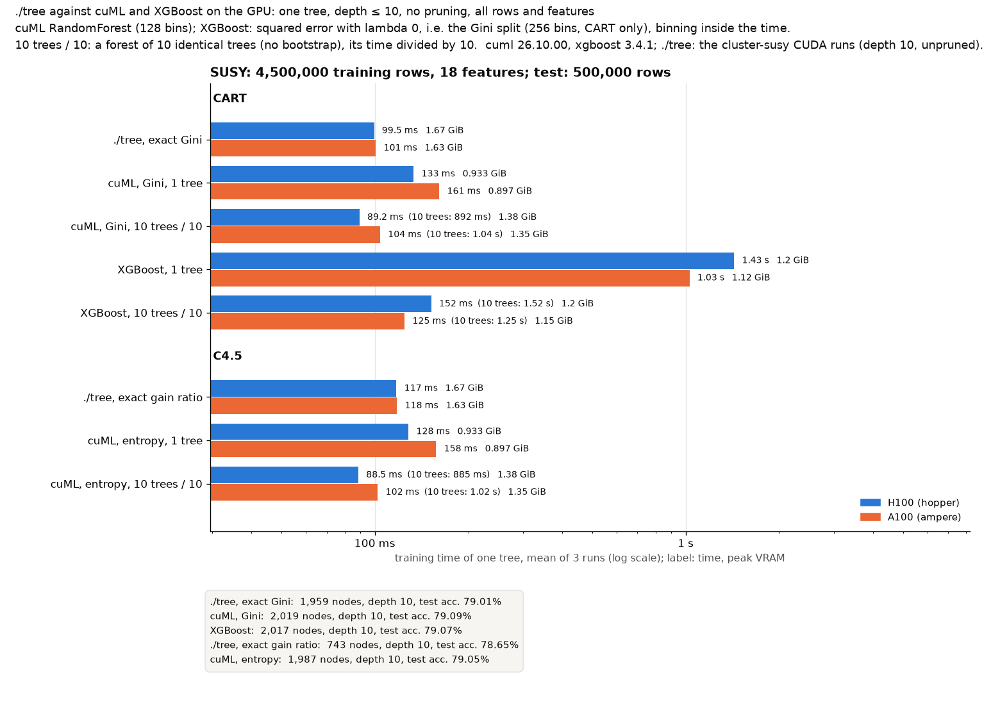

# ./tree against other GPU decision-tree builders: HIGGS, SUSY, airline, ECBDL'14 and chess 1000M on the mordor3 GPUs

**One tree, depth ≤ 10, no pruning, all rows and all features**, on the H100 (hopper) and the A100 (ampere), scored on each dataset's test set. cuML and XGBoost also grew a forest of 10 trees; its time divided by 10 is the bar "10 trees / 10". Run on 2026-10-27, 3 runs per case, mean times.

**Bottom line:**
- **One tree: ./tree is the fastest everywhere.**
  - **Against cuML:** 1.1–3.3× faster on HIGGS, SUSY, airline and ECBDL, 8.4–9.4× on chess 1000M.
  - **Against XGBoost:** 7–24× faster, and 98–111× on chess.
- **Per tree inside a 10-tree forest, the libraries come close.** Their setup (binning, copies) is then shared by 10 trees.
  - **cuML:** each tree costs 61–83% of a one-tree fit. ./tree's single tree is still 1.2–2.3× faster than cuML's per-tree time on HIGGS, airline and ECBDL, and 6–8× on chess. On SUSY cuML's per-tree time (88–104 ms) is equal to or below ./tree's single tree (100–118 ms).
  - **XGBoost:** binning is 91–96% of a one-tree fit, and the 10 trees cost little more than one. Its per-tree time is 1.2–2.7× ./tree's single tree on HIGGS, SUSY and airline, and 10–11× on chess. On ECBDL it is 1.1× slower on the H100 and 1.3× faster on the A100 (4.55 s against 5.84 s).
- **The same accuracy for CART:** the binned trees are within 0.1 point of ./tree's exact tree on HIGGS, SUSY and ECBDL. On airline cuML is 1.0–1.3 points lower and XGBoost 0.07 higher.
- **C4.5 is a different algorithm from cuML's entropy tree.** ./tree's gain-ratio tree at depth 10 has half the nodes or fewer, within 0.7 point of its accuracy on SUSY, airline and ECBDL, and 6.8 points lower on HIGGS (63.7% against 70.5%; also in [cluster-cpu-vs-others](../cluster-cpu-vs-others/BENCHMARK.md)).
- **Chess 1000M (2 features, 10^9 rows):** ./tree builds the exact 17-node board tree (depth 4) in 0.96–1.46 s. The libraries' binned trees fill all 10 levels (365–393 nodes) at 98.4% (cuML) and 99.4% (XGBoost) test accuracy.
- **VRAM:** ./tree uses more on HIGGS, SUSY and ECBDL (73.3 GiB on ECBDL, against 36–48 GiB) and less on chess (25.4 against 42–44 GiB for one tree, 72–77 GiB for 10 trees).





## What is compared

I found no public CUDA implementation of C4.5. The GPU C4.5 papers (CUDT, GPU C4.5 for traffic classification) publish no code. Every GPU tree library still in use builds **binary Gini, entropy or second-order-gain trees on histogram bins**: before growing, it sorts each feature's values into a fixed number of ranges with about the same number of rows each, and splits only at their edges (at most 127 thresholds per feature for cuML, 255 for XGBoost). ./tree tests every distinct value.

| Implementation | Version | Settings |
|---|---|---|
| **./tree --cuda** | as in each benchmark below | `--cart --no-prune -d 10` (exact Gini) and `--c45 --no-prune -d 10` (C4.5 Release 8 rules without the error-based pruning); default threads, the GPU + CPU split |
| **cuML** `RandomForestClassifier` | 26.10 | `n_estimators` 1 or 10, `bootstrap=False, max_features=1.0, n_bins=128, max_depth=10`. CART: Gini. C4.5 stand-in: entropy (information gain), `min_samples_leaf=2`. 10 trees with `n_streams=4` |
| **XGBoost** | 3.4.1, `device="cuda", tree_method="hist"` | `reg:squarederror` on the 0/1 label with `eta=1, lambda=0`: the gain is n/2 × the drop in Gini impurity, so **the CART split on bins** (`max_bin` 256). `max_depth=10`; 10 trees: `num_parallel_tree=10` in one round. No entropy criterion, so CART only |

- **10 trees / 10:** every tree of the forest sees all rows and all features, so the 10 trees are the same tree. Every job checked that the forest predicts like the single tree.
- **./tree is not rerun here.** Its bars are the depth-10 unpruned CUDA runs of [cluster-higgs](../cluster-higgs/BENCHMARK.md), [cluster-susy](../cluster-susy/BENCHMARK.md), [cluster-airline](../cluster-airline/BENCHMARK.md), [cluster-ecbdl](../cluster-ecbdl/BENCHMARK.md) and [cluster-chess](../cluster-chess/BENCHMARK.md) (`cuda-<node>-<dataset>`, protocols `cart_depth10` and `c45_depth10_unpruned`). Chess ran without a depth limit (`cart_full_nodepth`, `c45_unpruned`); its exact tree has depth 4 either way, and those runs recorded training accuracy only.
- **Test sets:** HIGGS and SUSY the last 500,000 rows (UCI's split), airline the 2008 flights (7.0M rows; trained on 1987–2007), ECBDL the official test set (2.9M rows), chess its 1,000-row test file.

### Measurement

- **Time:** from host memory to the finished tree.
  - **./tree:** its `train total` (GPU setup and upload, presort, build), a fresh process per run.
  - **Libraries:** one Python process per case: an untimed warm-up fit (cuML at full size, XGBoost on 50,000 rows), then 3 timed fits on the float32 NumPy arrays. A fit includes the copy to the GPU and the binning (`QuantileDMatrix` for XGBoost).
- **VRAM:** peak GPU memory in use above its idle value, sampled with nvidia-smi, for the whole process (CUDA context and memory pools included).
- **Nodes:** hopper's H100 PCIe 80 GB (GPU 2, NUMA node 1, 16 CPUs; the libraries) and ampere's A100 80 GB PCIe (GPU 0, NUMA node 0, 24 CPUs), each job with `--exclusive` and `numactl` binding. ./tree's hopper runs were bound to NUMA node 0 (see its benchmarks).

## Results

Time of one tree (mean of 3) and peak VRAM:

| Dataset | Case | GPU | ./tree | cuML 1 tree | cuML 10 trees / 10 | XGBoost 1 tree | XGBoost 10 trees / 10 |
|---|---|---|--:|--:|--:|--:|--:|
| HIGGS | CART | H100 | 176 ms, 3.33 GiB | 456 ms, 1.93 GiB | 309 ms, 2.57 GiB | 3.43 s, 2.67 GiB | 383 ms, 2.67 GiB |
| HIGGS | CART | A100 | 242 ms, 3.3 GiB | 498 ms, 1.89 GiB | 352 ms, 2.53 GiB | 3.94 s, 2.7 GiB | 433 ms, 2.7 GiB |
| HIGGS | C4.5 | H100 | 189 ms, 3.33 GiB | 432 ms, 1.85 GiB | 307 ms, 2.57 GiB | – | – |
| HIGGS | C4.5 | A100 | 268 ms, 3.3 GiB | 495 ms, 1.89 GiB | 348 ms, 2.53 GiB | – | – |
| SUSY | CART | H100 | 99.5 ms, 1.67 GiB | 133 ms, 0.93 GiB | 89.2 ms, 1.38 GiB | 1.43 s, 1.2 GiB | 152 ms, 1.2 GiB |
| SUSY | CART | A100 | 101 ms, 1.63 GiB | 161 ms, 0.9 GiB | 104 ms, 1.35 GiB | 1.03 s, 1.12 GiB | 125 ms, 1.15 GiB |
| SUSY | C4.5 | H100 | 117 ms, 1.67 GiB | 128 ms, 0.93 GiB | 88.5 ms, 1.38 GiB | – | – |
| SUSY | C4.5 | A100 | 118 ms, 1.63 GiB | 158 ms, 0.9 GiB | 102 ms, 1.35 GiB | – | – |
| airline | CART | H100 | 647 ms, 12.7 GiB | 2.13 s, 9.05 GiB | 1.5 s, 13.1 GiB | 15.5 s, 6.42 GiB | 1.74 s, 10.1 GiB |
| airline | CART | A100 | 992 ms, 12.7 GiB | 2.59 s, 9.5 GiB | 1.83 s, 13.1 GiB | 19.1 s, 6.37 GiB | 2.12 s, 10.1 GiB |
| airline | C4.5 | H100 | 666 ms, 12.7 GiB | 2.16 s, 9.54 GiB | 1.49 s, 13.1 GiB | – | – |
| airline | C4.5 | A100 | 995 ms, 12.7 GiB | 2.6 s, 9.51 GiB | 1.81 s, 13.1 GiB | – | – |
| ECBDL 15M | CART | H100 | 3.74 s, 73.3 GiB | 9.95 s, 36.2 GiB | 6.99 s, 37.2 GiB | 42.2 s, 47.7 GiB | 4.21 s, 47.7 GiB |
| ECBDL 15M | CART | A100 | 5.84 s, 73.3 GiB | 11.1 s, 36.3 GiB | 7.48 s, 37.2 GiB | 42.5 s, 47.6 GiB | 4.55 s, 47.6 GiB |
| ECBDL 15M | C4.5 | H100 | 3.85 s, 73.3 GiB | 9.89 s, 36.2 GiB | 6.96 s, 37.2 GiB | – | – |
| ECBDL 15M | C4.5 | A100 | 6.01 s, 73.3 GiB | 11.1 s, 36.2 GiB | 7.44 s, 37.2 GiB | – | – |
| chess 1000M | CART | H100 | 976 ms, 25.4 GiB | 9.08 s, 42.4 GiB | 6.71 s, 72.6 GiB | 108 s, 43.5 GiB | 11.3 s, 77.1 GiB |
| chess 1000M | CART | A100 | 1.46 s, 25.4 GiB | 12.3 s, 42.4 GiB | 8.79 s, 72.5 GiB | 143 s, 43.5 GiB | 14.8 s, 77 GiB |
| chess 1000M | C4.5 | H100 | 964 ms, 25.4 GiB | 9.09 s, 42.4 GiB | 7.7 s, 72.6 GiB | – | – |
| chess 1000M | C4.5 | A100 | 1.46 s, 25.4 GiB | 12.3 s, 42.4 GiB | 8.8 s, 72.5 GiB | – | – |

The trees (identical on both GPUs; one tree and the forest's trees are the same):

| Dataset | ./tree CART | cuML Gini | XGBoost | ./tree C4.5 | cuML entropy |
|---|--:|--:|--:|--:|--:|
| HIGGS | 2,029 nodes, 70.52% | 2,039 nodes, 70.48% | 2,033 nodes, 70.51% | 935 nodes, 63.73% | 2,035 nodes, 70.48% |
| SUSY | 1,959 nodes, 79.01% | 2,019 nodes, 79.09% | 2,017 nodes, 79.07% | 743 nodes, 78.65% | 1,987 nodes, 79.05% |
| airline | 2,047 nodes, 66.55% | 2,047 nodes, 65.30% | 2,047 nodes, 66.62% | 929 nodes, 66.21% | 2,045 nodes, 65.55% |
| ECBDL 15M | 1,863 nodes, 98.31% | 1,957 nodes, 98.23% | 1,863 nodes, 98.30% | 725 nodes, 98.32% | 1,961 nodes, 98.32% |
| chess 1000M | 17 nodes, 100% (training) | 393 nodes, 98.40% | 365 nodes, 99.40% | 17 nodes, 100% (training) | 389 nodes, 98.40% |

- **H100 against A100:** ./tree is 1.0–1.6× faster on the H100 and cuML 1.07–1.36×. XGBoost is 1.0–1.32× faster on the H100, except on SUSY, where it is 1.2–1.4× faster on the A100 (its binning takes 0.94 s there, against 1.28–1.35 s).
- **Setup and per-tree cost** (per tree = (T10 − T1) / 9): cuML's 10 trees take 6.5–8.5× one tree, XGBoost's 1.0–1.21×. XGBoost's binning is 91–96% of its one-tree time.

## Run it

Everything runs on mordor3 in `~/gpu-dt-bench`, outside this repository, as SLURM jobs on hopper and ampere. The scripts are in [`scripts/`](scripts/): `submit-forest.sh` submits both jobs (2026-10-27: jobs 46 and 47, about 1 hour each), `job.sh` runs `gpubench.py` per dataset, and `summarize.py` draws the charts. The data is the prepared datasets of [bench/cluster](../../cluster/README.md) (`~/dt/bench/data/<dataset>`, `train.f32`/`train.y.i32` and `test.*`).

```bash
# on the mordor3 login node, once: the harness and the venv
mkdir ~/gpu-dt-bench && cd ~/gpu-dt-bench && cp /path/to/scripts/* .
/usr/bin/virtualenv -p python3 venv          # python3-venv is missing on mordor3
venv/bin/pip install --extra-index-url=https://pypi.nvidia.com cuml-cu12 xgboost matplotlib
bash submit-forest.sh                        # -> results-forest/<dataset>/<node>/results.jsonl
```

Then copy `results-forest/<dataset>/<node>/{results.jsonl,machine.json}` here and, with matplotlib and this repository's ./tree results:

```bash
bench/.venv/bin/python bench/results/cluster-gpu-vs-others/scripts/summarize.py bench/results/cluster-gpu-vs-others
```

- **Never `scancel` a running `job.sh` started without `timeout --foreground`:** SLURM's kill on mordor3 once left the benchmark running in its own process group. `job.sh` uses `--foreground`.
- **Pinned versions:** `scripts/requirements-freeze.txt`. `build.sh` and `treebench.py` build and run ./tree inside the harness (`IMPLS=tree`); this version takes ./tree's runs from the test-set benchmarks instead.
- **What was replaced:** the depth-19 single-tree comparison (./tree GPU + CPU and GPU only, cuML, XGBoost, with agreement of the test predictions; 2026-10-20) and the earlier HIGGS-only versions are in the git history (last at 325039f).

## Files

| File | Content |
|---|---|
| `chart-<dataset>.png` | Per dataset (higgs, susy, airline, ecbdl_15m, chess_1b): time of one tree and peak VRAM per tool and GPU, CART and C4.5, and each tree's nodes, depth and test accuracy |
| `summary.csv` | One row per dataset, node, tool, case and tree count: mean time, time per tree, VRAM, nodes, depth, test accuracy |
| `<dataset>/<node>/` | `results.jsonl` (every cuML and XGBoost run), `machine.json` |
| `scripts/` | `submit-forest.sh`, `job.sh` (SLURM), `gpubench.py` (cuML, XGBoost), `summarize.py` (charts), `build.sh`, `treebench.py`, `requirements-freeze.txt` |
