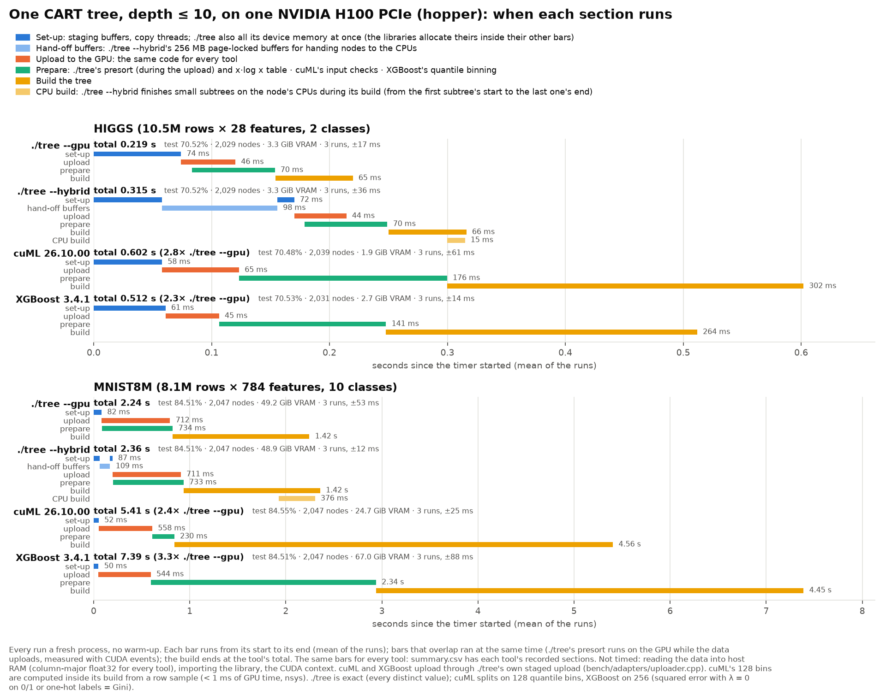

# GPU vs others: ./tree against cuML and XGBoost on HIGGS and MNIST8M (CART)

One CART tree per run, depth ≤ 10, no pruning, on every training row and feature, on hopper's H100 PCIe 80 GB (GPU 2) with every CPU of the node. ./tree `--gpu` and `--hybrid`, cuML and XGBoost run in one `bench/run.py` per dataset, their runs interleaved in a new shuffled order each repetition. Every run is a fresh process that builds exactly one tree with no warm-up. Every tool uploads its data through the same code, and the time of each step is recorded.

**Draft data (2026-11-18, job 393, 3 runs a case, built from uncommitted code `d669b05ad862-dirty`):** the protocol below. The chart marks these runs as out of date until the rerun of `final.sh -k gpulibs` (10 runs). The earlier protocol (each library uploading in its own way, a warm variant, forests of 10, the A100 node) is in git history up to 8ba60fae.



```bash
bench/cluster/final.sh -k gpulibs   # queues the runs on hopper (needs ~/gpu-dt-bench/venv and bench/.tools/libuploader.so)
bench/cluster/charts.sh             # among them gpu_steps_chart.py: chart.png, summary.csv
```

## Results

Mean of 3 runs on the H100, in seconds. Each step in time order; in ./tree, `upload` also contains its presort, which runs on the GPU during the upload.

| | ./tree --gpu | ./tree --hybrid | cuML 26.10 | XGBoost 3.4.1 |
|---|--:|--:|--:|--:|
| **HIGGS** total | **0.220** | 0.311 | 0.589 (2.7×) | 0.519 (2.4×) |
| set-up | 0.076 | 0.167 | 0.059 | 0.061 |
| upload | 0.043 (+ presort) | 0.041 (+ presort) | 0.062 | 0.044 |
| prepare / tables | 0.035 | 0.035 | 0.165 | 0.147 |
| build | 0.066 | 0.068 | 0.302 | 0.266 |
| test accuracy, nodes | 70.52%, 2,029 | 70.52%, 2,029 | 70.48%, 2,039 | 70.53%, 2,031 |
| VRAM | 3.3 GiB | 3.3 GiB | 1.9 GiB | 2.7 GiB |
| **MNIST8M** total | **2.258** | 2.370 | 5.383 (2.4×) | 7.443 (3.3×) |
| set-up | 0.089 | 0.197 | 0.051 | 0.045 |
| upload | 0.722 (+ presort) | 0.719 (+ presort) | 0.545 | 0.558 |
| prepare / tables | 0.029 | 0.029 | 0.204 | 2.338 |
| build | 1.419 | 1.425 | 4.572 | 4.498 |
| test accuracy, nodes | 84.51%, 2,047 | 84.51%, 2,047 | 84.55%, 2,047 | 84.51%, 2,047 |
| VRAM | 49 GiB | 49 GiB | 25 GiB | 67 GiB |

(×: slower than ./tree --gpu.)

- **The build is where ./tree wins:** 4.6× cuML and 4.0× XGBoost on HIGGS, 3.2× both on MNIST8M. The upload is the same code for every tool (about 47 GB/s on MNIST8M; HIGGS's 1.2 GB is too short a copy to reach full speed), so it does not decide the result.
- **./tree's upload with its presort takes longer on MNIST8M** (0.72 s against the libraries' 0.55 s for the same 25.4 GB): the presort of 784 features runs on the GPU during the copies and slows them. Without the overlap the presort would come after the upload, so the overlap still saves time.
- **--hybrid's set-up is 0.1 s longer** than --gpu's: it also allocates its 256 MB of page-locked hand-off buffers. Its build is the same as --gpu's on these two datasets.
- **cuML's prepare (0.17–0.20 s)** is its input checks (NaN/inf scan, the classes) and the lazy loading of the kernels it uses. Its binning is inside `build`: `nsys` shows that cuML computes its 128 quantiles from a row sample, which takes about 0.2 ms of GPU time on both datasets, so its `build` is the tree.
- **XGBoost's prepare is its quantile binning** (`QuantileDMatrix`): 0.15 s on HIGGS, 2.3 s on MNIST8M (784 features). Its raw device copy is then freed: on MNIST8M it does not fit next to the multi-output tree's histograms.
- **The same tree:** XGBoost's tree on MNIST8M is ./tree's tree (2,047 nodes, the same test accuracy). On HIGGS the libraries' trees differ in a few nodes because of their bins (128 and 256 quantiles; ./tree tests every distinct value). Test accuracy is within 0.05 points.
- **VRAM:** ./tree keeps presorted 8-byte entries for every value (49 GiB on MNIST8M). cuML keeps its bins and needs half as much. XGBoost needs the most (67 GiB) for its multi-output histograms (10 classes × 784 features × 256 bins per node), even with its histogram cache limited to 128 nodes.

## What is compared

**CART only.** No public GPU implementation of C4.5 exists, and an entropy (information-gain) tree is not C4.5, so ./tree's C4.5 has no GPU competitor here. Both libraries split only at the edges of a fixed number of quantile bins per feature; ./tree tests every distinct value.

| Implementation | Version | Settings |
|---|---|---|
| **./tree --gpu** and **--hybrid** | the commit under test | `--cart -d 10` (exact Gini), no pruning, every CPU of the node (`--hybrid` finishes small subtrees on them) |
| **cuML** `RandomForestClassifier` | 26.10 | `n_estimators=1, bootstrap=False, max_samples=1.0, max_features=1.0, n_bins=128, max_depth=10, split_criterion="gini", n_streams=1` |
| **XGBoost** | 3.4.1, `device="cuda", tree_method="hist"` | `reg:squarederror`, `eta=1, lambda=0, alpha=0, gamma=0, min_child_weight=1`, `max_bin=256`, `max_depth=10`, `grow_policy="depthwise"`, one round. On 0/1 labels the gain is n/2 × the drop in Gini impurity, so this is CART on the bins. MNIST8M (10 classes): one multi-output tree (`multi_strategy="multi_output_tree"`, `max_cached_hist_node=128`) on one-hot labels, whose summed squared error is again n/2 × the Gini drop. |

## The protocol

The same for every tool:

- **Not timed:** reading the files into host RAM as float32, column-major (./tree's loader holds its data column-major; the libraries get `np.asfortranarray`), and the labels (XGBoost's float32 or one-hot labels are made here); importing the library; the CUDA context alone (`cudaFree(0)`; ./tree makes it on a thread while the input loads). `CUDA_MODULE_LOADING=LAZY`, CUDA's default: each tool loads the kernels it uses inside the timed part.
- **Timed:** from the host arrays to the finished tree. Every step boundary waits for the GPU (`cudaDeviceSynchronize`), so asynchronous work is counted in the step that started it.

| Step | ./tree (`train total`, printed in parts) | cuML, XGBoost (`scripts/gpubench.py`) |
|---|---|---|
| set-up | `setup buffers` (page-locked staging buffers, copy threads; `--hybrid` also its hand-off buffers) + `setup allocate` (device memory) | `buffers`: the same staging buffers and copy threads (`bench/adapters/uploader.cpp`, a C++ copy of ./tree's `uploadStaged`) |
| upload | `setup upload`: labels and columns through the staging buffers, each feature presorted on the GPU as soon as it arrives (two lanes on the chart) | `upload`: labels and values through `uploader.cpp` into a column-major device array |
| prepare | `setup finish`: the x·log x tables and host arena (drawn as set-up) | cuML: its input checks (`_prepare_fit_inputs`); XGBoost: `QuantileDMatrix(max_bin=256)`, then the raw device copy is freed |
| build | `build` (all levels, the hand-offs, the CPU subtrees, the host tree) | cuML: `_fit_forest` (its row-sample quantiles, then the tree); XGBoost: `xgb.train`, one round |

- **The upload:** 4 page-locked 32 MB buffers on the GPU's NUMA node, up to 32 copy threads pinned to that node's CPUs, each 32 MB chunk copied in parallel into a free buffer, then an asynchronous copy to the GPU. cuML and XGBoost call the same algorithm through `ctypes` (`bench/.tools/libuploader.so`, built by `bench/cluster/build.sh`), so neither library is slowed by its own pageable copy and ./tree gets no advantage from its upload.
- **Not timed, after the tree:** prediction, accuracy, the tree walk (nodes, depth, root split).
- **Runs:** one `bench/run.py` per dataset with `--impls tree_gpu_only,tree_cuda,cuml,xgboost`; each repetition runs every tool once in a new shuffled order. Every process runs on all CPUs of the node, the GPU's NUMA node first; the job owns the node (`--exclusive`).
- **VRAM:** peak GPU memory in use above idle, sampled from outside every 20 ms with `nvidia-smi`, for the whole process, the same for every tool.
- **GPU:** hopper's GPU 2 (H100 PCIe 80 GB), by rule (`bench/cluster/job.sh`); a run on another GPU is marked out of date.
- **Test sets:** HIGGS the last 500,000 rows (UCI's split), MNIST8M the original MNIST test set (10,000).

## Run it by hand

cuML needs its own venv (`GPU_PYTHON`, default `~/gpu-dt-bench/venv/bin/python`; the pinned versions are in [`scripts/requirements-freeze.txt`](scripts/requirements-freeze.txt)):

```bash
# on the mordor3 login node, once
/usr/bin/virtualenv -p python3 ~/gpu-dt-bench/venv       # python3-venv is missing on mordor3
~/gpu-dt-bench/venv/bin/pip install -r bench/results/cluster-gpu-vs-others/scripts/requirements-freeze.txt \
  --extra-index-url=https://pypi.nvidia.com
# a plan line for bench/cluster/batch.sh (final.sh writes these)
- cluster-gpu-vs-others/one-tree vs-hopper-higgs higgs tree_gpu_only,tree_cuda,cuml,xgboost 10 cart_depth10 all 14400 ACCURACY=--test-accuracy
```

## Files

| File | Content |
|---|---|
| `chart.png` | HIGGS and MNIST8M: each tool's time in its steps, with test accuracy, nodes, VRAM and spread (`bench/gpu_steps_chart.py`) |
| `summary.csv` | one row per dataset and tool: mean, standard deviation, runs, min, max, each step's mean, VRAM, test accuracy, nodes, commit |
| `one-tree/vs-hopper-<dataset>/` | the run folders: `results.jsonl` (every run of every tool, each step's time), `plan.json`, `machine.json`, `run.log`, and `report.md`, `runs.csv`, `summary.csv` from `bench/report.py` |
| `scripts/gpubench.py` | one cuML or XGBoost run (called by `bench/run.py`) |
| `scripts/requirements-freeze.txt` | the venv's pinned versions |
