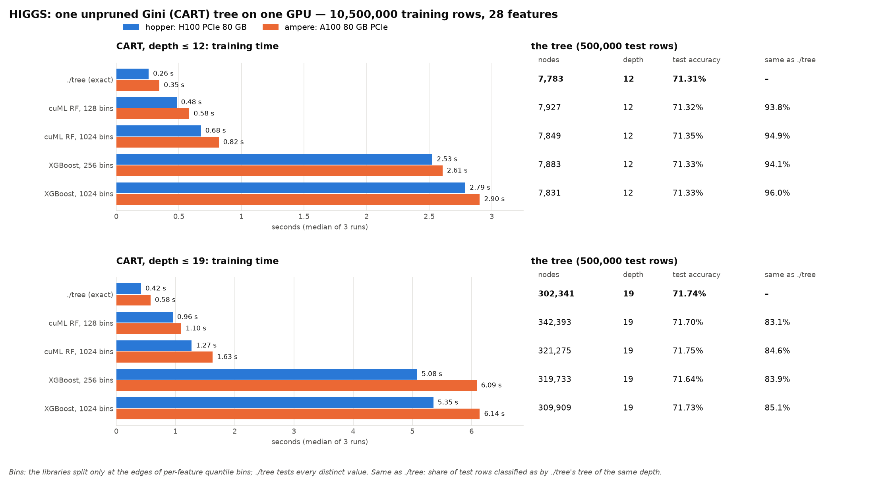

# HIGGS on the mordor3 GPUs: ./tree against other GPU decision-tree builders

**Status:** run on 2026-10-15, 3 runs per case. ./tree is at commit 35cf315, built for sm_80 and sm_90 in a separate clone (`~/gpu-dt-bench/dt`). Both GPU servers ran CUDA only, on GPU 0, with the whole node held through `--exclusive`. **Two cases: one unpruned CART tree with depth ≤ 12 and with depth ≤ 19** (19 is the depth of ./tree's pruned CART tree on HIGGS).

**Bottom line:** ./tree is the fastest single-tree GPU builder found, and the only one with exact splits.
- **Against cuML (the fastest of the others):** 1.7–2.3× faster.
- **Against XGBoost:** 8–13× faster.
- **Test accuracy is the same.** It is within about 0.1 points for every tool at the same depth.
- **The trees differ in their details.** Histogram thresholds change the deeper splits: 94–96% of test rows are classified the same as ./tree at depth 12, and 83–85% at depth 19. The other libraries agree with each other no better than they agree with ./tree.



**Bins:** cuML and XGBoost don't test every possible split. Before growing the tree, they sort each feature's values into a fixed number of ranges (bins) with about the same number of rows each, and split only at bin edges. That gives at most 127 or 1,023 candidate thresholds per feature. ./tree tests every distinct value, which on HIGGS is millions per feature. More bins means finer thresholds, but slower training.

## What is compared, and why only CART

I found no public CUDA implementation of C4.5. The GPU C4.5 papers (CUDT, GPU C4.5 for traffic classification) publish no code, and Weka's GPUTree package (Java with CUDA, numeric attributes only) was not tried. Every GPU tree library still in use builds **binary, Gini or second-order-gain trees on histogram bins**. So the comparison is CART: the same split criterion, but with approximate thresholds.

| Implementation | Version | How it builds one CART tree |
|---|---|---|
| **./tree --cuda** | 35cf315 | Exact Gini splits over every distinct value (presorted). |
| **cuML** `RandomForestClassifier` | 26.10 (RAPIDS, pip `cuml-cu12`) | `n_estimators=1, bootstrap=False, max_features=1.0, split_criterion="gini"`, `n_bins` 128 (default) or 1024. Thresholds are per-feature quantiles. |
| **XGBoost** | 3.4.1, `device="cuda", tree_method="hist"` | One round of `reg:squarederror` on the 0/1 label with `eta=1, lambda=0, alpha=0, gamma=0, min_child_weight=1`, `base_score` = the class-1 share. Every row has hessian 1, so the gain is the drop in squared error, which is n/2 × the drop in Gini impurity: **the CART split, on histogram bins** (`max_bin` 256 by default, or 1024). `depthwise` growth to the depth limit. |
| CudaTree | 0.6 (2013) | **Not run.** It is Python 2 code, and its kernels use texture references, which CUDA 12 removed. |

Settings shared by every case: all 10,500,000 training rows and all 28 features, no bootstrap or feature sampling, at least 1 row per leaf, no pruning. The cases are **depth ≤ 12** and **depth ≤ 19**. Accuracy is measured on HIGGS's own test set, the published split's last 500,000 rows, which no tool trains on; no extra 80/20 split is needed.

### Measurement

- **Time:** from host memory to the finished tree.
  - **./tree:** its `train total` (GPU setup and upload, presort, build). Reading the CSV isn't timed, and the CUDA context is created while the CSV loads. Each run is a fresh process.
  - **Libraries:** one Python process per case. The process first runs one untimed warm-up fit on 50,000 rows (imports, CUDA context, JIT), then 3 timed fits on the full float32 NumPy arrays.
  - **What a library fit includes:** the copy to the GPU and the binning. That is `QuantileDMatrix` for XGBoost; cuML bins inside `fit`.
- **Accuracy:** each library's own `predict`. ./tree's test accuracy comes from its `--dump` tree (`treebench.py`, the same walk as `bench/benchlib.py`).
- **Same as ./tree:** the share of the 500,000 test rows a tree classifies the same as ./tree's tree in the same case.
- **GPU memory:** peak `memory.used` of GPU 0 (nvidia-smi every 20 ms). It includes the CUDA context and memory pools.
- **Determinism:** every tree is identical on the H100 and the A100.

| Node | CPU | GPU (GPU 0 used) | Driver, CUDA |
|---|---|---|---|
| hopper | 2× Xeon Gold 6444Y, 32 cores | H100 PCIe 80 GB | 615.71.09, CUDA 12.9 |
| ampere | 2× EPYC 7402, 48 cores | A100 80 GB PCIe | 615.71.09, CUDA 12.9 |

## Results

Median of 3 runs (min–max). The node count, depth and accuracies are for the last run's tree, which is the same on both GPUs. The root split is `feature <= threshold` (XGBoost: `<`).

### CART, depth ≤ 12

| Implementation | H100 time | A100 time | Nodes | Depth | Train acc. | Test acc. | Same as ./tree | GPU mem. (H100) | Root split |
|---|--:|--:|--:|--:|--:|--:|--:|--:|---|
| ./tree (exact) | 0.26 s (0.26–0.26) | 0.35 s (0.34–0.35) | 7,783 | 12 | 71.63% | 71.31% | – | 5,089 MiB | `f25 <= 1.077748` |
| cuML RF, 128 bins | 0.48 s (0.48–1.60) | 0.58 s (0.58–1.66) | 7,927 | 12 | 71.55% | 71.32% | 93.80% | 1,929 MiB | `f25 <= 1.080328` |
| cuML RF, 1024 bins | 0.68 s (0.67–1.75) | 0.82 s (0.82–1.75) | 7,849 | 12 | 71.61% | 71.35% | 94.95% | 2,447 MiB | `f25 <= 1.073738` |
| XGBoost, 256 bins | 2.53 s (2.42–2.70) | 2.61 s (2.59–2.63) | 7,883 | 12 | 71.59% | 71.33% | 94.08% | 2,929 MiB | `f25 < 1.075816` |
| XGBoost, 1024 bins | 2.79 s (2.79–3.22) | 2.90 s (2.89–2.97) | 7,831 | 12 | 71.61% | 71.33% | 96.00% | 4,429 MiB | `f25 < 1.072648` |

### CART, depth ≤ 19

| Implementation | H100 time | A100 time | Nodes | Depth | Train acc. | Test acc. | Same as ./tree | GPU mem. (H100) | Root split |
|---|--:|--:|--:|--:|--:|--:|--:|--:|---|
| ./tree (exact) | 0.42 s (0.41–0.42) | 0.58 s (0.55–0.58) | 302,341 | 19 | 77.85% | 71.74% | – | 5,097 MiB | `f25 <= 1.077748` |
| cuML RF, 128 bins | 0.96 s (0.90–2.19) | 1.10 s (1.05–2.10) | 342,393 | 19 | 77.78% | 71.70% | 83.12% | 1,901 MiB | `f25 <= 1.080328` |
| cuML RF, 1024 bins | 1.27 s (1.26–2.49) | 1.63 s (1.61–2.69) | 321,275 | 19 | 77.86% | 71.75% | 84.56% | 2,461 MiB | `f25 <= 1.073738` |
| XGBoost, 256 bins | 5.08 s (5.00–5.25) | 6.09 s (6.03–6.09) | 319,733 | 19 | 77.79% | 71.64% | 83.95% | 2,971 MiB | `f25 < 1.075816` |
| XGBoost, 1024 bins | 5.35 s (5.28–5.61) | 6.14 s (6.07–6.25) | 309,909 | 19 | 77.85% | 71.73% | 85.09% | 6,813 MiB | `f25 < 1.072648` |

## Observations

- **./tree is the fastest at both depths, and the gap grows with the tree.**
  - **Depth 12:** 0.26 s (H100) against 0.48 s for cuML and 2.5 s for XGBoost.
  - **Depth 19:** 0.42 s against 0.96 s for cuML and 5.1 s for XGBoost.
- **More bins don't make the others exact.**
  - **Cost:** cuML with 1024 bins is 1.3–1.5× slower than with 128, and XGBoost with 1024 bins 1.0–1.1× slower than with 256.
  - **Benefit:** agreement with ./tree rises by only 1–2 points. HIGGS has millions of distinct values per feature, so 1024 quantiles still put thresholds elsewhere. Even the root threshold differs (./tree 1.077748, cuML 1.080328 or 1.073738, XGBoost 1.075816 or 1.072648).
- **Same accuracy, different trees.**
  - **Test accuracy:** depth 12, 71.31–71.35% for every tree; depth 19, 71.64–71.75%.
  - **Tree size:** about the same. Depth 12 gives 7,783 nodes for ./tree and 7,831–7,927 for the others; depth 19 gives 302,341 against 309,909–342,393.
  - **Agreement with ./tree:** 94–96% of test rows at depth 12, 83–85% at depth 19.
  - **Agreement between libraries:** the libraries agree with each other just as little (cuML 128 bins against XGBoost 256 bins: 93.8% and 83.1%). The deeper splits fit noise, so any threshold change moves them. Exact implementations give the same tree: ./tree's CART matched scikit-learn's except at exact ties when it was checked on 2026-10-13. The histogram libraries cannot.
- **H100 against A100:** ./tree is 1.35–1.4× faster on the H100. The libraries are 1.0–1.3× faster on it.
- **Memory:** ./tree peaks at about 5 GB on the GPU in both cases, as in [cluster-higgs](../cluster-higgs/BENCHMARK.md). cuML uses 1.9–2.5 GB. XGBoost uses 2.9–6.8 GB and grows with bins and depth.
- **First-run cost:** cuML's first full-size fit in each process took 0.9–1.2 s longer (max column), probably because its memory pool grows past the 50k-row warm-up size. The medians leave it out.

## Run it

Everything runs on mordor3 in `~/gpu-dt-bench`, outside this repository. Every computation is a SLURM job on hopper or ampere, with `--exclusive`. The scripts are in [`scripts/`](scripts/). The data is the prepared HIGGS of [bench/cluster](../../cluster/README.md) (`~/dt/bench/data/higgs`: `train.csv` for ./tree, `train.f32`/`train.y.i32` and `test.*` for the libraries; the path is set by `HIGGS_DIR`).

```bash
# on the mordor3 login node: a clone at the measured commit, the venv, the sources
mkdir ~/gpu-dt-bench && cd ~/gpu-dt-bench
cp /path/to/scripts/* .                      # build.sh job.sh gpubench.py treebench.py summarize.py
git clone ~/dt dt && git -C dt checkout 35cf315
/usr/bin/virtualenv -p python3 venv          # python3-venv is missing on mordor3
venv/bin/pip install --extra-index-url=https://pypi.nvidia.com cuml-cu12 xgboost matplotlib
sbatch build.sh                              # ./tree for sm_80 + sm_90
# the benchmark: about 5 min per node
# only some libraries: IMPLS="cuml xgboost" sbatch --export=ALL ... job.sh <node>
sbatch -p hopper --exclusive -t 00:30:00 -o results/hopper/job.log job.sh hopper
sbatch -p ampere --exclusive -t 00:30:00 -o results/ampere/job.log job.sh ampere
```

Then, anywhere with numpy and matplotlib, the tables (`tables.md`), `summary.csv` and `chart.png`:

```bash
venv/bin/python summarize.py results <out dir>
```

- **Results and logs:** the jobs write `results/<node>/results.jsonl` (one line per timed run), `machine.json`, `failed.jsonl` (cases that crashed, if any) and the job logs. `results.jsonl` and `machine.json` are in `hopper/` and `ampere/` here; the job logs stay on mordor3 (`~/gpu-dt-bench/results/<node>/job.log`).
- **Predictions:** the test-set predictions in `results/<node>/pred/` (0.5 MB per tree) are not kept in the repository.
- **Never `scancel` a running `job.sh` started without `timeout --foreground`.** `timeout` puts the benchmark in its own process group, and SLURM's kill on mordor3 left it running, which happened once here. `job.sh` now uses `--foreground`. To stop a case, kill it from inside the job: `srun --jobid=<id> --overlap -n1 kill <pid>`.
- **What was removed:** the first run also covered trees with no depth limit, ./tree's pruned CART and C4.5, and LightGBM. LightGBM was dropped because its CUDA version ignores the depth limit, so its trees were not comparable. Those rows were removed from `results.jsonl` and from `scripts/`, which now run only what is shown here; only the job logs on mordor3 still show those runs. The scripts' edits only removed code paths that the cuML, XGBoost and ./tree depth-12 and depth-19 cases never take.
- **Pinned versions:** `scripts/requirements-freeze.txt`.

## Files

| File | Content |
|---|---|
| `chart.png` | Training time per library, depth and GPU, with each tree's node count, depth, test accuracy and agreement with ./tree |
| `summary.csv` | One row per node, case and library: times, tree size, accuracies, agreement, GPU memory, root split |
| `hopper/`, `ampere/` | `results.jsonl` (every run), `machine.json` |
| `scripts/` | `build.sh`, `job.sh` (SLURM), `gpubench.py` (cuML, XGBoost), `treebench.py` (./tree), `summarize.py` (tables and chart), `requirements-freeze.txt` |
