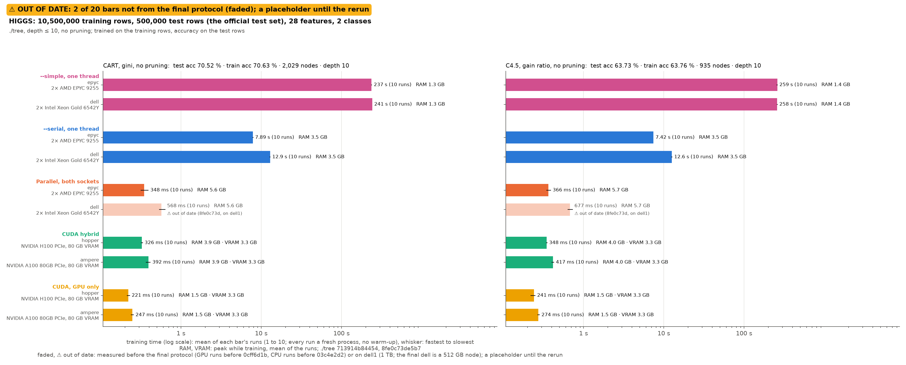

# HIGGS (28 features): training set and test set

./tree only, trained on the training rows and scored on the test rows
([bench/cluster/README.md](../../cluster/README.md#test-set-benchmarks)).

- **Training rows:** the first 10,500,000 rows.
- **Test rows:** the last 500,000, UCI's test set.
- **Protocols:** depth ≤ 10, CART (gini) and C4.5 (gain ratio), both without pruning.
- **Runs:** CUDA `--hybrid` and `--gpu` (GPU only) on hopper (H100) and ampere (A100 80 GB), with every CPU of the node; on epyc (2× EPYC 9255) and dell (2× Xeon Gold 6542Y): `--multicore` on both sockets (48 threads), `--serial` and `--simple` (one thread). 10 runs a case, each a fresh process with no warm-up, in a shuffled, interleaved order.
- **Builds:** ./tree at 8fe0c73d (CPU runs) and e55af94f (GPU runs: the same tree code plus `--gpu-startup`), one build for every node, run on 2026-11-17 by `bench/cluster/final.sh -D higgs,susy` ([bench/cluster/README.md](../../cluster/README.md#the-final-rerun)): `--multicore` on epyc1 and dell1, `--serial` on epyc2 and dell3, `--simple` on epyc1 and dell3, CUDA on hopper and ampere. The GPU runs time ./tree's GPU setup (kernel loading, memory pool, page-locked staging buffers, copy threads) by the rule every GPU tool follows: only the bare CUDA context is untimed (`--gpu-startup context`, [bench/README.md](../../README.md#how-time-is-measured)). The 2026-11-15 runs (f53347a9, 5 runs a case) are in git at 7d906f7d.
- **Measured:** ./tree's training time (presort, build; not reading the CSV), peak RAM while training, peak VRAM; the tree's test and training accuracy, nodes, depth and SHA-256.
- **Chart:** `chart.png`, `bench/testset_chart.py` (log scale).

## Results

Every run of a case grew the same tree (the same `tree_sha256`). The tables give the mean of ./tree's training time (`bench/testset_chart.py --table`); "runs" is the number of runs of the case, also on the chart.

- **Speed:** the H100 takes 311–340 ms: 246–256 ms of GPU setup (kernel loading, memory pool, staging buffers; a fixed cost, about 0.17 s even on the 200-row baseline set) and 65–83 ms of build. That is only 1.08–1.12× faster than epyc's `--multicore` (348 and 366 ms); the A100 (394–445 ms) is slower than epyc. dell takes 568 and 677 ms, 1.6–1.9× epyc. Hybrid and GPU only are within 2–7% of each other at depth 10.
- **Serial and simple:** `--serial` takes 7.89 s (CART) and 7.42 s (C4.5) on epyc, 20–23× `--multicore`, and 12.9 s and 12.6 s on dell. `--simple` takes 237–259 s on both: 30–35× `--serial` on epyc, 19–20× on dell.
- **Against the 2026-11-15 runs (7d906f7d):** the CPU runs are within ±7% (the same tree code). The GPU runs take 0.18–0.26 s more: the setup that was untimed before (see Builds).
- **Accuracy:** CART reaches 70.5% on the test set, C4.5 63.7%.
- **Memory:** VRAM 3.3 GB. GPU only needs 1.7–1.8 GB of RAM, hybrid 4.0 GB, `--multicore` 5.7 GB, `--serial` 3.5 GB, `--simple` 1.4 GB.

| Protocol | test acc | train acc | nodes | depth |
|---|---|---|---|---|
| CART, no pruning | 70.52% | 70.63% | 2,029 | 10 |
| C4.5, no pruning | 63.73% | 63.76% | 935 | 10 |

| Run | runs | CART | C4.5 | RAM GB (peak) | VRAM GB (peak) |
|---|---|---|---|---|---|
| epyc, --simple, one thread | 10 | 237 s | 259 s | 1.4 | – |
| dell, --simple, one thread | 10 | 241 s | 258 s | 1.4 | – |
| epyc, --serial, one thread | 10 | 7.89 s | 7.42 s | 3.5 | – |
| dell, --serial, one thread | 10 | 12.9 s | 12.6 s | 3.5 | – |
| epyc, parallel, both sockets | 10 | 348 ms | 366 ms | 5.7 | – |
| dell, parallel, both sockets | 10 | 568 ms | 677 ms | 5.7 | – |
| hopper, CUDA hybrid | 10 | 318 ms | 340 ms | 4.0 | 3.3 |
| ampere, CUDA hybrid | 10 | 418 ms | 435 ms | 4.0 | 3.3 |
| hopper, CUDA, GPU only | 10 | 311 ms | 335 ms | 1.8 | 3.3 |
| ampere, CUDA, GPU only | 10 | 394 ms | 445 ms | 1.7 | 3.3 |
