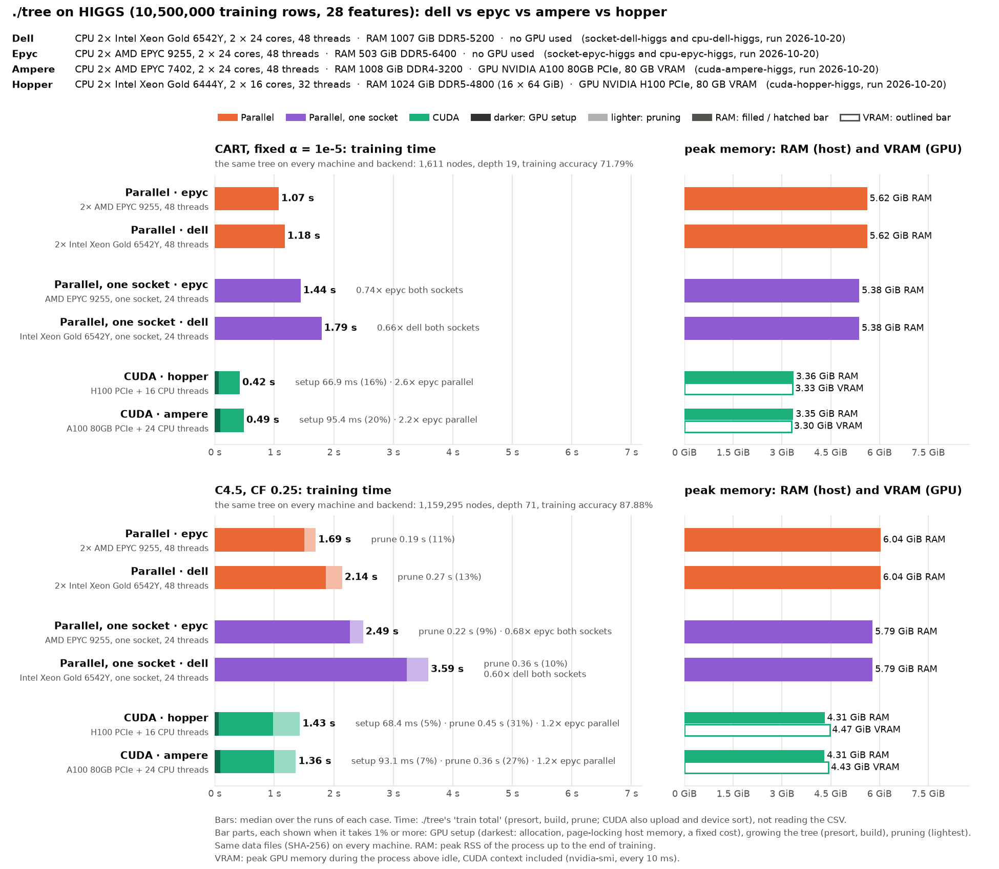

# HIGGS on the mordor3 cluster: ./tree parallel and CUDA on five servers

**Status:** run on 2026-10-14 from 16:03, 3 runs per case, at commit 16cc93b, with the defaults tuned for these servers ([docs/PERFORMANCE.md](../../../docs/PERFORMANCE.md)).
- **Nodes:** each node ran alone and was used whole. The runs started together on hopper, ampere, turing and epyc1; dell1 started a minute later.
- **Commits:** machine.json records 5f4f955, or 36c6b7c for dell1. Both are 16cc93b plus changes to `bench/cluster/` only.
- **Same trees:** every case built the same tree on every node and backend as the first cluster run (before tuning, below) and as the desktop and laptop.

How the runs are made and what is specific to the cluster: [bench/cluster/README.md](../../cluster/README.md).

| Run | Node | CPU | RAM | GPU (GPU 0 used) | Backends |
|---|---|---|---|---|---|
| `cuda-hopper-higgs` | hopper | 2× Xeon Gold 6444Y, 32 cores | 1 TB DDR5-4800 | H100 PCIe 80 GB | parallel (32 threads), CUDA |
| `cuda-ampere-higgs` | ampere | 2× EPYC 7402, 48 cores | 1 TB DDR4-3200 | A100 80 GB PCIe | parallel (48 threads), CUDA |
| `cuda-turing-higgs` | turing | Threadripper 1950X, 16 cores, SMT on | 128 GB DDR4-2667 | RTX 2080 Ti 11 GB | parallel (32 threads), CUDA |
| `cpu-epyc-higgs` | epyc1 | 2× EPYC 9255 (Zen 5), 48 cores | 512 GB DDR5-6400 | – | parallel (48 threads) |
| `cpu-dell-higgs` | dell1 | 2× Xeon Gold 6542Y, 48 cores | 1 TB DDR5-5200 | – | parallel (48 threads) |

## Results

Each bar is ./tree's training time (`train total`: GPU setup, presort, build and pruning, not reading the CSV). Its lighter part is the pruning.

Training time, median of 3 runs (min–max), and how much of it is pruning:

| | CART | C4.5 | of which C4.5 pruning |
|---|--:|--:|--:|
| Parallel · hopper (Xeon 6444Y, 32 threads) | 1.43 s (1.42–1.47) | 2.83 s (2.82–2.86) | 0.55 s |
| Parallel · ampere (EPYC 7402, 48 threads) | 2.08 s (2.05–2.09) | 3.92 s (3.83–3.93) | 0.56 s |
| Parallel · turing (Threadripper 1950X, 32 threads) | 3.67 s (3.63–3.67) | 6.78 s (6.77–6.86) | 0.68 s |
| Parallel · epyc (EPYC 9255, 48 threads) | 1.03 s (1.03–1.05) | **1.82 s** (1.81–1.85) | 0.26 s |
| Parallel · dell (Xeon 6542Y, 48 threads) | 1.21 s (1.20–1.25) | 2.33 s (2.30–2.38) | 0.34 s |
| CUDA · hopper (H100 PCIe + 32 threads) | **0.42 s** (0.41–0.42) | **1.37 s** (1.33–1.37) | 0.56 s |
| CUDA · ampere (A100 80GB PCIe + 48 threads) | 0.60 s (0.58–0.62) | 1.43 s (1.40–1.45) | 0.55 s |
| CUDA · turing (RTX 2080 Ti + 32 threads) | 1.91 s (1.86–1.94) | 3.75 s (3.69–3.85) | 0.69 s |

CART prunes in 1–2 ms: its tree is no longer grown beyond what pruning keeps (below).

### Before and after tuning

The first cluster run was made at 12:45 on the same nodes, 3 runs per case, with the code before tuning (commit ab8ebdd); turing was added at 14:42. Its files are no longer in the repository: commit 781f28b still has them (`bench/results/cluster-higgs/before/`).

| Median of 3 | CART before → after | C4.5 before → after |
|---|--:|--:|
| Parallel · hopper | 2.19 s → **1.43 s** (1.5×) | 3.51 s → **2.83 s** (1.2×) |
| Parallel · ampere | 3.42 s → **2.08 s** (1.6×) | 5.20 s → **3.92 s** (1.3×) |
| Parallel · turing | 5.01 s → **3.67 s** (1.4×) | 7.41 s → **6.78 s** (1.1×) |
| Parallel · epyc | 1.91 s → **1.03 s** (1.9×) | 2.43 s → **1.82 s** (1.3×) |
| Parallel · dell | 1.96 s → **1.21 s** (1.6×) | 2.85 s → **2.33 s** (1.2×) |
| CUDA · hopper | 1.14 s → **0.42 s** (2.7×) | 2.33 s → **1.37 s** (1.7×) |
| CUDA · ampere | 1.34 s → **0.60 s** (2.2×) | 2.48 s → **1.43 s** (1.7×) |
| CUDA · turing | 2.76 s → **1.91 s** (1.4×) | 4.42 s → **3.75 s** (1.2×) |

Hopper's CPU times drift during the day (bench/cluster/README.md). The same comparison inside one job, old and new binaries interleaved, gave 1.6–2.8× on hopper (CUDA) and 1.4–1.8× on epyc ([docs/PERFORMANCE.md](../../../docs/PERFORMANCE.md)).

What changed:
- **CART stops early.** With a fixed α, a node with fewer than α · n training errors is not split, because pruning would cut it back anyway. This grows 116 thousand instead of 2.2 million nodes, and gives the same pruned tree.
- **Fewer thread wake-ups.** Features are scanned in parallel only from 32768 rows (was 4096): the 48-core nodes spent a third of their CPU time in the kernel waking threads.
- **Huge pages** for every large array (`madvise`, which these nodes require).
- **GPU.** The dataset is page-locked properly for the upload (55 instead of 10 GB/s on the H100), and the hand-off to the CPU grows with the dataset (rows / 4096).
- **Parallel tree passes.** The passes over the whole tree (copy, compaction, C4.5's collapse and the pruning's bookkeeping) now run on all threads.

## Observations

- **Same trees:** CART 1,611 nodes, depth 19, test accuracy 71.59%; C4.5 1,159,295 nodes, depth 71, test accuracy 70.10%. These hold on every node and backend, before and after tuning.
- **CART:** the H100 takes 0.42 s, 3.4× hopper's own 32 cores and 2.5× the fastest CPU node (epyc, 1.03 s). The A100 is close behind (0.60 s). Only 1.2 GB of data moves to the GPU, so the GPU setup (0.1 s) and the per-level round trips are a large part of these times.
- **C4.5:** the H100 and the A100 take 1.37 and 1.43 s, 1.3× epyc's 48 Zen 5 cores (1.82 s). About 40% of a CUDA run is now pruning, 0.55 s on the host CPU. The 1.16-million-node tree's small subtrees also grow on the host. Both GPU nodes have slower CPUs than epyc: in a serial CART build, hopper's single thread was about half as fast as epyc's (18.2 against 9.5 s).
- **CPU nodes:** epyc is the fastest CPU node: CART 1.03 s, C4.5 1.82 s. Dell is 15–30% behind, and the older nodes far behind: ampere's Zen 2 at 2.0–2.2× epyc's time, turing's Zen 1 (16 cores) at 3.6–3.7×. Turing gained the least from the tuning (1.1–1.4×). The likely reason is that it has the fewest cores, so waking threads cost it the least to begin with.
- **Against the laptop and desktop** (CART, before this tuning, so not the same code: [`cuda-legion-higgs`](../cuda-legion-higgs/), [`cpu-pc-higgs`](../cpu-pc-higgs/)): they took 1.37 s on the RTX 5070 Laptop GPU, 3.22 s on the laptop's 20 threads and 3.47 s on the desktop's 28. The tuning was done on the cluster; the new defaults were not measured on them.
- **Memory:** the same on every node. Parallel: 5.7 GiB (CART) and 7.1 GiB (C4.5) peak RSS. CUDA: 3.5 / 5.0 GiB RSS plus 4.7–5.0 GiB on the GPU, CUDA context included.
