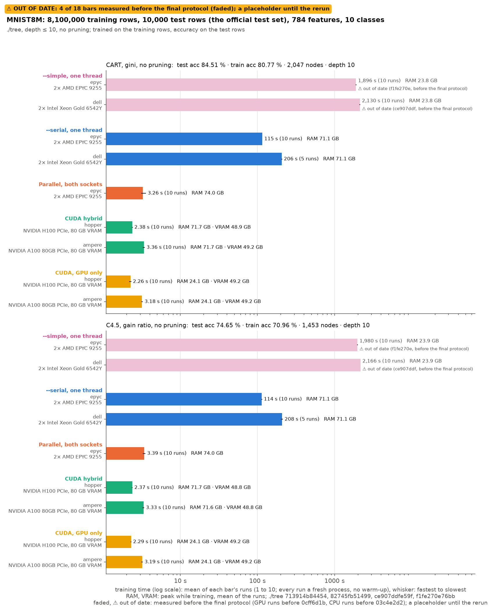

# MNIST8M (784 features, 10 classes): training set and test set

./tree only, trained on the training rows and scored on the test rows
([bench/cluster/README.md](../../cluster/README.md#test-set-benchmarks)).

- **Training rows:** infinite MNIST's 8,100,000 distorted digits (LIBSVM `mnist8m`), 784 pixel features (0–255).
- **Test rows:** the original MNIST test set, 10,000 rows (LIBSVM `mnist.t`).
- **Protocols:** depth ≤ 10, CART (gini) and C4.5 (gain ratio), both without pruning.
- **Runs:** CUDA `--hybrid` and `--gpu` (GPU only) on hopper (H100) and ampere (A100 80 GB), with every CPU of the node; on epyc (2× EPYC 9255) and dell (2× Xeon Gold 6542Y): `--multicore` on both sockets (48 threads), `--serial` and `--simple` (one thread). Runs per case: 5, `--simple` 10.
- **Builds:** ./tree at f53347a9 (`src/` = d2957ff2: presort of big columns in cache, GPU tiles without a cut skipped, CART bound per node), one build for every node, run on 2026-11-15/16 by `bench/cluster/final.sh -m 5` ([bench/cluster/README.md](../../cluster/README.md#the-final-rerun)): `--multicore` and CUDA on epyc1, dell1, hopper and ampere, `--serial` spread over epyc1/epyc2 and dell1/dell2/dell3 (the same hardware). `--simple` was not rerun, its code has not changed: its runs are from 2026-11-10/12, f1fe270e on epyc and ce907ddf on dell (`machine.json` says which). The runs before (f1fe270e, 10 runs per case, 2026-11-09/12) are in git at 1e655067.
- **Measured:** ./tree's training time (presort, build; not reading the CSV), peak RAM while training, peak VRAM; the tree's test and training accuracy, nodes, depth and SHA-256.
- **Chart:** `chart.png`, `bench/testset_chart.py` (log scale).

## Results

Every run of a case grew the same tree (the same `tree_sha256`). The tables give the mean ± standard deviation of ./tree's training time (`bench/testset_chart.py --table`); "runs" is the number of runs of the case, also on the chart.

- **Speed:** the H100 takes 2.02–2.12 s, 1.5–1.6× faster than epyc's `--multicore` (3.10 and 3.27 s); the A100 3.07–3.11 s, as fast as epyc. dell takes 5.45 and 6.03 s, 1.8× epyc. 784 features keep the CPU close to the GPUs.
- **Serial and simple:** `--serial` takes 115 s (CART) and 113 s (C4.5) on epyc, 35–37× `--multicore`, and 200 s and 205 s on dell. `--simple` takes 1,896–2,166 s: 16–18× `--serial` on epyc, 10–11× on dell.
- **Against the runs before (f1fe270e):** `--multicore` 44–47% faster on epyc and 36–41% on dell, the GPUs 40–48%, `--serial` 48–51% on epyc and 30–37% on dell.
- **Spread:** the H100's runs spread ±6–8% (two speeds, as on every H100 run here); the rest at most ±1%.
- **Accuracy:** CART 84.5% on the test set, C4.5 74.7%. Test accuracy is above training accuracy: the training digits are distorted copies, harder than the original test digits.
- **Memory:** VRAM 49 GB. GPU only needs 24 GB of RAM, hybrid 72 GB, `--multicore` 74 GB, `--serial` 71 GB, `--simple` 24 GB.

| Protocol | test acc | train acc | nodes | depth |
|---|---|---|---|---|
| CART, no pruning | 84.51% | 80.77% | 2,047 | 10 |
| C4.5, no pruning | 74.65% | 70.96% | 1,453 | 10 |

| Run | runs | CART | C4.5 | RAM GB (peak) | VRAM GB (peak) |
|---|---|---|---|---|---|
| epyc, --simple, one thread | 10 | 1,896 s ± 6.45 s | 1,980 s ± 7.16 s | 23.8 | – |
| dell, --simple, one thread | 10 | 2,130 s ± 3.52 s | 2,166 s ± 2.36 s | 23.8 | – |
| epyc, --serial, one thread | 5 | 115 s ± 234 ms | 113 s ± 190 ms | 71.1 | – |
| dell, --serial, one thread | 5 | 200 s ± 3.12 s | 205 s ± 1.8 s | 71.1 | – |
| epyc, parallel, both sockets | 5 | 3.1 s ± 15.7 ms | 3.27 s ± 19.9 ms | 74.0 | – |
| dell, parallel, both sockets | 5 | 5.45 s ± 44.7 ms | 6.03 s ± 66.3 ms | 74.0 | – |
| hopper, CUDA hybrid | 5 | 2.03 s ± 127 ms | 2.12 s ± 120 ms | 71.7 | 49.0 |
| ampere, CUDA hybrid | 5 | 3.1 s ± 27.1 ms | 3.1 s ± 60 ms | 71.7 | 49.0 |
| hopper, CUDA, GPU only | 5 | 2.02 s ± 150 ms | 2.04 s ± 168 ms | 24.4 | 49.2 |
| ampere, CUDA, GPU only | 5 | 3.11 s ± 22.2 ms | 3.07 s ± 26.4 ms | 24.4 | 49.2 |
