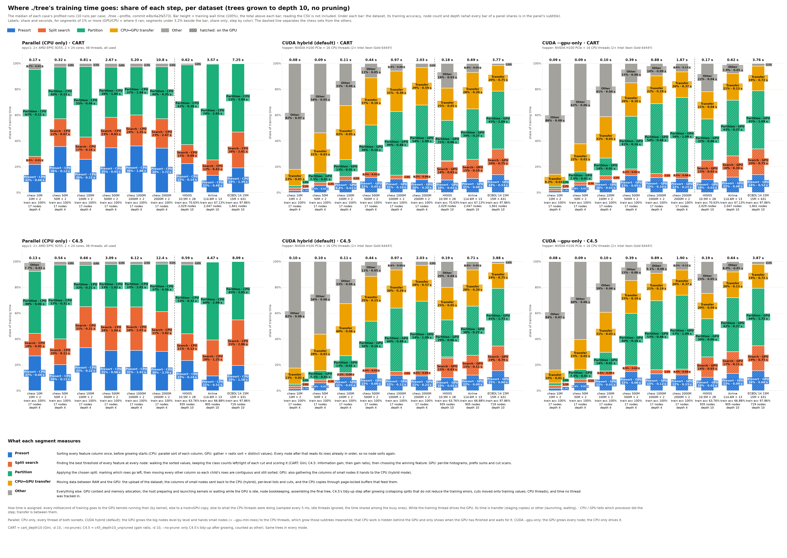

# Profiling: where CART and C4.5 spend their growing time

**Status:** run on 2026-10-22 at commit e4bc6a2 (the hash in `machine.json` and on the chart).
- **Jobs:** the server build is job 167; the profiled and plain jobs are 168–221. The epyc chess 2000M pair was resubmitted as 224/225, because 170/171 had started on the previous binary and were cancelled.
- **Machines:**
  - CUDA: hopper, on the GPU's socket: H100 PCIe, 16 CPU threads, NUMA-bound.
  - Parallel: epyc1, 48 threads (2× EPYC 9255).
- **Repetition:** every case ran 10 times profiled (`./tree --profile FILE`) and 10 times without `--profile` (`plain/`). The chart and table use the median profiled run; `without --profile s` is the median plain run.
- **Earlier runs:** the previous version of this benchmark (CART with α = 1e-5, C4.5 with CF 0.25 pruning, C4.5 unpruned, no depth limit) is in commit 08c4235.



Columns: Parallel (CPU only), CUDA hybrid (the default), CUDA `--gpu-only`. Rows: CART, C4.5.
- **Bars:** each bar is the median of 10 training runs. 100% is `train_seconds`, the total shown above the bar; reading the data is not included. The bar is split into five steps, and hatched segments ran on the GPU.
- **Under each bar:** the dataset, rows × features, the training accuracy, the node count and the depth. A fact that is the same for every bar of a panel would be shown once in the panel's subtitle; none is here, because chess stops at depth 4 and the other sets reach depth 10.
- **Divider:** the dashed line separates the six chess sets from HIGGS, Airline and ECBDL.

## What runs

```bash
bench/cluster/profile.sh -m 10 -d <dataset> -p cart_depth10,c45_depth10_unpruned -o cluster-profiling \
    cpu-epyc-<dataset> cuda-hopper-<dataset> gpuonly-hopper-<dataset>
bench/.venv/bin/python bench/profile_share_chart.py bench/results/cluster-profiling
```

**Datasets:**
- `chess_10m`, `chess_50m`, `chess_100m`, `chess_500m`, `chess_1b`, `chess_2b`: the 3×3 checkerboard, 2 features, 10M–2000M rows.
- `higgs`: 10.5M rows × 28.
- `airline`: 114.6M rows × 13.
- `ecbdl_15m`: the 15M-row ECBDL'14 sample, 631 features.

**Memory:** chess 2000M fits everywhere. On hopper it uses about 51 GB of the H100's 80 GB and about 50 GB of RAM. On epyc1 it uses about 94 GB of 512 GB.

**Protocols:**
- **CART** = `cart_depth10`: `--cart --no-prune -d 10` (Gini).
- **C4.5** = `c45_depth10_unpruned`: `--c45 --no-prune -d 10` (gain ratio). Pruning is off; only C4.5's tidy-up after growing runs, which collapses splits that do not reduce the training errors and moves cuts onto training values. The chart counts the tidy-up as other.
- Every mode grows the same trees.

## The five steps

| Step | What it measures | From which trace data |
|---|---|---|
| **Presort** | Sorting every feature column once, before growing. On the CPU this is a parallel sort of each column; on the GPU it is a gather, a radix sort and the distinct values. After it, every node reads its rows already in order. | GPU kernels `presort*`; CPU work `presort` |
| **Split search** | Finding the best threshold of every feature at every node: walking the sorted values, keeping the class counts on both sides of each cut, scoring it (Gini, or gain then gain ratio), and picking the winning feature. On the GPU: per-tile histograms, prefix sums and cut scans. | kernels `tile*`, `segment*`; CPU `sweep`, `build` |
| **Partition** | Applying the chosen split: marking the rows that go left, then moving every other column so that each child's rows are contiguous and still sorted. On the GPU this also gathers the columns of the small nodes handed to the CPU (hybrid). | kernels `markGoesLeft`, `partition`, `handOffGather`; CPU `mark`, `partition`, `partition_sweep`, `leaves` |
| **CPU↔GPU transfer** | Moving data between RAM and the GPU: the upload of the dataset, the hand-off columns, the per-level lists and cuts, and the host copies through page-locked buffers. | copy-lane spans; CPU `staging`, `page_lock` |
| **Other** | Everything else: GPU context and memory allocation, the host launching kernels or waiting while the GPU is idle, node bookkeeping, assembling the final tree, C4.5's tidy-up after growing, and untracked time. | the rest, including CPU `prune*` |

**How each millisecond is assigned** ([profile_share_chart.py](../../profile_share_chart.py)):
1. Running GPU kernels come first. Time when kernels of two steps overlap is shared between them.
2. Then a host↔GPU copy with no kernel running counts as transfer.
3. Then the training thread's phase decides. While it drives the GPU (gpu setup, upload, grow setup, gpu levels), the time is transfer if threads are staging or page-locking, and other otherwise.
4. Elsewhere, the time is shared among the busy CPU threads by their kind of work, taken from the 5 ms samples. If every thread is idle, it goes to the phase's step.

In hybrid mode, CPU subtree growth that hides behind the GPU is therefore not counted; it shows only when the GPU waits for it.

## Results

| Mode | Algorithm | Dataset | runs | train s | without --profile s | train acc % | nodes | depth | Presort % | Split search % | Partition % | CPU↔GPU transfer % | Other % | GPU share % |
|---|---|---|--:|--:|--:|--:|--:|--:|--:|--:|--:|--:|--:|--:|
| Parallel (CPU only) | CART | chess 10M | 10 | 0.17 | 0.27 | 100.00 | 17 | 4 | 21.7 | 6.3 | 67.3 | 0.0 | 4.7 | 0.0 |
| Parallel (CPU only) | CART | chess 50M | 10 | 0.32 | 0.43 | 100.00 | 17 | 4 | 35.7 | 21.6 | 40.0 | 0.0 | 2.8 | 0.0 |
| Parallel (CPU only) | CART | chess 100M | 10 | 0.81 | 0.66 | 100.00 | 17 | 4 | 25.8 | 17.2 | 54.5 | 0.0 | 2.5 | 0.0 |
| Parallel (CPU only) | CART | chess 500M | 10 | 2.67 | 2.66 | 100.00 | 17 | 4 | 34.7 | 23.5 | 38.8 | 0.0 | 3.0 | 0.0 |
| Parallel (CPU only) | CART | chess 1000M | 10 | 5.20 | 5.19 | 100.00 | 17 | 4 | 36.1 | 24.0 | 37.3 | 0.0 | 2.7 | 0.0 |
| Parallel (CPU only) | CART | chess 2000M | 10 | 10.82 | 10.87 | 100.00 | 17 | 4 | 34.3 | 22.9 | 40.2 | 0.0 | 2.6 | 0.0 |
| Parallel (CPU only) | CART | HIGGS | 10 | 0.62 | 0.61 | 70.63 | 2,029 | 10 | 22.4 | 14.8 | 61.8 | 0.0 | 1.0 | 0.0 |
| Parallel (CPU only) | CART | Airline | 10 | 3.57 | 3.56 | 67.13 | 2,047 | 10 | 13.4 | 12.0 | 74.1 | 0.0 | 0.5 | 0.0 |
| Parallel (CPU only) | CART | ECBDL'14 15M | 10 | 7.25 | 7.20 | 97.86 | 1,841 | 10 | 19.1 | 27.8 | 52.9 | 0.0 | 0.2 | 0.0 |
| Parallel (CPU only) | C4.5 | chess 10M | 10 | 0.13 | 0.32 | 100.00 | 17 | 4 | 26.9 | 17.5 | 47.9 | 0.0 | 7.7 | 0.0 |
| Parallel (CPU only) | C4.5 | chess 50M | 10 | 0.54 | 0.35 | 100.00 | 17 | 4 | 20.2 | 19.9 | 57.1 | 0.0 | 2.8 | 0.0 |
| Parallel (CPU only) | C4.5 | chess 100M | 10 | 0.66 | 0.78 | 100.00 | 17 | 4 | 33.3 | 31.8 | 31.9 | 0.0 | 3.0 | 0.0 |
| Parallel (CPU only) | C4.5 | chess 500M | 10 | 3.09 | 3.17 | 100.00 | 17 | 4 | 31.1 | 33.7 | 32.9 | 0.0 | 2.3 | 0.0 |
| Parallel (CPU only) | C4.5 | chess 1000M | 10 | 6.12 | 6.10 | 100.00 | 17 | 4 | 31.1 | 33.8 | 32.8 | 0.0 | 2.3 | 0.0 |
| Parallel (CPU only) | C4.5 | chess 2000M | 10 | 12.43 | 12.49 | 100.00 | 17 | 4 | 30.4 | 30.8 | 36.7 | 0.0 | 2.1 | 0.0 |
| Parallel (CPU only) | C4.5 | HIGGS | 10 | 0.59 | 0.62 | 63.76 | 935 | 10 | 23.3 | 20.7 | 53.3 | 0.0 | 2.6 | 0.0 |
| Parallel (CPU only) | C4.5 | Airline | 10 | 4.47 | 4.43 | 66.88 | 905 | 10 | 11.4 | 27.9 | 60.3 | 0.0 | 0.5 | 0.0 |
| Parallel (CPU only) | C4.5 | ECBDL'14 15M | 10 | 8.09 | 8.01 | 97.86 | 719 | 10 | 19.5 | 35.4 | 45.1 | 0.0 | 0.1 | 0.0 |
| CUDA hybrid (default) | CART | chess 10M | 10 | 0.08 | 0.09 | 100.00 | 17 | 4 | 1.5 | 2.1 | 1.8 | 12.6 | 82.0 | 5.3 |
| CUDA hybrid (default) | CART | chess 50M | 10 | 0.09 | 0.09 | 100.00 | 17 | 4 | 5.5 | 2.2 | 7.5 | 31.1 | 53.7 | 15.2 |
| CUDA hybrid (default) | CART | chess 100M | 10 | 0.11 | 0.11 | 100.00 | 17 | 4 | 9.4 | 3.1 | 13.1 | 41.8 | 32.7 | 25.5 |
| CUDA hybrid (default) | CART | chess 500M | 10 | 0.44 | 0.43 | 100.00 | 17 | 4 | 11.7 | 4.5 | 36.1 | 36.5 | 11.1 | 52.3 |
| CUDA hybrid (default) | CART | chess 1000M | 10 | 0.97 | 0.97 | 100.00 | 17 | 4 | 10.6 | 2.9 | 49.3 | 31.4 | 5.9 | 62.8 |
| CUDA hybrid (default) | CART | chess 2000M | 10 | 2.03 | 2.02 | 100.00 | 17 | 4 | 10.1 | 4.2 | 53.6 | 29.0 | 3.2 | 67.8 |
| CUDA hybrid (default) | CART | HIGGS | 10 | 0.18 | 0.17 | 70.63 | 2,029 | 10 | 9.8 | 15.0 | 31.0 | 25.1 | 19.1 | 55.1 |
| CUDA hybrid (default) | CART | Airline | 10 | 0.69 | 0.68 | 67.13 | 2,047 | 10 | 10.9 | 14.9 | 39.0 | 28.3 | 6.9 | 64.8 |
| CUDA hybrid (default) | CART | ECBDL'14 15M | 10 | 3.77 | 3.75 | 97.86 | 1,841 | 10 | 13.9 | 19.8 | 44.9 | 19.8 | 1.6 | 78.6 |
| CUDA hybrid (default) | C4.5 | chess 10M | 10 | 0.10 | 0.08 | 100.00 | 17 | 4 | 1.5 | 2.0 | 1.5 | 12.6 | 82.5 | 5.0 |
| CUDA hybrid (default) | C4.5 | chess 50M | 10 | 0.10 | 0.09 | 100.00 | 17 | 4 | 6.0 | 2.3 | 7.1 | 28.3 | 56.3 | 15.4 |
| CUDA hybrid (default) | C4.5 | chess 100M | 10 | 0.11 | 0.11 | 100.00 | 17 | 4 | 10.8 | 3.2 | 13.1 | 40.3 | 32.6 | 27.1 |
| CUDA hybrid (default) | C4.5 | chess 500M | 10 | 0.44 | 0.43 | 100.00 | 17 | 4 | 13.3 | 4.4 | 36.1 | 34.8 | 11.5 | 53.7 |
| CUDA hybrid (default) | C4.5 | chess 1000M | 10 | 0.97 | 0.97 | 100.00 | 17 | 4 | 12.0 | 2.9 | 49.0 | 29.5 | 6.6 | 63.9 |
| CUDA hybrid (default) | C4.5 | chess 2000M | 10 | 2.03 | 2.03 | 100.00 | 17 | 4 | 11.4 | 4.2 | 53.6 | 27.9 | 2.9 | 69.2 |
| CUDA hybrid (default) | C4.5 | HIGGS | 10 | 0.19 | 0.19 | 63.76 | 935 | 10 | 10.1 | 16.0 | 28.6 | 25.3 | 20.0 | 53.8 |
| CUDA hybrid (default) | C4.5 | Airline | 10 | 0.71 | 0.70 | 66.88 | 905 | 10 | 12.1 | 15.4 | 37.9 | 28.0 | 6.6 | 65.4 |
| CUDA hybrid (default) | C4.5 | ECBDL'14 15M | 10 | 3.88 | 3.85 | 97.86 | 719 | 10 | 15.5 | 19.1 | 44.6 | 19.3 | 1.6 | 79.2 |
| CUDA --gpu-only | CART | chess 10M | 10 | 0.09 | 0.09 | 100.00 | 17 | 4 | 1.4 | 1.7 | 1.7 | 9.2 | 85.9 | 4.8 |
| CUDA --gpu-only | CART | chess 50M | 10 | 0.09 | 0.09 | 100.00 | 17 | 4 | 5.8 | 2.3 | 7.9 | 21.8 | 62.2 | 16.1 |
| CUDA --gpu-only | CART | chess 100M | 10 | 0.10 | 0.10 | 100.00 | 17 | 4 | 9.8 | 3.2 | 13.7 | 32.2 | 41.2 | 26.7 |
| CUDA --gpu-only | CART | chess 500M | 10 | 0.39 | 0.39 | 100.00 | 17 | 4 | 13.2 | 5.1 | 40.7 | 26.0 | 15.0 | 59.0 |
| CUDA --gpu-only | CART | chess 1000M | 10 | 0.88 | 0.88 | 100.00 | 17 | 4 | 11.6 | 3.2 | 54.0 | 21.6 | 9.6 | 68.8 |
| CUDA --gpu-only | CART | chess 2000M | 10 | 1.87 | 1.86 | 100.00 | 17 | 4 | 10.9 | 4.5 | 58.2 | 19.8 | 6.6 | 73.6 |
| CUDA --gpu-only | CART | HIGGS | 10 | 0.17 | 0.17 | 70.63 | 2,029 | 10 | 10.1 | 14.9 | 32.1 | 21.1 | 21.9 | 57.0 |
| CUDA --gpu-only | CART | Airline | 10 | 0.62 | 0.62 | 67.13 | 2,047 | 10 | 12.0 | 16.4 | 43.0 | 20.6 | 7.9 | 71.5 |
| CUDA --gpu-only | CART | ECBDL'14 15M | 10 | 3.76 | 3.73 | 97.86 | 1,841 | 10 | 13.9 | 19.9 | 44.9 | 19.1 | 2.1 | 78.8 |
| CUDA --gpu-only | C4.5 | chess 10M | 10 | 0.08 | 0.08 | 100.00 | 17 | 4 | 1.8 | 2.3 | 1.9 | 10.1 | 84.0 | 6.0 |
| CUDA --gpu-only | C4.5 | chess 50M | 10 | 0.09 | 0.08 | 100.00 | 17 | 4 | 6.4 | 2.5 | 7.5 | 23.2 | 60.4 | 16.4 |
| CUDA --gpu-only | C4.5 | chess 100M | 10 | 0.10 | 0.10 | 100.00 | 17 | 4 | 11.8 | 3.5 | 14.4 | 31.0 | 39.3 | 29.7 |
| CUDA --gpu-only | C4.5 | chess 500M | 10 | 0.39 | 0.39 | 100.00 | 17 | 4 | 14.8 | 4.9 | 40.2 | 25.5 | 14.6 | 59.9 |
| CUDA --gpu-only | C4.5 | chess 1000M | 10 | 0.89 | 0.89 | 100.00 | 17 | 4 | 13.0 | 3.2 | 53.4 | 21.3 | 9.1 | 69.6 |
| CUDA --gpu-only | C4.5 | chess 2000M | 10 | 1.90 | 1.89 | 100.00 | 17 | 4 | 12.2 | 4.4 | 57.3 | 19.5 | 6.5 | 74.0 |
| CUDA --gpu-only | C4.5 | HIGGS | 10 | 0.19 | 0.19 | 63.76 | 935 | 10 | 10.3 | 15.8 | 29.5 | 19.7 | 24.7 | 55.7 |
| CUDA --gpu-only | C4.5 | Airline | 10 | 0.64 | 0.64 | 66.88 | 905 | 10 | 13.3 | 16.9 | 41.8 | 20.0 | 8.0 | 72.0 |
| CUDA --gpu-only | C4.5 | ECBDL'14 15M | 10 | 3.87 | 3.84 | 97.86 | 719 | 10 | 15.5 | 19.2 | 44.5 | 18.6 | 2.2 | 79.2 |

`runs` is the number of profiled runs; each row shows the median one. `without --profile s` is the median of the 10 plain runs (`plain/`). GPU share is the share of segments that ran on the GPU.

**Run-to-run noise and profiling overhead.**
- **Above 0.4 s:** profiled and plain medians agree within ±5% everywhere.
- **Small hopper runs (≤ 0.11 s):** they differ by up to ±0.02 s, which is ±25% at these times.
- **Sub-second epyc chess runs (10M–100M):** they vary up to 8× between the 10 runs of one case (chess 10M CART: 0.08–0.68 s profiled, 0.08–0.59 s plain). Their medians differ from −59% to +54% in both directions, so this is noise, not profiling cost.

## Findings

- **CPU growing is partition-bound.** On epyc, partition is 37–74% of CART and 32–60% of C4.5.
  - Split search takes more of C4.5 (17–35%) than of CART (6–28%), because of the gain ratio.
  - On chess 500M–2000M the three steps are about equal thirds (presort 30–36%).
  - Other stays under 8%; C4.5's tidy-up is part of it, at 0.1–2.6% outside chess.
- **The GPU's work is mostly partition plus the upload.** On hopper, chess 1000M/2000M and the non-chess sets spend 29–58% on partition and 19–31% on transfer. The GPU's share of the time grows with size: 5% at chess 10M, 52–60% at 500M, 68–74% at 2000M, and 79% on ECBDL.
- **Small runs are fixed cost.** CUDA chess 10M–100M take 0.08–0.11 s whatever the size: 33–86% of that is other (context, allocation, launches) and 9–42% is transfer.
- **Time scales linearly with chess size.**
  - CART on epyc: 2.67 s at 500M, 5.20 s at 1000M, 10.8 s at 2000M.
  - CART on hopper hybrid: 0.44, 0.97 and 2.03 s.
  - So the H100 is 5.3× faster for CART on chess 2000M (5.8× with `--gpu-only`), and 6.1–6.5× faster for C4.5.
  - It is also 3.1–3.6× faster on HIGGS and 5.2–7.0× faster on Airline, but only 1.9–2.1× faster on ECBDL.
- **At depth 10, `--gpu-only` is a little faster than hybrid.** Chess 2000M CART takes 1.87 s with `--gpu-only` and 2.03 s hybrid; Airline takes 0.62 s and 0.69 s. The hybrid mode spends more on transfer (29% against 20% on chess 2000M), copying the columns it hands back to the CPU. HIGGS and ECBDL take the same time in both modes.
- **CART and C4.5 cost the same on the GPU.** On epyc, C4.5 is 12–25% slower on chess 500M–2000M, Airline and ECBDL, and about the same on HIGGS.
- **The trees differ by algorithm.**
  - On chess, both reach 100% at depth 4 (17 nodes), well before depth 10.
  - On the other sets, C4.5's trees are half the size or smaller: HIGGS 935 nodes against 2,029, ECBDL 719 against 1,841. Its training accuracy is lower on HIGGS (63.8% against 70.6%), about the same on Airline (66.9% against 67.1%), and equal on ECBDL (97.86%).
