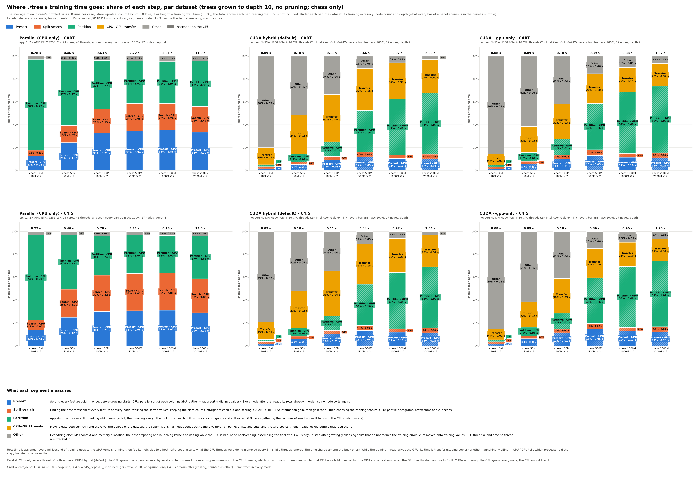

# Profiling, chess only: 50 runs per case, averaged

A rerun of the chess half of [the profiling benchmark](../BENCHMARK.md), with more runs per case to average out run-to-run noise. Everything else is as in the 10-run benchmark: the protocols, the machines, the steps and how time is attributed are described there.

**Status:** run on 2026-10-22/23, jobs 226–261.
- **Code:** `machine.json` says 0c6fb31. The binary is the build from job 167 (e4bc6a2); no source changed in between.
- **Repetition:** every case ran 50 times profiled and 50 times without `--profile` (`plain/`).
- **Averaging:** the chart and table show the **average** of the 50 runs, not the median, both for the training time and for every step's seconds (`profile_share_chart.py --mean`). Each step's share is its average seconds over the average attributed time.
- **Machines:** epyc1, 48 threads (2× EPYC 9255), for the parallel runs. hopper, on the GPU's socket (H100 PCIe, 16 CPU threads), for CUDA hybrid and `--gpu-only`.
- **Datasets:** chess 10M, 50M, 100M, 500M, 1000M and 2000M: the 3×3 checkerboard, 2 features.
- **Protocols:** CART = `cart_depth10` (`--cart --no-prune -d 10`); C4.5 = `c45_depth10_unpruned` (`--c45 --no-prune -d 10`).



Each tree is the same on every run and in every mode: 100% training accuracy, 17 nodes, depth 4. The chart therefore shows those facts once, in each panel's subtitle.

```bash
for d in chess_10m chess_50m chess_100m chess_500m chess_1b chess_2b; do
  bench/cluster/profile.sh -m 50 -d $d -p cart_depth10,c45_depth10_unpruned -o cluster-profiling/chess-50runs \
      cpu-epyc-$d cuda-hopper-$d gpuonly-hopper-$d
done
bench/.venv/bin/python bench/profile_share_chart.py bench/results/cluster-profiling/chess-50runs --chess --mean
```

## Results

| Mode | Algorithm | Dataset | runs | train s | without --profile s | train acc % | nodes | depth | Presort % | Split search % | Partition % | CPU↔GPU transfer % | Other % | GPU share % |
|---|---|---|--:|--:|--:|--:|--:|--:|--:|--:|--:|--:|--:|--:|
| Parallel (CPU only) | CART | chess 10M | 50 | 0.28 | 0.16 | 100.00 | 17 | 4 | 12.6 | 5.1 | 79.5 | 0.0 | 2.8 | 0.0 |
| Parallel (CPU only) | CART | chess 50M | 50 | 0.46 | 0.43 | 100.00 | 17 | 4 | 24.4 | 15.0 | 57.0 | 0.0 | 3.6 | 0.0 |
| Parallel (CPU only) | CART | chess 100M | 50 | 0.63 | 0.62 | 100.00 | 17 | 4 | 32.7 | 21.2 | 42.2 | 0.0 | 3.8 | 0.0 |
| Parallel (CPU only) | CART | chess 500M | 50 | 2.72 | 2.73 | 100.00 | 17 | 4 | 34.5 | 23.9 | 37.4 | 0.0 | 4.1 | 0.0 |
| Parallel (CPU only) | CART | chess 1000M | 50 | 5.31 | 5.27 | 100.00 | 17 | 4 | 35.3 | 23.4 | 36.5 | 0.0 | 4.8 | 0.0 |
| Parallel (CPU only) | CART | chess 2000M | 50 | 11.02 | 10.91 | 100.00 | 17 | 4 | 33.5 | 22.4 | 39.8 | 0.0 | 4.2 | 0.0 |
| Parallel (CPU only) | C4.5 | chess 10M | 50 | 0.27 | 0.21 | 100.00 | 17 | 4 | 13.8 | 8.7 | 74.3 | 0.0 | 3.2 | 0.0 |
| Parallel (CPU only) | C4.5 | chess 50M | 50 | 0.46 | 0.46 | 100.00 | 17 | 4 | 25.0 | 24.5 | 47.4 | 0.0 | 3.1 | 0.0 |
| Parallel (CPU only) | C4.5 | chess 100M | 50 | 0.70 | 0.71 | 100.00 | 17 | 4 | 30.1 | 31.7 | 34.2 | 0.0 | 4.0 | 0.0 |
| Parallel (CPU only) | C4.5 | chess 500M | 50 | 3.11 | 3.11 | 100.00 | 17 | 4 | 30.7 | 32.6 | 33.5 | 0.0 | 3.1 | 0.0 |
| Parallel (CPU only) | C4.5 | chess 1000M | 50 | 6.13 | 6.16 | 100.00 | 17 | 4 | 31.1 | 32.7 | 32.6 | 0.0 | 3.6 | 0.0 |
| Parallel (CPU only) | C4.5 | chess 2000M | 50 | 13.04 | 12.56 | 100.00 | 17 | 4 | 28.9 | 29.8 | 37.4 | 0.0 | 3.9 | 0.0 |
| CUDA hybrid (default) | CART | chess 10M | 50 | 0.09 | 0.09 | 100.00 | 17 | 4 | 1.5 | 1.9 | 1.7 | 14.9 | 80.0 | 5.1 |
| CUDA hybrid (default) | CART | chess 50M | 50 | 0.10 | 0.10 | 100.00 | 17 | 4 | 5.2 | 2.2 | 7.1 | 34.0 | 51.5 | 14.5 |
| CUDA hybrid (default) | CART | chess 100M | 50 | 0.11 | 0.11 | 100.00 | 17 | 4 | 9.3 | 3.0 | 12.9 | 41.3 | 33.6 | 25.1 |
| CUDA hybrid (default) | CART | chess 500M | 50 | 0.44 | 0.43 | 100.00 | 17 | 4 | 11.7 | 4.5 | 36.2 | 36.8 | 10.7 | 52.5 |
| CUDA hybrid (default) | CART | chess 1000M | 50 | 0.97 | 0.97 | 100.00 | 17 | 4 | 10.6 | 2.9 | 49.2 | 31.5 | 5.8 | 62.7 |
| CUDA hybrid (default) | CART | chess 2000M | 50 | 2.03 | 2.03 | 100.00 | 17 | 4 | 10.1 | 4.1 | 53.6 | 29.3 | 2.9 | 67.8 |
| CUDA hybrid (default) | C4.5 | chess 10M | 50 | 0.09 | 0.09 | 100.00 | 17 | 4 | 1.6 | 2.2 | 1.7 | 15.3 | 79.2 | 5.5 |
| CUDA hybrid (default) | C4.5 | chess 50M | 50 | 0.10 | 0.10 | 100.00 | 17 | 4 | 6.0 | 2.4 | 7.1 | 32.6 | 51.9 | 15.5 |
| CUDA hybrid (default) | C4.5 | chess 100M | 50 | 0.11 | 0.11 | 100.00 | 17 | 4 | 10.4 | 3.1 | 12.7 | 39.4 | 34.4 | 26.2 |
| CUDA hybrid (default) | C4.5 | chess 500M | 50 | 0.44 | 0.43 | 100.00 | 17 | 4 | 13.3 | 4.4 | 36.2 | 35.1 | 11.1 | 53.9 |
| CUDA hybrid (default) | C4.5 | chess 1000M | 50 | 0.97 | 0.97 | 100.00 | 17 | 4 | 12.0 | 2.9 | 49.2 | 30.0 | 6.0 | 64.1 |
| CUDA hybrid (default) | C4.5 | chess 2000M | 50 | 2.04 | 2.03 | 100.00 | 17 | 4 | 11.4 | 4.2 | 53.5 | 27.7 | 3.2 | 69.1 |
| CUDA --gpu-only | CART | chess 10M | 50 | 0.08 | 0.08 | 100.00 | 17 | 4 | 1.5 | 1.8 | 1.7 | 9.4 | 85.6 | 4.9 |
| CUDA --gpu-only | CART | chess 50M | 50 | 0.09 | 0.09 | 100.00 | 17 | 4 | 5.7 | 2.3 | 7.8 | 22.6 | 61.5 | 15.8 |
| CUDA --gpu-only | CART | chess 100M | 50 | 0.10 | 0.10 | 100.00 | 17 | 4 | 10.2 | 3.3 | 14.1 | 30.7 | 41.7 | 27.6 |
| CUDA --gpu-only | CART | chess 500M | 50 | 0.39 | 0.39 | 100.00 | 17 | 4 | 13.1 | 5.1 | 40.5 | 26.0 | 15.3 | 58.6 |
| CUDA --gpu-only | CART | chess 1000M | 50 | 0.88 | 0.88 | 100.00 | 17 | 4 | 11.6 | 3.2 | 53.9 | 21.6 | 9.8 | 68.7 |
| CUDA --gpu-only | CART | chess 2000M | 50 | 1.87 | 1.86 | 100.00 | 17 | 4 | 11.0 | 4.5 | 58.3 | 19.8 | 6.5 | 73.8 |
| CUDA --gpu-only | C4.5 | chess 10M | 50 | 0.08 | 0.09 | 100.00 | 17 | 4 | 1.7 | 2.0 | 1.7 | 9.4 | 85.2 | 5.4 |
| CUDA --gpu-only | C4.5 | chess 50M | 50 | 0.09 | 0.09 | 100.00 | 17 | 4 | 6.3 | 2.5 | 7.5 | 22.2 | 61.5 | 16.3 |
| CUDA --gpu-only | C4.5 | chess 100M | 50 | 0.10 | 0.10 | 100.00 | 17 | 4 | 11.4 | 3.4 | 13.8 | 30.3 | 41.1 | 28.6 |
| CUDA --gpu-only | C4.5 | chess 500M | 50 | 0.39 | 0.39 | 100.00 | 17 | 4 | 14.7 | 4.9 | 40.0 | 25.6 | 14.9 | 59.5 |
| CUDA --gpu-only | C4.5 | chess 1000M | 50 | 0.90 | 0.89 | 100.00 | 17 | 4 | 13.0 | 3.2 | 53.2 | 21.2 | 9.5 | 69.3 |
| CUDA --gpu-only | C4.5 | chess 2000M | 50 | 1.90 | 1.89 | 100.00 | 17 | 4 | 12.3 | 4.5 | 57.3 | 19.5 | 6.4 | 74.1 |

`runs` is the number of profiled runs. `train s` is their average; `without --profile s` is the average of the 50 plain runs. The step shares come from the average seconds of each step. GPU share is the share of segments that ran on the GPU.

## Run-to-run spread

The training time of every case, over its 50 profiled runs, and the 50 plain runs alongside.

- **hopper is steady.** From 500M up, run times vary by at most 0.9% (sd/mean); at 50M–100M by 3–7%, and at 10M by 15–17% (0.054–0.106 s).
- **epyc's small runs are not.** Chess 10M is bimodal: 13 of its 50 runs take more than twice the median, up to 0.89 s. Its average (0.27–0.28 s) is therefore 40–50% above the median, and the profiled and plain averages differ by up to 1.8×. Chess 50M has 2–3 such slow runs. From 100M up there are none.

| Mode | Algorithm | Dataset | mean s | median s | sd s | min–max s | slow runs (> 2× median) | plain: mean / median s |
|---|---|---|--:|--:|--:|--:|--:|--:|
| Parallel (CPU only) | CART | chess 10M | 0.278 | 0.197 | 0.202 | 0.073–0.797 | 13 | 0.157 / 0.124 |
| Parallel (CPU only) | CART | chess 50M | 0.463 | 0.439 | 0.206 | 0.266–1.26 | 3 | 0.435 / 0.383 |
| Parallel (CPU only) | CART | chess 100M | 0.629 | 0.588 | 0.132 | 0.495–0.948 | 0 | 0.621 / 0.588 |
| Parallel (CPU only) | CART | chess 500M | 2.72 | 2.69 | 0.086 | 2.61–2.92 | 0 | 2.73 / 2.71 |
| Parallel (CPU only) | CART | chess 1000M | 5.31 | 5.23 | 0.158 | 5.12–5.57 | 0 | 5.27 / 5.21 |
| Parallel (CPU only) | CART | chess 2000M | 11.02 | 10.87 | 0.307 | 10.71–11.89 | 0 | 10.91 / 10.83 |
| Parallel (CPU only) | C4.5 | chess 10M | 0.266 | 0.181 | 0.200 | 0.080–0.886 | 13 | 0.209 / 0.139 |
| Parallel (CPU only) | C4.5 | chess 50M | 0.462 | 0.418 | 0.179 | 0.305–1.30 | 2 | 0.458 / 0.461 |
| Parallel (CPU only) | C4.5 | chess 100M | 0.697 | 0.662 | 0.111 | 0.589–1.04 | 0 | 0.709 / 0.646 |
| Parallel (CPU only) | C4.5 | chess 500M | 3.11 | 3.09 | 0.071 | 3.01–3.30 | 0 | 3.11 / 3.09 |
| Parallel (CPU only) | C4.5 | chess 1000M | 6.13 | 6.08 | 0.143 | 5.96–6.40 | 0 | 6.16 / 6.09 |
| Parallel (CPU only) | C4.5 | chess 2000M | 13.04 | 12.63 | 1.12 | 12.31–17.45 | 0 | 12.56 / 12.48 |
| CUDA hybrid (default) | CART | chess 10M | 0.085 | 0.091 | 0.014 | 0.056–0.104 | 0 | 0.091 / 0.095 |
| CUDA hybrid (default) | CART | chess 50M | 0.098 | 0.095 | 0.007 | 0.087–0.108 | 0 | 0.097 / 0.096 |
| CUDA hybrid (default) | CART | chess 100M | 0.109 | 0.108 | 0.004 | 0.104–0.127 | 0 | 0.109 / 0.108 |
| CUDA hybrid (default) | CART | chess 500M | 0.436 | 0.435 | 0.003 | 0.430–0.445 | 0 | 0.434 / 0.433 |
| CUDA hybrid (default) | CART | chess 1000M | 0.969 | 0.970 | 0.004 | 0.957–0.978 | 0 | 0.966 / 0.966 |
| CUDA hybrid (default) | CART | chess 2000M | 2.03 | 2.03 | 0.001 | 2.03–2.04 | 0 | 2.03 / 2.03 |
| CUDA hybrid (default) | C4.5 | chess 10M | 0.087 | 0.091 | 0.013 | 0.058–0.106 | 0 | 0.089 / 0.094 |
| CUDA hybrid (default) | C4.5 | chess 50M | 0.097 | 0.095 | 0.007 | 0.082–0.108 | 0 | 0.097 / 0.097 |
| CUDA hybrid (default) | C4.5 | chess 100M | 0.110 | 0.109 | 0.005 | 0.102–0.124 | 0 | 0.108 / 0.106 |
| CUDA hybrid (default) | C4.5 | chess 500M | 0.436 | 0.435 | 0.004 | 0.428–0.444 | 0 | 0.433 / 0.433 |
| CUDA hybrid (default) | C4.5 | chess 1000M | 0.970 | 0.970 | 0.004 | 0.956–0.979 | 0 | 0.966 / 0.967 |
| CUDA hybrid (default) | C4.5 | chess 2000M | 2.04 | 2.04 | 0.001 | 2.03–2.04 | 0 | 2.03 / 2.03 |
| CUDA --gpu-only | CART | chess 10M | 0.085 | 0.089 | 0.013 | 0.054–0.104 | 0 | 0.084 / 0.088 |
| CUDA --gpu-only | CART | chess 50M | 0.089 | 0.088 | 0.005 | 0.080–0.100 | 0 | 0.089 / 0.087 |
| CUDA --gpu-only | CART | chess 100M | 0.099 | 0.098 | 0.005 | 0.091–0.117 | 0 | 0.097 / 0.096 |
| CUDA --gpu-only | CART | chess 500M | 0.390 | 0.390 | 0.003 | 0.383–0.401 | 0 | 0.385 / 0.385 |
| CUDA --gpu-only | CART | chess 1000M | 0.885 | 0.886 | 0.005 | 0.872–0.894 | 0 | 0.879 / 0.879 |
| CUDA --gpu-only | CART | chess 2000M | 1.87 | 1.87 | 0.001 | 1.87–1.87 | 0 | 1.86 / 1.86 |
| CUDA --gpu-only | C4.5 | chess 10M | 0.085 | 0.092 | 0.014 | 0.054–0.102 | 0 | 0.086 / 0.090 |
| CUDA --gpu-only | C4.5 | chess 50M | 0.091 | 0.090 | 0.005 | 0.080–0.101 | 0 | 0.090 / 0.090 |
| CUDA --gpu-only | C4.5 | chess 100M | 0.101 | 0.099 | 0.005 | 0.090–0.122 | 0 | 0.098 / 0.098 |
| CUDA --gpu-only | C4.5 | chess 500M | 0.394 | 0.394 | 0.004 | 0.387–0.409 | 0 | 0.392 / 0.392 |
| CUDA --gpu-only | C4.5 | chess 1000M | 0.896 | 0.896 | 0.005 | 0.883–0.905 | 0 | 0.893 / 0.894 |
| CUDA --gpu-only | C4.5 | chess 2000M | 1.90 | 1.90 | 0.002 | 1.90–1.90 | 0 | 1.89 / 1.89 |

## Findings

- **Averages agree with the 10-run medians.** From chess 500M up, and on hopper at every size, every step's share is within about 2 points of the [10-run benchmark](../BENCHMARK.md), and hopper's times are the same to 0.01 s. Only epyc chess 10M–100M move (at 100M, for example, partition falls from 55% to 42% for CART): they are too noisy for 10 runs (see the spread table).
- **CPU: three equal steps.** On epyc, from chess 100M up, CART splits into presort 33–35%, split search 21–24% and partition 37–42%. C4.5 splits into about a third each, because its split search costs more (30–33%). At chess 10M partition is 74–80% of the run.
- **GPU: partition and the upload.** On hopper at chess 1000M/2000M, partition is 49–58% and transfer 20–32%, and 63–74% of the time runs on the GPU.
- **Small GPU runs are fixed cost.** Chess 10M–100M takes 0.08–0.11 s on hopper whatever the size. At 10M, 79–86% of that is other (context, allocation, launches).
- **Linear in size.** From 500M to 2000M, time grows linearly with rows:
  - CART on epyc: 2.72 s, 5.31 s, 11.02 s.
  - CART on hopper hybrid: 0.44 s, 0.97 s, 2.03 s.
  - CART with `--gpu-only`: 0.39 s, 0.88 s, 1.87 s.
- **H100 against 2× EPYC 9255.** At chess 2000M, CART is 5.4× faster in hybrid mode (11.02 / 2.03 s) and 5.9× faster with `--gpu-only`. C4.5 is 6.4× and 6.9× faster.
- **`--gpu-only` is 7–11% faster than hybrid** from 500M up. Hybrid spends more on transfer (28–37% against 20–26%), copying back the columns it hands to the CPU threads.
- **C4.5 against CART.** On hopper they take the same time (within 3%). On epyc, C4.5 is 11–18% slower from 100M up, from its split search.
- **Profiling overhead is within the noise.** From 100M up, the profiled and plain averages agree within 1–2%. The one exception is epyc C4.5 2000M (13.04 against 12.56 s), where a single 17.45 s run lifts the profiled average; the medians are 12.63 and 12.48 s.
